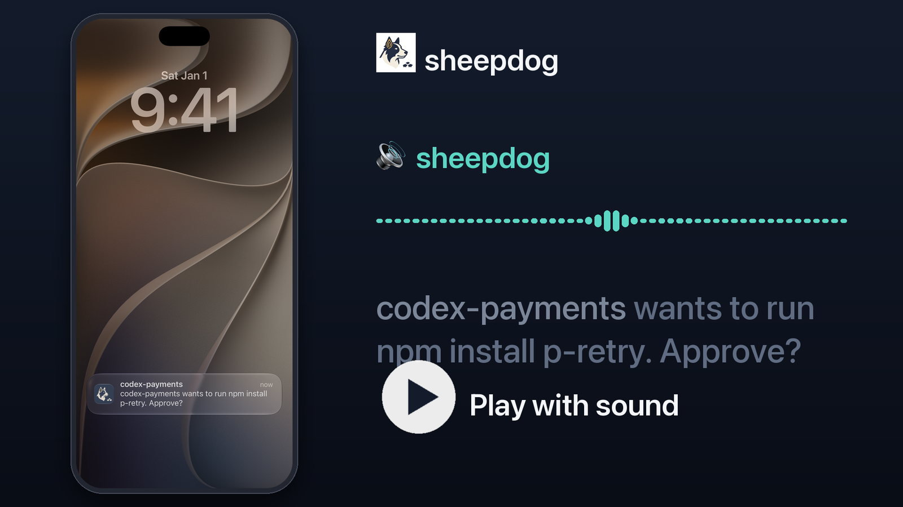

<p align="center">
  <picture>
    <source media="(prefers-color-scheme: dark)" srcset="https://github.com/kccarlos/herdr-sheepdog/raw/main/assets/logo-transparent.svg">
    
  </picture>
</p>

<p align="center">
  <a href="#install">install</a> · <a href="docs/quick-start.md">quick start</a> · <a href="docs/README.md">docs</a> · <a href="docs/iphone-app.md">iPhone app</a>
</p>

<p align="center">
  <a href="LICENSE"></a>
  <a href="https://github.com/kccarlos/herdr-sheepdog/releases/latest"></a>
  <a href="https://github.com/kccarlos/herdr-sheepdog/stargazers"></a>
  <a href="https://github.com/kccarlos/herdr-sheepdog/actions/workflows/ci.yml"></a>
  
  <a href="https://herdr.dev/plugins/"></a>
  <!-- TESTFLIGHT_LINK: replace the placeholder URL in this line and in docs/iphone-app.md once the public link exists. -->
  <a href="https://testflight.apple.com/join/TESTFLIGHT_LINK"></a>
</p>

---

# Manage your Herdr agents by voice.

**Hands-free, from anywhere. Hear who's stuck, approve with a word, ask what broke.**

<!-- replace with the user-attachments URL: drag launch.mp4 into the GitHub web editor -->
<p align="center"><a href="assets/readme/launch.mp4"></a></p>

- **hands-free voice** — talk to your agents on your phone and earbuds, no screen needed. [quick start →](docs/quick-start.md)
- **who's stuck, first** — "what's going on?" covers the whole fleet and names who needs you before anyone else. [commands →](docs/commands.md)
- **approve by voice** — an approval is answered only on your own words, enforced in code, not a prompt. [safety →](docs/safety.md)
- **ask why** — it reads screens and session records, and asks a read-only fork of the agent when a screen is not enough. [faq →](docs/faq.md)
- **it remembers** — "tell me when claude-auth is done", and it comes back to a question it could not answer. [faq →](docs/faq.md)
- **iPhone app** — notifications, Live Activity, earbud remote and QR pairing. [iPhone app →](docs/iphone-app.md)
- **bring your own models** — one free Gemini key is enough; Gemini Live or GPT-Live for the voice, Gemini, DeepSeek or any OpenAI-compatible endpoint for the brain. [models →](docs/models.md)
- **measured** — every prompt and harness change merges only past an eval suite with confidence intervals; the losses are published. [evals →](docs/dev/eval/README.md)

---

## install

**You need:** [herdr](https://github.com/herdrdev/herdr), macOS or Linux, and one voice model plus one brain model. The simplest is **one free Gemini key** from <https://aistudio.google.com/apikey> ([other options →](docs/models.md)).

```bash
herdr plugin install kccarlos/herdr-sheepdog   # 1. install the plugin
sheepdog setup                                  # 2. the browser wizard: key, checks, start at login
sheepdog pair                                   # 3. show the QR code for your phone (also in the wizard)
```

<p align="center"></p>

Setup opens a page, checks your key on the spot, and ends with a button that starts talking. About three minutes. No herdr yet? `sheepdog demo` runs three scripted agents you can talk to.

**iPhone app:** [TestFlight](https://testflight.apple.com/join/TESTFLIGHT_LINK), or [build it yourself](https://github.com/kccarlos/herdr-sheepdog-ios). It has an offline demo mode that needs no computer. [iPhone app →](docs/iphone-app.md)

**Away from home:** install [Tailscale](https://tailscale.com) on the computer and the phone, sign into the same account, then pair again. [remote access →](docs/remote-access.md)

Something wrong? Run `sheepdog doctor`; every problem prints its fix. [troubleshooting →](docs/troubleshooting.md)

## docs

[quick start](docs/quick-start.md) · [iPhone app](docs/iphone-app.md) · [remote access](docs/remote-access.md) · [models](docs/models.md) · [commands](docs/commands.md) · [configuration](CONFIG.md) · [troubleshooting](docs/troubleshooting.md) · [safety](docs/safety.md) · [privacy](docs/privacy.md) · [faq](docs/faq.md) · [developer docs](docs/dev/architecture.md)

## thanks

If sheepdog helps you, a ⭐ helps others find it.

## contributing

Bug reports and ideas are welcome: [open an issue](https://github.com/kccarlos/herdr-sheepdog/issues/new/choose) (attach `sheepdog doctor --report`). Code changes: read [CONTRIBUTING.md](CONTRIBUTING.md).

## agent instructions

If you are an AI agent working on this repository, read [`AGENTS.md`](AGENTS.md) first.

## license

sheepdog is licensed under the [MIT License](LICENSE). Security reports: [SECURITY.md](SECURITY.md).
