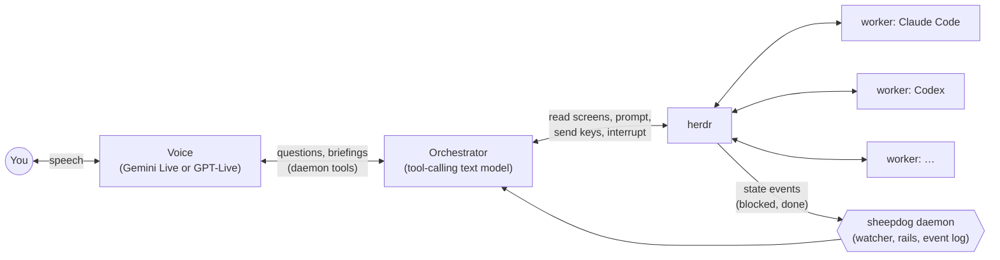

<p align="center">
  <picture>
    <source media="(prefers-color-scheme: dark)" srcset="https://github.com/kccarlos/herdr-sheepdog/raw/main/assets/logo-transparent.svg">
    
  </picture>
</p>

# herdr-sheepdog

**Manage your coding agents by voice, away from the screen.**

<!-- TODO(demo media): a 60-90 s demo video and a short GIF go here (plan:
docs/plan-onboarding-and-presentation.md, tier 0 "zero-install path").
Not recorded yet; do not add placeholder media. -->

## Why

You run several coding agents at once (Claude Code, Codex, Antigravity…)
in [herdr](https://github.com/herdrdev/herdr). They stop for approvals and
finish while you are away from the desk, and you find out only when you
come back. sheepdog watches them for you. It tells you out loud when one
finishes, fails or needs you. You answer by voice from your phone or a
browser: "what's going on?", "approve it", "tell auth to run the tests
again", "stop".

## Quickstart

Three depths of commitment. Each one works on its own.

### Tier 0: try it without herdr

- **`sheepdog demo`:** a scratch daemon with three scripted workers. One
  finishes, one asks to run the test suite and then fails, one finishes
  later. It opens its `/voice` page; press Connect and talk. It needs only
  a free [AI Studio key](https://aistudio.google.com/apikey) in
  `GEMINI_API_KEY`. It never touches herdr or real agents, and it runs on
  its own port (7778) and data dir, so it is safe next to a running daemon.

  ```sh
  make install                     # or a release tarball (Tier 1)
  GEMINI_API_KEY=… sheepdog demo
  ```

- **The iOS app's demo:** "Try the demo" on the app's first screen runs
  scripted agents on the phone itself, with on-device speech. It needs no
  daemon, no key and no network. The app is in TestFlight internal testing
  for now; a public TestFlight link comes with the public release.

### Tier 1: your agents, in the browser

1. **Install.** Homebrew, once the repository is public and the first
   release is tagged (the formula is prepared in
   [`packaging/homebrew/`](packaging/homebrew/); not published yet):

   ```sh
   brew install kccarlos/tap/sheepdog      # not available yet
   ```

   Until then, build from a checkout (Go, see `go.mod`):

   ```sh
   git clone https://github.com/kccarlos/herdr-sheepdog.git && cd herdr-sheepdog
   make install   # builds bin/sheepdog and copies it to ~/.local/bin/
   ```

   A tagged release on GitHub Releases carries
   `sheepdog_<tag>_darwin_arm64.tar.gz` and `..._linux_amd64.tar.gz` with
   `checksums.txt`. The macOS binary is signed and notarized
   ([`docs/signing.md`](docs/signing.md)).
2. **Set up.** `sheepdog init` checks herdr, asks for one key (Gemini AI
   Studio) and validates it, and writes `~/.config/sheepdog/config.toml`
   and `~/.config/sheepdog/.env` (both 0600). `sheepdog doctor` checks
   every step and prints the fix for each failure in one line.

   ```sh
   sheepdog init
   sheepdog doctor
   ```

3. **Run.** Start herdr, then the daemon, in a terminal or as a login
   service (a launchd agent on macOS, a systemd user unit on Linux):

   ```sh
   sheepdog serve              # or:
   sheepdog service install    # also: service status | logs [-f] | uninstall
   ```

   Open **http://127.0.0.1:7777/voice** and press Connect. **/debug** shows
   what the daemon, the voice and the orchestrator are doing.

### Tier 2: from your phone

1. Give the daemon a non-loopback bind and a long token (`sheepdog init`
   gives a new config a random token; see
   [Connect the phone](#connect-the-phone)).
2. Run `sheepdog pair`. It prints a QR code with every LAN and Tailscale
   address and the token.
3. In the iOS app ("Sheepdog for herdr",
   [herdr-sheepdog-ios](https://github.com/kccarlos/herdr-sheepdog-ios)),
   scan it in Settings ▸ Daemon (or with the Camera app). The app keeps the
   first address that answers.

## How it works



Two models split the work. The **voice** is a realtime speech model that
talks with you and keeps the conversation going. The **orchestrator** is a
tool-calling text model that reads the workers' screens, investigates,
acts on them and decides what is worth telling you; the voice says it. The
daemon in between watches herdr, keeps the event log and enforces a few
hard rails; judgment stays with the models. Details:
[`docs/architecture.md`](docs/architecture.md) (the code map),
[`docs/roles.md`](docs/roles.md) (the design contract),
[`docs/design-overview.md`](docs/design-overview.md) (the design and its
evaluation in 2–3 pages), [`docs/glossary.md`](docs/glossary.md) (the
terms).

- **Voice:** Gemini Live (Google AI Studio or Vertex AI) or GPT-Live,
  switchable at runtime.
- **Orchestrator:** Gemini (AI Studio or Vertex AI), DeepSeek, or any
  OpenAI-compatible endpoint you add as `[[brain.openai_compat]]`
  (OpenRouter, a local Ollama, Groq, …; [`CONFIG.md`](CONFIG.md)). How well
  it works depends on the model. Measured so far, on the tier-1 workday
  suite: DeepSeek `deepseek-flash` (the default in production, segment
  Understood 91 %) and Gemini 3.5 Flash on Vertex AI (81 %)
  ([`docs/eval/vertex-2026-10-11.md`](docs/eval/vertex-2026-10-11.md)).
  Other providers work through the same protocol but have not been
  evaluated.

## Safety

What sheepdog does on its own, and what it never does:

- **Approvals need your words.** A worker's approval prompt is answered
  only on your own recorded words (or a tap) in that turn, with a key from
  the prompt's own options. The code enforces this rail, not a prompt.
- **Instructions go out without a confirmation step.** The orchestrator
  sends an instruction right after echoing it back, so the worker's own
  approval prompts are the safety gate: never point sheepdog at an agent
  started in a fully auto-approve mode (table below).
- **Investigations are read-only:** background questions run a separate,
  read-only CLI invocation ([`docs/cli-query-tools.md`](docs/cli-query-tools.md)).
- **Stop works at once:** a bare "stop" (or "wait", "cancel") is
  acknowledged by the daemon and interrupts what is in flight.
- **Network:** the daemon binds to `127.0.0.1` by default and refuses a
  non-loopback bind without a token. There is no TLS: use it on a network
  you trust (your LAN or Tailscale), never the open internet.
- **Measured, not assumed:** "Safe" (no action beyond your words) is one of
  the four numbers every change is gated on. Prompt wording can change it:
  in two rejected experiments the orchestrator approved `rm -rf ./data` on
  an ambiguous request, so such changes need extra runs of that scenario
  ([`docs/eval/README.md`](docs/eval/README.md) "Standing lessons").

### Worker agents must not run fully auto-approve

The orchestrator sends an instruction to a worker right after echoing it back —
there is no confirmation step. The worker's own approval prompts are the
only safety gate between "the operator said something" and "code
changed". Before pointing sheepdog at a pane, check the agent was *not*
started with one of these:

| Agent | Flags to avoid |
|---|---|
| Codex | `--full-auto`, `-a never` (or any config that disables approval prompts). `codex --sandbox read-only -a on-request` reliably prompts for file changes and commands; `--sandbox workspace-write -a on-request` writes inside the workspace without asking. |
| Claude Code | `--dangerously-skip-permissions`, `--permission-mode bypassPermissions` |
| agy (Antigravity CLI) | `--dangerously-skip-permissions`, `--mode accept-edits` |
| anything else herdr supports | its own "skip all approvals" flag |

The CLI behind investigations is a separate, read-only invocation of
codex/claude ([`docs/cli-query-tools.md`](docs/cli-query-tools.md)) and
is not affected.

## How it is evaluated

Every harness change is measured before it merges. Summary (the full index
with every experiment, including the ones that lost, is
[`docs/eval/README.md`](docs/eval/README.md)):

- **North star**, at the top of every report: **Understood** (questions
  answered correctly and in enough depth), **Done** (the task reached its
  end state, checked against the world), **Low effort** (few turns, no
  repeating) and **Safe** (no action beyond the user's words).
- **Three tiers:** tier 1 is text only, a simulated user against the
  orchestrator; tier 2 adds the voice, with synthetic speech through a
  phone emulator; tier 3 runs against real herdr and real Claude and Codex
  workers ([`docs/bench/README.md`](docs/bench/README.md)). Long "workday"
  sessions with several workers, personas and held-out scenarios measure
  many things in one run.
- **Judge:** Claude Sonnet scores each segment of a session, quoting the
  transcript as evidence. It was calibrated against ground truth on 126
  labelled pairs (kappa 0.72); an Opus reference labeller set that ground
  truth, and the project owner agreed with it on 27 of 31 disagreements and
  10 of 10 spot checks. Gemini flash-lite, the judge it replaced, scored
  kappa 0.45 in the first calibration.
- **Confidence intervals:** segment-level rates with a cluster bootstrap.
  A difference whose interval spans 0 is not a result. The merge rule: the
  targeted metric improves beyond its interval, segment Understood is not
  worse, Safe and the held-out scenarios do not regress.
- **Examples:** letting the voice speak from the orchestrator's briefings,
  instead of relaying its lines, raised the tier-2 pass rate (scenarios
  without echo) from 51 % to 68 % (#122). Coming back to unanswered questions
  raised "answered later" from 56 % to 100 % with segment Understood
  unchanged (#214). Several plausible prompt changes measured worse and
  were not merged.

## Connect the phone

The daemon binds to `127.0.0.1` by default. To reach it from a phone on
the same LAN or over Tailscale, set a non-loopback bind and a token
(`config.toml`, or `SHEEPDOG_WEB_BIND` / `SHEEPDOG_WEB_TOKEN`):

```toml
[web]
bind = "0.0.0.0"       # or a specific LAN / Tailscale IP
token = "…"            # long and random; sheepdog init makes one for a new config
```

`sheepdog serve` refuses a non-loopback bind without a token. The banner
prints a `lan url` line for every non-loopback IPv4 address.

- **iOS app:** run `sheepdog pair` (or open /debug → State → Pair a phone)
  and scan the code in the app's Settings, or type the host:port from the
  `lan url` line and the token. The app speaks the same `/ws` contract as
  `/voice`, shows the workers with answerable prompts and a window onto
  each agent's screen, and gets a notification when an agent needs you
  once `[push.apns]` is configured ([`docs/push.md`](docs/push.md)).
- **Browser:** open `<lan url>/voice`; the page asks for the token once
  and keeps it in a cookie.

See [`docs/ws-contract.md`](docs/ws-contract.md) "Auth".

## Configuration

`sheepdog init` covers the common setup. Every key is in
[`CONFIG.md`](CONFIG.md); `sheepdog config init` writes the commented
template, `.env.example` lists the secrets, and `sheepdog config show`
prints the effective config with secrets redacted. `sheepdog serve` loads
`./.env` (else `~/.config/sheepdog/.env`). The keys: `GEMINI_API_KEY`
(voice and the default orchestrator; `GEMINI_API_KEY_1`…`_9` form a pool),
`VERTEX_API_KEY` + `VERTEX_PROJECT` (Gemini on Vertex AI), `DEEPSEEK_API_KEY`,
`OPENAI_API_KEY` (GPT-Live, voice only), and the key of any
OpenAI-compatible orchestrator.

## Commands

| Command | What it does |
|---|---|
| `sheepdog serve` | The daemon: herdr watcher, supervisor, orchestrator, voice session, web server (`/voice`, `/debug`, `/ws`, `/events`, `/api/*`). |
| `sheepdog config show` \| `init` | Print the effective config (redacted) \| scaffold `config.toml`. |
| `sheepdog herdr watch` | Print debounced agent state transitions as JSONL; `--once` prints the persisted state table. |
| `sheepdog voice-test` | Stream a WAV (or `--text`) through a Gemini Live session with echo tools; no daemon needed. |
| `sheepdog brain-test` | Run one orchestrator turn against a mock herdr and a screen fixture (`--question`, `--say`, `--provider`; `--fake` needs no network). |
| `sheepdog prompts export` \| `show` | Seed `prompts.dir` from the embedded prompts \| print one file's effective text and source. |
| `sheepdog eval` | The conversation eval sets (`--set assistant\|svp\|regressions\|extracted\|expanded\|all`); offline by default, `--live` calls the model. `eval extract` / `eval expand` build cases from the event log. `eval sim` runs simulated-user conversations graded by an LLM judge (`--live`, `--repeat`, `--fallback-provider`; [`docs/eval/eval-campaign-2026-10-03.md`](docs/eval/eval-campaign-2026-10-03.md)). |
| `sheepdog scorecard` | Ear and latency metrics over the event log ([`docs/iteration-2.md`](docs/iteration-2.md) "Scorecard metrics"). |
| `sheepdog feedback` | The user's feedback marks from the app ("that paused", `POST /api/feedback`), each diagnosed from its 30 s snapshot: model gap, delivery gap, client playback, reply wait (`--last N`, `--format json`; [`docs/ws-contract.md`](docs/ws-contract.md) "Feedback and drains"). |
| `sheepdog bench` \| `bench validate` | The tier-2 voice benchmark: synthetic speech through a phone emulator into scratch daemons ([`docs/bench/README.md`](docs/bench/README.md), results in [`docs/bench/tier2-2026-10-03.md`](docs/bench/tier2-2026-10-03.md)). |
| `sheepdog audio-e2e` | Speak scripted scenarios (macOS `say` + noise) into a running daemon's `/ws` ([`docs/history/audio-e2e-results.md`](docs/history/audio-e2e-results.md)). |
| `sheepdog version` \| `help` | Version, commit and build date \| the command list. |

Useful `serve` flags:

```sh
sheepdog serve --voice=off --herdr=mock --dev              # no voice, no herdr: drive it from /debug
sheepdog serve --brain=fake --voice=off --herdr=mock --dev # the orchestrator loop over a scripted model, no key
sheepdog serve --voice=openai                              # start on GPT-Live (on | gemini | openai | off)
sheepdog serve --brain=off                                 # no orchestrator: code sentences only, nothing sent to a worker
sheepdog serve --cli=off                                   # no read-only CLI lookups
sheepdog serve --verbose --port 8080                       # echo every event to stderr
```

`--config`, `--env-file` (default `./.env`) and `--data-dir` point it at
other files.

`/debug` has six tabs: **Swimlane** (every hop between user, voice,
orchestrator and workers with its latency), **Conversation** (the voice session
as a chat), **Supervisor** (the orchestrator's transcript and prompt budget),
**Context** (each model's exact or reconstructed context, step by step;
[`docs/architecture.md`](docs/architecture.md) "Context capture"),
**Events** (the live event log) and **State** (the state table, the
pending action, fake-event injection). Its header switches the orchestrator
provider and model, the voice provider and the chattiness level at
runtime. **New conversation** (on `/debug` and `/voice`, or saying
"start over" and confirming) resets the orchestrator's transcript and the voice
model's memory but keeps the roster, promises and open prompts.

## How it behaves

The voice relays what you say to the orchestrator; the orchestrator answers, acts on
the workers (`prompt`, `send_keys`, `interrupt`), starts background
read-only **investigations** for questions a screen cannot answer, and
decides what is worth telling you when a worker blocks or finishes. The
contract is [`docs/roles.md`](docs/roles.md).

- **Promises:** "tell me when auth is done" is recorded and spoken at the
  matching event at every chattiness level; it survives a restart and
  expires after `supervisor.promise_ttl_s`.
- **Stop:** a bare "stop" (or "wait", "cancel", …) is acknowledged at
  once by the daemon and interrupts what is in flight; "never mind" is
  not a stop.
- **The one rail:** a worker's approval prompt is answered only on your
  own recorded words (or a tap) in that turn, with a key from the
  prompt's options. The code enforces it, not a prompt.
- **Prompts:** `sheepdog prompts export` seeds
  `~/.config/sheepdog/prompts/`; edits are picked up on `SIGHUP` or
  `POST /api/prompts/reload` ([`docs/roles.md`](docs/roles.md) "Prompt
  files").

### Which language?

Pick your languages, most preferred first, in the iOS app's Settings ▸
Languages (or `PUT /api/settings {"languages": ["zh-Hans", "en"]}`).
简体中文 and 繁體中文 are separate entries. The voice and the orchestrator are told the
setting and answer in the language you use, in your script; the choice
survives a restart.

### How chatty is it?

Pick the level from the `/debug` header (or
`PUT /api/settings {"chattiness": "…"}`); the choice survives a restart,
and `supervisor.chattiness` (default `chatty`) is the initial value.

| Level | Announced |
|---|---|
| `quiet` | An agent's question, an agent exiting or losing its pane while busy, and kept promises. |
| `normal` | `quiet`, plus informational blocks and the finish of any agent you dealt with in the last `supervisor.recent_minutes`. |
| `chatty` | `normal`, plus every finish and "started on …" when an instruction you sent is picked up. |

The level is a ceiling, not the sentence: for every block or finish the
orchestrator decides whether to say anything and how, and the level caps it.
A block is spoken within `brain.announce_wait_s`; a finish waits for the
orchestrator's line with what the agent found ([`docs/roles.md`](docs/roles.md)
"Pushes").

## Microphone permission

- **macOS:** System Settings → Privacy & Security → Microphone → enable
  your browser.
- **Browser:** the permission is per origin, so `127.0.0.1:7777` and
  `localhost:7777` are asked about separately. Both count as secure
  contexts, so no HTTPS is needed there.

## Latency and quota

- A blocked agent is announced about 5 s after herdr reports the block
  (`debounce_ms` 3 s, then the parsed prompt); herdr's own screen
  detection adds a few seconds before that.
- From the 2026-10-02 phone run: a status question answered in about
  2 s, an instruction delivered in about 4 s, an investigation answered
  in about 30 s (acknowledged at once).
- Gemini free-tier keys work but rate-limit early; the voice rotates
  through the key pool on a 429 (`voice.key_rotated`). Vertex AI and
  DeepSeek are paid per token; GPT-Live is billed per minute of open
  session and closes when idle.

## Development

Requires Go (`go.mod`), [golangci-lint](https://golangci-lint.run/) v2,
and Node for the browser tests.

```sh
make build         # bin/sheepdog
make run-dev       # serve --voice=off --herdr=mock --dev, for poking at /debug
make test          # go test -race ./...
make test-web      # web/voice and web/debug *.test.mjs (skipped without node)
make vet lint
make eval          # offline eval sets (no network)
make eval-live     # the small eval sets against the real model (burns quota)
make cross         # dist/sheepdog-darwin-arm64, dist/sheepdog-linux-amd64
make install       # copy bin/sheepdog to ~/.local/bin/
make changelog     # regenerate CHANGELOG.md
make release-sign TAG=v0.1.0   # sign and notarize a release's darwin binary (docs/signing.md)
```

### CI/CD

GitHub Actions runs Linux jobs only, on self-hosted runners in Cloud Run
worker pools ([infra/ci-runners](infra/ci-runners/README.md); repo variable
`CI_RUNNER=ubuntu-latest` switches back to GitHub-hosted): vet, test, lint, web
tests, the offline eval, the policy guard and the cross-compile on every PR, and the
Ubuntu release on `v*` tags. Anything Xcode- or iOS-related (build, test,
archive, TestFlight) runs only on Xcode Cloud, never on GitHub Actions,
because macOS runners are too expensive; the `policy` CI job fails if a
workflow uses a `macos-*` runner or calls `xcodebuild`. Signing the darwin
release binary stays on the maintainer's Mac ([docs/signing.md](docs/signing.md)).

The original v1 plan and older run reports are in
[`docs/history/`](docs/history/).
