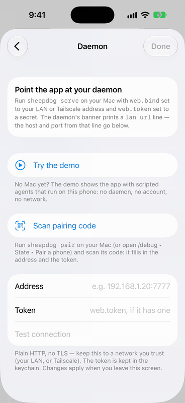
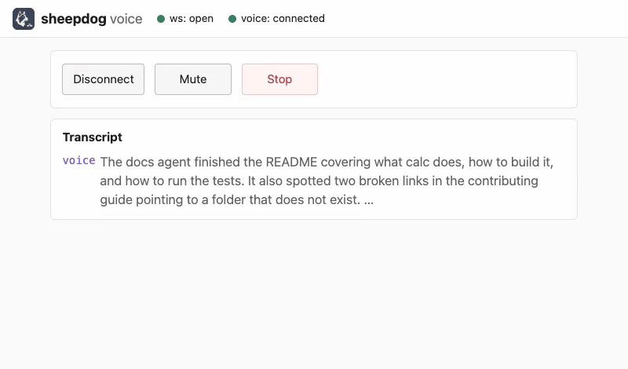
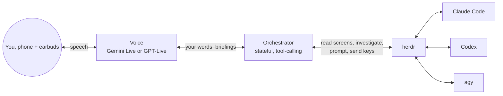

<p align="center">
  <picture>
    <source media="(prefers-color-scheme: dark)" srcset="https://github.com/kccarlos/herdr-sheepdog/raw/main/assets/logo-transparent.svg">
    
  </picture>
</p>

# herdr-sheepdog

**Walk away from your desk. Your coding agents keep working; sheepdog keeps you in the loop, in your earbuds.**

<!-- TODO(hero): add assets/readme/hero.gif and the demo video link once recorded (storyboard: docs/launch-kit.md). -->
<p align="center"></p>

sheepdog is a voice supervisor for the coding agents you run in
[herdr](https://github.com/herdrdev/herdr) (Claude Code, Codex, agy). You
use it **away from your desk**: an iPhone and earbuds, lock-screen
notifications, a Live Activity while you talk, earbud remote controls.

## Why it is different

- **It watches the whole fleet and tells you who is blocked first.** One
  question, "what's going on?", covers every agent: who needs you, who
  finished, who failed.
- **It investigates instead of guessing.** Behind the realtime voice (Gemini
  Live or GPT-Live) a stateful orchestrator reads the agents' screens and
  session records, and asks a read-only fork of the worker what a screen
  cannot say. It remembers "tell me when auth is done", and comes back to a
  question it could not answer.
- **Every change is measured.** Prompts and harness changes merge only past
  an eval suite with confidence intervals, and several that looked good
  lost ([how we measure](#how-we-measure)).

## Install

1. **Install the plugin** (a herdr plugin):

   ```sh
   herdr plugin install kccarlos/herdr-sheepdog
   ```

2. **Run the "Set up sheepdog" action** in herdr. It runs `sheepdog init`: it
   checks herdr, asks for one [Gemini key](https://aistudio.google.com/apikey)
   and validates it.
3. **Run "Pair your phone"** and scan the QR code with the iOS app,
   "Sheepdog for herdr" ([TestFlight link: TODO](#), source:
   [herdr-sheepdog-ios](https://github.com/kccarlos/herdr-sheepdog-ios)).

**Try it without herdr:** `GEMINI_API_KEY=… sheepdog demo` runs three
scripted agents you can talk to in the browser, and the iOS app has a demo
mode that needs no daemon and no key. By-hand install and everything else:
[docs/guide.md](docs/guide.md).

<table>
  <tr>
    <td align="center"><br>What is going on?</td>
    <td align="center"><br>Approve from the phone</td>
    <td align="center"><br>Three-step install</td>
  </tr>
</table>

## What it sounds like

An illustration of one exchange (not a transcript):

```text
sheepdog  Codex in "api" needs your approval to run the migration. The other
          two are working.
you       What does the migration touch?
sheepdog  Checking... It adds an index on orders, no data changes.
you       Approve.
sheepdog  Approved. Tell you when it is done?
you       Yes. And ask auth why the tests failed.
sheepdog  Asking auth's agent. I'll come back with that.
```

## How it works



The voice owns the conversation; it has two tools and no hands. The
orchestrator does the work behind code rails. Design:
[docs/design-overview.md](docs/design-overview.md).

## Safety

- **Approvals need your words.** A worker's approval prompt is answered only
  on your own recorded words (or a tap) in that turn, with a key from the
  prompt's own options. Code enforces it, not a prompt.
- **Investigations are read-only, and the workers' own prompts stay on.**
  Instructions reach an agent right after sheepdog echoes them, so never
  point it at an agent started in a fully auto-approve mode
  ([which flags to avoid](docs/guide.md#safety-details)).
- **No TLS.** The daemon listens on loopback by default and refuses a
  non-loopback bind without a token. Use your LAN or Tailscale, never the
  open internet.

## How we measure

- **Four numbers on every report:** Understood, Done, Low effort and Safe,
  from simulated workdays with several agents, through text, synthetic speech
  and real herdr workers.
- **A calibrated judge:** Claude Sonnet scores each segment (kappa 0.72
  against 126 labelled pairs). A difference whose confidence interval spans
  zero is not a result.
- **Gated, with losses published:** letting the voice speak from briefings
  lifted the tier-2 voice pass rate (scenarios without echo) from 51 % to 68 %; coming back to unanswered questions
  raised "answered later" from 56 % to 100 %; the production orchestrator
  (DeepSeek) scores 91 % segment Understood, Gemini 3.5 Flash 81 %. Index
  with the rejected experiments: [docs/eval/README.md](docs/eval/README.md).

## Links

[Guide](docs/guide.md) · [Configuration](CONFIG.md) · [Design](docs/design-overview.md) ·
[Architecture](docs/architecture.md) · [Evals](docs/eval/README.md) · [iOS app](https://github.com/kccarlos/herdr-sheepdog-ios) ·
[Changelog](CHANGELOG.md) · [License](LICENSE)
