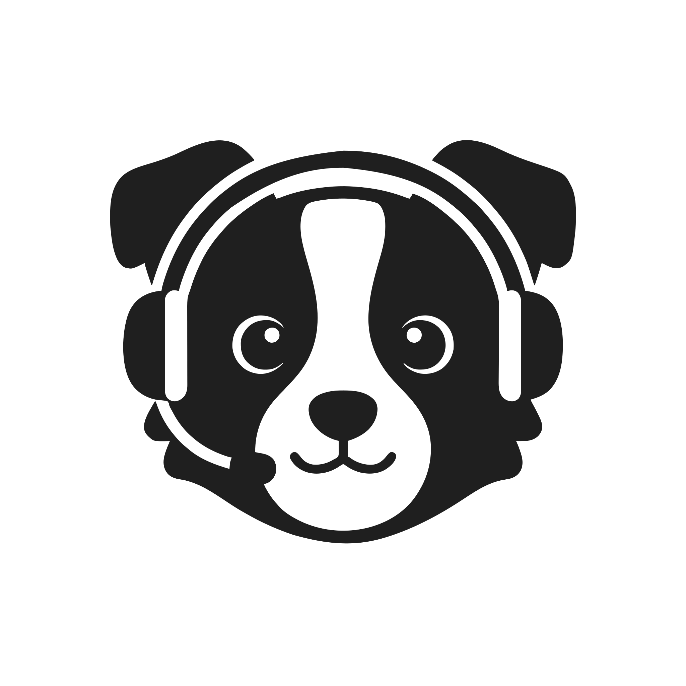

<p align="center">
  <picture>
    <source media="(prefers-color-scheme: dark)" srcset="assets/brand/logo/sheepdog-logo-color.svg">
    
  </picture>
</p>

<p align="center"><strong>sheepdog</strong></p>

<p align="center">
  <a href="#try-it-in-three-minutes">install</a> · <a href="docs/quick-start.md">quick start</a> · <a href="docs/README.md">docs</a> · <a href="docs/iphone-app.md">iPhone app</a>
</p>

<p align="center">
  <a href="LICENSE"></a>
  <a href="https://github.com/kccarlos/herdr-sheepdog/releases/latest"></a>
  <a href="https://github.com/kccarlos/herdr-sheepdog/stargazers"></a>
  <a href="https://github.com/kccarlos/herdr-sheepdog/actions/workflows/ci.yml"></a>
  
  <a href="https://herdr.dev/plugins/"></a>
  <a href="https://testflight.apple.com/join/bjCaFYgK"></a>
</p>

---

# Manage your Herdr agents by voice.

**Hands-free, from anywhere. Hear who's stuck, approve with a word, ask what broke.**

https://github.com/user-attachments/assets/4d0834e2-9d1a-453b-a88b-ff4b75428a5a

- **a voice-first agent harness** — a realtime voice model and a stateful orchestrator that reads your agents, wired together with rails in code (approvals only on your words) and tuned by evals, not prompt tricks. [how it works →](docs/dev/design-overview.md)
- **hands-free voice** — talk to your agents on your phone and earbuds, no screen needed. Real-time voice by the latest Gemini 3.8 Live or GPT-Live. [quick start →](docs/quick-start.md)
- **who's stuck, first** — "what's going on?" covers the whole fleet and names who needs you before anyone else. [commands →](docs/commands.md)
- **approve by voice** — an approval is answered only on your own words, enforced in code, not a prompt. [safety →](docs/safety.md)
- **ask why** — it reads screens and session records, and asks a read-only fork of the agent when a screen is not enough. [faq →](docs/faq.md)
- **it remembers** — "tell me when claude-auth is done", and it comes back to a question it could not answer. [faq →](docs/faq.md)
- **iPhone app** — QR pairing, Live Activity, earbud remote, and lock-screen notifications through an end-to-end encrypted relay. [iPhone app →](docs/iphone-app.md)
- **Mac panel and menu bar** — read the conversation, type, answer and talk in herdr-app; Sheepdog.app supplies the microphone, notifications and a global shortcut. [Mac →](docs/desktop.md)
- **herdr-app mod** — Sheepdog is also a community mod: [mods/sheepdog](mods/sheepdog), [RECIPE.md](RECIPE.md).
- **bring your own models** — one free Gemini key is enough; Gemini Live or GPT-Live for the voice, Gemini, DeepSeek or any OpenAI-compatible endpoint for the brain. [models →](docs/models.md)
- **measured** — every prompt and harness change merges only past an eval suite with confidence intervals; the losses are published. [evals →](docs/dev/eval/README.md)

---

<a id="install"></a>

## try it in three minutes

**You need:** [herdr](https://github.com/herdrdev/herdr) (the herdr app or herdr-core, `hc`), macOS or Linux, a browser with a microphone, and one voice model plus one brain model. The simplest is **one free Gemini key** from <https://aistudio.google.com/apikey> ([other options →](docs/models.md)). The install downloads a prebuilt binary for Apple silicon Macs and x86-64 Linux; any other machine builds from source and needs [Go](https://go.dev/dl/).

```bash
herdr plugin install kccarlos/herdr-sheepdog   # 1. install the plugin
sheepdog setup                                  # 2. the browser wizard: key, checks, start at login, phone
```

Or with Homebrew: `brew install kccarlos/tap/sheepdog`, then `sheepdog setup`. herdr 0.9.4 or newer is needed for the plugin. On herdr-core (`hc`), use Homebrew: sheepdog finds hc's socket when it starts ([herdr.backend](CONFIG.md)).

<p align="center"></p>

Setup opens a page, checks your key on the spot, and ends with a button that starts talking. About three minutes. No agents yet? The last step's **Try it with demo agents** runs three scripted ones you can talk to (also `sheepdog demo`, once the key is saved). Over SSH with no browser, see [quick start →](docs/quick-start.md#over-ssh-with-no-browser).

**iPhone app:** [join the TestFlight beta](https://testflight.apple.com/join/bjCaFYgK) (install the TestFlight app first), or [build it yourself](ios/README.md). To pair it, turn on phone access in the setup wizard (step 4), then run `sheepdog pair`. It has an offline demo mode that needs no computer. [iPhone app →](docs/iphone-app.md)

**Away from home:** install [Tailscale](https://tailscale.com) on the computer and the phone, sign into the same account, then pair again. [remote access →](docs/remote-access.md)

Something wrong? Run `sheepdog doctor`; every problem prints its fix. [troubleshooting →](docs/troubleshooting.md)

## docs

[quick start](docs/quick-start.md) · [iPhone app](docs/iphone-app.md) · [remote access](docs/remote-access.md) · [models](docs/models.md) · [commands](docs/commands.md) · [configuration](CONFIG.md) · [troubleshooting](docs/troubleshooting.md) · [safety](docs/safety.md) · [privacy](docs/privacy.md) · [faq](docs/faq.md) · [developer docs](docs/dev/architecture.md)

## iPhone app

The iPhone app, **Sheepdog for herdr**, lives in [`ios/`](ios/README.md) in this repository: talk to your agents, answer approvals from the lock screen and watch their screens away from your desk. Using it: [docs/iphone-app.md](docs/iphone-app.md). Building it with your own Apple team (XcodeGen, signing, push keys): [ios/README.md](ios/README.md).

## thanks

If sheepdog helps you, a ⭐ helps others find it.

## contributing

Bug reports and ideas are welcome: [open an issue](https://github.com/kccarlos/herdr-sheepdog/issues/new/choose) (attach `sheepdog doctor --report`). Code changes: read [CONTRIBUTING.md](CONTRIBUTING.md).

## agent instructions

If you are an AI agent working on this repository, read [`AGENTS.md`](AGENTS.md) first.

## license

sheepdog is licensed under the [MIT License](LICENSE). Security reports: [SECURITY.md](SECURITY.md).

## why a sheepdog

sheepdog is a border collie wearing a headset: it sits between you and your flock of coding agents, listens to them and talks to you. The whole look comes from that one picture; see [docs/dev/brand.md](docs/dev/brand.md).
