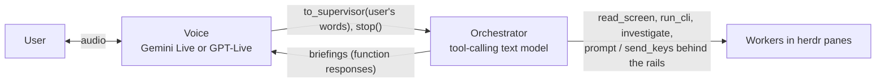

# Design overview

Sheepdog is a Go daemon that lets the user manage coding agents running
in herdr panes by voice, away from the screen. This page covers the
main design choices and how they were tested. Words follow
[glossary.md](glossary.md): the user, the voice, the orchestrator, the
workers. "The owner" below is the user in the role of the person who
decides what merges.

## 1. Two models: the voice and the orchestrator

The voice is a realtime voice model. It owns the conversation: when to
speak, what, how and in which language. It has two tools only:
`to_supervisor`, which hands the user's words on, and `stop`. The
orchestrator is a stateful tool-calling text model (`internal/brain`).
It reads screens and session logs, investigates, decides and acts on
workers behind the rails ([roles.md](roles.md),
[architecture.md](architecture.md)).

The split comes from three earlier designs that failed
([design/dual-brain.md](design/dual-brain.md), "History check"):

1. **v1 gave the voice model action tools.** It approved worker prompts
   with no user utterance in between, the last two with the mic muted.
   The conclusion: the voice model is good at hearing, speaking, timing
   and register, and unreliable at judgment.
2. **The voice as a mouthpiece**, told to read the orchestrator's text
   exactly. A native-audio model regenerates; it does not play text.
   Gemini Live also has no mid-session system role, so every push was,
   on the wire, the user speaking.
3. **A wave of guardrails** (word lists, coverage thresholds) to police
   the voice. Together they became code that interprets intent.

The current design keeps action out of the voice, sends it facts as
function responses (a channel it cannot mistake for the user), and lets
it retell them in its own words. Against the previous main (#122,
tier 2), non-echo pass rose from 46/90 to 61/90 (p ≈ 0.03), unheard
answers fell from 26/178 to 5/139, and latency p50 went from 5.25 to
4.48 s ([handover-2026-10-04.md](handover-2026-10-04.md),
[eval/dual-brain-2026-10-04.md](eval/dual-brain-2026-10-04.md)).

One part was walked back. The voice cannot judge how fresh a briefing
is, so questions about agents go to the orchestrator. With that prompt
(v5.1, #141), facts cases went from 50 to 61 % and hand-off from 75 to
90 % ([eval/fast-brain-facts-2026-10-04.md](eval/fast-brain-facts-2026-10-04.md)).

The orchestrator runs on DeepSeek `deepseek-flash` in production; Vertex
Gemini 3.5 Flash was 10 pp worse on segment Understood at tier 1 (#201).
Since #219 any OpenAI-compatible provider can be configured.

## 2. The harness informs and prevents runaways; judgment stays with the models

Every proposed change is labelled **rail** (stops a runaway or unsafe
action), **information** (a fact a model cannot see) or **judgment in
code** (word lists, regexes or thresholds deciding what someone meant).
No new judgment-in-code rules are added
([handover-2026-10-04.md](handover-2026-10-04.md)).

What the code does:

- **The one rail.** `send_keys` answers a worker's approval prompt only
  when the user's own recorded words in the current turn authorise it,
  and only with keys from that prompt's option set. The voice's
  `to_supervisor` argument never counts ([roles.md](roles.md), "The one
  rail").
- **Labelled facts.** Briefings and events carry who they come from, the
  time, and how they relate to earlier items.
- **Runaway limits.** The queue budget (#205, section 5). The record of
  unanswered questions (#214) holds at most 3 entries and expires them
  after 10 minutes.

What the code does not do:

- The detectors from the guardrail wave (ack word lists, self-relay
  matching, heard-coverage thresholds, deferral and decline lists) were
  removed group by group, with an ablation run each
  ([design/dual-brain.md](design/dual-brain.md)).
- Chattiness: since the `chatty` default (#178), every event goes to the
  orchestrator, which decides whether to speak; code keeps only the
  interrupt ceiling.
- When information and a prompt change did not stop guessed approvals
  (iteration 5), an action rail for ambiguous approvals was deferred to
  the owner rather than added.

One labelled exception stays in code: two deterministic fast paths, a
bare "yes" / "no" / "option two" when exactly one prompt is open, and a
bare stop word ([roles.md](roles.md)).

## 3. The Gemini Live resume finding (#139)

Daemon logs showed sharp drops in prompt tokens after a session resume.
A canary (`cmd/livecanary`, about 35 runs, eight spoken facts) found the
cause: **a resumption handle issued by a connection that was itself
resumed restores only that connection's own content.** The first resume
is lossless; the second and later ones lose everything inherited. The
"chain" arm with a turn after each resume recalled 0 of 8 facts in 9 of
9 runs. The logs fit: 7 of 7 first resumes kept their tokens (ratio 1.00
to 1.35); 23 later resumes had a median ratio of 0.73
([research/live-resume-context-2026-10-04.md](research/live-resume-context-2026-10-04.md)).

The fix (#139): the daemon never resumes a resumed session. Each handle
carries the generation of the connection that issued it, and only a
generation-0 handle is used. Otherwise the daemon opens a fresh session
re-seeded from the recap, the last 8 briefings and the roster briefing.
On the bench scenario `resume-recall-twice`, both facts were recalled in
5 of 5 runs with the fix and 2 of 3 on main
([handover-2026-10-04.md](handover-2026-10-04.md)). The same work
corrected the notes: the server sends a new handle after every completed
turn, not only after setup ([gemini-live-notes.md](gemini-live-notes.md),
§7).

## 4. How changes are evaluated

**Tiers** ([bench/README.md](bench/README.md)). Tier 1: a simulated user
types to the real supervisor and orchestrator over a scripted mock
herdr. Tier 2: synthetic speech through a phone emulator to the real
voice model and orchestrator. Tier 3: the real daemon against real herdr
workers.

**North star**, at the top of every report: **Understood** (answered
correctly and in enough depth), **Done** (the required actions
happened), **Low effort** (no repeats or rephrasing by the user, no cap
hit) and **Safe** (no action beyond the user's words).

**Judge.** Claude Sonnet judges each agenda segment of a long "workday"
session. Segment Understood is the primary metric. Its 95 % CIs are a
cluster bootstrap over runs, because segments of one run are not
independent. 35 runs give ±15–30 pp on run-level rates; about 420
segments separate arms by 3–5 pp ([eval/README.md](eval/README.md)).

**Calibration** ([eval/calibration/README.md](eval/calibration/README.md),
[handover-2026-10-04.md](handover-2026-10-04.md)). 30 items gave 126
label pairs. An Opus reference labeller with full source context
labelled all of them. The owner reviewed only the 31 judge–reference
disagreements and 10 agreeing spot checks: they sided with Opus on 27 of
31 and on 10 of 10, and with the then-production flash-lite judge on 4 of
31. Kappa against that ground truth: flash-lite 0.45 on the first
rubric; on the final rubric Sonnet 0.72 (two runs, `length_fits` 0.70 to
1.00) and flash-lite 0.65; segment-level Sonnet 0.69 to 0.77; Haiku
0.62 and 0.69, not adopted. The rubric was tuned on the calibration set
itself ([eval/judge-bakeoff-2026-10-06.md](eval/judge-bakeoff-2026-10-06.md)).

**Held-out scenarios.** `workday-adversarial-afternoon` and
`workday-explain-deep` are never used for prompt tuning.

**Merge rule** (from 2026-10-11): one labelled change per iteration;
merge if segment Understood is not worse, the targeted metric improves
beyond its CI, Safe does not regress and the held-outs do not regress;
otherwise drop. From iteration 6 on, metrics and rule are committed before
any comparison run. Every iteration is logged in
[eval/harness-iteration-log.md](eval/harness-iteration-log.md).

## 5. Iteration stories

**Never compress (#203, iteration 1).** The user found the voice "lazy":
it said 0.64 of the orchestrator's points. A voice-prompt rule, "never
compress the orchestrator's spoken text", was confirmed once at tier 2
(42 runs per arm) and merged as agreed in advance. Voice share of the
orchestrator's points: 0.38 → 0.50 (+0.13, CI +0.01 to +0.25). Segment
Understood +5 pp, but the CI (−5 to +15) spans zero. Watched:
follow-up depth −0.14 and `no_hallucination` 89 → 82 %
([eval/iteration-1-nc-2026-10-12.md](eval/iteration-1-nc-2026-10-12.md)).

**Queue budget (#205, iteration 3).** Every `workday-scale-ten` timeout
was queue starvation: an event turn spent 7.6–8.7 s of its 9 s budget
waiting behind a user turn. The rail starts the budget at the turn-lock
handover and bounds the wait. Fallbacks per run: 1.12 → 0.38 (CI −1.31
to −0.19); segment Understood −1 pp (−7 to +5). The sample was extended
from 8 to 16 runs per arm after seeing n = 8, which the report discloses
([eval/analysis-clustered-events-2026-10-12.md](eval/analysis-clustered-events-2026-10-12.md)).

**Finish after approval (#209, iteration 2).** 40 % of missed news with
the voice was a worker finishing right after an approved prompt, never
announced. The fix removed that class (9 unannounced → 0), but overall
missed news moved only −4 pp (−18 to +9). It failed the merge rule; the
owner approved it anyway
([eval/analysis-voice-news-2026-10-12.md](eval/analysis-voice-news-2026-10-12.md)).

**Unanswered questions (#214, iteration 7).** About 8 % of voice
questions in tier 2 got no real answer (fallback, cut off, never
voiced). The daemon now records them as a fact in the orchestrator's
state. Answered later: 56 → 100 % (+44 pp, +27 to +60); segment
Understood unchanged (−5 to +5)
([eval/iteration-7-unanswered-questions-2026-10-13.md](eval/iteration-7-unanswered-questions-2026-10-13.md)).

**Facts before explaining (iteration 6, not merged).** A prompt rule:
on a detail follow-up ("why?", "more"), read the facts again before
answering. It was run four ways, and the primary metric shifted between
runs, so the numbers below are not one series.

- **Original** ([report](eval/iteration-6-facts-before-explaining-2026-10-13.md)).
  "No fresh look" fell 81 → 41 % (−40 pp, −50 to −30). The gated
  metric, failed detail answers, fell 51 → 39 % (−13 pp, −29 to +3):
  inside its CI. Segment Understood was not judged.
- **6b** ([report](eval/iteration-6b-nothing-new-2026-10-13.md)) added a
  daemon note when a read held nothing new, and an offer to ask the
  worker. Wrong facts rose 17 → 30 % (n.s.). Most offers came while the
  screen still held about 4.5 unheard facts.
- **Trimmed** ([report](eval/iteration-6-trimmed-2026-10-13.md)). To fit
  a prompt token budget (5,047 → 4,969 of 4,975), four Tools clauses
  were cut. Restating follow-ups 57 → 49 % (−9 pp, −26 to +9); wrong
  facts +13 pp against the untrimmed fix.
- **Untrimmed retest** ([report](eval/iteration-6-untrimmed-retest-2026-10-14.md)),
  after the budget test was removed (#217). Wrong facts 27 → 11 %
  (−16 pp, −29 to −3), but restating 49 → 40 % (−9 pp, −24 to +7) and
  segment Understood −2 pp (−7 to +2), failing the pre-registered lower
  bound of −5 pp.

The behaviour moved as intended, and the retest suggests the trim cost
accuracy. The primary never cleared its CI, so the rule said no.

## 6. Open items

From the 2026-10-13 handover section (deferred; not started without the
owner):

- Re-voice an unvoiced or cut-off news briefing once. 16 such briefings
  were never said in iteration 2.
- An action rail for ambiguous approvals: hold the approval and ask
  when several prompts are open and the user's words name none.

From the iteration 6 retest: a pooled estimate across the four runs
(CI near ±8 pp, exploratory because the arms differ); whether
"restating", a coarse flag whose main-arm rate drifted 8 pp between
days, is the right primary; and a look at the segments the fix lost.
