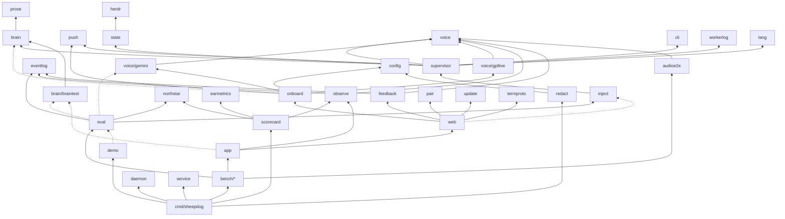

# Code health audit and cleanup plan (2026-10-21)

> **Status: adopted plan (2026-10-21).** This doc changes no code. It audits `main` at
> `b7f60dc8` (the Go daemon and the iPhone app in `ios/`) and proposes small,
> behaviour-preserving PRs. Updated for the CEO decisions of 2026-10-21:
> **no backward compatibility** (compatibility code is dropped now, not on dated
> triggers), and **iOS tests move to GitHub Actions macOS runners** (Xcode Cloud
> only archives TestFlight builds on `ios-v*` tags). Items already done are marked
> **Done (#N)**: #323, #324, #325 and #326 landed on 2026-10-21. Any step that touches the orchestrator, the voice
> or a prompt gets a DeepSeek tier-1 eval before and after
> ([eval/README.md](eval/README.md)).

## Summary

- **The code is healthier than its size suggests.** `golangci-lint` and
  `staticcheck` are clean, there are no import cycles, and Go coverage is above
  80 % in every core package (brain 91.7 %, supervisor 87.1 %, web 86.0 %).
- **Dead code is small.** Two Go functions are truly dead, and a few APIs are
  kept alive only by their own tests. The app has about 30 dead members and
  about 66 test-only ones.
- **Big wins:**
  1. One shared spawn helper. Today `UserNewAgent` copies `spawn()`, and both
     hard-code Claude and Codex instead of checking `brain.SpawnKinds`. That is
     the agy blocker in #318.
  2. Split the five biggest files. Most of the splits are mechanical moves
     inside one package.
  3. Take test and debug code out of the daemon build. `braintest` is compiled
     into the daemon, and the demo pulls in the whole eval harness.
  4. Run the 9 functional iPhone UI tests that skip today, on GitHub Actions
     macOS against a daemon built in the same job, and add Go↔Swift protocol
     goldens.
- **CI noise is mostly infrastructure.** 31 of the last 40 failed runs were the
  artifact quota (since fixed) or lost runners. Two test flakes were open on CI and
  three more showed up locally under heavy load; all come from timing
  assumptions (fixed sleeps, "wait for X, assume Y"). Four are fixed (#325,
  #326); `same_version` is still open.
- **Two docs facts were wrong:** **Done (#323).**
  - `brain.reply_wait_s` defaults to 30 in code, but [CONFIG.md](../../CONFIG.md) said 2.
  - [herdr-plugin.md](herdr-plugin.md) said herdr 0.9.5 is needed, but the plugin manifest and README say 0.9.4.
- **Compatibility code goes now.** The proposal kept it behind dated triggers
  for TestFlight 0.1.10–0.1.12 and daemons v0.1.0–v0.1.4. The decision is no
  backward compatibility: the new app and daemon replace the old ones, and the
  one tester re-pairs once. Phase 5 removes it all.

## Which builds are still in use

The proposal used this table to decide what compatibility code could go. With
no backward compatibility it no longer gates anything; it is kept as a record.

| Channel | Builds | Notes |
|---|---|---|
| Daemon releases (`v*`) | v0.1.0 (2026-10-15) … v0.1.5 (2026-10-20) | Only v0.1.5 has `/term`, `screen-ansi`, cards, agent actions, changes and attachments, and the shell. |
| TestFlight, external Public group | 0.1.10, 0.1.11, 0.1.12 | 0.1.12 has no `/term` and no cards, and it uses plain `screen-subscribe`. |
| TestFlight, internal group | 0.1.0–0.1.9, 0.1.14 | 0.1.13 was never uploaded. 0.1.0 expires around 2026-12-27. |

Old builds are not supported once the redesign and the security work ship.

## 1. Dead and unused code

### Go

Raw output is kept out of the repo. To reproduce, run these from the repo root:

| Command | Result |
|---|---|
| `go run golang.org/x/tools/cmd/deadcode@latest ./...` | 50 unreachable funcs in 14 packages. 31 of them are in `internal/herdr/herdrtest`. |
| `go run golang.org/x/tools/cmd/deadcode@latest -test ./...` | 2: `internal/northstar/events.go:87 FromTS` and `internal/onboard/onboard.go:530 IsLoopbackURL` |
| `go run honnef.co/go/tools/cmd/staticcheck@latest ./...` | 0 findings |
| `golangci-lint run` (v2.14.0; `make lint`, `default: standard` plus misspell, unconvert and unparam) | `0 issues.` |

The linters are clean even though `deadcode` flags 50 functions. That is
because `unused` counts calls from tests and never flags exported identifiers.
No tool in use covers unused exported types, consts or vars.

| Finding | Class | Action |
|---|---|---|
| `onboard.IsLoopbackURL` (onboard.go:530) | Truly dead. It duplicates `onboard.KeyOptionalURL`, left over from #220. | **Done (#324).** |
| `northstar.FromTS` (events.go:87) | Truly dead, added in #159 and never used. | **Done (#324).** |
| `service.Manager.LogsCommand` (service.go:409) | Superseded API that only its own test calls. `sheepdog logs` reads the file with `tailLines`. | **Done (#324)**, with its test. |
| `pcm.RMS` (bench/pcm/pcm.go:48) | Test-only. The bench uses `audioe2e.VoicedRMS`. | Delete, or move it into the test. |
| `brain.renderLedger`, `brain.journalLedgerLines`, `eval.RunSVPLive`, `checkSVPExpect`, `bench.Bed.SetDBFS`, `prose.Ear` | Test-convenience wrappers over the real `…N`/`…With` variants | Optional: move them to `_test.go` files. |
| `herdrtest` (all 31 funcs) | Test-only on purpose: a fake herdr server shared by test packages | Keep. |
| `termproto.DecodeFrame` and `EncodeInput`; `wsproto.Drain`, `ScreenSubscribe`, `ScreenUnsubscribe` and `Visibility`; `push.Open`; `pair.Parse` | Client halves of the wire protocols. The real clients are the web JS and the app; Go uses these only in round-trip tests. | Keep. |
| `eval.WorkdayGroup` | Test-only, but the bench docs cite it as the canonical mapping | Keep. |

### Swift (periphery 3.8.0)

periphery is now installed through Homebrew on the dev Mac. Its own build step
fails on SwiftTerm's package plugin validation, so it runs in two steps:

```sh
cd ios && xcodegen generate
xcodebuild -project Sheepdog.xcodeproj -scheme Sheepdog \
  -destination 'generic/platform=iOS Simulator' -derivedDataPath "$SCRATCH/dd" \
  -skipPackagePluginValidation -skipMacroValidation build-for-testing \
  CODE_SIGNING_ALLOWED=NO COMPILER_INDEX_STORE_ENABLE=YES INDEX_ENABLE_DATA_STORE=YES
periphery scan --project Sheepdog.xcodeproj --schemes Sheepdog --skip-build \
  --index-store-path "$SCRATCH/dd/Index.noindex/DataStore" \
  --retain-codable-properties [--exclude-tests] --format csv --relative-results
```

With tests indexed it reports 79 items, excluding SwiftTerm. With tests
excluded, 66 more items show up, and those are test-only.

**Truly dead (checked with grep):**
- `Sources/Sheepdog/SessionViewModel.swift`: `pendingQuestion(for:)` (:251) and `dismissMuteHint()` (:625).
- `Sources/SheepdogKit/DaemonClient.swift:213 login(token:)`. Its doc comment says it backs Test connection, but `probe()` uses `/api/hello` and `/api/state`. The comment is stale too.
- `Cards.hasSeen(_:)`, `BrainActivity.reply(id:)`, `DaemonHealth.problemTypes`, `SetupHelp.projectURL`, `AgentWindow.barLabel`, `SwiftTermSurface.name` and `.selectedText`, `ConversationHistory.isEmpty`, `DemoVoice.isSpeaking`.
- The static constructors `WSMessage.flush`, `.pong` and `.card(_:)`. The enum cases themselves are used.
- The unused `@State expanded` in `ConversationView.swift:308` and `HealthView.swift:179`.
- The unused parameter `canTakeOver` in `AgentWindow.closed(_:canTakeOver:)`.
- Several unused public memberwise `init`s in SheepdogKit.
- `AgentActions.suggestedBranch(from:)` has no caller. Check it against the backlogged herdr-style New agent (#318) before you delete it.

**Written but never read:**
- `paneID` in `ChangesView`, `AgentScreen` and `AgentWindow`
- `MarkdownText.source`
- `urgency` in `BrainActivity` and `DemoWorld`
- `TermSocket.protocolVersion`, `cols` and `rows`
- `CaptureGate.gatedFrames` and `peak`, which may be kept for debugging

**Superseded APIs that only tests keep alive.** These give false coverage,
because the tests exercise code the app does not run:
- `Push.registerPush(_:)`. The app calls `registerPushDevice`.
- `TermHub.open(paneID:…)`. The app calls `open(target:…)`.
- `AgentScreenModel.beginSend()` and `finishSend(error:)`, with `inputError`,
  `lastReply`, `canOperate` and `needsConfirmation`. `AgentScreenView` has its
  own private `beginSend()`, so the send-state logic exists twice.

**Kept on purpose:**
- The headless terminal grid (`TerminalGrid`, `SwiftTermGrid` and friends in
  `TerminalSurface.swift` and `SwiftTermSurface.swift`) is test-only, but six
  test files render recorded frames through it. Keep it, or move it to the test
  target.
- AppIntents `static var description`, which the system reads.
- About 25 `public` declarations used only inside the module. Narrowing their
  access level is cleanup, not dead code.

## 2. Leftover logic

| Candidate | Finding | Verdict |
|---|---|---|
| **`screen` snapshot vs `/term`** | `/term` (#301) and `screen-ansi` (#305) landed 2026-10-20. The app falls back to snapshots when the daemon offers no term: herdr older than 0.9.2, `--herdr=mock`, the demo, the bench, a refused or full term, or herdr down (`AgentWindow.swift:170/260/330`, `AgentScreenView.swift:734`). | **Keep the fallback for good.** Two pieces are old-version support: the daemon's plain `/ws` `screen-subscribe` (`internal/web/ws.go:791`, `screen.go`) serves apps 0.1.10–0.1.12, and the app's plain (non-colour) drawing serves daemons v0.1.0–v0.1.4. Remove both now (phase 5). No web client uses snapshots. |
| **v1 voice tools** | Removed cleanly in #51. `supervisor/tools.go:15-38` declares only `to_supervisor` and `stop`. The `turnDoneAt` field (`voice/gemini/session.go:145`) is written at `reader.go:167` and never read, a leftover from #122. The `gemini.briefing_channel="user_turn"` A/B control arm from #122 touches `config.go:477-509/899/1257`, `template.go:46` and `CONFIG.md:115`, plus 7 branches up to `briefing.go:298`. No eval or bench uses it. | Delete `turnDoneAt`. Retire `user_turn` with a note in the eval README; this needs an eval. Keep the heard/keyterms/requeue code, which GPT-Live uses. Stale prose: `herdr-protocol.md:439/707` mentions `confirm()` and `cli-query-tools.md:41` mentions `ask()`. |
| **Old config keys** | `internal/config/deprecated.go`, all from #51 (2026-09-23): `brain.propose_timeout_s` → `utterance_timeout_s`, `brain.enrich_timeout_s` → `announce_turn_timeout_s` and their env vars; `brain.ask_timeout_s` is dropped and only prints a note. No released build writes the old names. | Delete `deprecated.go` and its env vars now (phase 5); there is no compatibility. `load` silently ignores unknown keys (`config.go:778-795`), so an old config falls back to the defaults; the one tester's config does not use these names. Stale comment: `config.go:100` says the default is 12; it is 25. |
| **PaneSwitcher / Flock** | Users see "Agents". "Flock" survives in about 60 Swift identifiers (`FlockView`, `FlockPaneState`, `MainPane.flock`), the `flock.*` accessibility ids used by UI tests, and prose (README.md:93, brand.md, the iOS docs, `testdata/bench/tier3/codex.json:20`). `PaneSwitcher.swift:3` says "three panes" (there are two) and `:10` says "Conversation / Flock". The `syscall.Flock` hits in `internal/daemon` are unrelated. | Fix the prose and comments now. Do the identifier and accessibility-id rename inside the #318 iPhone UI pass, not as a separate churn PR. PaneSwitcher is a neutral name and can stay. |
| **Duplicated spawn** | `UserNewAgent` (`supervisor/useractions.go:112-208`, called from `web/agents_actions.go:81`) and `spawn()` (`supervisor/spawn.go:111-193`) share the kind check, snapshot, directory resolution, rate cap, pane open, shell wait, start command, logs and `followSpawn`. **Real differences:** the orchestrator path checks the words rail and spends the input under the lock; it takes a model, while the tap path takes a worktree branch and a text limit; the error types differ (`ErrNotPermitted` vs `ErrUserAction`); the log fields differ (`via` and `worktree` appear only on the tap path); and the reply goes through `tellBrain` on one path and an echo line on the other. Both check `Kind != SpawnClaude && != SpawnCodex` (`useractions.go:121`, `spawn.go:121`). | One helper, `startAgent(ctx, sp, spawnStart{Kind, Model, Dir, Branch, Text, Via, Authorise func() string})`. `Authorise` runs under `s.mu` next to the rate cap. The orchestrator passes the words rail plus the spend, so the rail stays in code at the call site; the tap path passes nil. Check the kind against `brain.SpawnKinds`. Medium-low risk; needs an eval. |
| **Version fallbacks** | **Daemon:** the legacy `/ws` handshake (`web/handshake.go:12-100`) is needed only by internal 0.1.0 builds and by `internal/audioe2e/runner.go:198-208`, which never sends `client-ready`. "An older app gets no cards" (`cards.go:15`) serves 0.1.10–0.1.12. **App:** about 8 fallbacks cover daemons older than v0.1.0, which were never released: `ProtocolHandshake.swift:100`, `SessionViewModel.swift:242`, `VoiceProviders.swift:12`, `PlaybackRatePolicy.swift:26`, `BrainActivity.swift:80`, `Push.swift:255`, `Feedback.swift:80`, `AgentScreen.swift:273`. The "404 means absent" handling for changes, attachments, actions, cards, term, `screen-ansi` and shell serves v0.1.0–v0.1.4. | Remove all of them now (phase 5): the 8 app fallbacks (keep `DaemonModels.swift:302` only if old history lines still need reading), the legacy `/ws` handshake (audioe2e sends `client-ready` in the same PR), "an older app gets no cards", and the 404 fallbacks, by raising `minDaemonProtocol` to 2 on both sides. |

**A bug-shaped risk:** on a slow network, `ProtocolHandshake.timedOut()`
marks the daemon as legacy (phase 5 removes the legacy path, and with it this risk). `TermAvailability` then reports no term, and the
window says "needs herdr 0.9.2", which is the wrong cause. A late `bot-ready`
recovers it. Map timeout to "unknown" and use the remembered features instead.

**Other leftovers:**
- There is one TODO in the tree: `internal/eval/svp.go:584 TODO(WP0a)`. It
  asks to switch the local `jargonTerms` to `earmetrics`. That changes an eval
  metric, so it needs eval evidence.
- `handshake.go:17` wrongly names voice-test as a legacy client.
- [ios/docs/dev/status.md](../../ios/docs/dev/status.md) and `ios/docs/dev/xcode-cloud.md`
  still say the latest TestFlight build is 0.1.5.

## 3. Structure

### Big files

**M** is a mechanical move inside one package. **P** needs a new package.

| File | Lines | Proposed split |
|---|---|---|
| `internal/app/app.go` | 1639 | **M:** `app.go` (Options, App, Build, Listen, URLs), `wire.go` (`wire()`), `voice.go` (voice provider selection, voice issues), `run.go` (Run, observers, watchdog), `lazy.go` (lazyPusher, lazyQuerier, teeLogger: the construction-order cycle breakers). Then split the 275-line `wire()` into wireHerdr, wireBrain, wireSupervisor, wireVoice and wireWeb. **P:** move the brain builder (buildBrain, BrainModels, BrainConfig, BrainProviders, …) to `internal/brainsetup`, so `sheepdog eval`, `eval sim` and `brain-test` stop importing the whole daemon. |
| `internal/config/config.go` | 1501 | **M:** `config.go`, `brain.go`, `voice.go`, `web.go`, `push.go`, `sections.go`, `validate.go` and `env.go` (the 175-line `applyEnv`). Then make key → env var → default a table. A docscheck test can compare [CONFIG.md](../../CONFIG.md) against it, which would have caught the `reply_wait_s` drift. |
| `internal/brain/braintest/braintest.go` | 1309 | **M:** `model.go`, `host.go`, `reflex.go` and `reflex_parse.go`. **P:** `Reflex`, `Catalog` and `FakeModel` are production code for `--brain=fake` (app.go:64, :404). Move them to `internal/brain/fakebrain`. |
| `internal/bench/run.go` | 1187 | **M:** `run.go`, `converse.go`, `collect.go`, `checks.go`, `rejudge.go`. |
| `internal/supervisor/utterance.go` | 1105 | **M:** `utterance.go`, `reply.go` (awaitReply, deliverLate), `fastpath.go` (bare stop, fast answers), `echo.go` (lines 904-1105). `echo_test.go` already exists with no `echo.go` beside it. |
| `cmd/sheepdog/init_flow.go` | 948 | **M:** `init_flow.go`, `init_voice.go`, `init_orch.go`, `init_keys.go`. It is only a size split: the shared rules are already in `onboard/setupcore.go`. |
| `ios/Sources/Sheepdog/SessionViewModel.swift` | 2152 | **M:** `extension SessionViewModel` files along the existing MARK sections: +Controls, +Routes, +Events, +History, +Settings, +AgentWindow, +Cards, +Banners, +Demo, +Pairing. Stored and `@Published` properties stay in the main file, and `private` members used across files become internal. Later, move demo running and history sync into SheepdogKit next to `SessionCore`, where they can be tested without UI. |

Other large files are smaller mechanical splits:
- `brain/anthropic.go` and `openaicompat.go`: move the wire conversion to `*_wire.go`.
- `web/ws.go`: split the hub from the client.
- `brain/loop.go`: split the loop from prompt building.
- `web/setup.go`: add `setup_phone.go` and `setup_keys.go`.
- `brain/brain.go`: move transcript ingest to `transcript.go`.
- `eval/svp.go`: split into run, grade and host.
- `voice/echogate.go`: move the signal maths to `echocorr.go`.

### Package dependencies

The graph has no cycles and 8 layers. Fan-out (internal imports): `cmd/sheepdog`
33, `app` 21, `web` 21, `eval` 14, `bench` 12, `supervisor` 11. Fan-in:
`logging` 15, `brain` 10, `voice` 10, `herdr` 8.

The diagram is the transitive reduction: 113 edges become 51. Edges to
`logging`, `ctxcap` and `prompts` are left out. Dashed edges are the muddled
ones.



**Muddled boundaries:**

1. **`app` is the god package.** It has 21 imports and exports the brain-building helpers, so the eval CLI and `brain-test` depend on the whole daemon. Fix: `internal/brainsetup`.
2. **`web` is a second hub.**
   - It imports `supervisor` from 8 files, `brain` from 6 and `onboard` from 4.
   - It imports `voice/gemini` only for `gemini.VertexModels` (setup.go:477).
   - So the HTTP layer holds provider model lists.
3. **Test and debug code is compiled into the daemon.**
   - `app` imports `braintest`.
   - `eval` type-asserts `*braintest.Model`.
   - architecture.md calls `inject` "debug-only", but `web/server.go` and `web/api.go` import it.
4. **The user-facing demo depends on the eval harness.**
   - `demo` uses `eval.SimScenario` and its loader, which pulls in brain, braintest, supervisor and gemini.
   - `bench/world` imports `eval` only for the Sim types.
   - Fix: a leaf `internal/sim` package.
5. **Provider names and defaults live in three places:**
   - `config.BrainProviders` (strings)
   - `brain`'s `Provider*` and `Default*Model` constants
   - `onboard`'s presets

   `onboard` imports `brain` in 9 files, mostly for those constants. Fix: a
   leaf `internal/provider`, which also removes `web → voice/gemini`.
6. **The measurement packages overlap.**
   - `earmetrics` is used only by `scorecard`.
   - `northstar` reports bench runs and `scorecard` reports event logs, with a bridge between them.

   Group them under `internal/metrics/…`, or at least document the split.
7. **Five packages deal with "logs":** `logging`, `eventlog`, `observe`, `feedback` and `ctxcap`. `workerlog` reads the *agents'* transcripts, not sheepdog's log, so its name misleads; `workersession` would say what it does.
8. **The package map in [architecture.md](architecture.md) is out of date.** It misses `bench/*`, `brain/braintest`, `daemon`, `lang`, `northstar`, `redact`, `service`, `update` and `voice/audiotiming`.

Clean, keep as is:
- brain ↔ supervisor: `brain.Host`, implemented in `supervisor/brainhost.go`.
- `onboard/setupcore.go` as the shared setup core.

## 4. Tests

### Coverage

Command: `go test -cover ./...`. These numbers count only each package's own
tests. The cross-package run (`-coverpkg=./...`) ran out of disk on the dev
Mac, so packages exercised from elsewhere look worse than they are
(`onboard/setupcore.go` shows 1.3 % but is driven from web and cmd).

| Coverage | Package | Non-test LOC | Notes |
|---|---|---|---|
| 0 % | cmd/livecanary | 1038 | Manual research canary |
| 0 % | brain/braintest, herdr/herdrtest | 1309, 671 | Test support (but see §3: braintest ships) |
| 29.9 % | bench/tier3 | 2910 | Needs live models |
| 37.5 % | audioe2e | 1620 | Harness |
| 41.7 % | bench | 3466 | Harness |
| **53.5 %** | **cmd/sheepdog** | **9320** | The gaps users hit are in `lifecycle.go` (42 %: `start` 24 %; `waitUp`, `waitGone`, `runRestart` and `tailOf` 0 %), `demo.go` 20 % and `setup_cmd.go` 40 %. The rest is dev tooling. |
| 60.4 % | daemon | 290 | |
| **61.2 %** | **onboard** | 2705 | Understated, see above |
| 65.4 % | inject | 673 | |
| 65.6 % | feedback | 783 | `report.go` 0 % |
| 75–80 % | termproto, app, bench/voiceclient, bench/world, wsproto, ctxcap | | |
| 81–88 % | eval 81.2, voice 81.5, push, workerlog, config 83.2, service, state, gptlive 86.0, web 86.0, eventlog, pair, supervisor 87.1, update, herdr 87.6 | | |
| ≥ 89 % | northstar, gemini 91.3, brain 91.7, prose, scorecard, observe, earmetrics, cli 96.1, lang 100 | | |

Proposed: a CI step `go test -coverpkg=./... -coverprofile=cover.out ./...` on
Linux, reported per package and not gated at first. Then write tests for
`cmd/sheepdog/lifecycle.go` (start, restart, wait) against a scratch daemon on
a free port.

### Flaky tests (last 40 failed CI runs)

Sources: `gh run list --status failure --limit 40`, then
`gh run view <id> --log-failed`. Every run was attempt 1, so failures are
classified by whether the commit touched the area and whether a later commit
fixed it.

| Category | Runs | Detail |
|---|---|---|
| Infra: artifact storage quota | 24 | `cross` failed at `actions/upload-artifact`. Fixed by #234. |
| Infra: lost runner | 7 | Jobs die after exactly 10:00 with empty logs. Hypothesis, not confirmed: the `ci-runner-reconcile` job in `infra/ci-runners`, which runs every 10 minutes, kills busy runners. |
| Real lint breakage in the PR | 3 | gofmt, errcheck, unparam |
| Real bug caught by a test, fixed before merge | 2 | `TestTermHelloFirst`: a queued term-error was dropped after `end()` cancelled the context. `TestAutoRestartPassesTheEnvFile`: the test did not wait for its goroutine before TempDir cleanup. |
| Real race, fixed on main | 2 | `TestRunSimFailureLabels`: `Brain.Quiesce` vs `Turn`, fixed by 467d2271. |
| Flaky, unrelated to the PR | 2 | `TestCaptureDiffPruneCompactReset`: the state clock crossed a second, fixed in 76456279. `TestVoiceContextCapture` (voice/gptlive): **still open**. |

**Open flakes:**
- **`TestVoiceContextCapture` (confirmed on CI).** **Done (#326).** The test
  injected the server transcript before the audio item was logged, so under
  `-race` load the label was "user (transcript only)". It now waits until an
  audio item is logged.
- **`TestServeNoRestartWhenAutoRestartOffOrSameVersion/same_version`
  (seen once locally, unconfirmed).** It runs `waitFor(RestartPending)`, then a
  fixed 200 ms sleep, then asserts, all against a 20 ms tick. Fix: wait on the
  condition, not on a sleep.

- **Three more were seen once while writing this audit.** They
  failed in one `make test` run on the dev Mac at a load average of about 150,
  and all passed on a rerun with `-race -count=1`:
  - `TestTurnLogged` (voice/gemini): `voice.turn = [], want 1`. **Done (#325):**
    a real ordering bug; the tool call's turn hold is now released before its
    response is sent.
  - `TestLoudAudioOpensOnlyForAttachedClient` (voice/gptlive): `session_open []`.
    **Done (#326).**
  - `TestFeedbackSnapshot` (web): a chunk was still unsent when the snapshot was
    taken. **Done (#326).**

  A `-count=50` stress run of each under `-cpu 1` is still worth doing once.

The pattern: the open flakes come from fixed sleeps and "wait for X, then
assume Y". None come from ports or test ordering.

### The 22 skipped iPhone UI tests

`ios/Tests/SheepdogUITests` has 50 test methods, and 22 of them skip on a plain
run, both locally and in CI.

- **13 are opt-in recordings or screenshots.** They are gated by
  `SHEEPDOG_SHOTS`, `SHEEPDOG_LAUNCH_SHOTS` and the `*_MARKS` variables. They
  are never meant for CI. Leave them local.
- **9 are functional tests that need a fixture daemon:**
  - Feedback (flag tap)
  - FlockTyping (inline answer)
  - Health (from the chip)
  - HistoryApproval (history, approve, cache)
  - NewConversation (menu, divider)
  - Reconnect (daemon restart; also needs `ios/scripts/fixture-daemon-restarter.sh`)
  - VoiceRobustness
  - Walkthrough ×2: one uses port 7799, the token one uses 7798 (the token
    variant becomes a pairing variant once the security design replaces the
    token)

What they need (from
[ios/docs/dev/status.md](../../ios/docs/dev/status.md#running-the-tests)):

```sh
SHEEPDOG_DATA_DIR=/tmp/sheepdog-ios SHEEPDOG_STATE_PATH=/tmp/sheepdog-ios/state.json \
  bin/sheepdog serve --brain=fake --herdr=mock --voice=off --dev --port 7799 --env-file /dev/null &
SHEEPDOG_DATA_DIR=/tmp/sheepdog-ios-token SHEEPDOG_STATE_PATH=/tmp/sheepdog-ios-token/state.json \
  SHEEPDOG_WEB_BIND=0.0.0.0 SHEEPDOG_WEB_TOKEN=devtoken \
  bin/sheepdog serve --brain=fake --herdr=mock --voice=off --dev --port 7798 --env-file /dev/null &
```

**CI (decided 2026-10-21): GitHub Actions macOS runs the iOS tests.** The repo
is public, so macOS runners are free. Xcode Cloud only archives and uploads
TestFlight builds on `ios-v*` tags; it runs no tests and no PR builds, and it
builds no Go.

1. **One GitHub Actions macOS job runs the iOS unit and UI tests** on every PR
   that touches `ios/`, the protocol goldens or the contract docs.
2. **The 9 fixture-daemon UI tests run in that job.** It builds `sheepdog` from
   the same commit with `actions/setup-go` (never a release tarball, which would
   test a PR against an old protocol), starts the fixture daemons in the
   background under `$RUNNER_TEMP` on non-7777 ports, then runs `xcodebuild
   test`. Reconnect uses `ios/scripts/fixture-daemon-restarter.sh` in the same
   job. The recordings stay local.
   - To verify first: `simctl privacy grant` on the runner, and
     `-sheepdogFakeVoice` (or `-sheepdogDemoSilent`) so no test waits on audio.
3. **StubDaemon stays for what it covers well** (FirstRun, UpdateNotice,
   Health, NewConversation). **Do not** grow it into SSE, `/ws` or orchestrator
   flows: a Swift copy of the daemon would drift from the real one. Those tests
   use the real daemon from step 2.
4. AGENTS.md, CONTRIBUTING.md, `scripts/workflow-policy.sh` and the iOS docs
   (`ios/docs/dev/xcode-cloud.md`, `ios/docs/dev/status.md`) change to match in
   the same PR as the workflow.

### Shared Go↔Swift protocol fixtures

**Today:**
- The Go contract tests (`wsproto/contract_test.go`,
  `termproto/contract_test.go`) parse every JSON block in
  [ws-contract.md](ws-contract.md) and [term-contract.md](term-contract.md)
  strictly.
- Swift has hand-copied JSON literals.
- The REST payloads (`/api/hello`, `/api/state`) have no contract test on
  either side.

**Proposal:**
1. **No new files.** A Swift unit test reads the same JSON blocks from the two
   contract docs, bundled into SheepdogKitTests as resources through
   `project.yml`, and decodes each one strictly with `WSMessage` and
   `TermMessages`.
2. **Generated goldens.** Go tests marshal real values (hello, state, every ws
   and term message, the push envelope) into `testdata/protocol/{ws,term,rest}/*.json`
   with an `-update` flag. CI fails on `git diff --exit-code testdata/protocol`.
   A Swift `ProtocolGoldenTests` decodes each file and round-trips the
   client→server messages. StubDaemon serves `rest/hello.json` and
   `rest/state-empty.json` instead of literals.
3. **Triggers.** Add `testdata/protocol/**` and `docs/dev/*-contract.md` to
   the iOS GitHub Actions workflow's `paths`. Otherwise a Go-side change never
   runs the Swift tests.

### End-to-end with a real herdr in Linux CI

herdr is public (`herdrdev/herdr`, Apache-2.0). Release v0.9.5 ships
`herdr-linux-x86_64` and `herdr-linux-aarch64`, so it installs on Ubuntu without
a build. Today the only driver for a real herdr is `internal/bench/tier3/herdr.go`.
It uses named sessions and refuses `default`, but it needs real LLM agents.

Proposed: an `e2e-herdr` job in `ci.yml`. It is not required at first, and it
runs only when herdr, term, supervisor or serve code changes. The job:

1. Downloads the pinned herdr binary and checks its sha256. The version lives
   in one variable.
2. Runs `go test -tags herdre2e ./internal/e2e/...`. The test skips unless
   `SHEEPDOG_E2E_HERDR` is set. It:
   - starts `herdr --session ci-$RUN_ID server`;
   - opens a pane running a fake agent script, which prints
     `testdata/herdr/claude-permission-prompt.screen.txt` and reads stdin;
   - starts `sheepdog serve --brain=fake --voice=off --env-file /dev/null` on a
     free port with temp `SHEEPDOG_DATA_DIR` and `SHEEPDOG_STATE_PATH`.
3. Asserts:
   - `/api/state` lists the pane;
   - the screen route matches `pane read`;
   - input reaches the pane;
   - `/term` gets frames;
   - a status event arrives;
   - closing the workspace yields "gone".

To spike first:
- whether herdr's server runs headless in the runner container;
- whether herdr detects a fake agent script as an agent kind. If not, use a
  plain shell pane.
- the Linux socket path.

### Overnight soak test

Nothing today measures a long real-time run. There is no goroutine, FD or RSS
tracking. The proposal is a `go test -tags soak ./internal/soak -timeout 10h`,
run nightly on a self-hosted runner or by launchd on a Mac, not on every PR.

**Setup:** a keyless daemon on a temp port and data dir, with `--herdr=mock`,
`--brain=fake` and `--voice=off`. A later variant uses the real herdr above.

**Drivers, looping:**
- mock agent events: start, block, finish, approve, close
- an SSE `/events` client
- a `/ws` client that reconnects every few minutes
- a `/term` client churning observers and control
- an app-like REST poller
- one daemon restart an hour

**Sampling:** every minute, record goroutines, open FDs, RSS, the sizes of the
event log, state and data dir, and `/api/state` latency. This needs an opt-in
`/debug/vars` route under `--dev`.

**Pass criteria:**
- goroutines and FDs return to baseline (±5 %) after each churn cycle;
- RSS slope is flat after warm-up;
- p99 `/api/state` is under 100 ms;
- no panics;
- log size stays bounded.

**Output:** a JSONL time series plus a one-line verdict, following the bench
convention.

## 5. Docs

**Wrong today. Fix these in phase 0:**
- **`brain.reply_wait_s`.** **Done (#323).** [CONFIG.md](../../CONFIG.md) said
  the default is `2`; the code and [status.md](status.md) say 30.
- **herdr minimum version.** **Done (#323).** [herdr-plugin.md](herdr-plugin.md)
  said 0.9.5; `herdr-plugin.toml`, README.md and quick-start say 0.9.4.
- **Stale status headers.** [status.md](status.md) says "Status — 2026-10-07"
  but has 2026-10-20 entries. [ios/docs/dev/status.md](../../ios/docs/dev/status.md)
  says 2026-10-05 and TestFlight 0.1.5.

**Move to `docs/dev/history/`.** First add a `history/README.md` index, and
give each moved file a "Historical (date). Superseded by X." line.
`go test ./internal/docscheck` checks relative links, so every move fixes its
inbound and outbound links in the same PR.

| File | Inbound links | Note |
|---|---|---|
| first-run-test-2026-10-15.md | 0 | Trivial move |
| public-release-check.md | 0 | Trivial move |
| plan-model-setup.md | 2 | Says steps 1–6 are done |
| plan-onboarding-and-presentation.md | 2 | Partly shipped. Move the open steps to status.md first. |
| handover-2026-10-04.md | 8, plus 6 code mentions | status.md still calls it "the working handover". Fold its queue into status.md first. |
| xcode-cloud-monorepo.md | 3 | Move once the iOS tests run on GitHub Actions |
| eval reports: eval-campaign-2026-10-03, campaign-d, campaign-e, baseline-2026-10-05, explain-baseline, workday-baseline, northstar-baseline, fast-brain-facts | 2–5 each | Pre-10-07 runs at `normal` chattiness with the flash-lite judge, which the Standing lessons say not to compare. Move each report with its raw folder to `history/eval/`. |

**Do not move these:**
- `iteration-2.md`, which has 54 code mentions. Its scorecard section is the
  live spec, so lift that section into a living doc first.
- The reports the Standing lessons rely on: judge-bakeoff, haiku-judge,
  calibration, roles-arms, harness-iteration, prompt-arms, dual-brain, and all
  iteration-* and analysis-* reports.

**A cheaper option that breaks no links:** split the
[eval/README.md](eval/README.md) table into "current evidence" and "archive"
sections. Also add the missing row for `rebaseline-2026-10-08.md`, which has no
inbound links.

**Two docs are current but nothing links to them:**
[herdr-plugin.md](herdr-plugin.md) and [launch-kit.md](launch-kit.md). Link
them; do not move them.

**Duplicated facts.** Pick one home for each and link to it from the others:
- **The iOS test command** appears in 5 places with two different simulators:
  "iPhone 17 Pro" in CONTRIBUTING, AGENTS, ios/README and launch-review, and
  "iPhone 17" in ios status. The Go test commands appear 3 times. Home:
  [development.md](development.md).
- **`push.mode`** is explained 4 times: CONFIG.md, push.md, iphone-app.md and
  privacy.md. Home: CONFIG.md for the key and push.md for the design.
- **Pairing steps** appear in README, iphone-app.md and remote-access.md. Home:
  iphone-app.md.
- **Open items** live in design-overview.md §6, status.md and the handover
  queue. Home: status.md.
- **design-overview.md §1** restates [architecture.md](architecture.md) and
  roles.md.

## 6. Phased plan

Each row is one PR.
- **Mech** = a mechanical move. Run `make test`, `make vet lint` and offline `make eval` as a guard; no live eval.
- **Eval** = a DeepSeek tier-1 eval before and after, plus offline `make eval`.
- **iOS** = simulator tests plus the dark-mode and Dynamic Type check.

### Phase 0: cheap and safe (one evening)

| # | PR | Kind | Risk |
|---|---|---|---|
| 0.1 | `docs:` ~~fix `reply_wait_s` in CONFIG.md, the herdr version in herdr-plugin.md~~ (**done, #323**); left: both status headers, the stale iOS TestFlight lines, `herdr-protocol.md`'s `confirm()`, the architecture package map, and the stale code comments (`config.go:100`, `handshake.go:17`, `PaneSwitcher.swift:3/10`) | Mech | None |
| 0.2 | `chore:` delete the truly dead Go code: ~~`IsLoopbackURL`, `FromTS`, `LogsCommand` with its test~~ (**done, #324**); left: `pcm.RMS`, gemini `turnDoneAt` | Mech | None |
| 0.3 | `chore(ios):` delete the truly dead Swift members and the assign-only fields (§1), keeping `suggestedBranch` until #318 decides | Mech + iOS | Low |
| 0.4 | `test:` fix the flakes by waiting on conditions instead of sleeps: ~~`TestVoiceContextCapture`, `TestLoudAudioOpensOnlyForAttachedClient`, `TestFeedbackSnapshot`~~ (**done, #326**), ~~`TestTurnLogged`~~ (**done, #325**); left: `same_version` | Mech | None |
| 0.5 | `ci:` add a non-gating `-coverpkg=./...` coverage report on Linux, and investigate the 10-minute lost runners | Mech | None |

### Phase 1: mechanical splits inside one package (no behaviour change)

| # | PR | Kind | Risk |
|---|---|---|---|
| 1.1 | Split `config.go` into eight files | Mech | None |
| 1.2 | Split `supervisor/utterance.go` (adds `echo.go`, `reply.go`, `fastpath.go`) | Mech | Low; it is orchestrator code, so run offline `make eval` |
| 1.3 | Split `app.go` into five files, then split `wire()` into the five wire* functions | Mech | Low |
| 1.4 | Split `bench/run.go`, `braintest.go` (in-package), `init_flow.go`, and the smaller splits in §3 | Mech | None |
| 1.5 | Split `SessionViewModel.swift` into extensions along its MARK sections | Mech + iOS | Low (access levels) |
| 1.6 | `test(config):` make key → env → default a table, and add a docscheck test against CONFIG.md | Mech | Low |

### Phase 2: tests

| # | PR | Kind | Risk |
|---|---|---|---|
| 2.1 | Swift test that decodes the contract docs' JSON blocks, and add the docs to the iOS triggers | iOS | None |
| 2.2 | `testdata/protocol/` goldens generated by Go and decoded by Swift; StubDaemon serves them | Mech + iOS | Low |
| 2.3 | `ci:` move the iOS unit and UI tests to a GitHub Actions macOS job, with the fixture daemons built by Go in the same job; Xcode Cloud keeps only the TestFlight archive on `ios-v*` tags; update AGENTS.md, CONTRIBUTING.md, `scripts/workflow-policy.sh` and the iOS docs | iOS / CI | Low-medium (runner simulator setup) |
| 2.4 | Extend StubDaemon for Health and NewConversation where a real daemon is not needed | iOS | Low |
| 2.5 | Tests for `cmd/sheepdog/lifecycle.go` (start, restart, wait) | Mech | None |
| 2.6 | `e2e-herdr` Linux job with a pinned herdr, not required at first | CI | Medium (headless herdr unknowns) |
| 2.7 | Soak harness, plus a dev-only `/debug/vars` route; run nightly | CI | Low |

### Phase 3: behaviour-touching cleanups

| # | PR | Kind | Risk |
|---|---|---|---|
| 3.1 | Shared `startAgent` helper for `spawn()` and `UserNewAgent`, checking `brain.SpawnKinds` (unblocks agy) | **Eval** | Medium-low; the words rail and the spend stay under one lock at the call site |
| 3.2 | Retire `gemini.briefing_channel="user_turn"` | **Eval** | Low |
| 3.3 | Moved to phase 5 (5.4): delete the old config keys | — | — |
| 3.4 | Moved to phase 5 (5.3): every compatibility fallback goes at once | — | — |
| 3.5 | Moved to phase 5 (5.1): with the legacy handshake gone, a slow `bot-ready` no longer marks the daemon as legacy | — | — |
| 3.6 | `svp.go` `jargonTerms` → `earmetrics` (the only TODO) | **Eval** | Changes a metric |

### Phase 4: package boundaries (mechanical, but each crosses packages; one PR each)

| # | PR | Kind |
|---|---|---|
| 4.1 | `braintest`'s production half → `internal/brain/fakebrain` | Mech, offline `make eval` |
| 4.2 | Brain builder out of `app` → `internal/brainsetup` (and `web.ProviderInfo` moves down) | Mech |
| 4.3 | Leaf `internal/provider` (names, default models, problem codes, Vertex model list) | Mech, offline `make eval` |
| 4.4 | Leaf `internal/sim` so `demo` and `bench/world` stop importing the eval harness | Mech |
| 4.5 | Docs: history/ README and the moves from §5 (or the cheaper index split) | Mech |

### Phase 5: drop compatibility code (now, no dated triggers)

There is no backward compatibility (CEO, 2026-10-21), so these go as soon as
someone picks them up, one PR each:

| # | PR | Kind |
|---|---|---|
| 5.1 | `refactor(web)!:` remove the legacy `/ws` handshake; audioe2e sends `client-ready` in the same PR | Mech |
| 5.2 | `refactor(web)!:` remove plain `/ws` `screen-subscribe` and "an older app gets no cards" | Mech + iOS (the app stops sending it) |
| 5.3 | `refactor!:` raise `minDaemonProtocol` to 2 on both sides; remove the app's "404 means absent" fallbacks, its 8 fallbacks for unreleased daemons and its plain snapshot drawing for old daemons (the snapshot fallback for old herdr, mock and the demo stays) | iOS |
| 5.4 | `refactor(config)!:` delete `internal/config/deprecated.go` and the renamed keys' env vars | Mech |
| 5.5 | The Flock → Agents identifier and accessibility-id rename, inside the iPhone UI redesign (not a compatibility item, but it was on this list) | iOS |

The security design removes the shared token, `web.shell_lan`, `/api/login`
and `?token=` in its own phase; that is not repeated here.

## Questions

Closed on 2026-10-21:

1. **Support window.** None. There is no backward compatibility; phase 5 drops
   the compatibility code now.
2. **Fixture daemon on Xcode Cloud.** No Go on Xcode Cloud. The iOS tests,
   including the fixture-daemon UI tests, run on GitHub Actions macOS with a
   daemon built in the same job (§4, row 2.3).
3. **Package moves.** Follow the plan: the phase 4 moves happen, one PR at a
   time, like the big-file splits.

Still open:

4. **Eval reports.** Move them to `history/`, or split the README index into
   current and archive sections?
5. **Lost runners.** Should the self-hosted runner pool be fixed (the suspected
   10-minute reconcile kill), or should the Linux CI move back to GitHub-hosted
   Ubuntu?
