# App redesign: several computers, iPhone and iPad

*Proposal for review, 2026-10-20. Nothing here is built yet. The
screenshots are throwaway SwiftUI mockups, not the app.*

This covers four pieces that share one design pass:

- managing several computers from one app;
- a calmer Agents page on the iPhone;
- iPad support;
- New agent done the herdr way, with space management and wrap-up.

It builds on [phone-terminal.md](phone-terminal.md), which designed the
agent window, the key bar and the first New agent sheet. The open
questions for review are at the [end](#11-open-questions).

## Contents

1. [Words](#1-words)
2. [Information architecture](#2-information-architecture)
3. [The voice with several computers](#3-the-voice-with-several-computers)
4. [Voice wording rules](#4-voice-wording-rules)
5. [Key screens](#5-key-screens)
6. [iPad](#6-ipad)
7. [States, accessibility and dark mode](#7-states-accessibility-and-dark-mode)
8. [Daemon and API changes](#8-daemon-and-api-changes)
9. [App changes](#9-app-changes)
10. [Phases](#10-phases)
11. [Open questions](#11-open-questions)

## 1. Words

These add to [the glossary](../glossary.md).

| Word | Meaning |
|---|---|
| **Computer** | One paired sheepdog daemon and the herdr it drives. Paired by its own QR code (`sheepdog pair`). It has a name the user can change, such as "Work Mac". |
| **Current computer** | The computer the voice is talking to right now. There is exactly one while a voice session runs. |
| **Space** | A herdr workspace: a folder (often a git checkout) with its panes. The app says "space" because herdr's own UI does. |
| **Agent** | A coding agent in a pane (claude, codex, agy, gemini, …). |
| **Window** | The live terminal of one agent or shell pane, as built in phone-terminal.md. |
| **Shell** | A plain terminal pane, without an agent. |

## 2. Information architecture

### The tree

```
App
├── Computer  (one daemon: its own voice, orchestrator, conversation, rails)
│   ├── Space  (herdr workspace: a folder, maybe a worktree)
│   │   ├── Agent  → Window
│   │   └── Shell  → Window
│   └── Conversation  (that daemon's history with the user)
└── Settings (app-wide) and each computer's own settings
```

Each computer owns its conversation, voice, orchestrator, approvals and
rails. The app never merges two daemons' state. It only shows them side by
side.

### The one rule for one computer

**With one computer paired, the app looks exactly as it does today.** The
computer level appears only when a second computer is paired.

| Element | One computer | Several computers |
|---|---|---|
| Title | "Sheepdog" (the voice's name) | The current computer, with a chevron: "Work Mac ⌄" opens *Talk to* |
| Agents page | One list | One section per computer, the current one first |
| Agent window title | Agent name | Agent name, plus "Work Mac · webapp" underneath |
| Pinned question | As today | Labelled "Home Mac · blog" when it is not on the current computer |
| Voice | Never names a computer | Names computers by the rules in [section 4](#4-voice-wording-rules) |
| Notifications and Live Activity | As today | The computer is added only to rows from another computer |
| Settings | Daemon settings, as today | A Computers list; each computer has its own settings page |

The mockup in [5.1](#51-agents-one-computer) is the one-computer case. It
has no computer label anywhere.

### Navigation on the iPhone

The structure stays the same: one screen with **Conversation | Agents**,
the voice bar at the bottom, and windows pushed on top.

- **Header:** connection chip on the left. On the right are `+` and `⋯`.
  - `+` creates: New agent, New shell.
  - `⋯` manages: New conversation, Stop, Type instead, Spaces, Settings.
  - The gear moves into `⋯`, so the header stays at two buttons.
  - Settings stays one tap away for first-time users: the first-run screen
    and every error state link to it directly.
- **Conversation:** the agent strip on top, the conversation, the pinned
  question above the voice bar. With several computers, the strip and the
  pinned question can show another computer's blocked agent, labelled with
  its computer.
- **Agents:** compact cards (see [5.1](#51-agents-one-computer)), grouped
  by computer when there are several.
- **Windows** are pushed from a card's window icon, a strip chip, a
  notification, a Live Activity row or a finished New agent. The window
  carries its own computer, so opening a window on Home Mac does not change
  the current computer.
- **Spaces** (from `⋯`) is a list. A space's page holds its agents,
  worktrees and wrap-up actions.

### Where voice, conversation and cards live

- **Voice bar:**
  - iPhone: at the bottom of the main screen, as today. Agent windows hide
    it; the voice keeps running.
  - iPad: at the foot of the sidebar. See [section 6](#6-ipad).
- **Conversation:** one per computer, because the history lives in that
  daemon.
  - Switching the current computer shows that computer's conversation,
    with a "Talking to Home Mac" divider.
  - The old conversation stays cached per computer, as today (the cache is
    already per daemon).
- **Cards:** these are the daemon's rich cards (CardViews). They belong to
  the computer that sent them and appear in its conversation. A card from
  another computer only bumps the badge; it does not take over the screen.
- **Approvals:** a question is answered on the computer that owns the pane.
  - The tap goes to that computer's `/api/pending/answer`.
  - The voice can answer by voice only on the current computer, because
    the rail lives in that daemon.

## 3. The voice with several computers

### Constraints

- iOS gives the app one microphone and one audio session. Only one voice
  can listen at a time.
- Each daemon has its own voice model, keys, cost, prompt and chattiness.
- The approval rail ("answered only on the user's own fresh words") runs in
  the daemon that owns the pane. It must stay there.
- The voice keeps two tools (`to_supervisor`, `stop`). Adding tools to the
  realtime model has measured badly.
- Daemons may not reach each other: the phone may reach both over
  Tailscale while the computers sit on different networks.

### Options

| | A. One current computer | B. All voices at once | C. A home computer federates | D. One current computer, plus facts from the others (recommended) |
|---|---|---|---|---|
| How | The app opens `/ws` to the current computer only, and `/events` to all of them. The user picks the current one. | `/ws` to every daemon at once. The microphone fans out. | One daemon is "home". Its orchestrator reaches the other daemons over a daemon-to-daemon API. | As A. In addition, the app passes each other computer's blocked and finished events to the current daemon as labelled facts. |
| What the voice knows about other computers | Nothing | Everything, several times | Everything | What is waiting or finished there, one line each |
| Answering a question on another computer | Tap, or switch first | Ambiguous: two voices answer | Home relays the user's words. B's rail would have to trust A. | Tap, or switch first. The voice says so. |
| Cost | 1 voice | N voices | 1 voice | 1 voice |
| Daemon changes | None (identity only) | Heavy | Heavy: peer auth, routing, rail across machines | Small: one endpoint that takes a fact, plus prompt lines (with an eval) |
| Failure mode | You miss another computer's event by ear | Chaos | Home offline means no voice at all | The current computer offline means switching (the app offers it) |
| Fits "keep the voice link simple" | Yes | No | No | Yes (no new voice tools) |

**Recommendation: D, built as A first.**

- Phase 1 is A: a current computer, with the other computers' state shown
  as cards, badges and pushes.
- Phase 2 adds D's facts after an eval: "On your home Mac, blog is waiting
  for you."
- The facts are *information*, not judgement in code. The current daemon
  gets the fact with its source; the orchestrator decides whether and how
  to say it.
- A fact carries no pending id the current daemon can act on, so the rail
  cannot be crossed by design.

**How the current computer is chosen:**

- It is the computer the user last picked. Its default is the computer
  paired first.
- The app never switches on its own. If the voice moved to wherever
  something happened, the user would not know who is listening.
- Ways to switch:
  - the title menu (*Talk to*);
  - the iPad sidebar;
  - a Live Activity or notification row from another computer, which
    offers "Talk to Home Mac" but does not switch on its own;
  - an App Intent, "Talk to Home Mac", for Siri and Shortcuts.
- Switching ends the old voice session cleanly and connects the new one.
  The voice's first line names the computer (section 4).
- Switching by voice ("switch to my home Mac") would need a signal from the
  daemon to the app. It is an open question, not part of this plan.

## 4. Voice wording rules

These rules are prompt text the daemon adds **only when the app reports
other computers**. With one computer, the prompt is unchanged. Each rule
needs an eval case before it ships.

1. **One computer: never name it.**
2. **Say which computer you are on, once.** The first spoken line after
   connecting or switching names it in a few words. After that, the title
   bar carries it.
3. **An agent on another computer always comes with its computer, first:**
   "On your home Mac, blog is waiting for you." Do not put the computer
   last ("blog, on the home Mac, …").
4. **Agents on the current computer get no computer name**, unless the same
   reply also mentions another computer. Then name both, for contrast.
5. **Group by computer and name each computer once per group.** Never
   repeat the computer for every agent.
6. **Use the user's name for the computer**, with "your" in front when it
   reads naturally ("your work Mac", "your Studio mini").
7. **Same agent name on two computers:** always name the computer for both.
8. **A question on another computer:** say where it is and how to answer:
   tap it, or switch.
9. **An offline computer:** say it once, with when it was last seen. Do not
   repeat it on every status reply.

| Situation | English | 中文 |
|---|---|---|
| After switching | "On your work Mac now." | "现在在工作电脑上。" |
| Another computer's question | "On your home Mac, blog is waiting for you. It wants to publish the draft to staging. Tap it, or switch to your home Mac to answer by voice." | "家里那台 Mac 上，blog 在等你：它想把草稿发到预发环境。点一下卡片就能回答，或者切到家里那台用语音回答。" |
| Both computers in one reply | "On your work Mac, auth-fix is done. On your home Mac, blog needs you." | "工作电脑上，auth-fix 做完了；家里那台上，blog 在等你。" |
| Only the current computer | "auth-fix wants to run the tests. payments is still working." | "auth-fix 想跑测试，payments 还在做。" |
| Same name on two computers | "The docs agent on your work Mac is done. The one on your home Mac is still writing." | "工作电脑上的 docs 做完了，家里那台上的 docs 还在写。" |
| Offline | "Your Studio mini isn't answering. I last saw it at 9:12." | "Studio mini 连不上，最后一次看到是九点十二分。" |
| Too verbose (don't) | "On your work Mac, auth-fix on your work Mac is done, and payments on your work Mac…" | "工作电脑上的 auth-fix 在工作电脑上做完了，工作电脑上的 payments……" |

## 5. Key screens

Each pair is light | dark. The phone is an iPhone 17 Pro; the iPad is a
13-inch iPad Pro. Full-size originals were saved with the overnight
screenshots as `redesign-*.png`.

### 5.1 Agents, one computer

| Light | Dark |
|---|---|
| 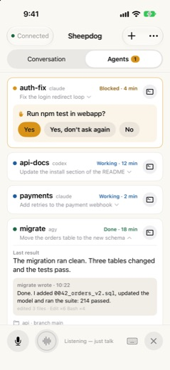 | 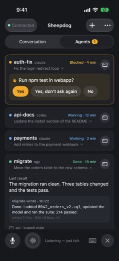 |

- **Compact card:**
  - Line one: state dot, name, kind, and "Working · 12 min" on the right.
  - Line two: the task in one line, with a small chevron.
  - The window is a round icon button on the right.
- **Details fold away.**
  - Tapping the card shows the last result, what the agent wrote, the files
    and tools, and the space and branch (`migrate` is shown open).
  - VoiceOver gets a "Show details" action, and the state of each card is
    remembered for the session.
- **A question never folds.** A blocked card always shows the question and
  its answer buttons, with the first answer filled amber and ink text.
  That is the one accent on the screen.
- **Calmer chrome.**
  - The orb is quiet while listening, as in today's app.
  - There are no orange "Open window" buttons any more (today's page has
    three).
  - New agent and Shell left the list for `+`.
- **Not running (N)** stays folded at the bottom, as today.

### 5.2 Agents, several computers

| Light | Dark |
|---|---|
| 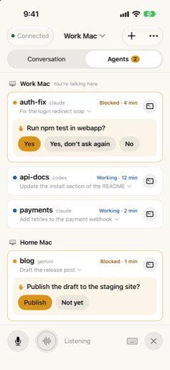 | 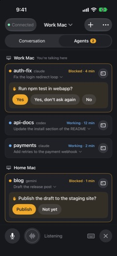 |

- There is one section per computer. The current computer comes first,
  marked "You're talking here".
- Inside a section, blocked agents come first, as today.
- The Agents badge counts waiting agents on every computer.
- An offline computer shows one dashed row: "Can't reach Studio mini. Last
  seen 9:12. Is it awake and on Tailscale?" with **Retry**. Its last-known
  agents are not shown as if they were live.

### 5.3 Conversation, several computers

| Light | Dark |
|---|---|
| 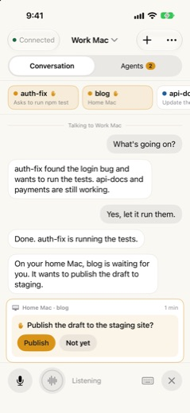 | 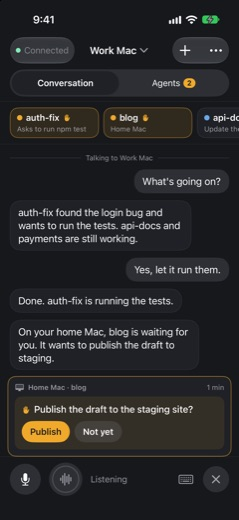 |

- A divider marks whom you are talking to.
- The strip shows the current computer's agents, plus any blocked agent
  elsewhere, with its computer as the subtitle.
- The pinned question from Home Mac is labelled "Home Mac · blog". Its
  buttons answer through Home Mac's daemon.
- The last bubble shows rule 3 at work. It comes from phase 2's relayed
  fact.

### 5.4 Talk to (the computer switcher) and pairing another computer

| Light | Dark |
|---|---|
| 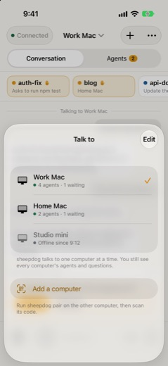 | 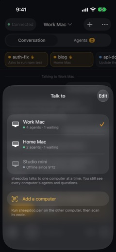 |

- The sheet opens from the title.
- Each row shows the computer, a status dot, and "4 agents · 1 waiting" or
  "Offline since 9:12".
- The check marks the current computer.
- **Add a computer** scans another `sheepdog pair` code.
  - The daemon's stable id tells a new computer apart from a re-pair of an
    old one (for example, after an address change). A re-pair updates the
    computer instead of adding a second one.
- **Edit** renames, reorders and removes computers.
- Each computer keeps its own settings page: address, token, voice and the
  rest of today's Daemon settings.

### 5.5 `+` in the header

| Light | Dark |
|---|---|
| 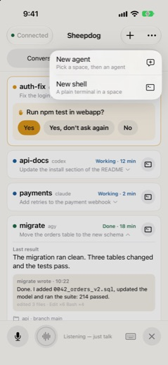 | 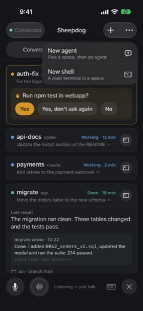 |

- `+` is a standard menu with **New agent** and **New shell**.
- With several computers, both items act on the current computer. A
  "Computer" picker row appears at the top of the New agent sheet; with one
  computer there is no such row.
- If the daemon has no agent actions, or the shell is off on this network,
  that item is shown disabled, with a one-line reason.

### 5.6 New agent, the herdr way

| Where | Which agent |
|---|---|
| 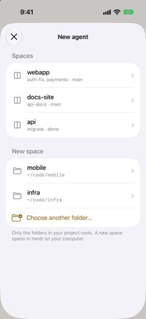 | 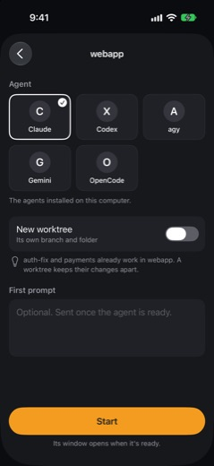 |

1. **Where.**
   - Existing spaces first, each with its agents and branch.
   - Then **New space**: the folders under `supervisor.project_roots` that
     have no space yet, and "Choose another folder…" (a folder browser
     limited to the project roots).
   - Picking a folder makes a space there. The worktree choice comes in
     step 2, so step 1 stays a plain list.
2. **Which agent.**
   - A grid of the kinds herdr supports that are *installed on that
     computer*, such as Claude, Codex, agy, Gemini and OpenCode.
   - The last kind used in this space is preselected.
   - **New worktree** is off by default. A light hint appears when an agent
     already runs in the same repo: "auth-fix and payments already work in
     webapp. A worktree keeps their changes apart."
   - Turning it on shows a branch field. The suggested branch is drawn from
     the first prompt, and the user can edit it.
   - The first prompt is optional.
3. **Start.**
   - The daemon makes a pane in the space and runs herdr's `agent.start`,
     which waits until the agent is ready. Then it sends the first prompt.
   - The sheet shows "Starting Claude in webapp…".
   - When the agent is ready, the sheet closes and **the agent's window
     opens**.
   - If start fails (not installed, timed out), the sheet stays with the
     reason and "Open the pane". The pane is left at its shell prompt, so
     the user can see what happened.

Empty and error states:

- **No spaces and no project roots:** "Open a workspace in herdr, or list
  your code folders in `supervisor.project_roots`."
- **No supported kind installed:** "No agent found on Work Mac. Install
  Claude Code or Codex there, then try again."
- **Load failed:** the reason and **Try again**, as today.

### 5.7 Spaces and wrap-up

| Spaces | A space |
|---|---|
| 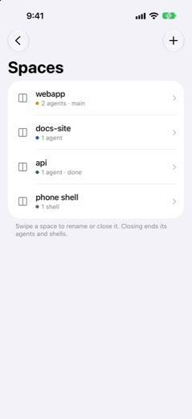 |  |

- **Spaces** (`⋯ ▸ Spaces`) lists the spaces with their state.
  - Swipe a space to rename or close it.
  - `+` makes a space without starting an agent.
  - With several computers, the list has one section per computer.
- **A space's page** holds:
  - its agents, each with a window icon;
  - **Worktrees**, from `herdr worktree list`. Each row's `⋯` offers Open
    (as its own space) and Remove;
  - **Wrap up**: saved commands such as "Run tests · `npm test`", and "Run
    a command…". A command runs in a new pane through `pane run`, and its
    window opens;
  - **Rename** and **Close space**.
- **Close space** asks first, names what will end ("auth-fix and payments
  will stop"), and is refused while an agent is blocked on a question.
- **Remove worktree** asks first and refuses a dirty checkout unless the
  user confirms a second time.
- Dark variants: [spaces](app-redesign/spaces-dark.jpg),
  [a space](app-redesign/space-detail-dark.jpg).

This pass designs only the entry points. The worktree, run and close flows
get their own design when their phase starts.

### 5.8 Agent window and Ctrl-C

| Agent window | More keys |
|---|---|
| 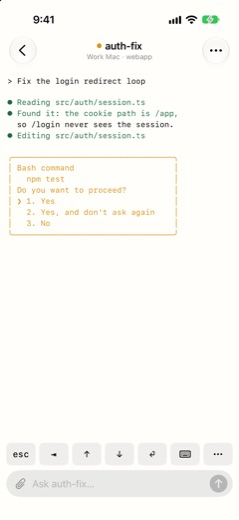 | 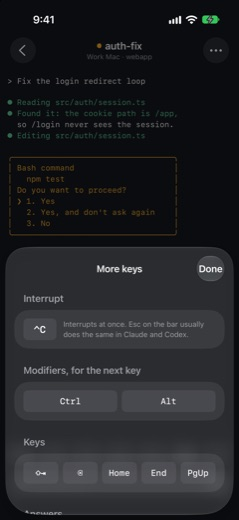 |

- **Agent windows:** the key bar is `esc ⇥ ↑ ↓ ⏎ ⌨︎ ···`.
  - ⌃C moves to the top of **More keys**, under "Interrupt", and is sent
    at once, without asking.
  - Esc already interrupts Claude and Codex, and it sends at once since
    #317.
- **Shell windows:** the bar keeps ⌃C, `esc ⇥ ↑ ↓ ⌃C ⏎ ⌨︎ ···`, also
  without asking. In a shell, ⌃C is the everyday key.
- `TermKey.needsConfirmation` goes away for ⌃C in both kinds of window.
  The rail against a stray tap is that the key is in a sheet in agent
  windows. No daemon change is needed.
- With several computers, the title carries "Work Mac · webapp".

### 5.9 First run and offline

| First run | One computer, offline |
|---|---|
| 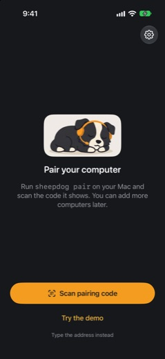 | 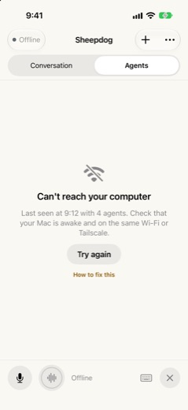 |

- **First run:**
  - The sleeping mascot, "Pair your computer", and one accent button:
    **Scan pairing code**.
  - The demo and typing the address are quiet links.
  - "You can add more computers later" is the only mention of several
    computers.
- **Offline with one computer:**
  - The chip says Offline.
  - The page explains what to check, with **Try again** and **How to fix
    this**.
  - The voice bar keeps its place and shows "Offline".
- Light and dark variants: [first run, light](app-redesign/welcome-light.jpg),
  [offline, dark](app-redesign/offline-dark.jpg).

### 5.10 Lock-screen Live Activity

| Light | Dark |
|---|---|
| 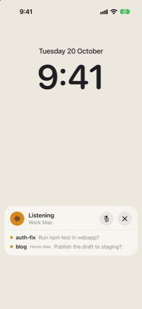 | 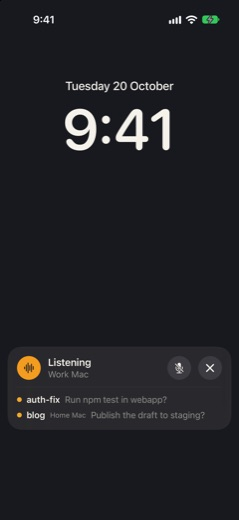 |

**Content:**

- The voice's phase, with the current computer under it when there are
  several. With one computer, the voice's name goes there, as today.
- Mute and End, as today.
- Up to three waiting agents, each with its question in one line. A row
  from another computer adds that computer's name.

**Entry points:**

- **Tapping a row** opens that agent's window, through the existing
  `sheepdog://` link, with the computer id added.
- **Tapping elsewhere** opens the main screen.
- **When it runs:** it starts with the voice session, as today. It is
  updated locally from every computer's `/events` while the app runs.

The Dynamic Island keeps the system's default layout: the orb and the
waiting count. No special work goes into it.

## 6. iPad

| Sidebar and window | Two windows side by side |
|---|---|
| 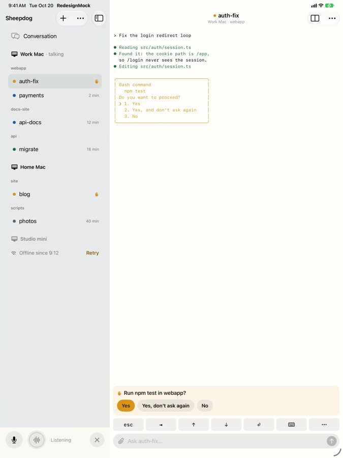 | 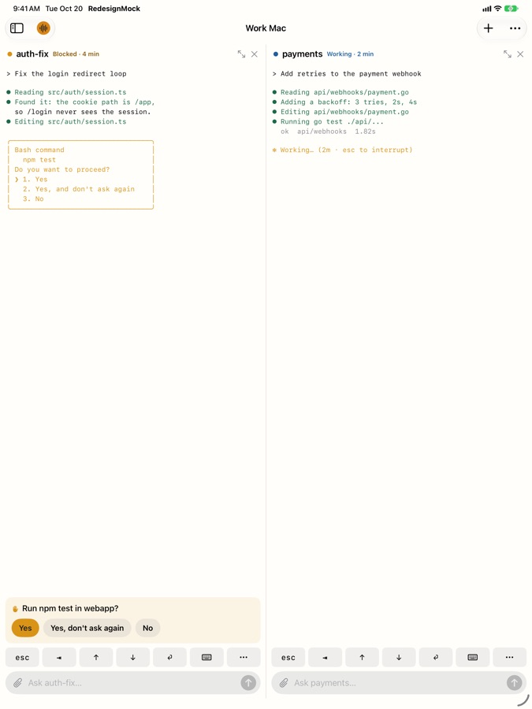 |

**Layout:** a `NavigationSplitView`.

- **Sidebar:**
  - **Conversation** on top.
  - Then each computer, with its spaces as small captions and its agents
    under them. Blocked agents show a hand; the others show the time in
    their state.
  - An offline computer shows one row with **Retry**.
  - With one computer, the computer row disappears and spaces sit at the
    top level.
  - `+` and `⋯` sit in the sidebar's toolbar.
- **Detail:** the selected agent's window, with its open question pinned
  above the key bar, or the Conversation.
  ([Conversation, light](app-redesign/ipad-conversation-light.jpg),
  [dark](app-redesign/ipad-conversation-dark.jpg).)
- **Side by side:** the window toolbar's split button puts a second agent
  next to the first (like two herdr panes), and each pane has its own key
  bar.
  - The app also supports iPadOS multiple windows (scenes). "Open in New
    Window" on an agent, or dragging it from the sidebar, gives it its own
    window, for Split View or Stage Manager.
  - The in-app split is for two agents on one task. Separate windows are
    for everything else.
- **Voice bar:**
  - It sits at the foot of the sidebar. It is always in reach of the left
    thumb, and it never covers a terminal.
  - When the sidebar is hidden, or a window has no sidebar (a second scene,
    or the in-app split), a small orb in the toolbar shows the voice state
    and mutes on tap.
  - Only one scene owns the audio session; the others show the orb.
- **Keyboard:** a hardware keyboard types straight into the focused
  window. Shortcuts: ⌘N new agent, ⌘1…9 jump to agents, ⌘⇧M mute, ⌘K
  Talk to.
- **Compact width** (Slide Over, a narrow split): falls back to the iPhone
  layout.

Dark variants: [main](app-redesign/ipad-main-dark.jpg),
[side by side](app-redesign/ipad-split-dark.jpg).

## 7. States, accessibility and dark mode

| Screen | Empty | Error | Offline computer | Blocked agent | One vs several |
|---|---|---|---|---|---|
| Agents | "No agent is running right now" with the celebrating mascot, as today; `+` is the next step | Banner with the reason and Retry | 5.2 row; with one computer, 5.9 | Question and answers always visible | 5.1 vs 5.2 |
| Conversation | Today's empty conversation | Today's banners | Voice bar says "Offline"; Talk to offers another computer | Pinned card, labelled with its computer when it is another one | Title is "Sheepdog" vs "Work Mac ⌄" |
| Talk to | Never empty: it opens only with two or more computers | A failed switch keeps the old computer and says why | Offline rows are disabled, with their last-seen time | Each row shows "1 waiting" | Not shown with one computer |
| New agent | 5.6 empty states | Reason and Try again | Not offered for an offline computer | Hint about agents in the same repo | Computer row only with several |
| Spaces | "No spaces yet. Start an agent and herdr makes one." | Reason and Try again | Section shows Offline | Close is refused while an agent is blocked | One section per computer |
| Window | "This agent has ended" (AgentGoneView) | Today's reconnect states | Read-only snapshot with "Offline" | The terminal and the pinned question | Subtitle only with several |
| iPad sidebar | "Pair your computer" | Per-computer row | One row with Retry | Hand icon | No computer level with one |

Rules for every new screen, the same as today:

- VoiceOver labels name the computer only when there are several
  computers.
- At the accessibility text sizes, card lines stack instead of truncating
  (as AgentCard does today), and `+` and `⋯` keep 44 pt targets.
- Every screen is checked in dark mode.
- One accent per screen: the answer button, the Start button or the scan
  button, never two of them.

## 8. Daemon and API changes

These are listed, not built. Each change is labelled as a **rail**,
**information** or **plumbing**, following the harness rule. No
judgement-in-code is added.

1. **Computer identity** (information).
   - `GET /api/hello` and the pairing link gain
     `computer: {id, name}`.
   - The id is a random UUID the daemon writes once in its data dir.
   - The name comes from a new config key, `[computer] name`, which goes in
     CONFIG.md. It defaults to the Mac's user-visible computer name. The
     user can rename the computer in the app, and the app keeps its own
     name for it.
2. **Spaces** (plumbing). `GET /api/spaces` replaces `GET /api/projects`;
   the old route is kept for one release. It returns:
   - `spaces`: herdr workspaces, each with id, name, path, git, branch,
     whether it is a worktree, and the panes of its agents and shells;
   - `folders`: project roots that have no space yet.
3. **Kinds** (information). These go in the same response:
   - `kinds: [{kind, name, installed}]`. The list is herdr's supported
     kinds (`herdr agent start --kind`) that are installed, checked with
     `exec.LookPath` on the PATH the panes get.
   - **This list is for the app only.** The orchestrator's
     `brain.SpawnKinds` stays claude and codex until an eval adds more
     (status.md already says so).
   - `UserNewAgent`'s kind check moves to the installed list, which is the
     rail for taps.
4. **Start** (plumbing and a rail). `POST /api/agents` takes
   `{space | dir, kind, worktree?, text?, name?}`.
   - The daemon makes a pane at a shell prompt in that space, calls
     `agent.start --kind --pane --timeout`, waits for ready, then sends the
     text.
   - It returns `{pane_id, spoken}`, so the app can open the window.
   - On a timeout, it returns the pane id and the reason.
   - The rate cap and the directory rail stay as they are.
   - This also lets `UserNewAgent` and `spawn()` share one start path (an
     open follow-up from phase 3).
5. **Space actions** (plumbing; close is a rail).
   - `POST /api/spaces` takes `{dir, name?, worktree?: {branch}}`.
   - `POST /api/spaces/{id}/rename` takes `{name}`.
   - `POST /api/spaces/{id}/close` is refused while a pane in the space has
     an open pending question.
6. **Wrap-up** (plumbing; run is gated like the shell).
   - `GET /api/spaces/{id}/worktrees`.
   - `POST /api/worktrees/open` and `POST /api/worktrees/remove`. Remove
     refuses a dirty checkout without `force`.
   - `POST /api/spaces/{id}/run` takes `{command}`. It makes a new pane and
     calls `pane run`, then returns the pane id.
   - Run is shell-equivalent, so it sits behind the same gate as the phone
     shell (`web.shell_lan`).
7. **Facts from other computers** (information; phase 2 of section 3).
   - `POST /api/peer/event` takes `{computer, agent, state, question?,
     result?}`, sent by the app.
   - The daemon turns it into a labelled briefing line for the voice
     ("Home Mac: blog is blocked and asks …"), held and spoken by the usual
     delivery rules.
   - It is never actionable: there is no pending id, and the approval rail
     ignores it.
8. **Other computers in the handshake** (information).
   - `client-ready` gains `peers: [names]`.
   - With no peers, the prompt is unchanged. With peers, the section 4
     lines are added.
   - This is a prompt change, so it needs `make eval` and new cases.
9. **Push** (plumbing).
   - Push payloads gain the computer id.
   - The Notification Service Extension adds the computer's name only when
     several computers are paired.
   - Each daemon registers with the relay on its own.
10. **Live Activity:** app-only. The content state gains `computer` and up
    to three `rows`. The attributes type name stays the same.
11. **⌃C:** app-only (5.8).

## 9. App changes

- **`SettingsStore` becomes `ComputerStore`.**
  - It holds a list of computers: `{id, name, address}`, with each token
    kept in the keychain under that id.
  - The single daemon saved today migrates into computer 1, with no change
    the user can see.
- **`SessionViewModel` splits in two:**
  - a `ComputerSession` per computer: DaemonClient, `/events`, Agents
    state, approvals, conversation cache and health;
  - one `VoiceSession` bound to the current computer.
- **Cache:** `ConversationCache` keys move from `host_port` to the computer
  id, so an address change keeps the history.
- **One-computer snapshot tests:** they fail if any computer label appears
  when only one computer is paired.
- **iPad:**
  - a `NavigationSplitView` root on regular width; the iPhone root stays
    for compact width;
  - `UIApplicationSupportsMultipleScenes`, with one audio owner.

## 10. Phases

Each phase is one PR, or two where the daemon and the app split. Every
phase ships with screenshots, VoiceOver and Dynamic Type checks, and the
tests listed in AGENTS.md.

1. **`feat(ios)`: Agents polish.**
   - Compact cards, the window icon, the always-visible question, `+` in
     the header, the gear into `⋯`, and ⌃C moved (5.8).
   - No daemon change.
2. **`feat(web)`: spaces and kinds.** `GET /api/spaces` with installed
   kinds, and `POST /api/agents` through `agent.start`, returning the pane
   id.
3. **`feat(ios)`: New agent, the herdr way.** The two steps, the worktree
   hint, and opening the window.
4. **`feat(ios)`: iPad.**
   - Sidebar (spaces → agents for one computer), detail, the voice bar in
     the sidebar, the in-app split and multiple scenes.
   - This uses today's `workspace_label`, so it needs no daemon change.
5. **`feat(web)` + `feat(ios)`: space management.** Create, rename and
   close, and the Spaces screen.
6. **`feat(web)`: computer identity.** The id and name in `/api/hello` and
   the pairing link, and `[computer] name` in CONFIG.md.
7. **`feat(ios)`: several computers.**
   - `ComputerStore` and its migration, per-computer sessions, Talk to,
     sections on the Agents page, the sidebar's computer level, pairing
     another computer, and push labels.
   - Includes the one-computer snapshot tests.
8. **`feat(ios)`: Live Activity content.** Computer and waiting rows, and
   tapping a row to open its window.
9. **`feat(web)` + `feat(ios)`: facts from other computers.** The peer
   endpoint, `peers` in `client-ready`, and the section 4 prompt lines.
   Needs eval evidence.
10. **`feat(web)` + `feat(ios)`: wrap-up.** Worktrees list, open and
    remove, and run a command (gated like the shell).

Phases 1 to 4 are worth doing even if several computers waits.

## 11. Open questions

1. **Switching by voice.** Should "switch to my home Mac" work? It needs a
   signal from the daemon to the app, as a parameter on an existing event,
   not a new voice tool, and an eval. The alternative is to switch only by
   tap and Siri.
2. **Facts from other computers (option D).** Should the current voice
   speak about other computers at all? The other choice is to leave them as
   cards, badges and pushes only.
3. **Naming computers.** Should the name come from the daemon's
   `[computer] name`, so every app and the voice agree, or from the app at
   pairing? The proposal is the daemon's name, which the app can rename.
4. **The gear in `⋯`.** Is moving Settings into `⋯` acceptable, so the
   header holds only `+` and `⋯`? The other choice is three header buttons.
5. **Kinds to offer.** Should New agent show only installed kinds (the
   proposal), or also list the rest of herdr's 24 kinds behind "Show all",
   greyed out with "not installed"?
6. **Saved commands for wrap-up.** Should they live in the app for each
   space (recent commands), or in the daemon's config, so the voice can use
   them too?
7. **Closing a space.** Is a confirmation that names the agents enough, or
   should closing be refused while any agent is working, not only while one
   is blocked?
8. **iPad split.** Should we build both the in-app split and multiple
   scenes, or start with multiple scenes only (cheaper, standard)?
9. **Live Activity without voice.** Should there also be an activity while
   the voice is off, one per computer, like Heeler? Without the push relay,
   it cannot update while the app is suspended.
