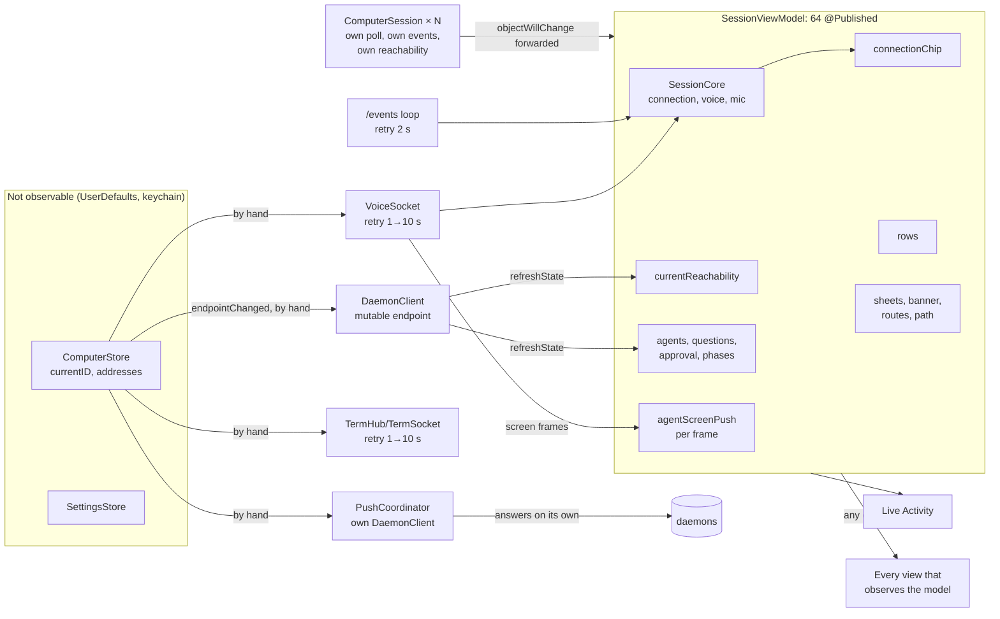
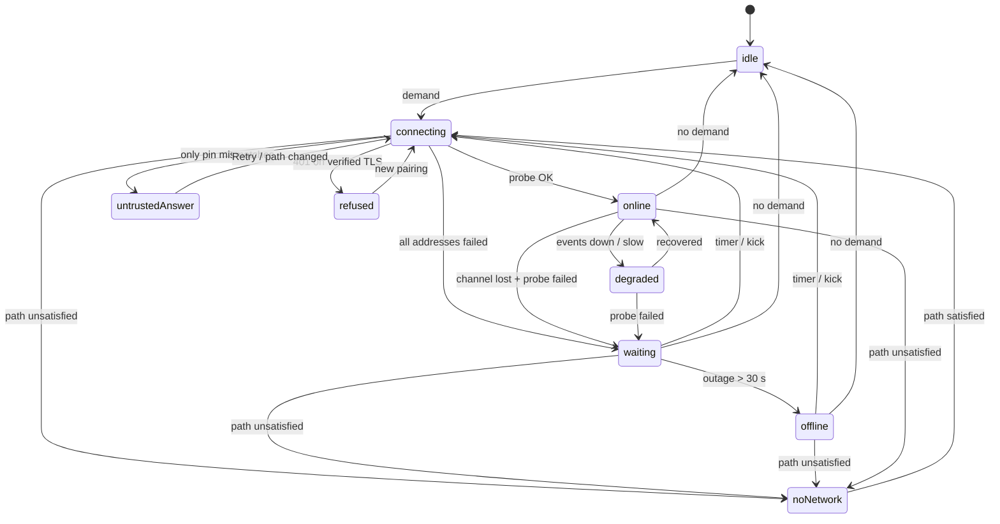
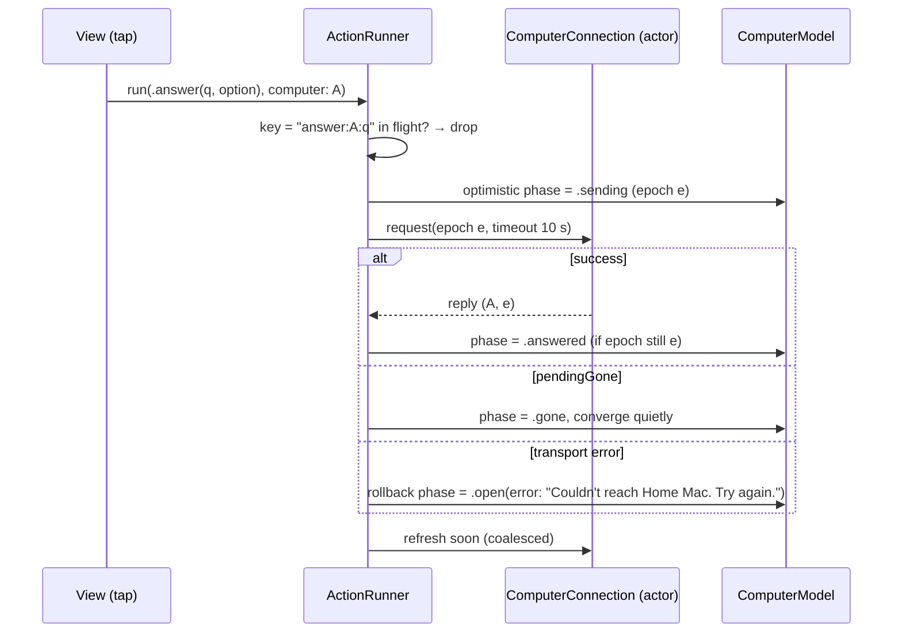

# iOS app: state and runtime architecture

*Accepted 2026-10-23; built phase by phase (section 6).
Code references are `file:line` at commit `d425f46a` (TestFlight 0.1.17);
the fix for the three 0.1.17 bugs will move some lines.*

The app grew fast: several computers, iPad with several windows, the
terminal, the Live Activity, push, TLS pinning, certificate rotation and
address switching. Each feature was added to the same `SessionViewModel`,
so today one 2,560-line `ObservableObject` with 64 `@Published`
properties holds most of the app's state. Many facts are stored in more
than one place, and different code paths keep the copies up to date.
TestFlight 0.1.17 showed three symptoms of this:

- (a) the Add a computer sheet opened and closed in a loop;
- (b) the status page stayed on "Reconnecting…" while the voice worked;
- (c) the terminal's ⋯ menu text flickered while the screen streamed.

A separate PR fixes those three with small changes. This document is
about the structure, so that this class of bug stops: what the state is
today, the principles, the proposed architecture (including a
per-computer connection state machine that handles bad networks), how to
test it, and a migration in small PRs.

How the app works today is in
[ios/docs/dev/architecture.md](../../../ios/docs/dev/architecture.md);
this document does not restate it. Several computers follow
[app-redesign.md](app-redesign.md) (option A), and pairing, pins and
rotation follow [security.md](security.md).

## Summary

**What is wrong.** The app has no single owner per fact. "Is the
computer reachable" lives in at least six places:

- `SessionCore.connection`;
- the published `connectionChip`;
- `currentReachability`;
- each `ComputerSession.reachability`;
- `TermSocket.State`;
- the trust delegate's sticky `sawMismatch`.

Different paths write each of these. One `ObservableObject` re-renders
every view on any change, including a change on another computer every
5 s and every terminal frame. Sheets are built inside binding getters with
fresh `UUID`s. Requests are not tied to the computer they were made for,
so a reply can land after a switch. The app has 4–5 uncoordinated retry
loops per computer, no network-path monitoring and no address failover.

**What to build.** The app should be organised by computer and driven by
state machines:

- `ComputerRuntime`, one per paired computer, current or not. It owns that
  computer's transport, a pure `Link` state machine (connecting, online,
  degraded, waiting, offline, no network, refused, untrusted answer),
  address failover, an epoch, and that computer's agents, questions and
  conversation.
- An `AppModel` that holds only the list of computers and which one is
  current. Switching computers means changing one id.
- A `VoiceEngine` that attaches to the current computer's runtime. It
  keeps the existing `SessionCore` reducer.
- A `PresentationCoordinator` with stable identities and a queue instead
  of `sleep`s.
- Thin feature models on Swift Observation (`@Observable`). Terminal
  frames and audio levels are kept out of the observation graph.
- One action pipeline for taps: dedup keys, epochs, timeouts and inline
  errors.

**How to get there.** The migration is ten small PRs, highest value first:

1. stable presentation identities;
2. stop the re-render fan-out and isolate the streams;
3. the `Link` machine as the one connection truth;
4. per-computer runtimes;
5. network path, foreground and background rules;
6. address failover;
7. the action pipeline;
8. Observation and the split of `SessionViewModel`;
9. the fault-injecting stub and a nightly chaos lane;
10. removing what is left.

There is no rewrite and no compatibility code.

## Contents

1. [Current state](#1-current-state)
2. [Principles](#2-principles)
3. [Proposed architecture](#3-proposed-architecture)
4. [Real-world conditions](#4-real-world-conditions)
5. [Testing strategy](#5-testing-strategy)
6. [Migration plan](#6-migration-plan)
7. [Decisions](#7-decisions)

## 1. Current state

### 1.1 What is already good

The app is not in bad shape everywhere. Several pieces already follow the
principles below, and the proposal builds on them:

- **`SessionCore`** (Kit) is a pure reducer for the voice session. It
  takes `apply(_ event:, now:) -> [SessionEffect]`, its clock is injected,
  and `SessionCoreTests` pins its behaviour as event sequences. The orb
  (`SessionState.resolve`) and the chip (`ConnectionChip(_:)`) are pure
  functions of it. The connection machine proposed here copies this
  pattern.
- **`ApprovalFlow`**, `ConversationReducer`, `ConversationTimeline`,
  `Flock`, `QuestionOrder` and `AgentWindowState` are value types with
  tests.
- **`VoiceMeter`** already takes the 10–25 Hz audio levels out of the big
  model (`VoiceMeter.swift:4-12`).
- **`SocketLife`** unified three socket enums into one.
- **Answers are idempotent by question id.** The daemon's `pendingGone`
  makes a tap on a card, a notification's Approve and a Live Activity
  answer converge: the second one is told the question is gone.
- **The conversation cache** is keyed by computer id, not by address
  (`ConversationCache.swift:74-79`).

### 1.2 Inventory

Each row is one fact. "Copies" are places that store the same fact
again, rather than computing it.

| Fact | Stored in | Written by | Read by | Copies and problems |
|---|---|---|---|---|
| **Is the current computer reachable** | `SessionCore.connection` (`socket`, `events`, `failed`, `dropped`, `tokenRefused`, `handshake`; `SessionCore.swift:25-55`) | `send(_:)` from the `VoiceSocket` callbacks (`SessionViewModel.swift:765-797`), the `/events` loop (`:1098`, `:1103`, `:1109`, `:1127`) and the probe (`:482-506`) | the core's derived values | the main record, but it is the *voice session's* view: everything resets to idle when the voice is off |
| | `connectionChip` (`:99`), `handshake` (`:102`) and `wantsConnection` (`:157`), all `@Published` | `publish()` (`:975-987`) | chip (`MainView.swift:413`), Settings status (`SettingsView.swift:214-229`), Health, the Agents empty state (`FlockPaneState`), `sessionIsLive` (`:288`), which keeps pushes quiet in the foreground | copies of the core; "Reconnecting…" when **either** `/ws` **or** `/events` is not open (`ConnectionChip.swift:97-100`) |
| | `currentReachability` (`:238`) and `currentLastSeen` | `refreshState` only (`:1272`, `:1277`); reset in `endpointChanged` (`:438`); a non-`DaemonError` failure changes nothing (`:1283-1289`) | the current computer's row in `computerSnapshots` (`SessionViewModel+Computers.swift:52`): Agents sections, sidebar, Talk to, ⌘K | a second, independent truth for the **same computer**. With several computers the Agents page can say online while Settings says "Reconnecting…" |
| | `TermSocket.State` (`TermSocket.swift:43`, `:82`) and `shellOffered` (`:1647`) | the `/term` socket's own backoff | the agent window, shell entry points | a third socket with its own retry loop (`TermSocket.swift:228-241`) |
| | `PinnedTrustDelegate.mismatched` (`PinnedTrust.swift:100-127`) | every TLS challenge | `DaemonClient.translate` (`DaemonClient.swift:538-548`) | **sticky**: after one mismatch, any later `.cancelled` error (including our own cancellation on a switch) is read as "scan again" |
| **Is another computer reachable** | `ComputerSession.reachability` (`ComputerSession.swift:14`) | its 5 s poll and its `/events` loop (`:35-57`), assigned **unconditionally** (`:83`, `:91`) | snapshots, Talk to, ⌘K, offline rows | a second implementation of state fetch, events and answering. It never pauses in the background, flips to offline on one failure, and has no backoff |
| **Which computer is current** | `ComputerStore.currentID` in `UserDefaults` (`ComputerStore.swift:83-90`) | `pair`, `switchComputer`, `removeComputer` | everything, through `SettingsStore.endpoint` (`SettingsStore.swift:67-70`) | not observable. Its consequences are pushed by hand in `endpointChanged()` (`:423-465`) into `client`, `socket`, `termHub`, `PushCoordinator`, and 15 fields cleared one by one. `objectWillChange.send()` is called by hand (`:2391`, `:2482`, `:2503`) |
| **The address in use** | `computers.address.<id>` in `UserDefaults` (`ComputerStore.swift:98-105`) | pairing, Settings ▸ Addresses (`:2501-2505`) | `endpoint(for:)` | never changes on its own: **no failover**, although pairing already races the code's addresses with the pin check (`:2276-2286`) |
| **The HTTP client** | one mutable `DaemonClient` (`DaemonClient.swift:197-229`) | `update(endpoint:)` on every switch (`:428`, `:474`) | every request | requests in flight when the endpoint changes complete against the new computer's state (see 1.4) |
| **Settings** | `SettingsStore` (`UserDefaults`), `talkMode` mirrored into the core and `@Published talkMode` (`:151`); `daemonSettings` (`:146`), `brainModels` (`:142`) | Settings screens | Settings | acceptable, but they belong to the current computer and are cleared by hand on a switch (`:446-448`) |
| **The voice provider** | `hello.voiceProvider`, `voiceProviders.provider` (`:168`), `liveVoiceProvider` (`:174`), `stateVoiceProvider` (`:177`) | `/api/hello`, the picker, `/ws` status, `/api/state` | `resolvedVoiceProvider` (`:261`), the audio engine's jitter profile | four copies with one resolver. Each `didSet` re-tells the audio engine |
| **Agents** | `agents` (`:59`); `ComputerSession.agents` | `apply(_ state:)` (`:1293-1335`); the other session's poll | Agents, sidebar, strip, Live Activity | two code paths for the same `/api/state` |
| **Questions and approvals** | `pendingAction` (`:67`), `questions` (`:71`), `approvalFlow` → `approval` (`:54`, `:312`), `questionPhases` (`:73`), `ComputerSession.phases`, `cuedPendingIDs` | state refresh, `pending.*` events (`:1178-1202`), taps (`:1899-2002`), the push action handler (`PushNotifications.swift:321-346`), which has its own `DaemonClient` | floating questions, cards, Live Activity | three tap paths: voice, current, other computer. The push path does not share the app's in-flight state |
| **Conversation** | `history`, `reducer`, `activity`, `cardInbox` → `rows` (`:52`); `lastSeq`; the disk cache | events, history sync, cards, notices | Conversation | sound (pure reducers), but one instance for "the current computer", reloaded on every switch |
| **Voice and audio** | `SessionCore.mic`/`voice`/`playback`/`suspension`; mirrors `isMuted`, `talkMode`, `holding`, `noMicSignal`, `state` (`:47`, `:150-157`); `VoiceMeter` | `send(_:)` → `publish()` | voice bar, orb, Live Activity | sound pattern (a reducer plus derived values), but the mirrors are copies |
| **Terminal** | one app-wide `TermHub` (`:1637`); per window `AgentWindowController` (`AgentScreenView.swift:639-662`); `agentScreenPush` on the big model (`:107`, bumped per frame at `:851`) | `/term`, `/ws` `screen` messages | agent windows | **per-frame `@Published` on the app-wide model.** `rememberedFeatures` is written inside the `termAvailability` getter (`:1698`) during view bodies |
| **Presentation** | `showSettings`, `settingsRoute`, `pairingSheet`, `daemonNotice`, `daemonNoticeProblem`, `presentedCard`, `showsNewAgent`, `showsSpaces`, `primer`, `banner`, `windowRequest`, `navigationPath`, `pane` on the model; `SceneUI` per window; `SceneCoordinator` | many places | the scenes' sheets | identities made with `UUID()` (`:27`, `:2519`); sheets built in a getter (`SettingsView.swift:142`); ordering by `sleep` (`:1044`, `:1857`, `:2117`, `:2127`, `SpacesView.swift:141`, `NewAgentSheet.swift:50`) |
| **Push and Live Activity** | `PushCoordinator.shared` (`@Published` authorization, token, registrations); App Group defaults (`PushContentKeyStore.swift:123-132`); `VoiceLiveActivity.content` | the app; the daemon (APNs, Live Activity push token) | Settings ▸ Notifications, the extension, the widget | two writers of the Live Activity (the app and the daemon's push) without ordering. A notification tap focuses a pane id with **no computer id** (`PushNotifications.swift:326-328`, `:367-377`) |

### 1.3 The picture today



### 1.4 The three 0.1.17 bugs, traced

The fix agent owns the fixes; this section traces each bug to its class.

- **(a) Add a computer opening and closing.**
  `SettingsView.swift:142` builds the sheet's item in a binding getter:
  `addingComputer.map { PairingSheet(stage: $0) }`. `PairingSheet` has
  `let id = UUID()` (`SessionViewModel.swift:2518-2519`), so every
  evaluation of the body hands SwiftUI a *different* item, and SwiftUI
  dismisses the old sheet and presents a new one. Re-renders are frequent
  because each `ComputerSession`'s `objectWillChange` is forwarded into
  the big model (`SessionViewModel+Computers.swift:27`), and the session
  assigns `reachability` and `phases` on every 5 s poll whether or not
  they changed (`ComputerSession.swift:83`, `:89`). `refreshState` does
  the same for `pendingAction`, `brain`, `stateVoiceProvider` and
  `questionPhases` (`:1310`, `:1330-1333`). `Banner` has the same
  fresh-`UUID` identity (`:27`).
  *Classes:* unstable presentation identity; observation fan-out.
- **(b) "Reconnecting…" while the voice works.** Settings reads
  `connectionChip.word` (`SettingsView.swift:214-219`). The chip says
  "Reconnecting…" whenever `/events` is connecting or reconnecting, even
  with `/ws` open (`ConnectionChip.swift:97-100`). The `/events` loop
  sets `.connecting` at the top of every iteration (`:1098`) and `.open`
  only on `onOpen` or the first event (`:1100-1110`). Meanwhile the
  Agents page reads `currentReachability`, which only `refreshState`
  writes. So one computer has two statuses with different writers, and
  neither describes "can I talk to this computer".
  *Class:* more than one source of truth, and a derived status built from
  the wrong inputs.
- **(c) The ⋯ menu flickering.** `agentScreenPush` is a `@Published`
  property of the app-wide model, bumped on every `/ws` screen frame
  (`:851`). Every view that observes the model re-renders per frame. Inside
  the window, `AgentWindowController.screenText` is republished on every
  content change (`AgentScreenView.swift:832-835`), and the header and its
  `Menu` (`:225-232`) are built from the same object.
  *Class:* a high-frequency stream inside the observation graph.

### 1.5 Bug classes still latent

These have not been reported yet, but they exist in the code today.

1. **A reply for the wrong computer.**
   - `refreshState` awaits `client.state()` and then calls `apply`
     (`:1267-1275`) with no check that the current computer is still the
     one it asked. A switch during the request writes computer A's agents
     onto computer B.
   - The answer tasks read `self.client` when the spawned `Task` runs,
     not at tap time (`:1905`, `:1988`). Question ids are unique only within one daemon,
     so a tap made just before a switch can be sent to the wrong computer.
2. **Overlapping probes.** The `.probe` effect starts an untracked `Task`
   (`:883`). A fast A → B → A switch runs two `openSession`s; whichever
   returns last wins. The core ignores a late result only when
   `wantsConnection` is false, not when it belongs to an older attempt.
3. **Side effects in getters.** `termAvailability` writes
   `rememberedFeatures` (`:1695-1700`) and is read from view bodies.
4. **Ordering by sleep.**
   - `open(url:)` waits 700 ms for Settings to close (`:1041-1046`).
   - `openAgentWindow` waits 400 ms (`:1856-1859`).
   - The demo waits 700 ms (`:2117`, `:2127`).
   - `SpacesView` and `NewAgentSheet` have their own waits.
   On a slow device, or with Reduce Motion, the next sheet is dropped or
   flashes.
5. **Uncoordinated retries.** For one computer the app runs the
   `VoiceSocket` backoff (1 → 10 s, no jitter; `VoiceSocket.swift:277-286`),
   the `/events` loop (fixed 2 s; `:1129`), the 5 s state poll (`:1231`)
   and the `/term` backoff. For each other computer it runs a 5 s poll and
   a 3 s events retry. There is no `NWPathMonitor`, so after a network
   loss everything keeps retrying blind, and on return nothing retries
   until its timer fires (up to 10 s). Coming back to the foreground does
   not kick the backoff.
6. **No failover across a computer's addresses.** A phone that walks from
   home Wi-Fi (LAN address) to cellular (Tailscale address) stays on the
   LAN address until the user picks another one in Settings ▸ Addresses.
7. **A pin mismatch is always terminal.** A mismatch becomes
   `.pairing(.pinMismatch)` (`DaemonClient.swift:542-546`). That stops the
   session as a refused token would (`:1115-1119`, `:813-815`) and opens
   "scan again". The warning is right to give. But a middlebox on one
   network (a hotel or captive-portal TLS proxy) is treated the same as a
   computer whose key changed, and the flag is sticky across requests
   (see 1.2).
8. **Background leaks.** `ComputerSession` keeps polling and retrying its
   stream in the background, until iOS suspends the app. On return, every
   loop wakes into failed connections at once.
9. **Push focus without a computer.** A notification tap calls
   `focus(paneID:)` with no computer id, so another computer's pane id is
   looked for on the current one (`PushNotifications.swift:326-328`).
10. **Answers that are not coordinated.** The push action handler answers
    with its own `DaemonClient` (`PushNotifications.swift:331-341`), so an
    in-app card can still say "open" and accept a second tap. The daemon
    makes this safe (`pendingGone`), but the user sees a needless
    "already answered".
11. **Leftover compatibility code.** `ComputerStore.migrate()`
    (`ComputerStore.swift:185-193`) contradicts the no-backward-
    compatibility decision.

## 2. Principles

Each principle names the bug class it removes.

1. **One owner per fact.** Every fact has exactly one stored home and one
   writer. Everything else derives it. (Kills 1.4 b.)
2. **Derived state is computed, never copied.** No mirrors like
   `connectionChip`, `isMuted` or `currentReachability`; views read a
   computed property of the owner. When a derived value is expensive,
   cache it inside the owner, keyed by its inputs.
3. **Unidirectional flow.** View → intent → reducer (pure) → new state +
   effects → effect runner → events back to the reducer. Views never
   mutate shared state directly (`$model.showSettings` bindings become
   intents).
4. **Explicit state machines** for the four lifecycles that hurt:
   - the connection (`Link`, per computer);
   - the voice session (`SessionCore`, which exists already);
   - pairing;
   - a terminal channel (`AgentWindowState`, which exists already).

   Each is a value type in Kit with `apply(event, now:) -> effects` and
   exhaustive tests.
5. **Side effects live at the edges.** Reducers do no I/O and no
   `Task {}`. Getters never write. Views never start network work except
   through an intent.
6. **High-frequency streams stay out of the observation graph.** Terminal
   frames go straight from the socket to the terminal surface (a UIKit
   view). Audio levels go to one leaf view. Neither passes through an
   observable property that other views read. Anything shown at human
   speed (VoiceOver's screen text, metrics) is throttled to ≤ 2 Hz.
7. **Stable identity.** A presented item's `id` comes from its content (a
   route, a question id, a card id), never `UUID()` at construction. A
   presented value is stored, never built in a binding getter.
8. **Every action is cancellable and idempotent.**
   - Each tap carries a dedup key and the computer id and epoch it was
     made for.
   - A second tap with the same key while the first is in flight is a
     no-op.
   - Results for an older epoch are dropped.
   - Each action class has a timeout.
   - Optimistic UI rolls back on failure.
9. **Networking per computer, structured.** All of one computer's tasks
   are children of its runtime's scope. Switching computers, removing one
   or going to the background cancels the scope; nothing is fire-and-
   forget.
10. **Observation, not `ObservableObject`.** The target is iOS 26, so use
    Swift Observation (`@Observable`) with per-property tracking.
    Evaluation:
    - **What it fixes:**
      - A view re-renders only for the properties its body read, so a
        change to `banner` no longer re-renders the Conversation.
      - Nested models are tracked without forwarding `objectWillChange`
        (`SessionViewModel+Computers.swift:27` disappears).
      - It works in Swift 5 language mode, so moving to Swift 6 is not a
        prerequisite.
    - **What it does not fix:**
      - Whether setting an equal value notifies depends on the toolchain's
        macro (newer ones skip equal `Equatable` values). Keep the
        "assign only on change" helper anyway, so the behaviour does not
        depend on it.
      - A computed property that reads ten stored ones (for example
        `floatingQuestions`) depends on all ten.
      - Array properties invalidate every reader of the array.
      - It does nothing for identity: a getter that makes a new `UUID()`
        still loops.
    - **Outside views:** observe with `withObservationTracking`, or the
      `Observations` async sequence (SE-0475, Swift 6.2, in the iOS 26
      SDK), for the Live Activity projection.
    - **Coexistence:** `ObservableObject` and `@Observable` can live side
      by side, so the migration can go one feature at a time.

## 3. Proposed architecture

### 3.1 Layers

```mermaid
flowchart TB
  subgraph UI["Views (SwiftUI, per scene)"]
    V1[Conversation] --- V2[Agents / All agents] --- V3[Agent window] --- V4[Settings] --- V5[Voice capsule]
  end
  subgraph Feature["Feature models (@MainActor @Observable, thin)"]
    F1[ConversationModel] --- F2[AgentsModel] --- F3[AgentWindowController] --- F4[SettingsModel] --- F5[VoiceModel]
  end
  subgraph App["App layer (@MainActor @Observable)"]
    AM[AppModel<br/>computers, currentID]
    PRES[PresentationCoordinator<br/>per scene, stable ids]
    ACT[ActionRunner<br/>dedup, epochs, timeouts]
    PROJ[Projections<br/>Live Activity, App Group,<br/>push registration]
  end
  subgraph Runtime["Per computer"]
    CM[ComputerModel<br/>@MainActor @Observable<br/>link, agents, questions, conversation]
    CR[ComputerConnection actor<br/>Link machine, address race,<br/>REST, /events, /term, timers]
  end
  VE[VoiceEngine<br/>SessionCore + AudioEngine + VoiceSocket]
  NET[NetworkMonitor<br/>NWPathMonitor]
  UI --> Feature --> App
  Feature --> CM
  AM --> CM
  CR -->|"snapshots + epoch"| CM
  NET --> CR
  VE -->|"attaches to current"| CR
  ACT --> CR
  AM --> PROJ
```

Each layer has one job:

- **`AppModel`** holds the paired computers (loaded from the keychain and
  defaults once, then kept in memory and written through) and `currentID`.
  It is the only writer of both. It creates one runtime per computer.
  "Several computers" stops being a special case: the current computer is
  a runtime like the others, with the voice attached.
- **`ComputerConnection` (an actor)** owns one computer's I/O:
  - an immutable `DaemonClient` per address, so a new address means a new
    client and a new epoch, and nothing is repointed;
  - the `Link` machine (3.2);
  - the address race;
  - the `/events` stream, the state refresh and the `/term` socket;
  - all timers and retries.

  It emits value snapshots tagged with `(computerID, epoch)`. An actor
  fits because URLSession delegate callbacks and timers touch this state
  off the main thread. SwiftUI cannot read an actor synchronously, so
  views never see it.
- **`ComputerModel` (`@MainActor @Observable`)** is the view-facing copy
  of one computer: the link status, agents, questions with their tap
  phases, the conversation (`ConversationHistory`, the reducer, the
  cache), the hello and its features. It applies a snapshot only if its
  epoch is current. It replaces both `ComputerSession` and the
  current-computer half of `SessionViewModel`.
- **`VoiceEngine`** is `SessionCore`, `AudioEngine`, `VoiceSocket` and
  `VoiceMeter`, taken out of `SessionViewModel` almost unchanged. It
  attaches to the current computer: it borrows the runtime's verified
  address and credentials, opens `/ws` itself (the real-time audio path
  does not cross an actor per frame), and reports the `/ws` health to the
  runtime's `Link`. When `currentID` changes it detaches from the old
  runtime (ending cleanly) and, if the voice was on, attaches to the new
  one.
- **Feature models** are small `@Observable` objects or plain computed
  views over `AppModel` and `ComputerModel`. They hold screen-local state
  (filters, expanded cards) and send intents. `SessionViewModel` shrinks
  to nothing over the phases.
- **`PresentationCoordinator`** owns which sheet, dialog or cover is up in
  each scene, with stable ids and a queue (3.6).
- **`ActionRunner`** turns taps into requests (3.5).
- **Projections** are one-way derived outputs with one writer each: the
  Live Activity content, the App Group blob (content keys and names for
  the extension and widget), and push registration across computers.
  They observe `AppModel` and the current `ComputerModel`; nothing writes
  them from anywhere else.

### 3.2 The connection state machine (`Link`)

`Link` is a pure value type in Kit, one per computer, written in the same
style as `SessionCore` (`apply(_ event:, now:) -> [LinkEffect]`). It
answers one question: **can this app talk to this computer right now,
and if not, why, and what is it doing about it.** The voice session's
state stays in `SessionCore`, and the chip shows the link, not the voice.

**Demand.** A link works only while something needs it:

- the current computer, while the app is in the foreground;
- the current computer, while the voice runs in the background with Keep
  listening on;
- another computer, while the app is in the foreground;
- any computer with an action in flight (with a background task, at most
  30 s).

With no demand the link is `idle` and opens nothing. This rule replaces
the background leak (1.5.8).

**States.**

| State | Meaning | Leaves on |
|---|---|---|
| `idle` | Not needed. | demand |
| `connecting(attempt, address)` | Racing the addresses (3.3); first attempt or kicked. | probe OK → `online`; all failed → `waiting` |
| `online(address, since)` | The last request or keepalive succeeded within the liveness window (15 s). | a channel lost *and* the confirming probe failed → `waiting`; slow → `degraded` |
| `degraded(address, why)` | Reachable, but part of it is not working: `/events` is reconnecting while `/ws` or REST works, or replies take more than 2 s. | recovers → `online`; probe fails → `waiting` |
| `waiting(retryAt, lastError, outageSince)` | Backing off between attempts. | timer, kick (foreground, path change, Retry) → `connecting`; outage over 30 s → `offline` |
| `offline(since, lastError)` | Unreachable past the quiet period. It keeps retrying on the slow schedule. | same as `waiting` |
| `noNetwork` | `NWPath` is unsatisfied. Retries stop. | path satisfied → `connecting` (immediately) |
| `untrustedAnswer(address)` | Something answered over TLS with a key that matches no pin, and no other address verified. See 3.4 and open question 1. | another address verifies → `online`; Retry; a new scan |
| `refused(problem)` | A 401 on a TLS session that matched the pin: revoked, unknown device. Only a scan fixes it. | a new pairing (new credentials, new epoch) |
| `incompatible(message)` | The protocol handshake mismatch. | an update, then a reconnect |

**Events:**

- `demandChanged`;
- `pathChanged(satisfied, interface)`;
- `appPhase(active | background)`;
- `probeSucceeded(address, rtt)`;
- `probeFailed(address, error class)`;
- `channelOpened(kind)` and `channelLost(kind, error class)`, where the
  kind is `ws`, `events` or `term`;
- `requestSucceeded` and `requestFailed(error class)`;
- `timerFired(epoch)`;
- `retryTapped`;
- `credentialsChanged`;
- `addressesChanged`.

**Error classes** are decided per attempt, never from shared sticky
flags:

- transport (unreachable, timeout, reset);
- `tlsUntrusted(sawPin: false)`;
- `http401(reason)`;
- `httpOther`;
- `decode`;
- `cancelled`.

A cancellation the app made itself is never an error.



**Backoff.**

- **Timing.** Full jitter: `delay = random(0, min(cap, base × 2^attempt))`,
  with a base of 0.5 s. The cap is 15 s in the foreground and 60 s for
  another computer while the voice is on the current one. The random
  source is injected, so tests are deterministic.
- **What resets it.** A path change, coming to the foreground and Retry
  all reset the attempt count and kick at once. Today nothing kicks
  (1.5.5).
- **One schedule per computer.** `/ws`, `/events` and `/term` do not each
  back off on their own: a lost channel reports `channelLost`, the link
  probes once, and every channel reopens when the link is `online` again.
  That removes three independent timers and the reconnect storm after a
  network change.
- **Hysteresis.** `online` needs one success, but leaving it needs a lost
  channel *and* a failed confirming probe. `offline` is shown only after
  the existing 30 s quiet period (`ReconnectPolicy`), unless the path is
  unsatisfied, which is certain at once.

**Liveness and health probes.**

- `/ws` keeps its 5 s ping and pong (`VoiceSocket.swift:23-27`).
- `/events` keeps its keepalive timeout (`DaemonClient.swift:202-222`).
- The probe is `GET /api/state` with a 4 s timeout. It proves the pin
  and the ticket, and refreshes the data in the same request.
- The link probes on: entering `connecting`, coming to the foreground, a
  path change, a lost channel and Retry. It never polls on a timer while a
  live channel delivers keepalives. The 5 s `/api/state` poll
  (`:1227-1236`) becomes "refresh on events, plus every 30 s as a safety
  net".

**Network path.** One `NWPathMonitor` for the app feeds every link:

- **Unsatisfied:** every link goes to `noNetwork`, and retries stop.
- **Satisfied after unsatisfied, or the interface changed (Wi-Fi ↔
  cellular):** every link with demand is kicked and re-races its
  addresses. The address that won on the old interface may be wrong on
  the new one.
- **Constrained (Low Data Mode) or expensive:** links to computers other
  than the current one fall back to refreshing on the 30 s timer, with no
  `/events`.

**Foreground and background.**

| Situation | Current computer | Other computers | Voice |
|---|---|---|---|
| Foreground | demand on; `/events` and state | demand on; `/events` and state | as the user left it |
| Background, voice on, Keep listening on | `/ws` only; `/events` and `/term` closed | idle | runs (audio background mode) |
| Background, voice on, Keep listening off | idle (the core already mutes and suspends) | idle | suspended (existing rule) |
| Background, voice off | idle after in-flight actions finish (≤ 30 s background task) | idle | — |
| Returning to the foreground | kick: probe now, reopen channels, sync history | kick | resumes (existing rule) |
| Killed and relaunched | render from the cache (conversation, last snapshot with "as of"), then connect | same | off until tapped |

While the app is away, the daemon keeps the Live Activity and
notifications current. That is already built (Live Activity push token,
APNs).

**What the UI shows.** The chip, the Settings row, the Agents empty state
and the sidebar all render one function, `LinkPresentation(link,
isCurrent)`, so they cannot disagree. With one computer the copy has no
names ([app-redesign.md](app-redesign.md), "The one rule for one computer"); with several, "your computer" becomes its name.

| Link | Chip | Inline copy (where the data would be) | Data on screen |
|---|---|---|---|
| `connecting` (first) | Connecting… (amber) | — | cache, normal |
| `online` | Connected (green); Settings: "Talking here · address" with the voice on | — | live |
| `degraded` | Connected (green) | Health only: "Live updates are reconnecting" | live, refreshed by probe |
| `waiting` (< 30 s) | Reconnecting… (amber) | — | last data, normal (no flicker for a blip) |
| `offline` | Offline (red) | "Can't reach your computer. Last seen 9:12. Is it awake, and is this phone on a network that reaches it?" **Try now** | last data dimmed, "as of 9:12"; answer buttons disabled with "Reconnect to answer" |
| `noNetwork` | No network (grey) | "This phone is offline. Sheepdog reconnects when the network is back." | last data dimmed |
| `untrustedAnswer` | Not verified (red) | "Something on this network answered instead of your computer, so Sheepdog didn't connect." **Try again** · **Use another address** | last data dimmed |
| `refused` | Scan again (red) | the existing pairing problem text (`DeviceAuth.swift:30-48`) and **Scan** | cleared |
| `incompatible` | Update needed (red) | the handshake message | last data |

The copy does not assume Tailscale (app-redesign.md section 1.1). Another computer's row
uses the same states with its name: "Home Mac · Offline since 9:12".

### 3.3 Address failover

A computer has several addresses: the LAN address, the Tailscale address,
a port forward and an `advertise` address. The pin is the check, never the
host (security.md). So any address that answers with the computer's key
is that computer, and the app can try several at once safely.

- **The race.** On `connecting`, the link tries the remembered address
  for the current interface first. After 300 ms, if that has not answered,
  it starts the next one, and so on (staggered, happy-eyeballs style).
  The first pinned `GET /api/state` success wins, and the others are
  cancelled. This reuses pairing's `firstReachable` (`:2276-2286`).
- **The memory.** The winner is remembered per interface type (Wi-Fi,
  cellular, wired), so the phone goes straight to the LAN address at home
  and to the Tailscale address on cellular. A per-network memory (SSID)
  needs a location entitlement and is not worth it.
- **One address per computer at a time.** Every channel uses the link's
  current address. Today `client`, `socket` and `termHub` are each
  repointed separately (`:428-431`).
- **Settings ▸ Addresses** keeps Add and Remove. "Use this address"
  becomes "Prefer this address", which moves it to the front of the race.

### 3.4 Certificates and trust, mid-session

- **Rotation.** The daemon switches keys 7 days before expiry. Open
  connections keep the old key, and new connections get the new one. The
  app learned `next_pin` at sign-in, so `PinnedTrustDelegate` accepts it
  and `served(pin:)` promotes it. This is already designed and has tests
  (`CertRotationTests`). The runtime adds one thing: promoting the pin
  bumps the credentials version, and the `Link` treats a pin promotion as
  a normal event, not an error.
- **Classifying errors per attempt.** Use a per-task delegate
  (`session.data(for:delegate:)`) so that each attempt reports whether
  *its own* challenge matched. This replaces the shared `mismatched` flag
  (1.2).
- **Pin mismatch.**
  - If the mismatch is on one address and another address verifies, the
    link goes `online` on the other address, and the mismatching address
    is marked "answered with another key" in Settings ▸ Addresses.
  - If every address mismatches and the certificate's expiry says it may
    have rotated, the link goes `refused(.renewedWhileAway)`: scan again,
    as today.
  - Otherwise it goes `untrustedAnswer`: the warning is shown, nothing is
    sent, and Retry and other networks stay possible. The app does not
    send the user to rescan the computer because of one hostile network.
  - See open question 1.
- **Revocation** is the only 401 on a verified TLS session, and it is
  final (`refused`).

### 3.5 The action pipeline



- **Capture at tap time.** Every action is
  `Action(kind, computerID, epoch, key)`. The runner routes it to that
  computer's connection, never to "the current client". A result whose
  epoch is no longer the model's is dropped (1.5.1).
- **Dedup keys.** A second action with the same key while the first is in
  flight is ignored. Buttons read `runner.isInFlight(key)` to disable
  themselves; no view keeps its own `sending` flag. The same key is used
  whether the tap came from a card, the floating question, another
  window, the Live Activity or a notification's Approve while the app is
  running, so all of those converge in the app as well as on the daemon.

  | Action | Key | Idempotent on the daemon | Timeout | Retry |
  |---|---|---|---|---|
  | Answer a question | `answer:<computer>:<question>` | yes (`pendingGone`) | 10 s | once, on a transport error |
  | Typed line (`/api/utterance`) | `utter:<computer>` | with its `Idempotency-Key` (decision 3, built in phase 7) | 10 s | once, with the same key, on a daemon that says `idempotency_keys` |
  | New agent (`POST /api/agents`) | `spawn:<computer>:<sheet>` | with its `Idempotency-Key` | 60 s (herdr waits until the agent is ready) | the same; show "Open the pane" on failure |
  | Agent input, keys | `input:<computer>:<pane>` (keys add `:<seq>`) | with its `Idempotency-Key` | 5 s | the same |
  | Rename, settings toggles | `set:<computer>:<field>` | yes (last write wins) | 10 s | coalesce: the newest value replaces a queued one |
  | Refresh, history | `refresh:<computer>` | yes | 4 s | link backoff |
  | Talk to (switch) | `switch` | local | — | the latest tap wins |

- **Errors** show where the tap was: under the question, in the composer,
  in the New agent sheet. The global banner is only for link-level states
  (3.2), and the link presentation already covers most of those.
- **Switching computers while requests are in flight.** Switching changes
  `currentID` and moves the voice; it does **not** cancel the old
  computer's actions. An answer already sent still completes and lands on
  that computer's model, because that computer's runtime keeps running.
  Only the voice and the current-only channels move.
- **Fast or repeated taps during transitions.** Intents are accepted
  whenever the state allows them, and refused (no-op) otherwise. For
  example, Connect while the link is `connecting` is a no-op, and End
  during the microphone primer is already handled by the core
  (`SessionCore.swift:211-214`). There is no time-based debouncing on
  buttons, except text fields that save as you type.

### 3.6 Presentation and identity

- **Stable identities.** `Presentation` is an enum whose `id` comes from
  its content:
  - `pairing(.start)` → `"pairing.start"`;
  - `pairing(.confirm(code))` → `"pairing.confirm.<code id>"`;
  - `card(id)`, `settings(route)`, `newAgent`, `spaces`, `primer(kind)`,
    `newDevice(id)`.

  `Banner`'s id is its message and tone. No `UUID()` at construction.
- **Stored state.** The coordinator stores the presented value; views bind
  to it. No `.sheet(item:)` binding builds its item in a getter.
- **A queue, not sleeps.** `present(_:)` while something else is up
  enqueues the request. The next one is shown from `onDismiss`. Examples:
  - a pairing link while Settings is open closes Settings, then shows the
    pairing sheet;
  - a card's Open window closes the card, then pushes the window.

  This replaces the 400–700 ms sleeps (1.5.4), and Reduce Motion or a
  slow device cannot drop a sheet.
- **Scenes.** Each main window has its own coordinator. An app-level
  request goes to `SceneCoordinator.presenter` (that rule stays), so two
  iPad windows never show the same sheet. Per-window state (`SceneUI`)
  stays per window.
- **Routes from outside** (a notification, the Live Activity, Siri, a
  `sheepdog://` link) always carry the computer id
  (`AppRoute.openAgent(id, computer)`). They become one intent, handled by
  the same coordinator (1.5.9).

### 3.7 High-frequency streams

- **Terminal frames.** `/ws` `screen` messages and `/term` frames are
  routed by the computer's connection to a `ScreenStreamRouter` keyed by
  pane id. The router calls the window's surface directly. There is no
  `agentScreenPush` on any shared model. `AgentWindowController` exposes
  only the slow state (phase, sending, error, font size) as observed
  properties. Its `screenText`, which is VoiceOver's value, updates at
  most twice a second and only while VoiceOver runs. The window's header
  and ⋯ menu are separate small views that read only the slow state.
- **Audio levels.** `VoiceMeter` becomes `@Observable`. Only the orb and
  the mic ring read `micLevel` and `outputLevel`. Diagnostics read
  `metrics` at 1 Hz.
- **A rule for the future.** Anything that changes more than twice a
  second needs a short comment naming its only reader. A unit test checks
  that `AppModel` and `ComputerModel` stay quiet (no change notifications)
  while frames and levels stream.

### 3.8 Push, Live Activity, widgets and the extension

- **One writer per output.** The Live Activity projection is the only code
  that calls `activity.update`. It derives the content from the current
  `ComputerModel` and the others' snapshots.
- **Ordering against the daemon's pushes.** Add the daemon's event `seq`
  (the same one `/events` uses) to `ContentState`. The app reads
  `activity.content` and writes only if its own `seq` is newer, so a
  foreground write from a slightly stale state cannot overwrite a newer
  daemon push. This needs a daemon field (open question 4).
- **The App Group.** The app is the only writer, and it writes one
  versioned blob (content keys by computer, names). The Notification
  Service Extension and the widget only read it. An unknown version is
  read as "no names", never as a crash.
- **Notification actions while the app runs** go through the
  `ActionRunner` with the same key as an in-app tap. While the app is not
  running they use the direct path as today, and the next foreground
  refresh converges.

### 3.9 Caches and staleness

- The conversation cache stays as it is (per computer id).
- Add a small per-computer snapshot cache (agents, questions, `asOf`), so
  a cold launch shows the last known state at once with "as of 9:12"
  instead of an empty page. It is written on change and debounced.
- **Never act on cached data.** Answer buttons on cached questions are
  disabled until the link is `online` and the question is confirmed open.
  An answer is never queued offline: a question can be stale by the time
  the network returns.
- Per-daemon learned facts (`rememberedFeatures`,
  `conversationResetSupported`, `shellOffered`) move into `ComputerModel`
  and come from `hello` and `bot-ready`. No getter writes them.
- Delete `ComputerStore.migrate()` and the legacy keys
  (no backward compatibility).

### 3.10 Offline and degraded behaviour per screen

| Screen | `waiting` (short blip) | `offline` / `noNetwork` | `untrustedAnswer` / `refused` |
|---|---|---|---|
| Conversation | cached rows; the composer works and sends when online (it is disabled only while `offline`) | cached rows; the composer is disabled with "Reconnect to send"; the capsule shows the link copy | the link copy and its button |
| Voice capsule | Reconnecting… (existing) | Offline + Try now; Connect is still allowed (it kicks the link) | Scan again / Not verified |
| Agents, All agents | last data | last data dimmed, "as of", Retry; with several computers that computer's section is the dashed offline row (existing) | that computer's row says why |
| Agent window | live or snapshot; input queued ≤ 2 s, else "Not sent" | the last screen, frozen and labelled; key bar disabled | same |
| Floating questions | buttons active | buttons disabled: "Reconnect to answer" | hidden for that computer |
| New agent | Start disabled while `connecting` | the offline-computer state (designed in app-redesign.md) | same |
| Settings ▸ Connection | status line from `LinkPresentation`; Test connection always works and runs a real probe | same | Scan a new code |
| Live Activity | the daemon keeps it current; the app does not end it for a blip | ends with the voice, as today | ends |

## 4. Real-world conditions

This table maps the CEO's list of conditions to the design.

| Condition | How it is detected | What happens | What the user sees |
|---|---|---|---|
| The daemon is unreachable (Mac asleep, daemon stopped) | probe and connect fail with a transport error | `waiting`, then `offline` after 30 s; jittered retries up to 15 s | "Reconnecting…", then the offline copy with last-seen; cached data |
| High latency (satellite, congested cellular) | RTT > 2 s on probes and requests | `degraded`; timeouts stay per action class; keepalive windows are long enough not to flap | nothing alarming; slow actions show their spinner, and fail inline at the timeout |
| Packet loss and flaky Wi-Fi | missed pongs or keepalives, request timeouts | a lost channel triggers one probe; hysteresis prevents flapping; channels reopen together | at most a short "Reconnecting…" |
| Wi-Fi ↔ cellular handoff | `NWPathMonitor` interface change | kick and re-race the addresses (LAN → Tailscale) | usually nothing; at worst a second of "Reconnecting…" |
| Tailscale down | its address times out | the race uses another address; if none works, `offline` | the offline copy (no Tailscale wording) |
| Captive portal or hotel TLS proxy | pin mismatch on an address, or HTTP redirects to a portal | `untrustedAnswer` (3.4), or a transport error | "Something on this network answered instead of your computer" |
| No network at all | path unsatisfied | `noNetwork`, no retries | "This phone is offline…" |
| Backgrounded | `appPhase` | demand drops per 3.2; in-flight actions finish under a background task | — |
| Foregrounded | `appPhase` | kick every link with demand; sync history | data refreshes in place |
| Killed and relaunched | cold start | render from the caches, then connect | last state "as of", then live |
| Double submit and fast taps | dedup key in flight | the second tap is a no-op; the button is disabled from the runner's state | one request, one haptic |
| Tapping during a transition | the state machines refuse intents that do not apply | no-op, or queued presentation | no flicker, no lost sheet |
| Switching computers mid-request | epoch and `computerID` captured at tap time | an old reply lands on its own computer or is dropped | the right computer shows the result |
| Two iPad windows showing the same state | one `AppModel` and `ComputerModel`; per-scene presentation | both render the same values; one presents the sheet | consistent |
| Push, Live Activity and foreground racing | one projection writer; `seq` ordering; the shared answer key | the newest state wins; answers converge | no "already answered" surprise in the app |
| Certificate rotation mid-session | pin promotion event | transparent; reconnects use the next pin | nothing |
| Stale caches | `asOf` on every cached snapshot | never act on cached questions; refresh on the first `online` | "as of 9:12" while not live |
| Daemon restart | `/ws` closed, `/events` ended | one probe, reopen; `/events` resumes from `lastSeq` (existing) | brief "Reconnecting…" at most |
| Voice taken by another client | `/ws` close reason `replaced` (existing) | the voice stops; the link stays `online` | the existing "Take it back" banner; the chip stays Connected |

## 5. Testing strategy

**State machines (Kit, fast, no network).**

- `LinkTests`, in the style of `SessionCoreTests`: event sequences go in,
  exact effects come out. The clock is injected (`now:`) and so is the
  random source (a seeded generator for the jitter).
- Cover every row of the state table, plus:
  - hysteresis (one dropped channel with a good probe stays `online`);
  - the 30 s quiet period;
  - `noNetwork` stops timers;
  - a kick resets the backoff;
  - an epoch bump drops late results;
  - error classification, including `cancelled` never counting.
- `AddressRaceTests`:
  - staggered start;
  - the first pinned success wins and the others are cancelled;
  - a mismatch on one address with success on another;
  - all mismatching inside the rotation window → `renewedWhileAway`.
- `PresentationQueueTests`:
  - a request while presenting is queued;
  - dismissal advances the queue;
  - the same id twice is idempotent;
  - ids are stable across rebuilds.
- `ActionRunnerTests`:
  - a duplicate key in flight is dropped;
  - timeouts;
  - rollback;
  - stale epochs;
  - coalescing for settings.

**Runtime with a fake network.**

- `ComputerConnection` takes a `Transport` protocol (REST, SSE and
  WebSocket factories) and a `Clock`. The tests use a `FakeTransport`
  with a scripted plan per request:
  - answer after N ms;
  - fail with a class;
  - reset after K bytes;
  - hang until cancelled;
  - TLS mismatch;
  - 401.
- A `ManualClock` advances time without sleeping. No real sockets, so
  these run in milliseconds.

**Property tests for fast taps and races.** These are hand-rolled with a
seeded generator, with no new dependency. They generate random
interleavings of:

- user intents (tap answer, switch computer, Connect, End, open a sheet);
- network events (drop, reconnect, latency, path change);
- app phase changes.

After every step, check these invariants:

- at most one request in flight per dedup key;
- no reply applied under a stale epoch;
- `currentID` changes only through a switch intent;
- the chip equals `LinkPresentation(link)`;
- at most one presented item per scene;
- every action reaches a terminal phase within its timeout;
- the connection count stays within the daemon's limits (security.md
  section 8).

A failure prints its seed so it can be replayed.

**A fault-injecting `StubDaemon`.** `StubDaemon` (an `NWListener`) gains a
`FaultPlan`:

- added latency;
- drop the connection after N bytes;
- refuse the next N connections;
- close `/events` every N seconds;
- 401 after N requests;
- a slow `/api/state`.

TLS needs an `NWProtocolTLS` identity from a test `.p12` fixture, including
a second identity for the mismatch case. That is a moderate amount of
work, so it comes after the plain-HTTP faults.

**UI tests**, with animations off (`UIView.setAnimationsEnabled(false)`
behind a launch flag) and the offline demo or `StubDaemon`:

- Add a computer stays open for 15 s while another computer polls
  (regression for a);
- `/events` closed with `/ws` open keeps the chip at Connected
  (regression for b);
- the agent window's ⋯ menu label stays the same element while frames
  stream (regression for c);
- double-tapping an answer sends one request (the stub counts them);
- switching computers during a slow `/api/state` shows the right agents.

**Chaos lane.** This is worth having after phase 9, as a **nightly
scheduled** job inside `ios.yml` (macOS jobs are allowed only there,
docs/dev/development.md). It runs the UI and property tests against
`StubDaemon` with random fault plans and seeds, and stores the seed and
the `.xcresult` on failure. It does not run on every PR: it is slow, and
flaky by design until the code is right.

**On a device (manual, before a TestFlight with networking changes):**

- the Network Link Conditioner profiles (100 % loss, Very Bad Network,
  High Latency DNS);
- a walk from Wi-Fi to cellular;
- Tailscale off;
- airplane mode on and off;
- locking the phone mid-answer;
- force-quitting and relaunching from a notification.

## 6. Migration plan

Each phase is one reviewable PR (or two where marked) that keeps the app
working and passing the iOS tests. Sizes: S < 300 lines changed,
M 300–800, L > 800 (split).

| # | PR | Value | Size | Risk |
|---|---|---|---|---|
| 1 | `refactor(ios)`: stable presentation identities and a presentation queue. Content-derived ids for `PairingSheet`, `Banner` and cards; stored presented values; `PresentationCoordinator` per scene replaces the sleeps; regression UI test for (a). | kills the sheet-loop class | S–M | low |
| 2 | `perf(ios)`: stop the re-render fan-out and isolate the streams. Assign only on change everywhere (`refreshState`, `ComputerSession`); `ScreenStreamRouter` replaces `agentScreenPush`; throttled `screenText`; header and menu as separate views; a test that the model stays quiet while frames stream; regression for (c). | kills flicker and wasted renders; big battery win | S–M | low |
| 3 | `feat(ios)`: the `Link` state machine in Kit, and one connection truth for the current computer. `LinkTests`; the view model drives it; `LinkPresentation` replaces `connectionChip`, `currentReachability` and `sessionIsLive` for display; the voice state stays in `SessionCore`; per-attempt error classification; regression for (b). | kills the "five truths" class | M | medium (the chip's behaviour changes; the tests pin it) |
| 4a | `refactor(ios)`: `ComputerConnection` and `ComputerModel` for other computers. Replaces `ComputerSession`; epochs; immutable client per address; background demand rules for others. | one implementation for state, events and answers | M | medium |
| 4b | `refactor(ios)`: the current computer on its runtime too. Switching is `currentID` plus `VoiceEngine` re-attach; `endpointChanged()`'s fan-out disappears; conversation per `ComputerModel`. | kills the wrong-computer reply class | L (split: conversation; then voice attach) | high; needs the fake-transport tests from 3 first |
| 5 | `feat(ios)`: network path, foreground kick, one jittered backoff. `NWPathMonitor`; demand table; channels reopen together; the separate `VoiceSocket`, `/events` and `TermSocket` timers removed. | fast recovery, no blind retries | M | medium |
| 6 | `feat(ios)`: address failover. Staggered pinned race; per-interface memory; "Prefer this address"; untrusted-answer handling per open question 1. | Wi-Fi ↔ cellular just works | M | medium (security review: the pin stays the only check) |
| 7 | `refactor(ios)`: the action pipeline. `ActionRunner` for answers (all paths, including notification actions while running), typed lines, New agent, agent input, settings; inline errors; property tests. | double submit and stale replies gone everywhere | M | medium |
| 8 | `refactor(ios)`: Observation and the split of `SessionViewModel`. One PR per feature: Settings → Agents → Conversation → voice capsule; `@EnvironmentObject` → `@Environment(Type.self)`; `SessionViewModel` deleted at the end. | small files, precise re-renders | L total (4–5 PRs, M each) | low–medium per PR |
| 9 | `test(ios)`: fault-injecting `StubDaemon` and the nightly chaos lane. Plain-HTTP faults first, TLS identities second. | catches regressions in what users actually hit | M | low |
| 10 | `chore(ios)`: remove what is left. `ComputerStore.migrate()` and the legacy keys, `otherSinks`, mirrors, the manual `objectWillChange.send()`. | — | S | low |

Order and dependencies:

- 1 and 2 are independent, cheap and the highest value per line. Do them
  first unless the 0.1.17 fix already covers them, in which case extend
  that fix to the whole class.
- 3 comes before 4, because the runtime needs the machine.
- 5 and 6 need 4a.
- 7 needs 4b for epochs on the current computer.
- 8 can start after 3, one feature at a time, and run in parallel with
  5–7.

**Progress.**

- **Phase 1 (done, #405).** `Presentation` (app) and `PresentationQueue` (Kit,
  pure, `PresentationQueueTests` with seeded interleavings) replace the
  model's `showSettings`, `pairingSheet`, `presentedCard`,
  `showsNewAgent`, `showsSpaces`, `primer` and `demoActive`, the scene's
  `showsConnection` and the separate demo cover. `SessionChrome` binds one
  `.sheet(item:)` and one `.fullScreenCover(item:)` to the coordinator.
  - **Ids:** from content (`settings`, `card.<id>`,
    `pairing.confirm.<daemon>.<code>`). `Banner` and `PairingSheet` lost
    their `UUID()`.
  - **No sleeps:** the 700 ms and 400 ms waits in `open(url:)`,
    `openDemo`, the first-run return, `openAgentWindow`, Spaces and New
    agent became `presentInstead` and `dismiss(then: .openWindow)`, run
    from the sheet's `onDismiss`. The scroll, splash and copy-feedback
    timers stay: they order no presentation.
  - **One coordinator for the app, not per scene:** it shows in the
    presenter window only (`SceneCoordinator`), which gives the same
    guarantee (two windows never show the same sheet) for less code. A
    window request after a dismissal also opens in the presenter only.
    Sheets local to one screen (Changes, More keys, Add a computer inside
    Settings) stay `@State`.
  - **Tests:** `PairingLinkUITests.testPairingLinkOverSettingsIsQueuedNotDropped`
    (animations on, re-render churn), next to #402's Add a computer test.
- **Phase 2 (done, #407).** The fan-out and the fast streams.
  - **Assign only on change:** `refreshState`/`apply` (`pendingAction`,
    the approval card, `questionPhases`, `brain`, the provider and model,
    `update`, `polledReachability`) and every `ComputerSession` property,
    so another computer's quiet poll announces nothing and its forwarder
    fires only on a real change.
  - **Terminal:** `ScreenStreamRouter` (Kit) replaces `agentScreenPush`.
    `AgentWindowController` no longer publishes `screenText` or the
    snapshot model per frame. The text is read at most twice a second,
    always rather than only under VoiceOver, because the UI tests read it
    too. `AgentWindowView` and `ShellWindowView` now observe the session
    only in a thin outer view, and their content observes the controller
    alone. The header is an `Equatable` view.
  - **Audio levels:** `VoiceMeter` is `@Observable`. The orb and the mic
    ring are the only readers of the levels; the capsule used to observe
    the meter whole, which redrew its voice menu per level tick.
  - **Menus:** `StableMenu` draws a menu from one `Equatable` value. Every
    menu #402 left is one now:
    - the voice menu in the capsule and the mini capsule, and `+` and
      `⋯` on the iPhone and the iPad sidebar;
    - the pane switcher, the iPad split menu, Spaces' New space and
      worktree menus, and Attach.

    The pane switcher's menu cannot show today, because the top bar caps
    the text size below the accessibility sizes.
  - **Measured** (`RenderChurnUITests.testTerminalFramesReRenderOnlyTheSurface`,
    4 s of the demo terminal at 20 frames a second, about 105 frames):

    | Count | Before | After |
    |---|---|---|
    | Window change announcements | 17 | 0 |
    | Model change announcements | 0 | 0 |
    | Header re-renders | — | 0 |
    | ⋯ menu re-renders | — | 0 |

    Before, each announcement re-rendered the whole window. A `/ws`
    `screen` push used to announce a change on the app-wide model as well;
    it now announces nothing.
  - **Tests:** `RenderChurnUITests` (iPhone: the main menus, the agent and
    shell windows' ⋯ and Attach, Spaces' menus, and the frame count) and
    `IPadRenderChurnUITests` (the sidebar's menus, the voice and mini
    capsule menus, a pane's split and ⋯). Each opens a menu under
    `-sheepdogRenderChurn` and checks that it stays open with the same
    items and is not drawn again. `ScreenStreamRouterTests` is in Kit.
  - **Left for later phases:**
    - the model still re-renders every observer on any real change, such
      as transcripts while the voice talks (phase 8);
    - the conversation's and the Agents page's own views;
    - the side effect in `termAvailability`'s getter (phase 4b);
    - on the CI Mac, a menu *item* tapped during the 10 Hz churn did not
      open its screen (locally it did). The tests that need one tap their
      way there before the churn starts (`-sheepdogRenderChurnAfter`);
      worth a look once the model is split (phase 8).

- **Phase 3, the pure part (done).** The machine is in Kit, not yet
  wired. It is named `ComputerLink`, because a public `Link` would clash
  with SwiftUI's `Link` view in every app file. The pure decisions of
  phases 5 and 6 are in the same PR, since they belong to the same type:
  - `ComputerLink.swift`: the states, events and effects, and `apply`;
  - `LinkDemand.swift`: the demand and channel table, and `LinkBackoff`;
  - `AddressRace.swift`: the race order, the stagger and the verdict;
  - `LinkPresentation.swift`.

  The tests are `LinkTests`, `LinkPresentationTests`,
  `LinkDemandAndRaceTests` and `LinkPropertyTests` (400 seeds × 400
  steps). Choices this doc left open:
  - **Mixed results.** Any pin mismatch with no verified address is
    `untrustedAnswer`, as in 3.4. `renewedWhileAway` needs *every*
    address to mismatch inside the rotation window.
  - **A mismatch on the address in use** starts a full race before
    warning.
  - **A 401 with no known reason** is a ticket to renew (`renewTicket`),
    then a retry. It is not `refused`.
  - **`refused`** outlives a loss of demand.
  - **`untrustedAnswer`** does not retry on coming to the foreground.
  - **`incompatible`** retries on Retry and on the foreground, never on
    a timer.
  - **A path change or Prefer while online** re-races without leaving
    `online`.
  - **The 30 s refresh** is a confirming probe.
  - **A connect after an outage** reads "Reconnecting…", and one past the
    quiet period stays "Offline".
  - **New copy:** "Replies are slow" in Health; "Connecting…" as the hint
    on cached questions during a first connect.
- **Phase 3, the wiring (done, #413).** The current computer's connection
  is its `ComputerLink`, and nothing else.
  - **`LinkRuntime`** (Kit) runs the link's effects behind two seams,
    `LinkTransport` and `LinkScheduler`: the 4 s probe timeout, timers with
    tokens, the channel set, `useAddress` and the winners per interface
    (`LinkWinnerDefaults`). The app passes `DaemonProbeTransport` (one
    immutable `DaemonClient` per address) and `LinkClock`, which uses the
    wall clock, because the presentation prints times of day.
  - **The view model feeds it** with each request's outcome
    (`DaemonClient.onOutcome`), `/ws` opening and dropping, a handshake
    mismatch, `/events`, and the app phase. It is rebuilt on every
    `endpointChanged`, so a late reply from the old computer lands nowhere.
  - **Per-attempt errors.** `PinnedTrustDelegate` answers only at the task
    level, and each request passes its own `attempt()` delegate. The
    sticky `mismatched` flag is gone, and so is its other user, pairing's
    parallel probes. A mismatch is `DaemonError.untrusted`, classified as
    `LinkError.tlsUntrusted`, so decision 1 applies: `untrustedAnswer`, and
    a rescan only inside the rotation window. A cancelled `URLError` stays a
    cancellation (it used to read as unreachable).
    `DaemonError.unauthorized`, a 401 that survived the client's own
    re-sign-in, is `unauthorized(.unknownDevice)`, as the old `/ws` token
    probe read it.
  - **One presenter.** The link opens the scan sheet on entering
    `refused`, and the voice ends. `SessionCore` lost `openSettings`,
    `events`, `failed`, `dropped`, `tokenRefused`, `connectionChip`,
    `startStreams` and `stopStreams`. `ConnectionChip` and
    `Reachability.current` are deleted, and `probeTokenAfterSocketFailure`
    is replaced by the link's confirming probe.
  - **The link owns `/events`.** The stream opens with the link's channel
    set (in the foreground, voice on or off), does not retry by itself, and
    reports drops. A stream that keeps failing while the computer answers
    waits a little longer before each reopen. The 5 s `/api/state` poll is
    gone: the probe's reply is the data, every 30 s and on every kick.
  - **Every surface renders `linkPresentation`:**
    - the capsule's connection row and the chip's sheet (with the inline
      explanation);
    - Settings ▸ Computers' row (`status`, without the name);
    - the Agents page and the iPad sidebar (`FlockPaneState.resolve(link:)`,
      with new `noNetwork` and `untrusted` states);
    - Health ("Connection", "Live updates", and the degraded note);
    - this computer's snapshot (`Reachability(link)`);
    - quiet foreground notifications (`link.isUsable`).

    The Live Activity shows the voice, not the connection, so it is
    unchanged.
  - **A slow answer is not "unreachable"** (backlog). A `URLError.timedOut`
    is `DaemonError.timedOut`. With the link online, the New agent sheet
    says "Taking longer than usual … Try again" (`RequestFailure`), and the
    link's confirming probe keeps the chip Connected.
  - **Behaviour that changed:**
    - with the voice off, the chip says Connected (it used to say "Not
      connected");
    - a computer that does not answer reads "Reconnecting…" for the 30 s
      quiet period before "Offline";
    - `/events` runs whenever the app is in front.
  - **Tests.**
    - `LinkRuntimeTests` (a manual clock and a scripted network): the probe
      timeout, backoff and quiet period, Try now, the stale-"Reconnecting…"
      class in both directions, the slow request, decision 1, refusal,
      ticket renewal, the refresh timer, the winners, stopping and no
      demand.
    - `LinkErrorClassificationTests`, and `FlockPaneStateTests` and
      `ComputersTests` on links.
    - `PairingE2ETests` checks the per-request verdict over real TLS, an
      untrusted sign-in and a cancellation.
    - `LinkStatusUITests`: `StubDaemon` 404s `/events` forever and the
      status stays Connected, with Health saying the rest.
  - **Left for later:**
    - phase 4a: other computers still use `ComputerSession`;
    - phase 5: `VoiceSocket` and `TermSocket` still back off on their own
      and only report to the link, and there is no `NWPathMonitor`, so no
      interface is known and no winner is remembered yet;
    - phase 6: the race has one address (the one in use);
    - phase 7: only the New agent sheet uses `RequestFailure`.

- **Phase 4a (done, #419).** Other computers run on `ComputerConnection` and
  `ComputerModel`; `ComputerSession` is deleted.
  - **Decision 7, as built.** `ComputerConnection` is an actor that owns
    the I/O: one immutable client per address (`ComputerRequests`, which
    `DaemonClient` is), the REST requests and the `/events` loop with its
    wait after failures. The link's machine stays where #413 put it, in a
    `@MainActor` `LinkRuntime`, now owned by `ComputerModel`
    (`@MainActor @Observable`), whose probe goes through the actor
    (`ConnectionProbeTransport`). Moving `LinkRuntime` into the actor would
    have meant rewriting it and its tests for no gain: the actor is the
    ownership and cancellation scope, and its callbacks never touch the
    machine.
  - **Epochs.** The model owns the number and every call names it. A newer
    epoch drops every client of the actor, a call from an older one is
    refused, and a reply is applied only while its epoch is still the
    model's. Re-pairing or a new address set is a new epoch (`renew`, which
    also sends `credentialsChanged(.newPairing)`); `stop` ends the last
    one. A promoted pin is not a new epoch.
  - **Demand.** Other computers stream `/events` in the foreground and are
    idle in the background (decision 2). `LinkDemand.channels(on:)`
    already keeps `/events` closed on a constrained path, and the model
    takes the path (`setPath`), so Low Data Mode polls every 30 s once
    phase 5's `NWPathMonitor` feeds it. While the voice is on the current
    computer they back off up to 60 s. An answer in flight keeps the link
    up (`actionsInFlight`) until it finishes; the 30 s background task is
    phase 7's.
  - **Talk to** asks `canTalkTo`, not `Reachability`: a computer whose link
    is backing off, offline, not verified, refused or incompatible is not
    switched to, even while its quiet period still reads "Connecting…".
    The voice menu and a computer's page disable it the same way. Because
    the link waits out the 30 s quiet period, an unreachable computer's
    dashed row now shows after about 30 s, not after one failed poll.
  - **`pinPromoted`.** `DeviceCredentials` posts `certificateChanged` when
    a TLS handshake promotes the next pin or a sign-in learns a new
    `cert_expires`. The current computer's link and the others' models
    hear it as `credentialsChanged(.pinPromoted)`, so `renewedWhileAway`
    can trigger without a relaunch.
  - **Observation.** The session view model no longer forwards each other
    computer's changes (`otherSinks` is gone): SwiftUI observes the
    models' properties read in `body`. `ComputerModel` assigns only on
    change, because an `@Observable` setter notifies even for an equal
    value.
  - **Tests.** `ComputerRuntimeTests` (two computers on a scripted network
    and a manual clock: own state per computer, an event refreshes only
    its computer, a late reply from an older pairing, an answer that
    finishes after the app leaves, a gone question, Low Data Mode, the
    background, a lost stream, the quiet period and Talk to, a promoted
    pin, stop, and an unchanged refresh that notifies nothing) and
    `ComputerRuntimePropertyTests` (40 seeds × 40 steps of refreshes,
    answers, replies in any order, re-pairing, events and the app's
    phase). `ComputersUITests` waits up to 45 s for the offline row.

- **Phase 4b (done, #423).** The current computer runs on its runtime too.
  - **`ComputerFleet`** (Kit, `@MainActor @Observable`) holds every
    computer's `ComputerModel` (plus one for a bare address or the demo)
    and `currentID`. Switching computers changes that id. The computer the
    app left keeps running as one of the others: its link backs off as
    another computer's, its answers in flight finish there, and its stream
    goes on refreshing its badges.
  - **The session attaches** (`attachCurrent`): the current model's link
    is the chip, its state and its `/events` output feed the session view
    model, and the stream's life is Health's Live updates. Each hook checks
    that its model is still current. `rebuildLink`, the session's own
    `/events` loop, `linkRuntime`, `requestFinished` and the repointed
    `client` are gone; so is `endpointChanged`'s fan-out of `update(endpoint:)`.
  - **Requests on the current computer** go through `current { … }`
    (`ComputerFleet.onCurrent`, then `ComputerModel.request`). The reply is
    returned only if the same computer is still current at the same epoch,
    otherwise it throws `Moved` or `Stale` and nothing is applied. That
    covers every REST call the session makes: state, history, health,
    models, settings, typed lines, agent actions and the voice's probe.
    Each outcome tells that computer's link, which replaces
    `DaemonClient.onOutcome` for it.
  - **Answers by tap** on the current computer's other questions go
    through its model (`ComputerModel.answer`), like another computer's.
    After a switch they finish and land on that computer's card
    (decision 6). The voice's approval card still answers through
    `approvalFlow` (phase 7).
  - **The conversation is per computer** (`ComputerConversation` on the
    model: history, live bubbles, activity, the last event id). Switching
    back shows it again without reading the cache, and a switch syncs the
    new computer's history at once, because its stream may have been open
    all along. Switching away clears only that computer's live bubbles and
    saves its conversation to its own cache. This also fixes a bug: a
    switch used to save the old conversation under the new computer's
    cache key, because it read the endpoint after the switch.
  - **Per computer:** `hello` and the features from the last `bot-ready`
    live on the model. `termAvailability` is a pure read now; the features
    are recorded where the handshake lands.
  - **The voice** is not yet a separate `VoiceEngine`: `VoiceSocket` and
    the `TermHub` are still one object each, repointed on a switch, with
    the voice ended before and reconnected after. Splitting the voice out
    of the session view model is phase 8, and making `/ws` and `/term`
    channels of the link is phase 5.
  - **Tests.**
    - `ComputerSwitchPropertyTests` runs 40 seeds × 50 steps. Each step is
      one of: a switch, a request on the current computer, an answer on
      any computer, re-pairing, or a reply in any order. After every step
      it checks two things. A reply is applied only for the computer it
      was asked of, while that computer is still current. Every answer
      finishes on its own computer.
    - `ComputerFleetTests`.
    - `ComputersUITests` now checks that, after Talk to Home Mac, the
      conversation is Home Mac's, caught up, with nothing of Work Mac's.
  - **Left for later:**
    - phase 5: `NWPathMonitor` feeds `setPath`, `/ws` and `/term` become
      the link's channels, and a late `/ws` callback is guarded by epoch;
    - phase 7: the approval card, typed lines and New agent go through an
      `ActionRunner` with keys;
    - phase 8: the voice leaves the session view model;
    - the session's own `refreshState` does not update the current
      model's copy of the state; the model's next probe does.

- **Phase 5 (done).** The network path, the foreground kick, and one
  jittered backoff per computer.
  - **`NWPathMonitor`.** `SystemNetworkMonitor` (Kit) feeds
    `ComputerFleet.setPath`, which gives every `ComputerModel` the path,
    a model added later included. No network is `noNetwork` with no
    retries; the network back or a new interface kicks every link with
    demand from attempt 0; Low Data Mode is `isConstrained` only
    (decision 2), so other computers poll every 30 s. Models start with
    the monitor's last path, and the first interface it reports is not a
    change, so launch does not kick every link twice. The demo always has
    Wi-Fi; `-sheepdogNoNetwork` has none.
  - **An interface change while online** re-checks without leaving
    online and, once the probe wins, reopens every open channel: a socket
    on the old interface is dead before its keepalive notices (up to 10 s
    for `/ws`, 40 s for `/term`, 60 s for `/events`).
  - **The foreground kick was lost.** `ComputerModel.setAppPhase` sent a
    `demandChanged` with the new phase before `.appPhase`, so the link saw
    no change and a `waiting` link kept its backoff timer. It now sends
    only `.appPhase`.
  - **`/ws` and `/term` are channels of the link.** `VoiceSocket` and
    `TermHub` are `LinkChannelClient`s that the session attaches to the
    current computer's model (`ComputerModel.attach`) and detaches on a
    switch. Each opens only while it is wanted and the link allows it, and
    reports through a `LinkChannelReporter` tagged with the epoch and the
    attachment, so a late callback from an older pairing or a computer the
    app left is dropped. A channel the link stops allowing closes without
    reporting a loss (`VoiceSocket.Event.paused`; `TermSocket` keeps its
    channels for the reopen).
  - **Removed retry loops:** `VoiceSocket`'s 1–10 s reconnect
    (`scheduleRetry`, `retryMinimum`, `retryMaximum`), `TermSocket`'s
    (`retryDelay`, `retryTask`, `nextRetryDelay`), and
    `ComputerConnection`'s wait before reopening `/events`
    (`eventFailures`, its `sleep`).
  - **One schedule.** The link's own `reopen` timer replaces that last
    wait: the first loss of a channel reopens as soon as the confirming
    probe answers; a channel lost again within 10 s of opening waits
    `LinkBackoff` with full jitter, up to the cap, so a `/ws` upgrade or a
    `/events` stream that keeps failing while REST works cannot spin at
    the probe's pace. A reopen never runs while a race is in flight.
  - **The background, strictly** (3.2's table, `LinkDemand.channels`):
    with Keep listening off the current computer goes idle and `/ws`
    closes too (it used to stay open, muted); the Live Activity says
    paused, not "Reconnecting…", while suspended. With Keep listening on,
    only `/ws` stays.
  - **The voice's copy.** `SessionCore` lost `ReconnectPolicy` and its
    `stillReconnecting` banner: past 30 s the chip already says Offline
    with Try now, and the banner's "still trying every few seconds" no
    longer described the backoff. Connect with no network ends with "This
    phone is offline." (`SessionBanner.noNetwork`), not "can't reach" the
    address under a "No network" chip.
  - **Tests.** `LinkChannelTests` (the streak and its cap, an interface
    change, no network and back, Low Data Mode, the background table, the
    foreground kick) and `LinkChannelRuntimeTests` (a manual path source,
    a manual clock and the scripted network: Wi-Fi to cellular, no network
    and back, a model added offline, foreground retry-now, the background
    rules with both channels, a lost channel reopened by the link alone, a
    channel that keeps failing, reports from an older pairing or a
    detached channel). `LinkPropertyTests` now also checks that a reopen
    happens only on a usable link with no race in flight, once per event,
    and that the reopen wait stays within the cap.
    `LinkStatusUITests.testNoNetworkSaysSoAndConnectSaysWhy`. The socket
    tests that asserted the deleted loops now assert that a lost socket
    waits for the link.
  - **Left for later:**
    - phase 6: the race still has one address, so the per-interface
      winners stay empty;
    - the voice still opens `/ws` from the session's endpoint, not the
      link's address in use (they are the same with one address);
    - the 30 s background task for an answer in flight is phase 7's.

- **Phase 6 (done).** Address failover.
  - **Every address races.** A paired computer's model gets all its
    addresses: the store's address first (now the *preferred* one, which
    only Prefer changes), then the pairing's. The link's machine already
    had the staggered race, the per-interface winners, `preferAddress` and
    the partial-then-full race of decision 1 (phase 3); this phase feeds
    it. The winners per interface are kept per computer in
    `LinkWinnerDefaults`, and `ComputerStore.remove` forgets them.
  - **No new epoch for addresses.** The fingerprint that renews a model
    is the pairing only (device id, paired-at, secure), not the address:
    a new address or a removed one is `ComputerModel.setAddresses`, Prefer
    is `prefer`, and both keep the epoch, so an answer in flight survives
    them. This changes phase 4a's "a new address set is a new epoch":
    the pin, not the address, is the computer.
  - **One address for every channel.** The model passes the link's
    address (the runtime's link, which is current inside effects) with
    every request and `/events` open, so the actor never serves an
    address the link has left because a `use` call arrived late. The
    attached `/ws` and `/term` hear `LinkChannelClient.linkUses` before
    the reopen that moves them, and on `attach`; the session repoints the
    voice and the terminal with `channelEndpoint` after a switch, and Test
    connection uses it too. The Settings header shows the address in use.
  - **Settings ▸ Connection ▸ Addresses** renders `AddressRow` (Kit,
    pure): "In use on Wi-Fi" (cellular, a wired network), "Checking…",
    "Answered with another key", and Preferred. Tapping a row prefers it,
    with no separate check (the race is the check); the link re-races
    without leaving online and stays put if the preferred address does not
    verify. Add still checks a typed address by the pin before keeping it,
    and no longer switches to it. Remove is for an address neither
    preferred nor in use. A confirmation dialog with Prefer and Remove was
    tried and dropped: one tap is simpler, and Remove stays a swipe.
  - **Tests.** `AddressFailoverTests` (a manual clock and a scripted
    network): Tailscale down at home, the LAN address wins after the
    300 ms stagger and the loser is cancelled; on cellular Tailscale wins
    and back on Wi-Fi the LAN goes first; a mismatch on the address in use
    goes online on the other; all unreachable backs off, all mismatched is
    `untrustedAnswer`, one mismatched and one unreachable too, and inside
    the rotation window it is `renewedWhileAway`; Prefer moves the link and
    forgets the winners, a dead preferred address leaves it where it was;
    winners in `UserDefaults` per computer; and a property test (150 seeds
    × 120 steps of answers, time, paths, Prefer, Retry, failed requests and
    the app's phase) that every probe open on the network is the current
    race's and a decided race leaves none. `AddressFailoverRuntimeTests`
    runs the same through `ComputerModel`: a dead preferred address, and
    requests, `/events`, `/ws` and `/term` all on the winner; Prefer moves
    every channel without a new epoch; an added address is raced.
    `EventsTLSE2ETests.testTheRaceSkipsADeadAddressAndStreamsFromTheLiveOne`
    pairs with the fixture daemon and races a dead `127.0.0.1:9` against it
    over pinned TLS. `AddressesUITests` checks the in-use and Preferred
    labels and that a tap moves them.
  - **Left for later:**
    - phase 7: three callers still build a `DaemonClient` from a
      computer's preferred address, not the address in use: push
      registration and the push status (`PushCoordinator`), an answer
      from a notification action (`PushNotifications.swift`), and the
      unpair call when a computer is removed. Route them through the
      computer's model like the other requests;
    - `AddressesUITests` runs on a fixture (`AddressesFixture`) that
      builds the rows itself, so `SessionViewModel.presentAddresses` is
      covered by the Kit tests of `AddressRow` only;
    - phase 7: the voice's approval card, typed lines and New agent through
      `ActionRunner` with keys, and the 30 s background task;
    - a per-Wi-Fi-network memory stays out (decision 10).

- **Phase 7 (done, #429, #430).** The action pipeline, and the daemon's
  `Idempotency-Key` (decision 3).
  - **The daemon (#429).** Any `POST` from a paired device may carry
    `Idempotency-Key`; the reply is kept 10 minutes per device, route and
    key, a repeat gets it back without the action running again, and a
    repeat while the first runs waits for it. Bounded: 256 replies per
    device, 1024 in all, 64 KiB a reply. `GET /api/hello` says
    `idempotency_keys` (docs/dev/ws-contract.md "Idempotency keys").
  - **`ActionRunner`**, one per `ComputerModel` (`model.actions`). Every
    tap that changes something runs through it: answers on every surface
    (the voice's approval card, the question cards, a notification's
    Approve while the app runs), the typed line, New agent, agent input
    and keys, agent actions and the Spaces actions. A run under a key in
    flight joins it (a key carries what is sent, so different words or
    names are two actions); the epoch is the one at tap time, so a re-pairing
    drops the reply and a switch does not (decision 6); a per-kind timeout
    on the model's clock, also set on the URL request; one retry after no
    reply, for answers always and for keyed actions only on a daemon that
    keeps replies, with the same key. `ComputerModel.answer` is built on
    it, and its `answersInFlight` is the runner's count.
  - **Errors where the tap was**, through `RequestFailure` with that
    computer's link: the composer, the approval card and question cards,
    the agent window, Spaces, New agent.
  - **The background task.** One short task (`AppActionBackground`) while
    any action is in flight, injected into Kit as `ActionBackground`.
  - **The three callers phase 6 named** go through the computer's model:
    push registration and status (`PushCoordinator.onComputer`), a
    notification's Approve (the runner, under the question's key), and the
    unpair on Remove (`DaemonClient.unpairDevice`, before the store
    forgets the computer). Before the models exist (a cold launch from a
    notification) they use the stored endpoint as before.
  - **Tests.** `ActionRunnerTests` on a scripted daemon that keeps one
    effect per key and a manual clock: a double tap is one request, a
    timeout retries with the same key and the daemon acts once, a second
    timeout says "Taking longer than usual", no retry without
    `idempotency_keys`, answers retry without a key, Try again reuses the
    key, a switch mid-action lands on the original computer (runner and
    `ComputerModel.answer`), a re-pairing drops the reply, an action
    tapped before the background completes and ends the task, a reply is
    never retried, and a property test of fast taps (25 seeds × 30 steps:
    one request out per key, every tap gets its own request's reply, one
    effect per request, no background task left open).
    `ActionDedupUITests` double-taps Approve and Send against a slow
    `StubDaemon` and counts one request each. Go:
    `internal/web/idempotency_test.go`.
  - **Left for later:**
    - settings toggles (`set:<computer>:<field>`, last write wins) and
      refresh still go through `current { … }`, which is right for reads;
      coalescing settings writes is not built;
    - the voice's approval card still keeps its own `ApprovalFlow` phase;
      it now shares the question's key with the other surfaces, so a
      second tap joins, but the card and the model's `phases` are not one
      value yet (phase 8, with the voice leaving the session view model);
    - another computer has no `hello` until it is current, so its keyed
      actions are not retried (only answers happen there today).

- **Phase 8 (in progress, small PRs).**
  - **Done: the small objects.** `SceneCoordinator`, `SceneUI`,
    `AgentWindowController`, `PushCoordinator` and `AIConsentModel` are
    `@Observable`; `@Published`, `@ObservedObject`, `@StateObject` and
    `@EnvironmentObject` of those are gone (`SceneUI` travels as
    `@Environment(SceneUI.self)`). State the views must not follow per
    frame (`snapshot`, `screenText`, the stream subscription) is
    `@ObservationIgnored`, so the window's granularity is the same or
    finer. A `@State` initial value is built on every `init` of the view,
    so a window's controller (it owns a terminal surface) is built on
    first use by `LazyWindow`, as `@StateObject` did. The render probe's
    `window` count tracks the controller's observable properties
    (`withObservationTracking`, DEBUG only) in place of
    `objectWillChange`.
  - **Done: Health.** `HealthModel` (`HealthModel.swift`, `@Observable`)
    holds `health` and `loading`; `/events` folds, the computer switch
    and the Health pane's fetch go through it, and `HealthView` reads
    `model.healthModel`. The `async let` fan-out to models, settings and
    providers stays in `SessionViewModel.loadHealth` until those move.
    A problem count changing no longer announces on the session view
    model.
  - **Done: Settings.** `SettingsModel` (`SettingsModel.swift`,
    `@Observable`) holds `brainModels`, `daemonSettings`, `voiceProviders`,
    the switching flags and their errors, with the loaders and pickers;
    `loadAll()` is the Health pane's fan-out. It runs requests through the
    session's `current` (a weak `session`), and tells the session when a
    provider was picked (`voiceProviderSelected`) and, through
    `onVoiceProvidersChange`, when the audio engine's profile must follow.
    Views read `model.settingsModel`. A catalog or an error changing no
    longer announces on the session view model.
  - **Done: Notices.** `NoticeModel` (`NoticeModel.swift`, `@Observable`)
    holds `banner`, `feedbackNotice`, `update`, `pairingProblem`,
    `daemonNoticeProblem` and `daemonNotice`; views read `model.notices`.
    `update` and `pairingProblem` assign only on change.
  - **Done: Link.** `LinkModel` (`LinkModel.swift`, `@Observable`) holds
    the link presentation, the address rows, the `/events` life, the `/ws`
    handshake and `/api/hello`, each assigned only on change; views read
    `model.linkModel`. They are still mirrors the session writes, not
    derived: `ComputerModel` keeps its link, hello and stream life
    `@ObservationIgnored` on purpose (`lastSeen` moves on every request),
    and the presentation also needs the voice and computer-count state.
    Making `ComputerModel`'s link observable is a later, separate change.
  - **Done: Navigation.** `NavigationModel` (`NavigationModel.swift`,
    `@Observable`) holds `pane`, `focusedAgentPaneID`, the navigation
    `path`, `settingsRoute` and `windowRequest`; views read
    `model.navigation` and bind with `Bindable(model.navigation)`.
  - **Left, in order** (sizes S/M/L):
    5. Agents and questions: `agents`, `pendingAction`, `questions`,
       `expandedAgents`, `screenCovers`, `shellOffered` (M).
    6. Conversation: `rows`, paging, the typed line (M).
    7. The voice leaves: `VoiceEngine` owns `state`, mute, talk mode,
       hold, microphone modes, the coach mark, `wantsConnection` and the
       audio session (L, the hard part: the audio path is Swift 5 and
       its tests need a real engine).
    8. The approval card's `ApprovalFlow` phase becomes the model's
       per-question `phases` (M, hard: it changes who owns the answer
       key, see phase 7's left-for-later).
    9. Delete `SessionViewModel`; `@EnvironmentObject` becomes
       `@Environment(Type.self)` (S).

**What not to do:**

- **No rewrite** and no big-bang branch. Every PR ships to TestFlight on
  its own.
- **No compatibility shims or data migrations.** Re-pairing once is fine
  (app-redesign.md, "The rules for every phase"). Phase 10 deletes the one migration that exists.
- **No third-party architecture framework** (TCA and the like) and no new
  Combine pipelines. The existing reducer-plus-effects pattern is enough
  and the team knows it.
- **No switch to Swift 6 language mode as part of this.** The audio path
  is deliberately Swift 5 (ios architecture.md, Concurrency). `@Observable`
  and actors work without it.
- **No request ids for answers.** They are idempotent by question id
  already.
- **No offline action queue.** Questions go stale.
- **No safety rail moved into the app or a prompt.** The approval rule
  stays in the daemon's code.

## 7. Decisions

Decided on 2026-10-23: each question below takes its recommendation.

1. **A pin mismatch on a network that is not the computer's.** Today any
   mismatch ends the session with "scan again" and the interception
   warning.
   - **Recommendation:** try the computer's other addresses. If none
     verifies, show the warning as `untrustedAnswer`, with Try again and
     no forced rescan. Force a rescan only inside the rotation window
     (`renewedWhileAway`) or after the user chooses it.
   - **The security trade-off:** the user is still warned and nothing is
     sent, but the app no longer treats a hotel proxy like a reinstalled
     computer.
2. **Should other computers stream `/events` in the foreground, or only
   poll?**
   - **Recommendation:** stream in the foreground (instant badges), stop
     in the background. Under Low Data Mode, poll every 30 s.
   - The connection budget (security.md section 8: about 32 per daemon)
     is not a concern: it is one stream per phone per computer.
3. **Idempotency keys for non-idempotent POSTs** (typed line, New agent,
   agent text input).
   - **Recommendation:** yes. Add a small daemon change: an
     `Idempotency-Key` header remembered for 10 minutes, with the same
     reply for a repeat.
   - Without it, a timeout followed by a retry can start two agents. Until
     then, the app does not retry these.
4. **Ordering the Live Activity against the daemon's pushes.**
   - **Recommendation:** add the event `seq` to the Live Activity content
     the daemon pushes (a small daemon field), so the app never overwrites
     a newer state.
5. **What the chip means.**
   - **Recommendation:** the chip shows whether the app can talk to the
     computer (`Link`). A degraded `/events` shows only in Health, and the
     voice's own state stays on the capsule.
   - This changes today's rule, where the chip needed both `/ws` and
     `/events` open, and it is the fix for bug (b) as a class.
6. **Switching computers with an answer in flight.**
   - **Recommendation:** let the old computer's actions finish. Its
     runtime keeps running and the result lands on its card. Only the
     voice moves.
7. **The runtime as an actor or as `@MainActor`.**
   - **Recommendation:** an actor for the I/O (`ComputerConnection`) and a
     `@MainActor @Observable` model for the views. The value is mostly the
     ownership and cancellation scope; the actor keyword is the cheap way
     to make it safe against URLSession's callbacks.
8. **How far to take Observation.**
   - **Recommendation:** convert every `ObservableObject` in the app
     target (phase 8, one feature per PR), since iOS 26 is the minimum.
     Keep `@Published` nowhere.
9. **The chaos lane.**
   - **Recommendation:** nightly only, inside `ios.yml`, after phase 9. It
     costs nothing on public-repo runners, but it should not gate PRs
     until it has been green for two weeks.
10. **Address memory per network.**
    - **Recommendation:** per interface type (Wi-Fi, cellular, wired), not
      per Wi-Fi network. Per network needs the location permission for
      the SSID, which is not worth the prompt.
