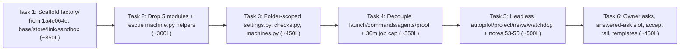

# Factory Engine Line Audit

This audit is based on **`origin/kc-factory` at commit `1a4e064e`** (`FAC-116: Last upstream Shepherdr sync into kc-factory (decision 6)`), covering the Shepherdr factory engine (`mods/tasks/bin/herdr_task/`, CLI wrapper `mods/tasks/bin/herdr-task`, templates `templates/*.md`, helpers `bin/herdr-secret`, `mods/tasks/bin/herdr_task/reviewer.sb`, `mods/coordinator/restart.sh`, and the Python test suite in `test/`) ahead of phase 1 extraction into `factory/` in `herdr-sheepdog`. See [architecture.md](../architecture.md) and [glossary.md](../glossary.md) for sheepdog's daemon and orchestrator terms.

---

## 1. Module-by-Module Audit (`mods/tasks/bin/` at `1a4e064e`)

At commit `1a4e064e`, the reference engine contains **45 Python modules** in `mods/tasks/bin/herdr_task/` (**20,760 lines** total) plus the macOS Seatbelt profile `mods/tasks/bin/herdr_task/reviewer.sb` (**43 lines**), for **46 files** inside `mods/tasks/bin/herdr_task/`, and the CLI entrypoint `mods/tasks/bin/herdr-task` (**36 lines**), totaling **47 files (20,839 lines)** in `mods/tasks/bin/`.

### Corrections & Post-Sync (`1a4e064e`) Delta vs Design Section 7

Where our line-by-line reading of the code at `1a4e064e` disagrees with or updates the design's section 7 table (which was snapshotted at `19,268` lines before `FAC-109`..`FAC-116`):

1. **Upstream sync (`FAC-116`, `1a4e064e`) added 2 modules and deleted `star.py`:**
   - **`link.py` (202 lines, new in `FAC-116`) → Audit: `Keep (light adapt)`:** Runs cross-machine task actions (`ACTIONS` at `L25–26`) as detached `hc run --bg --rm --label herdr.role=action` jobs on the remote machine (`start()` `L97–100`) and polls their result files across link drops (`poll()` `L103–114`, `follow()` `L132–170`), returning exit `75` (`PENDING`) with `herdr-task --on <m> _job <job>` if slow (`cli.py:92–118, L558–560`). Couplings to adapt: remove `"star"` from `ACTIONS` (`L25`) and update bare `"python3", "-c", POLL` (`L105`) for `uv`-managed Python.
   - **`sandbox.py` (162 lines, new in `FAC-116`) → Audit: `Keep`:** Probes whether Codex's Linux `bubblewrap` (`bwrap`) sandbox can start (`codex sandbox -- true`, `probe()` `L72–86`, `check()` `L89–116`), detects Ubuntu 24.04 AppArmor `kernel.apparmor_restrict_unprivileged_userns=1` failures, and prints `sudo` fix commands without loosening the sandbox (`cmd_sandbox()` `L154–162`). Uses `WHERE.roots["state"]` (`L21`) and feeds directly into `sheepdog factory doctor`.
   - **`star.py` (was 145 lines in Design §7 `Drop`) → Deleted upstream in `FAC-116`:** Already removed from `mods/tasks/bin/herdr_task/` and `templates/assistant.md` (with `cli.py:454–455, L561–562` keeping only a 2-line retired-command error stub).
2. **`feedback.py` (473 lines) — Design: `Adapt` → Audit: `Drop`:**
   `feedback.py` exists solely for agents to offer and file GitHub issues against upstream `eliasstravik/shepherdr` (`DEFAULTS["agents"]["feedback_repo"] = "eliasstravik/shepherdr"` in `settings.py:31`, `shepherdr_version()` reading `APP_HOME/data/shepherdr/installed.json` at `feedback.py:206`, and `--surface web|window|both` at `cli.py:286`). Design section 1 states that upstream is gone for good, and section 7's own Templates table drops `Feedback for Shepherdr` from all three templates (`assistant.md`, `worker.md`, `reviewer.md`). Dropping `feedback.py` saves 473 lines and removes callers in `cli.py`, `launch.py`, `assistant_settings.py`, `settings.py`, and `templates.py`. (Its couplings are still listed below in case `adapt` is chosen.)
3. **`handoff.py` (73 lines) — Design: `Adapt lightly` → Audit: `Keep`:**
   `handoff.py` has zero `herdr-app`, `APP_HOME`, `~/.herdr`, `space`, `tab`, `chat`, or `window` couplings (`grep -c` across those terms is `0`; section 7's grep-count pass matched `chat_tail` in `handoff.py:11,69`, which reads the agent's local JSONL session log in `agents.py`). It can be kept unchanged.
4. **`home.py` (613 lines at `1a4e064e`) — Design: `Drop (its health sample stays in machine)` → Audit: `Drop after rescuing task_builds() and leftover_worktrees()`:**
   While `machine.sample()` lives in `machine.py`, **field note 41** (`FAC-85`, commit `b7b59327` — per-task build output and listing biggest task build folders in the `disk-over` alert, tested by `BuildOutput.test_disk_over_news_lists_biggest_task_folders`) is implemented in `home.task_builds()` (`home.py:226–243`) and `home.health_lines()` (`home.py:390–403`), not in `machine.py`. Likewise, `home.leftover_worktrees()` (`home.py:115–161`) finds orphaned task worktrees. Both functions must move to `machine.py` / `news.py` before `home.py` is deleted.
5. **`store.py` (404L), `github.py` (1,264L), `checks.py` (178L), `proof.py` (148L), `output.py` (125L), `simulators.py` (217L), `devices.py` (116L) — Design: `Keep` → Audit: `Keep (light adapt)`:**
   - `store.py` imports `LEGACY` (`~/.config/herdr-app/data/tasks`) from `base.py` (`L12`) and `retag_tabs` from `launch.py` (`L17`), calls `retag_tabs(self)` in `Store.__exit__` (`L292`), and has `Store.migrate()` (`L328–366`) reading `<repo>/.git/herdr-tasks.json` and `LEGACY` (`local*.json`) while assigning `t["space"], t["tab"] = labels.get("herdr.space"), labels.get("herdr.tab")` (`L358`).
   - `github.py` stores `space=task.get("space") or w.get("space")` in `watch_main()` (`L1150`) and writes `"Shepherdr's proof artifact: {proof}"` in `pr_body()` (`L265`).
   - `checks.py` passes `t.get("space")` to `settings_for(s, t.get("space"))` in `checks_pass()` (`L79`) and `sync_check_pass()` (`L131, L142`).
   - `proof.py` reads `WHERE.path("artifacts")` (`L13`) and validates `herdr-artifact` JSON metadata (`find_proof` `L33–56`, `task_artifacts` `L59–92`, rejecting `"main.js" in files or "recipe.json" not in files`). Because section 7 drops `herdr-artifact` in the web app in favor of proof files (Markdown, images, `recipe.json`) linked from the PR, `proof.py` needs light adaptation.
   - `output.py` calls `held_ask(k["address"])` (`L7, L27`, reading `HERDR_APP_HOME/data/chat-asks`) and includes `"tab": labels.get("herdr.tab")` in `v["live"]` (`L46`).
   - `simulators.py` passes `t.get("space")` to `simulator_pool()` (`L136, L186`) and reads `HERDR_BROWSER_TASK` in `_open_for_task()` (`L147`).
   - `devices.py` imports `send_alert` (`L48`, called at `L71–72` with `"or say so in its chat"`) and `_open_for_task` (`L49`, which reads `HERDR_BROWSER_TASK`).
6. **`agents.py` (1,407 lines) vs `automations.py` (842 lines) — Swap adaptation weight:**
   Design puts `agents.py` in `Adapt` (heavy) and `automations.py` in `Adapt lightly`. In fact, `agents.py` has zero `herdr-app` calls and zero `space` logic — only `held_ask()` (`L762–779`, reading `HERDR_APP_HOME/data/chat-asks` at `L849, L884, L1405`), `CHAT_TAGS` (`L552`), and `herdr.*` label names (`Adapt lightly`). Conversely, `automations.py` imports and calls `backup_pass` (`L30, L718`), `home_pass` (`L739–740`), and `default_space` (`L19, L304`), and threads `a["space"]` through 7 functions (`Adapt`).
7. **`__init__.py` (38 lines) & `mods/tasks/bin/herdr-task` (36 lines):**
   Section 7's `3,992`-line `Keep` sum silently includes `__init__.py` (`38` lines) and omits `mods/tasks/bin/herdr-task` (`36` lines), which calls `layout.ensure()` at `L28–31`.

### Full Module Table (at `1a4e064e`)

| Module | Lines (`wc -l`) | Design §7 Fate | Audit Fate | Reason & Exact Couplings to Remove (`herdr-app`, `APP_HOME`/`~/.herdr`, space/tab/chat/backup/window) |
|---|---:|---|---|---|
| `herdr-task` (CLI wrapper) | 36 | *(omitted)* | `adapt` | Entrypoint script. Remove `from herdr_task import layout; layout.ensure()` (`L28–31`), docstring `~/.local/share/shepherdr/tasks/<slug>.json` & `herdr.task=<key>` (`L6, L17`), and update `#!/usr/bin/env python3` (`L1`) for `uv`-managed Python. |
| `__init__.py` | 38 | *(in Keep sum)* | `keep` | Package docstring only. Update docstring module list (`backups`, `layout`, `herdr-app`, `~/.herdr/tasks` at `L1–36`). |
| `store.py` | 404 | `keep` | `keep` (light adapt) | Per-repo JSON store, `fcntl.flock`, and `DoubleStart` lock (`FAC-116`). Remove `LEGACY` import (`L12`), `retag_tabs` import & call in `Store.__exit__` (`L17, L292`), `Store.migrate()` reading `.git/herdr-tasks.json` and `LEGACY` (`~/.config/herdr-app/data/tasks/local*.json`) and setting `t["space"], t["tab"] = labels.get("herdr.space"), labels.get("herdr.tab")` (`L328–366`); update `.git/config` key `shepherdr.id` in `project_id()` (`L62–71`) and comments (`L1, L387`). |
| `queues.py` | 250 | `keep` | `keep` | `--after` dependency graph & `max_running` cap. Zero `herdr-app`, `APP_HOME`, `space`, `tab`, `chat`, or `window` couplings. |
| `github.py` | 1,264 | `keep` | `keep` (light adapt) | `gh` PR/check/merge engine, `-R <fork_repo>`, merge queue, `update-branch`, `FAC-111` `sync_behind_pr()` (`L542–625`), `FAC-112` `TIMED_OUT` CI check handling (`L461–505`), `FAC-113` `main_is_red()` merge hold (`L1158–1264`), `FAC-115` `head_runs()`/`dispatch_ci()` (`L920–1035`). Remove `space=task.get("space") or w.get("space")` in `watch_main()` (`L1150`); update `"Shepherdr's proof artifact: {proof}"` in `pr_body()` (`L265`). |
| `budget.py` | 532 | `keep` | `keep` | Diff sizecheck, review/CI/time/token loop breaker, recap & `continue`. Zero app/space/chat/window couplings; only `herdr.task` & `herdr.role` label check in `cmd_recap()` (`L482`). |
| `checks.py` | 178 | `keep` | `keep` (light adapt) | Head-SHA check runner (`checks_pass` `L65–121`) and `FAC-111` behind-PR local check runner (`sync_check_pass` `L124–178`). Remove `t.get("space")` argument to `settings_for(s, t.get("space"))` (`L79, L131, L142`); keep `herdr.role=checks`, `herdr.checks`, and `herdr.sync_checks` labels (`L96, L160`). |
| `proof.py` | 148 | `keep` | `keep` (light adapt) | Proof gate before `ready`. `ARTIFACTS = WHERE.path("artifacts")` (`L13`), `find_proof()` (`L33–56`), and `task_artifacts()` (`L59–92`) read `herdr-artifact` metadata and enforce `"recipe.json" in files`. Adapt to check file/Markdown/`recipe.json` proof linked from the PR without `herdr-artifact` web viewer. |
| `provider.py` | 102 | `keep` | `keep` | Provider error classifier (rate-limit, 5xx, auth, billing) from JSONL transcripts. Zero couplings. |
| `sessions.py` | 250 | `keep` | `keep` | Single-pass `ProcessTable` (`L19–68`, `FAC-116`) and Claude Code, Codex, and Agy session/transcript discovery (`~/.claude`, `~/.codex`, `~/.gemini`). Zero couplings. |
| `simulators.py` | 217 | `keep` | `keep` (light adapt) | Per-task iOS Simulator pool & lease lifecycle. Remove `space` parameter in `simulator_line(s, task, space=None)` (`L135–136`) and `t.get("space")` in `cmd_simulator()` (`L186`); replace `HERDR_BROWSER_TASK` fallback in `_open_for_task()` (`L147`). |
| `devices.py` | 116 | `keep` | `keep` (light adapt) | Physical iPhone wait (`herdr-task device-wait`, `FAC-110`): `device_available()` (`L19–45`) polls `xcrun devicectl list devices`; `cmd_device_wait()` (`L47–79`) records `t["device_wait"]` and alerts once; `device_pass()` (`L81–116`) clears the wait and notifies the worker when paired/available. Couplings to adapt: `send_alert` (`L48, L71–72`, sets `herdr.alert` and mentions `"in its chat"`), `_open_for_task` (`L49`, reads `HERDR_BROWSER_TASK`), and `herdr.role` label check (`L110`). |
| `usage.py` | 89 | `keep` | `keep` | `codexbar usage` reader (1-minute cache) and pool picker by weekly reset / 5h floor. Zero couplings. |
| `machine.py` | 517 | `keep` | `keep` (+rescue from `home.py`) | CPU/memory/disk sampler, start-limit holds, Claude/Codex plan-limit probes, per-task `build_dir` lifecycle (`task_build_dir`, `ensure_task_build_dir`, `remove_task_build_dir` at `L469–516`). Zero app/space/window couplings; absorb `task_builds()` (`home.py:226–243`) and `leftover_worktrees()` (`home.py:115–161`) when `home.py` is dropped. |
| `when.py` | 168 | `keep` | `keep` | Natural/ISO `--at` timestamp parser. Zero couplings. |
| `archive.py` | 80 | `keep` | `keep` | Moves old `done` tasks to `<slug>.archive.json`. Only reads `herdr.task` label in `busy_task_keys()` (`L37`). |
| `output.py` | 125 | `keep` | `keep` (light adapt) | JSON/table views (`view`, `subagent`, `task_Agent`). Remove `held_ask` import & call in `view()` (`L7, L27`, which reads `HERDR_APP_HOME/data/chat-asks`) and `"tab": (k.get("labels") or {}).get("herdr.tab")` in `v["live"]` (`L46`). |
| `handoff.py` | 73 | `adapt` (lightly) | `keep` | Builds `<herdr-handoff>` from `work_so_far()` and `chat_tail()` when switching CLIs or hitting pool floor. Zero `herdr-app`, `APP_HOME`, `space`, `tab`, or `window` couplings. |
| `link.py` | 202 | *(new in `1a4e064e`)* | `keep` (light adapt) | Detached cross-machine action runner (`hc run --bg --rm --label herdr.role=action`) and reconnect poller (`_job`). Remove `"star"` from `ACTIONS` (`L25`); update bare `"python3", "-c", POLL` (`L105`) for `uv`-managed Python. |
| `sandbox.py` | 162 | *(new in `1a4e064e`)* | `keep` | Linux Codex `bwrap` / AppArmor userns probe (`codex sandbox -- true`) and `sudo` fix advisor (`herdr-task sandbox [--check]`). Uses `WHERE.roots["state"]` (`L21`); zero `herdr-app` or `space` couplings. |
| `reviewer.sb` | 43 | `keep` | `keep` | macOS `sandbox-exec` Seatbelt profile for Agy reviewer (`ALLOW_READ_ROOT`, `ALLOW_WRITE_TMP`, `ALLOW_WRITE_HOME`). Zero couplings. |
| `revive.py` | 337 | `adapt` (lightly) | `adapt` (lightly) | Restores dead worker and Assistant terminals in `hc` after reboot/crash. Remove `HERDR_BROWSER_TASK` in `env_of()` (`L193`); update `template_of()` path `~/.config/herdr-core/templates/assistant.md` (`L245`) and `ASSISTANT_TEMPLATES = ("assistant", "coordinator")` (`L22`). |
| `takeover.py` | 242 | `adapt` (lightly) | `adapt` (lightly) | Mid-task CLI failover (`cli_check_pass`, `other_cli`, `takeover`, `auto_switch_pass`). Remove `APP_HOME` import (`L7`) and `os.path.isdir(os.path.join(APP_HOME, "mods"))` check in `cli_check_pass()` (`L78`); remove `herdr.task.space` / `herdr.space` lookup in `takeover()` (`L218`); replace `<herdr-backup>` chat wrapper tag (`L194`). |
| `ghnews.py` | 320 | `adapt` (lightly) | `adapt` (lightly) | Polls GitHub PR reviews/comments/checks and `main` branch CI. Remove `w.get("space")` and `coordinator_in(n.get("space"))` in `main_check()` (`L290`) and `main_pass()` (`L310`); route `main-red` / `main-green` news to the project's Assistant by folder. |
| `tick.py` | 814 | `adapt` (lightly) | `adapt` (lightly) | 15s tick loop (`tick_store`, `retry_pass`, `end_done_pass`, `memory_guard`, `lost_logs_pass`, `sync_check_pass`). Remove `browser_pass` import & call (`L30, L809`), `default_space` import & call (`L26, L394`), `held_ask` import & calls in `end_done_pass()` (`L17, L673, L703`), `space` lookup in `rescue_question()` (`L459–469`) and `retry_one()` (`L625`); replace `herdr.alert` window toast label in `memory_guard()` (`L596`). |
| `agents.py` | 1,407 | `adapt` | `adapt` (lightly) | Worker/reviewer state machine, transcript tailing, background job detection, Agy SQLite conversation matching. Remove `held_ask(address)` (`L762–779`, reading `HERDR_APP_HOME` / `~/.config/herdr-app/data/chat-asks/req` & `ans`), called in `open_question()` (`L849`), `asking()` (`L884`), and `own_work()` (`L1405`); update `CHAT_TAGS` (`L552`) as needed. |
| `automations.py` | 842 | `adapt` (lightly) | `adapt` | Scheduled & event-driven automations and `one_pass()` runner. Remove `default_space` import & call (`L19, L304`), `backup_pass` import & call (`L30, L718`), `home_pass` import & call (`L739–740`), `report["backups"]` & `report["home"]` output (`L786–793`), and `space` field on automation records (`L210, L214, L258, L304, L384–399, L625`). |
| `base.py` | 274 | `adapt` | `adapt` | Paths, shell helpers, process-group kill (`end_group`, `kill_agent`), `probe_volume`, `stop_log`, `bundle`. Replace `layout.Where()` (`L14, L20–31`) with sheepdog's XDG/factory paths; remove `LEGACY = ~/.config/herdr-app/data/tasks` (`L33`), `SYNC_HOLD`/`SYNC_HOLDS` (`~/.herdr/sync-hold`, `L51–63`), `addon_off()` reading `everywhere.off` for window add-ons (`L69–76`), `"herdr-app"` in `GUARDED` & `HERDR_APP_HOME` in `not_real()` (`L113–146`), `APP_HOME = ~/.config/herdr-app` (`L246`), and `ASK_HOME = .local/share/herdr/ask` (`L249`). |
| `cli.py` | 579 | `adapt` | `adapt` | `argparse` CLI & `--on <machine>` forwarder (`link.py`). Remove imports and subparsers for dropped modules: `cmd_backup` & `cmd_restore_spaces` (`L22, L372–374, L546–550`), `star` stub (`L454–455, L561–562`), `cmd_home` (`L26, L487–503, L566–567`), `cmd_feedback` (`L28, L273–293, L536–537`), `_session-note` (`L551–553`), `_hold-news` (`L554–557`); remove `.config/herdr-app/mods/tasks/bin/herdr_task` check in `remote_run()` (`L83`) and `name_tabs()` call in `remote()` (`L135`); drop `--space` flag across subcommands (`L184, L201, L236, L295, L318, L378, L394, L403, L413, L432, L444, L480`). |
| `commands.py` | 2,236 | `adapt` | `adapt` | Task lifecycle commands (`add`, `start`, `status`, `ready`, `reviewed`, `accept`, `fix`, `merge`, `done`, `resume`, `switch`, `tell`, `config`, `edit --amend`). Remove `name_tabs`, `retag_tabs`, `tab_title`, `task_tabs`, `caller_space`, `default_space`, `space_base` imports & calls (`L19–35, L121, L129, L183, L271, L324–388, L1200, L1563–1565, L1637, L1666, L1937, L2209`); key tasks and settings by `s.repo` instead of `space`; replace `--owner-approved` flag in `cmd_accept` (`L2133–2173`) with owner-contract approval verification over loopback (design §3); replace `herdr.alert` window toast label in `send_alert()` (`L1021–1063`). |
| `launch.py` | 1,120 | `adapt` | `adapt` | Worker & reviewer launcher in `hc`, worktree creation, sandboxed Agy launcher, brief builder. Remove `browser_line` & `browser_path` from `browsers.py` (`L23, L97–99, L267–270, L688, L1016, L1031`), `feedback_on` from `feedback.py` (`L680–684`), `ask_hook()`/`ask_card()`/`cmd_allow()` shelling out to `HERDR_APP_HOME/mods/chat/ask-hook.sh` or `ASK_HOME/ask-hook.sh` (`L338–390`), `UNSANDBOXED_FLAG = ~/.herdr/agy-review-unsandboxed` (`L424`), `caller_space()` & `default_space()` calling `["herdr-app", "status"]` (`L584–605`), `name_tab()`/`name_tabs()`/`task_tabs()`/`retag_tabs()` calling `["herdr-app", "do", "tab.rename", ...]` and `["herdr-app", "ls"]` (`L612–654`), and `coordinator_tab()`/`coordinators()`/`coordinator_in()` matching `herdr.space`/`herdr.coordinator.space` (`L1069–1086`); replace with project-folder coordinator discovery (`herdr.role=coordinator`, lease/folder). |
| `news.py` | 619 | `adapt` | `adapt` | Event router to Assistant (`ready`, `merged`, `checks-failed`, `needs-you`, `auto_accept_pass`, Fable gate). Replace `coordinator_in(space)` (`L226`) with project-folder Assistant lookup; remove `home.log_news` (`L241–242`), `assistant_settings.settings_pass` (`L251–252`), and `reactions.reactions_pass` (`L257–258`); remove window chat unread/typing label checks `READ = "herdr.chat.read"` (`news_read()` `L269–296`) and `TYPING = "herdr.typing"` (`chat_typing()` `L363, L498–503`). |
| `autopilot.py` | 912 | `adapt` | `adapt` | Wakes Assistant on task events and timers (`autopilot_pass`, `deliver`, `events_for`, `cmd_autopilot`, `cmd_progress`, `cmd_complete`). Remove `addon_off("autopilot")` (`L13, L734`), `HEARTBEATS = ~/.config/herdr-core/autopilot` (`L51`), `window_spaces()` & `local_spaces()` running `["herdr-app", "ls"]` (`L286–299`), `space_info()` (`L408–415`), and `my_space()` reading `herdr.space`/`herdr.coordinator.space` (`L418–429`); key Autopilot state by project `folder` with Autopilot on by default. |
| `project.py` | 621 | `adapt` | `adapt` | `project start` / `project checklist` one-command onboarding. Rewrite `ensure_space()` (`L223–238`, which runs `["herdr-app", "ls"]` and `["herdr-app", "do", "space.new", ...]`) and `ensure_assistant()` (`L276–315`, which reads `APP_HOME/shared.json` `coordinator.slots` and sets `herdr.chat`, `herdr.chat.slot`, `herdr.chat.origin`, `herdr.coordinator.tab`, `herdr.coordinator.space`) to register the project in `settings.json` by folder and spawn the Assistant directly in `hc`; key `ensure_settings()`, `sync_autopilot()`, `save_project()` by project folder instead of `cfg["spaces"][bare_id]`. |
| `settings.py` | 1,029 | `adapt` | `adapt` | Settings reader/writer (`everywhere`, project, `machines`), role model resolver, task settings block (`tasks.sync`, `sandbox.check()`). Replace `spaces` layer (`d["spaces"][space]` across `autopilot_layers` `L59`, `write_autopilot` `L70`, `write_max_running` `L110`, `settings_layers` `L275`, `settings_for` `L309`, `space_base` `L757`) with project-folder layer; remove `d.get("pushed_from")` window-push guard (`L67, L108`), `reactions` / `suggestions` / `feedback` / `feedback_repo` keys in `DEFAULTS["agents"]` (`L31`), `reactions_on()` (`L232–249`), `SET_BY["flag"] = "~/.herdr/agy-review-unsandboxed"` (`L261`), and `Suggested next message` line (`L709–712`); update `TEMPLATES` (`~/.config/herdr-core/templates`) and `OLD_INSTRUCTIONS` (`~/.herdr/instructions`) (`L24–25`). |
| `assistant_settings.py` | 263 | `adapt` | `adapt` | Builds the Assistant's `"Your settings"` block and notifies running Assistants when settings change. Remove `addon_off("chat")` (`L15, L213`), `reactions` imports & calls (`L18, L173, L193–194, L247, L259–260`), `space_of()` (`L34–36`), `spaces` layer lookup (`L39–51`), `reactions`/`suggestions`/`feedback` rows (`L99–107`), `cmd_session_note()` (`L197`, called by `mods/chat/session-note.sh`), and `READ = "herdr.chat.read"` check (`L230, L262`). |
| `templates.py` | 205 | `adapt` | `adapt` | Renders & upgrades `worker.md` and `reviewer.md`. Remove `FEEDBACK_RULE` (`L91`), `SUGGEST_RULE` (`<hc suggest="…"/>`, `L99`), `REVIEWER_FEEDBACK` (`L138`), `REVIEWER_SANDBOX` (`herdr-app check` / `shepherdr doctor`, `L142`), and Tasks panel / `[#shop](space:…)` references (`L39, L49, L56`); update `TEMPLATES` and `OLD_INSTRUCTIONS` paths (`L11`). |
| `ask.py` | 237 | `adapt` | `adapt` | Blocking structured questions (`herdr-task ask`). Replace `_ask-pane` terminal reader (`L126–197`) and `coordinator_in(space)` lookup (`L226–229`) with owner-contract records answered by the Assistant or by the owner over sheepdog's loopback contract (design §3). |
| `watchdog.py` | 287 | `adapt` | `adapt` | Assistant stall/API-error/old-template detector & restarter. Remove `APP_HOME` & `addon_off` imports (`L7, L143`), `held_ask` import & check (`L6, L180`), and `restart_assistant()` shelling out to `APP_HOME/mods/coordinator/restart.sh` with `HERDR_RESTART_CHAT` (`L24–37`); inline the `hc` Assistant restart in Python and key state by project folder instead of `space` / `herdr.chat` / `herdr.coordinator.tab` / `herdr.tab` (`L189–190`). |
| `scheduler.py` | 39 | `adapt` | `adapt` | Starts/checks the `herdr-automations` loop in `hc`. Remove `APP_HOME` import (`L7`) and `os.path.isdir(os.path.join(APP_HOME, "mods"))` check (`L27`, which kept the loop running for window backups); sheepdog's daemon keeps the tick/automation loop alive in `hc`. |
| `machines.py` | 1,003 | `adapt` | `adapt` | Multi-machine tool sync (`hc`), `machines find` (`L780–895`), and reachability probe. Remove `APP_HOME`, `ASK_HOME`, `addon_off` imports (`L27, L468`), `ARTIFACT_HOME`, `VIEWER_BUILT`, `STAMP = ".herdr/tools.json"` (`L43–45`), `herdr-artifact` / `viewer.html` / `herdr-browser` / `mods/chat/ask-hook.sh` / `ask-end.py` entries in `manifest()` (`L95–155`), `.config/herdr-app/mods/tasks/bin/herdr_task` check in `INSTALL` (`L185`), and `["herdr-app", "ls"]` + `docs.json` space parsing in `PROBE` (`L550–562`). |
| `feedback.py` | 473 | `adapt` | **`drop`** | Upstream issue filer (`eliasstravik/shepherdr`). See Correction #2 above. If adapted instead of dropped: remove `APP_HOME/data/shepherdr/installed.json` (`L206`), `--surface web\|window\|both` (`L199`), `space` routing (`L198, L233, L375`), and `eliasstravik/shepherdr` default (`L36`). |
| `backups.py` | 203 | `drop` | `drop` | Backs up and restores the `herdr-app` window document (`docs.json`) and `APP_HOME/shared.json` (`spaces-chat`, `space.colors`, `coordinator.slots`) in `~/.config/herdr-app/data/backups/`. |
| `home.py` | 613 | `drop` | `drop` (after rescuing 2 helpers) | Home-space Assistant (`main_here` checks `APP_HOME/mods` at `L47`; runs `["herdr-app", "ls"]` at `L254, L427`). Move `task_builds()` (`L226–243`) and `leftover_worktrees()` (`L115–161`) to `machine.py` / `news.py`, then drop. |
| `reactions.py` | 125 | `drop` | `drop` | Chat emoji reactions (`<hc react="…"/>`, `herdr.reactions` label, `addon_off("chat")`). |
| `browsers.py` | 150 | `drop` | `drop` | Per-task `herdr-browser` Chrome profile lifecycle in `WHERE.path("browser")`. Agents use standard Playwright/MCP or simulator tools. |
| `layout.py` | 895 | `replace` | `replace` | One-time migration from `~/.herdr` to XDG `shepherdr` folders with symlinks and healing passes. Replace with a small (~100-line) one-time importer from `~/.local/share/shepherdr/tasks/` and `~/.config/shepherdr/settings.json` into sheepdog's data dir. |

**Totals across the 45 `.py` modules in `mods/tasks/bin/herdr_task/` at `1a4e064e` (20,760 lines):**
- **Design §7 (pre-`FAC-109`..`116`, 44 files, 19,268 lines):** `Keep` 3,992 lines (16 files incl. `__init__.py`) · `Adapt lightly` 2,526 lines (6 files) · `Adapt` 10,703 lines (16 files) · `Drop` 1,152 lines (5 files incl. `star.py`) · `Replace` 895 lines (1 file).
- **This Audit at `1a4e064e` (45 files, 20,760 lines):** `Keep` 4,915 lines (19 files: `__init__` 38L, `store` 404L, `queues` 250L, `github` 1,264L, `budget` 532L, `checks` 178L, `proof` 148L, `provider` 102L, `sessions` 250L, `simulators` 217L, `devices` 116L, `usage` 89L, `machine` 517L, `when` 168L, `archive` 80L, `output` 125L, `handoff` 73L, `link` 202L, `sandbox` 162L; 8 with light touchups) · `Adapt lightly` 3,120 lines (5 files: `revive` 337L, `takeover` 242L, `ghnews` 320L, `tick` 814L, `agents` 1,407L) · `Adapt` 10,266 lines (15 files: `automations` 842L, `base` 274L, `cli` 579L, `commands` 2,236L, `launch` 1,120L, `news` 619L, `autopilot` 912L, `project` 621L, `settings` 1,029L, `assistant_settings` 263L, `templates` 205L, `ask` 237L, `watchdog` 287L, `scheduler` 39L, `machines` 1,003L) · `Drop` 1,564 lines (5 files: `backups` 203L, `home` 613L, `reactions` 125L, `browsers` 150L, `feedback` 473L; `star.py` already deleted upstream) · `Replace` 895 lines (1 file: `layout` 895L).

---

## 2. Test Coverage by Module & Tests to Drop (at `1a4e064e`)

At `1a4e064e`, the Python test suite in `test/` comprises **24 `test_*.py` files** (**18,919 lines**, **127 test classes**, **875 test methods**), guarded by `test/home_guard.py` (**117 lines**), which sets a throwaway `HOME`, strips `HC_*`/`HERDR_*` environment variables, and installs a `sys.addaudithook` that aborts if any test touches `~/.herdr`, `~/.config/herdr-app`, or `~/.local/share/shepherdr`.

### Coverage per Engine Module

| Module | Covering Test Files & Test Classes (`test/test_herdr_task.py` unless noted) | Fate of Tests |
|---|---|---|
| `store.py` | `HerdrTask`, `Store`, `ReadOnlyStore`, `IdleCompaction`, `BackToWork`, `DoneWorktreesGo`, `NewWorktrees`, `MergedOnlyWithOwnWork`, `ReviewedNamesItsCommit`, `TaskFlow`, `ProjectStart`, `GhAlwaysNamesForkRepo`, `OpenQuestionSurvivesDone`, `SimulatorPool`, `UpToDateBeforeMerge`, `DoubleStart` (`L12924`, 2 tests); `test_layout.py`: `ProjectId` | **Keep** (`ProjectId` moves from `test_layout.py` to `test_herdr_task.py`; update `shepherdr.id` git config key if renamed). |
| `queues.py` | `Scheduled` (`L5951`, 14 tests), `MachineHoldFollowsSettings` (`L6678`, 2 tests) | **Keep** |
| `github.py` | `BackToWork` (`L1072`, 55 tests), `DoneWorktreesGo` (9), `MergedOnlyWithOwnWork` (15), `AcceptKeepsLaterCommits` (2), `PrLooks`, `ChecksBeforeReady` (6), `CiStopped` (`L3753`, 7 tests incl. `FAC-112`), `ChecksUnreadable` (6), `LoopBreaker` (13), `TaskFlow` (26), `GhAlwaysNamesForkRepo` (3), `OpenQuestionSurvivesDone` (4), `ReviewTheCommitGitHubHas` (5), `UpToDateBeforeMerge` (`L11597`, 7), `HoldWhileMainIsRed` (`L11738`, 8 tests, `FAC-113`), `SyncBehindBase` (`L11855`, 13 tests, `FAC-111`), `BoardSnapshotStore` (2), `DesignDocAndOpenAskWaitForAccept` (3), `NoCIRunWithCISetUp` (`L12567`, 5), `CIRunOnTheHeadCounts` (`L12666`, 6 tests, `FAC-115`), `ExpectedChecks` (`L12868`, 2 tests), `ReadyMergeGit` (`L12976`, 9 tests) | **Keep** |
| `budget.py` | `LoopBreaker` (`L5435`, 13 tests), `UpToDateBeforeMerge` (`L11597`), `MergeOnlyReviewRounds` (`L12002`, 3 tests), `BoardSnapshotStore` (`L12149`, 2 tests) | **Keep** |
| `checks.py` | `Checks` (`L9303`, 9 tests), `SyncBehindBase` (`L11855`, 13 tests), `OwnBackgroundWork` (`L1933`), `GhAlwaysNamesForkRepo` (`L10987`) | **Keep** |
| `proof.py` | `ChecksUnreadable`, `AcceptCardArtifacts` (`L6645`, 1 test), `NoCIRunWithCISetUp` (`L12567`), `AutoAccept` (`L12426`) | **Adapt** `AcceptCardArtifacts` and proof fixtures for file/PR-linked proof. |
| `provider.py` | `GateReview` (`L3979`: `test_a_quota_reviewer_fails_at_once_with_its_reset_time`, `test_a_passing_mention_of_usage_limit_is_no_quota_failure`), `GateEndToEnd` (`L6844`: `test_agy_hits_a_quota_error_and_the_round_goes_to_claude`), `Watchdog` (`L10429`: `test_api_error_*`) | **Keep** |
| `sessions.py` | `AgyWorker` (`L6433`, 14 tests), `Revive` (`L7040`, 16 tests), `LostLogs` (`L7548`, 5 tests), `ProcessTable` (`L13212`, 3 tests) | **Keep** |
| `simulators.py` | `SimulatorPool` (`L11252`, 3 tests), `ProjectStart` (`test_project_start_adds_the_simulator_lines_once_and_keeps_notes`) | **Keep** |
| `devices.py` | `DeviceWait` (`L11366`, 5 tests: `test_the_wait_shows_as_needs_you_with_its_reason_and_alerts_once`, `test_a_tick_that_finds_the_device_clears_it_and_tells_the_worker`, `test_a_wait_again_soon_after_a_clear_neither_alerts_nor_loops`, `test_unknown_never_clears`, `test_device_available_reads_devicectl_json`) | **Keep** |
| `usage.py` | `test_usage.py`: `Parse` (3 tests), `Read` (1 test), `Pick` (4 tests) | **Keep** (`Parse`, `Read`, `Pick` in `test_usage.py`; drop `UsageIsLocal` which checks `core/usage.js`, `lib/usage.js`, `service/usage.ts`, `web/src/usage.ts`). |
| `machine.py` | `MachineHoldFollowsSettings` (`L6678`, 2 tests), `MacMemoryIsWhatMacOSCallsFree` (`L6722`, 2 tests), `AutomationFromAnotherMachine` (`L7292`), `BuildOutput` (`L12230`, 4 tests) | **Keep** (repoint `BuildOutput.test_disk_over_news_lists_biggest_task_folders` from `home` to `machine` / `news`). |
| `when.py` | `Scheduled` (`L5951`: `test_parsing_absolute_relative_and_refused`, `test_automations_once_takes_the_same_words`) | **Keep** |
| `archive.py` | Exercised via `tick.py` in `SchedulerRound`, `Scheduled`, `AutomationFromAnotherMachine` | **Keep** |
| `output.py` | `OwnBackgroundWork` (`L1933`), `BackgroundJobEnded` (`L2453`), `WorkersOwnHelpers` (`L2558`, 3 tests), `TimeLeft` (`L3224`), `WorkersAskThroughHerdrTask` (`L3281`), `GateReview` (`L3979`), `LoopBreaker` (`L5435`), `DesignAndDocReview` (`L10758`), `OutOfRoundsAutoGrant` (`L10897`), `MergeOnlyReviewRounds` (`L12002`), `DesignDocAndOpenAskWaitForAccept` (`L12327`), `NoCIRunWithCISetUp` (`L12567`), `AgyStartNudge` (`L12759`) | **Keep** |
| `handoff.py` | `HandoffsAtTheFloor` (`L9244`, 3 tests), `TaskFlow` (`test_a_switch_to_another_cli_hands_over_the_work_so_far`), `Resume` (`test_fresh_handoff_when_session_missing_or_cli_changed_without_duplicate_continue`) | **Keep** |
| `link.py` | `LinkActions` (`L13363`, 8 tests) | **Keep** |
| `sandbox.py` | `CodexSandbox` (`L13275`, 4 tests) | **Keep** |
| `revive.py` | `Revive` (`L7040`, 16 tests), `SandboxedReviewer` (`test_revive_never_brings_a_sandboxed_reviewer_back`) | **Adapt** (remove `HERDR_BROWSER_TASK` assertion in `test_a_worker_resumes_with_its_task_browser`). |
| `takeover.py` | `ReviewerLine` (`L3409`, 4 tests), `GateReview` (`test_a_dead_reviewer_uses_no_round_and_falls_back_to_the_other_cli`, `test_sign_in_required_and_claude_fallback_to_agy`) | **Keep** |
| `ghnews.py` | `PrLooks`, `TaskFlow` (`L8459`), `GhAlwaysNamesForkRepo` (`L10987`), `UpToDateBeforeMerge` (`L11597`), `HoldWhileMainIsRed` (`L11738`) | **Adapt** (replace `space` with folder). |
| `tick.py` | `SchedulerRound`, `IdleCompaction` (5), `BackToWork` (55), `BackgroundJobEnded` (3), `DoneWorktreesGo` (9), `MergedOnlyWithOwnWork` (15), `ChecksBeforeReady` (6), `CiStopped` (7), `GateReview` (68), `LoopBreaker` (13), `Scheduled` (14), `LostLogs` (5), `OpenQuestionSurvivesDone` (4), `ReviewTheCommitGitHubHas` (5), `UpToDateBeforeMerge` (7), `HoldWhileMainIsRed` (8), `SyncBehindBase` (13), `DesignDocAndOpenAskWaitForAccept` (3), `AgyStartNudge` (8) | **Adapt** (drop `browser_pass`, `backup_pass`, `held_ask` mocks). |
| `agents.py` | `IdleCompaction` (5), `BackToWork` (55), `OwnBackgroundWork` (9), `CodexCodeMode` (14), `NoFalseNeedsYou` (6), `BackgroundJobEnded` (3), `WorkersOwnHelpers` (3), `WorkersAskThroughHerdrTask` (3), `GateReview` (68), `SandboxedReviewer` (3), `FolderTrustQuestion` (4), `AgyWorker` (14), `OpenQuestionSurvivesDone` (4), `AgyStartNudge` (8), `ProcessTable` (3) | **Adapt** (in `OpenQuestionSurvivesDone`, drop `chat-asks` card subtest or adapt to owner-ask records; keep terminal question subtest). |
| `automations.py` | `AutomationMachine` (`L626`, 4 tests), `SchedulerRound` (`L666`, 1 test), `Scheduled` (`L5951`, 14 tests), `FolderTrustQuestion` (`L6347`), `AutomationFromAnotherMachine` (`L7292`, 8 tests), `TaskFlow` (`test_an_automation_sets_its_tasks_review`) | **Adapt** (remove `space`, `backup_pass`, `home_pass`). |
| `base.py` | `HerdrTask` (`test_addon_off`), `StopLog` (`L9067`, 2 tests), `ProbeVolume` (`L10393`, 3 tests), `EndGroup` (`L11466`, 4 tests); `test_sync_hold.py`: `Hold` (5 tests) | **Adapt** (drop `HerdrTask.test_addon_off` and `test_sync_hold.py`; keep `StopLog`, `ProbeVolume`, `EndGroup`). |
| `cli.py` | `HerdrTask` (`L19`, 5 tests), `Autopilot`, `RemoteInstall` (`L585`, 2 tests), `AutomationMachine`, `NoStarPrompt` (`L7981`, 2 tests), `SimulatorPool`, `BuildOutput`, `CodexSandbox`, `LinkActions` | **Adapt** (remove `--space` flags in CLI calls; drop `NoStarPrompt`). |
| `commands.py` | `BackToWork`, `DoneWorktreesGo`, `MergedOnlyWithOwnWork`, `AcceptKeepsLaterCommits`, `TimeLeft`, `ChecksUnreadable`, `GateReview`, `LoopBreaker`, `Scheduled`, `AgyWorker`, `ReviewedNamesItsCommit`, `GateEndToEnd`, `TaskFlow` (`L8459`, 26 tests incl. `FAC-109` `edit --amend`), `Resume`, `BusyWorkerDelivery`, `DesignAndDocReview`, `OutOfRoundsAutoGrant`, `GhAlwaysNamesForkRepo`, `OpenQuestionSurvivesDone`, `ReviewTheCommitGitHubHas`, `UpToDateBeforeMerge`, `HoldWhileMainIsRed`, `SyncBehindBase`, `MergeOnlyReviewRounds`, `BoardSnapshotStore`, `DesignDocAndOpenAskWaitForAccept`, `AutoAccept`, `NoCIRunWithCISetUp`, `CIRunOnTheHeadCounts`, `AgyStartNudge`, `DoubleStart`, `ReadyMergeGit` | **Adapt** (remove `--space` and `retag_tabs` mocks; update `--owner-approved` tests in `BackToWork` to test the loopback approval rail). |
| `launch.py` | `IdleCompaction`, `NewWorktrees` (8), `TimeLeft` (4), `GateReview` (68), `SandboxedReviewer` (3), `AgyWorker` (14), `GateEndToEnd` (4), `CleanEnv` (2), `Revive` (16), `CodexAsksOnTheCard` (`L8263`, 11), `TaskFlow` (26), `Resume` (7), `SimulatorPool` (3), `CodexSandbox` (4) | **Adapt** (drop `CodexAsksOnTheCard` which tests `mods/chat/ask-hook.sh` chaining via `herdr-task _allow`). |
| `news.py` | `IdleCompaction`, `BackToWork`, `OwnBackgroundWork`, `WorkersAskThroughHerdrTask`, `PrLooks`, `CiStopped`, `GateReview`, `Asks`, `BusyWorkerDelivery` (5), `ProjectStart`, `Watchdog`, `DesignAndDocReview` (3), `OutOfRoundsAutoGrant` (4), `AutoAccept` (9), `NoCIRunWithCISetUp` (5), `AgyStartNudge`, `test_contract_gate_evidence.py`: `GateEvidence` (3) | **Adapt** (remove `herdr.chat.read` / `herdr.typing` label checks; keep `GateEvidence`). |
| `autopilot.py` | `Autopilot` (`L68`, 23 tests), `ReadOnlyAutopilot` (`L3505`, 1 test), `ProjectStart` (`L9987`), `Watchdog` (`L10429`) | **Adapt** (key by folder instead of `space`; drop window-space subtests `test_list_names_a_space_as_the_screens_do`, `test_a_folder_told_from_another_machines_window`, `test_another_machines_space_is_switched_there`, `test_another_machines_refusal_is_said_here`, `test_another_machines_space_is_set_here_by_its_full_id`, `test_list_holds_every_machines_spaces`). |
| `project.py` | `ProjectStart` (`L9987`, 11 tests), `LoopBreaker`, `GhAlwaysNamesForkRepo`, `MergeOnlyReviewRounds`, `BoardSnapshotStore` | **Adapt** (`ProjectStart` tests folder-keyed registration and `hc` Assistant launch instead of `herdr-app do space.new` and `coordinator.slots`). |
| `settings.py` | `Autopilot`, `NewWorktrees`, `ReviewerLine` (4), `GateReview`, `Scheduled`, `FastOffIsSaid` (1), `AgyWorker`, `ReviewerFlags` (1), `MachineHoldFollowsSettings`, `AutomationFromAnotherMachine`, `ReviewerFlagsSet` (1), `AssistantSettings` (12), `TaskFlow`, `Resume`, `ProjectStart`, `DesignAndDocReview`, `OutOfRoundsAutoGrant`, `SimulatorPool`, `SyncBehindBase`, `BuildOutput`, `DesignDocAndOpenAskWaitForAccept`, `AutoAccept`, `NoCIRunWithCISetUp`, `CodexSandbox` | **Adapt** (replace `spaces` layer with project folder). |
| `assistant_settings.py` | `AssistantSettings` (`L7757`, 12 tests), `GateReview`, `Watchdog`; `test_repo.py`: `SessionNote` (`L504`, 3 tests) | **Adapt** `AssistantSettings` (drop `reactions` subtests `test_reactions_on_by_default_everywhere_and_a_space_sets_its_own`, `test_the_assistants_reactions_from_before_still_apply`, `test_only_assistants_get_the_block_other_agents_reactions_only`, `test_the_hook_text_is_json_ready`, `test_chat_tags_hide_the_message`; **drop** `test_repo.py:SessionNote`). |
| `templates.py` | `TimeLeft` (`L3224`), `WorkersAskThroughHerdrTask` (`L3281`), `ReviewAsAHelperAgent` (`L3356`, 3 tests), `GateReview`, `AgyWorker`, `Resume`; `test_repo.py`: `Repo.test_assistant_*` (6 tests, `L388–440`) | **Adapt** (`ReviewAsAHelperAgent`; move the 6 `Repo.test_assistant_*` template tests from `test_repo.py` into the factory test suite). |
| `ask.py` | `Asks` (`L9091`, 3 tests), `AskPane` (`L9496`, 6 tests), `ProjectStart`, `OpenQuestionSurvivesDone`, `DesignDocAndOpenAskWaitForAccept`, `AutoAccept` | **Adapt** (`Asks`, `ProjectStart`, `OpenQuestionSurvivesDone`, `DesignDocAndOpenAskWaitForAccept`, `AutoAccept` for owner-contract asks; **drop** `AskPane` if `_ask-pane` terminal card UI is replaced by loopback owner asks). |
| `watchdog.py` | `Watchdog` (`L10429`, 15 tests); `test_restart.py`: `RemoteRestart` (3), `ChatLabel` (2), `NoTab` (3), `Bash32` (2), `Detach` (2) | **Adapt** `Watchdog` (remove `HERDR_RESTART_CHAT` / `restart.sh` wrapper; fold `NoTab`, `Bash32`, and `Detach` into `watchdog.py` restart tests, drop `ChatLabel`). |
| `scheduler.py` | `SchedulerRound` (`L666`, 1 test), `Autopilot.test_on_starts_this_machines_scheduler` | **Adapt** |
| `machines.py` | `HerdrTask`, `AutomationFromAnotherMachine` (`L7292`), `CodexAsksOnTheCard` (`test_a_sync_takes_the_card_hook_along`), `ReachProbeSpaces` (`L9022`, 3 tests); `test_reach.py`: `Reach` (`L42`, 5 tests) | **Adapt** (keep `test_reach.py:Reach`; **drop** `ReachProbeSpaces` and `test_a_sync_takes_the_card_hook_along`). |
| `feedback.py` *(drop)* | `Feedback` (`L8006`, 14 tests), `AgentReactions` (`L7635`) | **Drop** `Feedback` (14 tests). |
| `backups.py` *(drop)* | Mocked in `SchedulerRound`, `Scheduled`, `AutomationFromAnotherMachine`; no dedicated Python test class. | **Drop** `backup_pass` mocks in those 3 classes. |
| `home.py` *(drop)* | `HomeLead` (in `AutomationFromAnotherMachine` `L7292`, 3 lead/overview tests), `BuildOutput.test_disk_over_news_lists_biggest_task_folders` (`L12309`); mocked in `SchedulerRound`, `GateReview`, `Scheduled`, `Watchdog`. | **Drop** `home` mocks and the 3 `lead_of` tests in `AutomationFromAnotherMachine`; **move** `BuildOutput.test_disk_over_news_lists_biggest_task_folders` to test `machine.py` / `news.py`. |
| `reactions.py` *(drop)* | `AgentReactions` (`L7635`, 2 tests); `AssistantSettings` (`L7757`, 4 subtests); `test_repo.py`: `SessionNote` (`L504`, 3 tests) | **Drop** `AgentReactions` (2 tests), 4 `AssistantSettings` reaction subtests, and `test_repo.py:SessionNote` (3 tests). |
| `browsers.py` *(drop)* | `test_layout.py`: `OneTable.test_browser_keeps_a_running_profiles_path` (`L675`), `BrowserSessionNames` (`L691`, 5 tests); `Revive.test_a_worker_resumes_with_its_task_browser` (`L7143`) | **Drop** `BrowserSessionNames` (5 tests) and `test_browser_keeps_a_running_profiles_path`. |
| `layout.py` *(replace)* | `test_layout.py`: `Home`, `Fresh` (2), `Upgrade` (18), `CustomRoots` (3), `Healing` (3), `MixedVersions` (5), `ProjectId` (1), `OneTable` (4), `BrowserSessionNames` (5) | **Drop** `Fresh`, `Upgrade`, `CustomRoots`, `Healing`, `MixedVersions`, `OneTable`, `BrowserSessionNames` (40 tests); **keep** `ProjectId` (1 test) and replace with tests for the one-time Shepherdr store importer. |

### Whole Test Files in `test/` at `1a4e064e` (24 `test_*.py` files + 2 support files)

| Test File | Lines | Classes | Tests | Fate & Reason |
|---|---:|---:|---:|---|
| `test/home_guard.py` | 117 | 0 | — | **Keep** — Throwaway `HOME` and `sys.addaudithook` protecting real `~` (adapt guarded path list to include `~/.config/sheepdog` and `~/.local/share/sheepdog`). |
| `test/contract_gate_evidence.py` + `test/test_contract_gate_evidence.py` | 117 | 1 | 3 | **Keep** — `contract_gate_evidence.py` (63L) + `test_contract_gate_evidence.py` (54L) validate the auto-accept / Fable gate-evidence JSON contract (`news.py`). |
| `test/test_herdr_task.py` | 13,459 | 91 | 640 (`649` subtest runs) | **Keep & adapt** — Drop 5 classes (`AgentReactions` 2, `NoStarPrompt` 2, `Feedback` 14, `CodexAsksOnTheCard` 11, `ReachProbeSpaces` 3 = **32 tests**); keep/adapt 86 classes (**608 tests**). |
| `test/test_reach.py` | 122 | 1 | 5 | **Keep** (`Reach`) — Tests `machines.py` (`machines reach`, `machines find`, multi-hop reach). |
| `test/test_usage.py` | 143 | 4 | 12 | **Keep 3 classes (`Parse`, `Read`, `Pick` = 8 tests); drop 1 class (`UsageIsLocal` = 4 tests)** checking `core/usage.js`, `lib/usage.js`, `service/usage.ts`, `web/src/usage.ts`. |
| `test/test_secret_main.py` | 318 | 4 | 19 | **Keep & adapt** — Covers `bin/herdr-secret` (`Record`, `Mark`, `Forward`). Remove `--space` scope renaming in `Forward.test_the_main_machine_renames_the_callers_words`. |
| `test/test_restart.py` | 231 | 5 | 12 | **Adapt or inline** — Drop `ChatLabel` (2 tests) and `RemoteRestart.test_no_env_without_a_chat`; fold `NoTab` (3), `Bash32` (2), and `Detach` (2) into `watchdog.py` restart tests when `restart.sh` is rewritten inside the engine. |
| `test/test_layout.py` | 760 | 9 | 41 | **Replace** — Keep `ProjectId` (1 test); replace the remaining 40 `~/.herdr` symlink-migration tests with tests for the one-time Shepherdr store importer. |
| `test/test_repo.py` | 649 | 6 | 43 | **Drop file after extracting 11 tests** — Move the 6 `Repo.test_assistant_*` template rules (`L388–440`) and 5 `TestsOnAThrowawayHome` guard tests (`L586–649`) into the factory test suite; drop the 32 window/mod/web-parity tests. |
| `test/test_ask_hook.py` | 153 | 1 | 7 | **Drop** (`AskHook`) — Tests `mods/chat/ask-hook.sh` and `data/chat-asks/` window/web chat cards. |
| `test/test_sync_hold.py` | 153 | 2 | 5 | **Drop** (`Calls`, `Hold`) — Tests Shepherdr installer `sync-hold` across `herdr-task`, `herdr-artifact`, and `herdr-secret`. |
| `test/test_sync_shared.py` | 69 | 1 | 3 | **Drop** (`ArtifactModsAreNotCopies`) — Tests `bin/sync-shared` for `lib/COPIES` window mods. |
| `test/test_herdr_artifact.py` | 255 | 3 | 11 | **Drop** (`Artifacts`, `WhoPublishes`, `ReadOnlySandbox`) — Tests `mods/artifacts/bin/herdr-artifact` (dropped in §7). |
| `test/test_herdr_artifact_crop.py` | 113 | 1 | 5 | **Drop** (`Crop`) — Tests `herdr-artifact picture` image cropping. |
| `test/test_herdr_artifact_media.py` | 200 | 5 | 13 | **Drop** (`Kinds`, `Limits`, `RecipeChecks`, `MakingReady`, `Spans`) — Tests `herdr-artifact` media preparation. |
| `test/test_herdr_artifact_preview.py` | 155 | 2 | 6 | **Drop** (`Preview`, `Sync`) — Tests `herdr-artifact preview` web viewer server. |
| `test/test_herdr_artifact_publish.py` | 297 | 1 | 13 | **Drop** (`Publish`) — Tests `herdr-artifact publish` custom panel checker. |
| `test/test_herdr_artifact_show.py` | 135 | 1 | 7 | **Drop** (`Show`) — Tests `herdr-artifact open/link` window/web integration. |
| `test/test_recipe_view_form.py` | 97 | 1 | 2 | **Drop** (`FormFieldsMadeInInit`) — Tests `mods/artifacts/recipe-view.js` GPUI form fields. |
| `test/test_herdr_browser_args.py` | 90 | 1 | 5 | **Drop** (`BrowserArgs`) — Tests `bin/herdr-browser` CLI argument forwarding. |
| `test/test_herdr_browser_libs.py` | 261 | 1 | 11 | **Drop** (`MissingLibraries`) — Tests `bin/herdr-browser` Chrome shared-library checks. |
| `test/test_chat_assistant_exit.py` | 73 | 1 | 6 | **Drop** (`AssistantExitKeepsItsTab`) — Tests `mods/chat/` UI tab retention on exit. |
| `test/test_chat_refocus.py` | 81 | 2 | 5 | **Drop** (`RefocusKeepsSelection`, `ChatTracksDrags`) — Tests `mods/chat/` UI focus. |
| `test/test_chat_switch_focus.py` | 79 | 1 | 4 | **Drop** (`ChatBoxTakesKeysAfterSpaceSwitch`) — Tests `mods/chat/` UI space switching. |
| `test/test_chat_view_size.py` | 106 | 1 | 2 | **Drop** (`ViewSizeWithoutImageMagick`) — Tests `mods/chat/` media dimensions. |
| `test/test_install.py` | 1,020 | 4 | 37 | **Drop** (`Install`, `LayoutBrandRow`, `AudioTools`, `AgentBrowser`) — Tests `install.sh` and `bin/shepherdr` service/web installer. |

---

## 3. Field-Note Fixes & Section 5 Defaults (`sheepdog-factory-design.md` §5 & §7)

### 3.1 Field-Note Fixes Table (`sheepdog-factory-design.md:216–230` at `1a4e064e`)

With `FAC-111` (`1f4afc3f`, `SyncBehindBase`) merged at `1a4e064e`, **11 of the 13 rows** in the design's "Field-note fixes that must survive, as named tests" table are now **fully covered** by existing named tests in `test/test_herdr_task.py` and `test/test_contract_gate_evidence.py`, and **2 rows (`54, 55` and `53`)** have **`no test`** (commits `ee49d234` and `d0fc9db8` recorded those field notes in the design docs only; they become new tests in phase 1/2):

| Notes | Fix in Design §7 (`sheepdog-factory-design.md:216–230`) | Modules | Existing Covering Tests at `1a4e064e` (`test/test_herdr_task.py` unless noted) | Caveats / New Tests Needed |
|---|---|---|---|---|
| **13 to 15, 22** | The agy traps listed in section 5 | `agents.py`, `sessions.py`, `launch.py`, `revive.py`, `tick.py` | • **Turn-0 nudge & `-i` / worktree trust (notes 13, 22):** `AgyStartNudge` (`L12759`, 8 tests), `Resume.test_a_resumed_agy_worker_idle_at_turn_0_gets_one_nudge` (`L9611`), `AgyWorker` (`L6433`: `test_its_argv`, `test_own_commands_join_the_global_allow_list`, `test_its_first_message_is_a_prompt_not_an_argument`, `test_it_trusts_the_worktree_made_for_the_task_only`, `test_the_brief_gives_an_agy_reviewer_i_and_its_worktree_trusted`) • **Footer background job (note 14):** `OwnBackgroundWork.test_agy_footer_tasks_count_shows_waiting_on_a_background_job` (`L2091`), `GateReview.test_an_agy_reviewer_whose_job_is_gone_gets_one_nudge_then_fails` (`L5373`) • **Conversation DB matching & resume (note 15):** `AgyWorker` (`test_resume_by_conversation`, `test_its_conversation_is_the_db_it_holds_open`, `test_a_switched_task_does_not_read_the_old_agents_log`, `test_a_resumed_agent_keeps_its_sessions_log_until_its_own_is_found`, `test_a_resumed_agent_at_its_address_falls_back_to_its_sessions_log`, `test_a_resumed_agent_has_its_session_from_the_start`), `Revive` (`L7040`: `test_an_agy_worker_resumes_its_own_conversation`, `test_an_agy_worker_lost_before_any_record_resumes_trusting_its_worktree`, `test_an_agy_worker_whose_conversation_is_gone_starts_anew`) | Self-contained. |
| **20, 24, 25** | A reviewer's verdict is recorded end to end per CLI; a pass tells the worker and starts the next round | `commands.py`, `tick.py`, `launch.py` | • **Gate & sandboxed verdict read / next-round start (notes 20, 25):** `GateReview` (`L3979`, 68 tests: `test_ready_starts_a_reviewer_for_the_head`, `test_pass_with_min_2_starts_round_2_then_ready`, `test_its_verdict_is_read_from_its_own_terminal`, `test_a_read_pass_starts_the_next_round_and_a_moved_head_records_none`, `test_a_pass_tells_the_worker_starts_the_next_round_and_final_pass_tells_merging`, `test_a_pass_never_starts_a_worker_when_none_is_live`, `test_a_sandboxed_reviewer_skips_permissions_inside_sandbox_exec` .. `test_the_launcher_really_confines_it_and_removes_its_temp_dir`), `SandboxedReviewer` (`L5922`, 3 tests) • **End-to-end per CLI & idle-reviewer nudge / crash-quota fallback (note 24):** `GateEndToEnd` (`L6844`, 4 tests), `GateReview` (`L4756–5434`: `test_a_dead_reviewer_uses_no_round_and_falls_back_to_the_other_cli`, `test_a_reviewer_done_with_a_shell_still_running_is_not_failed_and_nudged_once_past_the_limit`, `test_an_agy_reviewer_whose_job_is_gone_gets_one_nudge_then_fails`) | Update `UNSANDBOXED_FLAG` path (`~/.herdr/agy-review-unsandboxed` in `launch.py:424`, `settings.py:261`) to sheepdog's config dir. |
| **27, 42** | Size limit in code, generated files excluded | `budget.py`, `commands.py`, `output.py` | `LoopBreaker` (`L5435`: `test_brief_size_estimate_and_set_override`, `test_ready_measures_diff_ignores_locks_refuses_past_twice_size_until_continue`, `test_size_check_counts_source_lines_and_reports_generated_ones_apart`), `BoardSnapshotStore` (`L12149`: `test_ready_stores_size_split_and_estimate_and_reopen_clears_it`) | None (`FAC-82`, commit `b44ddeeb`). |
| **28** | CI attempts count in the loop-breaker | `budget.py`, `github.py`, `commands.py` | `LoopBreaker` (`L5435`: `test_ci_triggers_window_and_recap_reset`, `test_pr_ci_recorded_from_pr_view_counts_reruns_and_stops_for_recap`) | None. |
| **31, 51** | An open ask outlives its worker; no blocking dialogs | `agents.py`, `commands.py`, `tick.py`, `templates.py` | • **Open ask outlives worker (note 31, `FAC-70`):** `OpenQuestionSurvivesDone` (`L11112`, 4 tests: `test_open_card_becomes_herdr_task_ask_and_closes_worker_then_worktree`, `test_terminal_waiting_on_input_with_question_produces_ask`, `test_worker_with_no_open_question_closes_as_today`, `test_failed_ask_leaves_worker_alive_and_logs_why`) • **No blocking dialogs (note 51, `FAC-97`):** `WorkersAskThroughHerdrTask` (`L3281`, 3 tests: `test_the_worker_template_says_herdr_task_ask`, `test_a_blocking_dialog_shows_every_question_in_why_and_news`, `test_a_permission_prompt_reads_as_before`) | **Caveat:** `test_open_card_becomes_herdr_task_ask_and_closes_worker_then_worktree` exercises `held_ask()` reading `data/chat-asks/req/*.json` (written by `mods/chat/ask-hook.sh`). When `chat-asks` is removed, `test_terminal_waiting_on_input_with_question_produces_ask` remains the primary path unless `herdr-task _allow` writes open-ask state directly to the factory store. |
| **33** | Every `gh` call pins the repo | `github.py`, `commands.py`, `checks.py` | `GhAlwaysNamesForkRepo` (`L10987`, 3 tests: `test_pr_create_view_checks_news_and_merge_carry_fork_repo`, `test_push_remote_overrides_and_upstream_never_picked_unless_push_remote`, `test_non_repo_gh_calls_stay_unchanged_and_unguarded_repo_calls_refuse`) | None (`FAC-68`, commit `17b8ab91`). |
| **38** | Ending an agent ends its process group | `base.py`, `launch.py`, `watchdog.py` | `EndGroup` (`L11466`, 4 tests), `Watchdog` (`L10429`: `test_a_restart_ends_the_old_agents_group`, `test_two_blank_starts_alert_once_and_hold_off_restarts_until_a_good_start`, `test_a_good_start_between_two_blank_ones_is_no_outage`), `test/test_restart.py`: `Detach` (`L196`, 2 tests) | None (`FAC-86`, commit `06a640dd`). |
| **54, 55** | One coordinator per project after any exit; orphaned workers re-parented; identity by lease | `watchdog.py`, `revive.py`, `launch.py`, `project.py` | **`no test`** | **New tests needed in phase 1/2** (commit `ee49d234` added notes 54 and 55 to the design doc only; coordinator lease, re-parenting orphaned workers, and restarting an exited coordinator are new phase 1/2 work). |
| **39, 40** | Timed volume probe | `base.py`, `project.py`, `watchdog.py`, `launch.py` | `ProbeVolume` (`L10393`, 3 tests), `ProjectStart` (`test_checklist_shows_a_stalled_repo_disk_and_notes_an_external_volume`, `test_a_stalled_disk_stops_checklist_and_start_before_any_repo_read`), `Watchdog` (`test_a_stalled_disk_alerts_once_per_spell_and_blocks_restarts`, `test_a_stall_spell_survives_the_assistant_being_away`), and `CleanEnv` (`L6986`, 2 tests) / `Resume.test_claude_launch_and_resume_never_auto_update` (`L9619`, note 40 `DISABLE_AUTOUPDATER=1`) | None (`FAC-83`, commit `13eb5153`). |
| **45, 46** | The reviewed commit is the PR's head; merge-only commits are exempt | `commands.py`, `github.py`, `tick.py`, `budget.py`, `output.py` | • **Reviewed commit is PR head (note 45, `FAC-88`):** `ReviewTheCommitGitHubHas` (`L11504`, 5 tests) • **Merge-only commits exempt (note 46, `FAC-89`):** `MergeOnlyReviewRounds` (`L12002`, 3 tests) | None (`commits 843dda96, 8da92a19`). |
| **48 to 50** | Design waits for its gate; out-of-rounds is visible and self-granting; a wake after ready keeps the merge | `news.py`, `commands.py`, `output.py`, `tick.py`, `agents.py` | • **Design/doc & open ask wait for gate (note 48, `FAC-94`):** `DesignDocAndOpenAskWaitForAccept` (`L12327`, 3 tests), `AutoAccept` (`L12426`, 9 tests), `DesignAndDocReview` (`L10758`, 3 tests), `test/test_contract_gate_evidence.py`: `GateEvidence` (3 tests) • **Out-of-rounds visible & self-granting (note 49, `FAC-95`):** `OutOfRoundsAutoGrant` (`L10897`, 4 tests) • **Wake after ready keeps merge (note 50, `FAC-96`):** `BackToWork` (`L1072`: `test_a_wake_up_after_ready_with_nothing_new_still_merges`, `test_ready_again_without_a_merge_reads_ready`, `test_only_a_job_started_in_the_woken_turn_holds_it`, `test_a_new_commit_after_ready_drops_the_pending_merge`, `test_a_fix_the_assistant_asked_for_still_takes_it_back`), `BackgroundJobEnded` (`L2453`, 3 tests) | None (`commits 8d93692f, 7bd5adf5, 716ce486`). |
| **52** | Bring a PR up to date before merge (then FAC-111's cheap path) | `github.py`, `checks.py`, `settings.py`, `tick.py` | • **Bring behind PR up to date (`FAC-98`):** `UpToDateBeforeMerge` (`L11597`, 7 tests) • **Cheap local-check path (`FAC-111`, `tasks.sync="check"`):** `SyncBehindBase` (`L11855`, 13 tests, landed in `1f4afc3f`) | Fully covered at `1a4e064e`. |
| **53** | "Working" with no child is stuck | `watchdog.py` | **`no test`** | **New test needed in phase 1/2** (commit `d0fc9db8` added note 53 to the field notes only; `Watchdog.test_busy_changing_assistant_is_left_alone` currently leaves a working Assistant alone even when it has no child process). |

*(Additional field-note and `FAC-105`..`116` tests outside the 13-row table that must also survive extraction: **note 26 / 44** `SimulatorPool` `L11252` (3 tests) & `FAC-110` `DeviceWait` `L11366` (5 tests); **note 41** `BuildOutput` `L12230` (4 tests, requires rescuing `home.task_builds()` into `machine.py`); **note 43** `test_usage.py` `Parse`/`Read`/`Pick` (8 tests) & `HandoffsAtTheFloor` `L9244` (3 tests); **`FAC-105`** `NoCIRunWithCISetUp` `L12567` (5 tests); **`FAC-109`** `TaskFlow.test_edit_amend_*` (`L8459`); **`FAC-112`** `CiStopped.test_a_timed_out_run_is_not_re_run_and_says_timed_out` (`L3753`); **`FAC-113`** `HoldWhileMainIsRed` `L11738` (8 tests); **`FAC-115`** `CIRunOnTheHeadCounts` `L12666` (6 tests); and **`FAC-116`** `ExpectedChecks` `L12868` (2), `DoubleStart` `L12924` (2), `ReadyMergeGit` `L12976` (9), `ProcessTable` `L13212` (3), `CodexSandbox` `L13275` (4), `LinkActions` `L13363` (8).)*

### 3.2 Design Section 5 Defaults Still Missing from the Engine at `1a4e064e`

While `FAC-111`, `FAC-112`, `FAC-113`, and `FAC-115` landed in `1a4e064e`, the following autonomy defaults from Design §5 (`sheepdog-factory-design.md:115–159`) are not yet in `mods/tasks/bin/herdr_task/` and are assigned either to a Phase 1 task or `defer`red to Phases 2–4:

| Design §5 Default (`sheepdog-factory-design.md`) | State in Engine at `1a4e064e` | Modules Involved | Phase 1 Task or `defer` |
|---|---|---|---|
| **Structured `blocked` and `dropped` worker reports** (§5 `Worker reports`, `L128`: `status`, `ask`, `ready`, plus `blocked` and `dropped` ending without a message; no free-text `needs-you` inference) | Missing: `cli.py` and `commands.py` have `status`, `ask`, and `ready`, but lack `blocked` and `dropped` subcommands, and `agents.py` still infers `needs-you` from terminal screen / last words when a worker stops without `ready` or `ask`. | `cli.py`, `commands.py`, `agents.py`, `news.py`, `templates/worker.md` | **Defer to Phase 3** (Owner channel: structured worker reports + zero free-text worker speech) or **Phase 1 Task 6**. |
| **Answered-ask queue slot** (§5 `Queue`, `L130`: one slot kept for work the owner just answered, generalizing `FAC-103`'s urgent slot so new work never holds up an answered ask) | Partial: `queues.py:131–169` (`queue_reason`) grants one extra slot (`cap + 1`) to `priority == "urgent"`, and `ask.py:85–119` (`cmd_answer`) delivers answers to live workers, but answering an ask on a queued/resumed task does not yet grant that answered-ask slot in `queues.py`. | `queues.py`, `ask.py`, `commands.py` | **Phase 1 Task 6** (when adapting `ask.py` and `commands.py`, mark answered-ask tasks eligible for the reserved slot in `queues.py`; ~25 lines). |
| **30-minute background job cap** (§5 `Background jobs`, `L131`: a task waiting on its own background job keeps its slot and stays `"working"`, capped at 30 minutes) | Partial: `agents.py:55–57` defines `BG_NUDGE_QUIET_MS = 3 * 60_000` (nudges once after a background job ends) and `REVIEWER_SHELL_MAX_MS = 60 * 60_000` (60m cap for a *reviewer* shell in `tick.py`), but a *worker* waiting on a still-running background job (`own_work()` in `agents.py:1379–1407`) stays `"working"` with no 30-minute cap. | `agents.py`, `tick.py` | **Phase 1 Task 4** (add `BG_WORK_MAX_MS = 30 * 60_000` cap in `agents.py` / `tick.py` alongside `own_work()` adaptation; ~30 lines). |
| **Coordinator `"working"` with no child process and no output for 20 minutes** (§5 `Watchdog`, `L153`, note 53: `Esc` once, then fresh session with handoff, then alert) | Missing: `watchdog.py:180–215` currently skips any coordinator whose status is `"working"` (`test_busy_changing_assistant_is_left_alone`). | `watchdog.py`, `sessions.py` (`ProcessTable`) | **Phase 1 Task 5** (or **Phase 2** watchdog/recovery pass; `ProcessTable` in `sessions.py` already gives child PIDs per tick). |
| **Coordinator lease & single-coordinator reconciliation + orphan worker re-parenting** (§5 `Watchdog, recovery, identity`, `L156–159`, notes 54 & 55) | Missing: `launch.py` and `watchdog.py` still discover coordinators by `herdr.role=coordinator` / `herdr.space` labels without a store lease or orphan re-parenting pass. | `project.py`, `launch.py`, `watchdog.py`, `revive.py`, `news.py` | **Phase 1 Task 5** (folder-keyed coordinator lookup & headless restart) + **Defer full lease/reconcile to Phase 2** (§8 Roadmap row 2: `"coordinator lease and reconcile; engine-owned restart"`). |
| **New CI capacity & hygiene rules** (§5 `CI`, `L142–145`: count PRs in CI against runner cap before pushing another; alert at 90m CI wait; docs-only commits exempt from new review rounds and keep first `ready_at`; `project start` CI shape checklist item) | Missing (`FAC-111`, `FAC-112`, `FAC-113`, and `FAC-115` are landed; these 4 rules are marked **`new`** in Design §5). | `github.py`, `commands.py`, `tick.py`, `project.py` | **Defer to Phase 4** (§8 Roadmap row 4 explicitly schedules `"the new CI rules"`). |

---

## 4. Templates & Helpers Audit (at `1a4e064e`)

### 4.1 `templates/assistant.md` (219 lines at `1a4e064e`)

Also covered by 6 tests in `test/test_repo.py` (`L388–440`: `test_assistant_decide_yourself_rules`, `test_assistant_inherited_suite_rule`, `test_assistant_unattended_night_checklist_rule`, `test_assistant_design_and_doc_review_kind_rule`, `test_assistant_checks_apple_agreements_before_a_release`, `test_assistant_claude_ai_artifact_export_rules`) that must move into the factory test suite. Note that `FAC-116` (`1a4e064e`) already removed `## A GitHub star, once` and added `edit <id> --amend` (`L56`) and `"merging main in"` (`L165, L171`).

| Section in `templates/assistant.md` (`1a4e064e`) | Lines | Design §7 Fate | Exact Changes Required |
|---|---|---|---|
| **YAML frontmatter** (`name: assistant`, `description`, `command: claude`) | `L1–5` | **Change** | Update `description` (`"Coordinates the work in one Herdr space…"`) to project-scoped factory coordination in sheepdog. |
| **Opening & `Rules:`** (coordinator identity, read-only rule, `herdr-task` lifecycle, `PREFIX-n`, `AGENTS.md`, claude.ai export, `"Your settings"`, queue cap, `project checklist` before unattended night, `asc apps list` Apple agreements, `Suggested next message`) | `L6–22` | **Change** | • **Change (`L6, L10–11, L16–18`):** Replace `"coordinator of one space in Herdr… in the 'Assistant' tab"` (`L6`) with project coordinator identity (`"you coordinate project X; the owner does not read this pane; you reach them only through ask, alert and the digest"`). Change `"Never accept or mark done on your own"` (`L10–11`) so accept is policy-driven (`auto_accept` / delegated gates). Remove `space` and `herdr.coordinator=<your tab>` from `L16, L18`. • **Keep (`L9, L12–15, L19–21`):** Keep read-only rule (`L9`), `PREFIX-n` (`L12–13`), `AGENTS.md` (`L14`), claude.ai artifact/doc repo export rule (`L15`), queue cap (`L19`), `herdr-task project checklist` before an unattended night (`L20`), and `asc apps list` Apple agreement check (`L21`). • **Drop (`L22`):** Drop `Suggested next message` (`<hc suggest="…"/>`). |
| **`## Where you are`** (`hc get $HC_TERMINAL_ID`, `SPACE=…`, `MYTAB=…`, `herdr-app ls`) | `L24–32` | **Change / Drop** | **Drop** `herdr.space`, `herdr.coordinator.space`, `herdr.tab`, `herdr.coordinator.tab` (`L28–30`) and `herdr-app ls` (`L31`, explicitly in Design §7 Drop list). Replace with project folder (`cwd = the repo`) and coordinator lease identity. |
| **`## Plan`** (splitting tasks, `--after`, worktrees vs `--here` file-overlap ordering) | `L34–38` | **Keep & Change** | **Keep** worktree vs `--here` file-overlap sequencing (`L38`); **Change** task planning (`L36`) so plans become a milestone graph applied through `plan apply` (Design §7). |
| **`## Start the workers (one per task)`** (`herdr-task add/start`, `--after`, `--here` research tasks, `--prompt-file`, `edit --amend`, Settings block, `--set`, `priority=urgent`, `review.kind=design\|doc`, CLI/model picker & designer task canvas flow, `--base`, `--at`/`--in`, `--start-notes`/`--finish-notes`, `hc read` before resending) | `L40–68` | **Keep** (with targeted edits) | • **Keep:** `--after` (`L47, L52, L63`), `--here` (`L53–54`), `--prompt-file` (`L55`), `edit <id> --amend` (`L56`, `FAC-109`), Settings block (`L57`), `--set` (`L58`), `priority=urgent` (`L59`), `review.kind=design\|doc` (`L60`), CLI/model picker & designer task repo-copy/approval flow (`L61`), `--base` (`L62`), `--at`/`--in` (`L64`), `--start-notes`/`--finish-notes` (`L65–66`), and `hc read <terminal>` before resending (`L67`). • **Change / Drop:** Remove `herdr.task.space=$SPACE`, `herdr.coordinator=$MYTAB`, `--space "$SPACE"`, and Tasks panel mentions (`L42, L48, L62`); change `herdr-artifact` proof references (`L54, L58`) to file/PR-linked proof. |
| **`## News and watching`** (`<herdr-news>` events `ready`, `needs-you`, `done`, `failed`, `stalled`, `working-again`, `For AGENTS.md`, `review-more`, `main-red`, `fix`, `<herdr-github>`, `hc wait --children any`) | `L70–92` | **Keep** (light edit) | **Keep** all event handling (`L72–80, L82–92`). **Change (`L81`):** Remove `"Each task has one live row in your chat…"` window chat phrasing; route owner-facing updates through `ask`, `alert`, and the digest. |
| **`## Feedback for Shepherdr`** (`herdr-task feedback`, `event="feedback"`) | `L94–102` | **Drop** | Drop whole section (upstream `eliasstravik/shepherdr` issue offering & filing). |
| **`## When the person asks you to act on a task`** (`list`, `start`, `accept`, `merge`, `resume`, `fix`, `review-more`, `done`, `reopen`, `alert`; showing media in chat; `herdr-artifact open` / `preview`) | `L104–126` | **Change** | • **Keep (`L106–123`):** Keep the `herdr-task` action commands (`list`, `start`, `accept`, `merge`, `resume`, `fix`, `review-more`, `done`, `reopen`, `alert`), removing `--space "$SPACE"` (`L111, L114`) and `"The Tasks panel"` (`L106`). • **Drop (`L124–126`):** Drop `"Show things in the chat"` (`L124`), `herdr-artifact open` (`L125`), and `herdr-artifact preview` (`L126`). |
| **`## Automations`** (`herdr-task auto add/list/show/pause/resume/run-now/rm/edit`, `--every`, `--on`, `--from`, `--set`) | `L128–143` | **Keep** | Keep section; remove `"in this space"` (`L141`) and `"with Herdr closed"` (`L143`). |
| **`## Autopilot`** (`<herdr-autopilot>`, 6-step wake loop, `progress`, `Waiting on the person`, `alert` on irreversible take-overs, `<hc no-reply why="…"/>`, `complete`) | `L145–160` | **Change** | **Drop** `"the switch in your header"` (`L147`): Autopilot is the only mode (always on), and a pool table arrives in each wake (Design §7). **Keep** the 6-step wake loop (`L149–154`), non-parking on `Waiting on the person` (`L156`), `alert` on irreversible actions (`L158`), and `progress` / `complete` (`L154, L160`). |
| **`## Decide yourself / Ask only for`** (delegated engineering choices, `--owner-approved`, reviewer/worker restarts, worktree permission boundary, CI rerun & loop-breaker `recap --decide`, `--decide continue --small`, inherited suite flakiness & gated fork release workflow, ask-first boundary) | `L162–174` | **Keep** (change `L166`) | **Keep** all engineering delegation (`merging main in` at `L165, L171`), permission, CI rerun/recap, `--small`, inherited-suite (`L172`), and ask-first (`L174`) rules. **Change (`L166`):** Replace `herdr-task accept <id> --owner-approved "…"` with owner approval verified over sheepdog's loopback contract (Design §3). |
| **`## Usage insights`** (`~/.local/state/shepherdr/service/usage.jsonl`, `.autopilot.json`, `Settings > Window > Add-ons`) | `L176–184` | **Drop** | Drop whole section (window/web UI click and view telemetry). |
| **`## Secrets`** (`herdr-secret ask / run`, masked box, zero-leak rules) | `L186–188` | **Change** | **Keep** by-name `herdr-secret` usage and zero-leak rules; **Change** `"in a masked box, in the worker's chat and in yours… Settings > Secrets"` to a terminal prompt at the Mac (Design §7). |
| **`## Other machines`** (`machines reach`, `machines find`, `assistants`, `tell-assistant`, `[#shop](space:…)`, `[@SHOP-2](task:…)`, `<herdr-assistant>`) | `L190–203` | **Keep** (light edit) | Keep multi-machine reach (`machines reach`, `machines find`) and `tell-assistant` (`L190–200, L202–203`); drop `[#shop](space:vm-demo/sp1)` (`L201`) and replace `space` with project folder. |
| **`## Home space`** (`herdr-task home`, `<herdr-health>`, `<herdr-overview>`) | `L205–213` | **Drop** | Drop whole section (`home.py` is dropped; machine health stays in `machine.py`). |
| **`## If you were restarted`** (reading previous agent's session log/screen, watching workers with `hc wait <t>`) | `L215–219` | **Keep** | Keep section; replace `"as the space's Assistant"` (`L217`) with project coordinator. |

### 4.2 `templates/worker.md` (34 lines at `1a4e064e`, synced with `mods/tasks/bin/herdr_task/templates.py`)

| Bullet / Rule in `templates/worker.md` (`1a4e064e`) | Lines | Design §7 Fate | Exact Changes Required |
|---|---|---|---|
| **YAML frontmatter** (`name: worker`, `description`, `command: claude`) | `L1–5` | **Keep** | Update `description` wording if `herdr-task` CLI name changes. |
| **Scope, Settings block, commits & merge-main rule** (`You work on one Herdr task…`, `Your brief ends with a Settings block…`, `Commit as you go… Never rebase or force-push a branch that already has a pull request: when it is behind or in conflict, merge main into it…`) | `L6–8` | **Keep** | Keep single-task scope, Settings block precedence, commit discipline, and `FAC-113`'s merge-main-never-rebase rule (`L8`). |
| **Space & task chat mentions** (`[#shop](space:vm-demo/sp1)` at `L9`, `[@SHOP-2](task:…)` at `L10`) | `L9–10` | **Drop / simplify** | **Drop** `[#shop](space:vm-demo/sp1)` (`L9`). Simplify `L10` (`herdr-task show` / `tell-assistant`) to project folder without `space`. |
| **Blocked status (`<=40` chars), CI/release/remote wait, size overrun (`herdr-task ask`)** | `L11–13` | **Keep** | Keep `herdr-task status` (`L11`), keeping status as working during CI/release/remote waits (`L12`), and stopping at size overrun with `herdr-task ask` to the Assistant (`L13`). Remove `"in your chat"` at `L11`. |
| **Status & `--left` estimate every 5m (`L14`), running project checks (`L15`)** | `L14–15` | **Keep** | Keep `herdr-task status` (`--done`, `--left` every 5m) and running project checks before done. Remove `"The person sees it in the Tasks panel"` (`L14`). |
| **`~/.config/herdr-app` `lib/COPIES` (`sync-shared`) & mod hot-reload rules** | `L16–17` | **Drop** | Drop both bullets (`L16–17`): specific to editing the Herdr desktop app (`~/.config/herdr-app/bin/sync-shared`, `herdr-app check`). |
| **Helper-agent review (`Review: on`, `L18`) & judging findings (`L19`)** | `L18–19` | **Keep** | Keep helper-reviewer flow (`herdr.role=reviewer`, `herdr-task reviewed`) and finding judgment rules (remove `"in your chat"` wording). |
| **Secrets (`herdr-secret`, `L20`)** | `L20` | **Keep** | Keep `herdr-secret ask / list / run / env` and zero-leak rules; replace `"masked box in your chat"` with Mac terminal prompt. |
| **Proof (`herdr-artifact`, `L21`), artifact preview (`herdr-browser`, `L22`), & `Show it in the chat` (`L23`)** | `L21–23` | **Change / Drop** | **Change `L21`:** Proof becomes files (Markdown, images, `recipe.json`) linked from the PR rather than `herdr-artifact` in the web app. **Drop `L22` (`herdr-artifact preview` + `herdr-browser`) and `L23` (`Show it in the chat`).** |
| **Browser (`herdr-browser`, `L24`)** | `L24` | **Drop** | Drop `herdr-browser` session instructions (`browsers.py` and `bin/herdr-browser` are dropped). |
| **Shepherdr feedback (`herdr-task feedback`, `L25`)** | `L25` | **Drop** | Drop upstream Shepherdr bug-reporting instructions (`templates.py:91` `FEEDBACK_RULE`). |
| **Finishing (`herdr-task ready`, `L26`), scope amend (`edit --amend`, `L27`), `<herdr-github>` PR news (`L28`), `--agents-md` (`L29`)** | `L26–29` | **Keep** | Keep `herdr-task ready` (`<=160`-char summary, `--details`), `FAC-109`'s `herdr-task edit <id> --amend` rule (`L27`), handling `<herdr-github>` PR news after ready (`L28`), and `--agents-md` (`L29`). |
| **Physical iPhone wait (`herdr-task device-wait`, `L31`)** | `L31` | **Keep** | Keep `herdr-task device-wait` / `--clear` rule (`FAC-110`). |
| **Structured questions (`herdr-task ask`, `L33`)** | `L33` | **Keep** | Keep `herdr-task ask "<question>" --option A --option B --recommend A` (`--kind owner\|release\|paid-key\|delete\|install\|reset`, never `AskUserQuestion`). |
| **Suggested next message (`<hc suggest="…"/>`, `L34`)** | `L34` | **Drop** | Drop window/web chat UI prompt chip (`templates.py:99` `SUGGEST_RULE`). |

*(Note: `launch.py:271` dynamically appends the `codexbar usage` quota line, `simulators.py:135` appends the `herdr-task simulator` lease line when a pool is configured, and `templates.py:69–88` (`GATE_SECTION`) swaps in the `Review: herdr-task's own` gate instructions when `gate_on` is active; all three dynamic additions stay.)*

### 4.3 `templates/reviewer.md` (16 lines, synced with `mods/tasks/bin/herdr_task/templates.py`)

| Bullet / Rule in `templates/reviewer.md` | Lines | Design §7 Fate | Exact Changes Required |
|---|---|---|---|
| **YAML frontmatter** (`name: reviewer`, `description`, `command: claude`) | `L1–5` | **Keep** | Keep frontmatter. |
| **Core read-only review rubric** (read task & diff vs base, run checks, blocker/major/minor levels, concrete file/line/fix, plain last message, start no other agents) | `L6–10` | **Keep** | Keep unchanged (`templates.py:129–137`). |
| **Shepherdr feedback line** (`"Shepherdr itself misbehaving while you review… starting 'Shepherdr feedback:'"`) | `L11` (`templates.py:138`) | **Drop** | Drop `L11` (`REVIEWER_FEEDBACK` in `templates.py:138`). |
| **Read-only sandbox check warning** (`"A check that can't run in a read-only sandbox (Codex's): herdr-app check hangs there… and shepherdr doctor can't reach the Shepherdr service…"`) | `L12` (`templates.py:142`) | **Change** | Keep the general `"Not run in my sandbox:"` rule for checks needing network/GUI/outside writes, but drop the Shepherdr-specific `herdr-app check` and `shepherdr doctor` examples (`REVIEWER_SANDBOX` in `templates.py:142`). |
| **Evidence, restraint, `$TMPDIR` report file, and verified-facts rules** (`A finding counts only with a run…`, `A proposed fix gets the same restraint…`, `If a write to a temp folder runs without a prompt…`, `Facts the brief marks as verified…`) | `L13–16` (`templates.py:147–157`) | **Keep** | Keep all four rules unchanged. |

### 4.4 Helper Scripts & Profiles (at `1a4e064e`)

| Helper | Lines (`wc -l`) | Design §7 Fate | Audit Fate & Couplings to Remove / Change |
|---|---:|---|---|
| `bin/herdr-secret` | 984 | `adapt` | **Adapt.** Vault encryption (`openssl enc -aes-256-cbc -pbkdf2`), output masking (`Masker`), `run`, `env`, `list`, `set`, `rm`, `names`, `where`, and multi-machine forwarding stay. Remove or adapt: 1. `APP_HOME = ~/.config/herdr-app` (`L29`) and `DOC = APP_HOME/data/herdr-app/docs.json` (`L27, L130–149`, reading `docs.json` to map space IDs/names and machine names). 2. `SETTINGS = WHERE.path("settings")` (`L19–25, L91–128`, reading `shepherdr` layout table from `~/.config/herdr-app/lib/dirs.json` or repo `lib/dirs.json`). 3. `space` scope (`--space` at `L281, L745–755, L787, L811–824, L923`; `caller_context()` reading `herdr.space`, `herdr.coordinator.space`, `herdr.task.space` at `L299–303`) → replace `space` scope with `project` (folder/slug) scope. 4. `cmd_ask()` (`L653–729`): currently looks up `coordinator_in` by `herdr.space`, `herdr.tab`, `herdr.chat`, `herdr.chat.origin` (`L418–457`) and sends `<herdr-secret-ask …/>` into the chat terminal (`L494, L718`). Replace with creating an owner-contract secret ask record and terminal prompt at the Mac (Design §7). 5. `SYNC_HOLDS` (`L836–847`, `~/.herdr/sync-hold`) → drop. |
| `mods/tasks/bin/herdr_task/reviewer.sb` | 43 | `keep` | **Keep unchanged.** macOS `sandbox-exec` Seatbelt profile used by `launch.py` (`sandboxed_agy_command`). |
| `mods/coordinator/restart.sh` | 162 | `adapt` (rewrite in engine) | **Rewrite inside the engine (`watchdog.py` / `revive.py`).** Restarts an Assistant in `hc`, resuming its session (`claude --resume` / `codex resume`) or building a fresh handoff when the session is gone (`--probe-only` at `L65`, headless `--keep --label herdr.space=$space` at `L94` added in `FAC-116`). Remove: 1. `HERDR_RESTART_CHAT` / `herdr.chat` / `herdr.chat.origin` / `herdr.coordinator.tab` / `herdr.coordinator.space` / `herdr.space` / `herdr.tab` label copying (`L42–53, L90–130`). 2. `herdr-app do terminal.park` (`L154`, which parks the terminal behind a window chat pane). 3. `~/.config/herdr-core/templates/assistant.md` & `~/.config/herdr-app/data/coordinator.md` paths (`L81`). |
| `mods/artifacts/bin/herdr-artifact` | 2,442 | `drop` (in web app) | **Drop.** Custom-panel JSX bundler, recipe store, `picture` crop helper, and preview HTTP server for the Shepherdr window/web app. Proof becomes Markdown/image/`recipe.json` files linked from the PR (`proof.py`). |
| `bin/herdr-browser` + `bin/herdr-browser-view` | 454 + 607 | `drop` | **Drop.** Wrapper around `agent-browser` and live screencast viewer for the Herdr window's Browser pane. |

---

## 5. Runtime Couplings Outside `herdr_task` (`herdr-app`, Bun Service, Web App)

The reference engine relies on **8 runtime mechanisms** implemented outside `mods/tasks/bin/herdr_task/` (in `service/*.ts`, `mods/chat/*`, `mods/coordinator/*`, and `mods/tasks/*`). Each must be accounted for in sheepdog's Go daemon or the adapted Python engine:

| Runtime Mechanism Outside `herdr_task` | Where It Lives in Reference Repo | How `herdr_task` Relies on It at Runtime | Replacement in `herdr-sheepdog` |
|---|---|---|---|
| **1. Background 15s `tick` & 60s `scheduler --ensure` runner + 2s reactive tick on terminal state change** | `service/jobs.ts:56–114` (and window fallback `mods/tabs-tasks/service.js`) | `herdr-task` does not daemonize its own `tick` loop: `service/jobs.ts` runs `herdr-task tick --json` every 15s, runs `herdr-task tick --json` 2s after any `herdr.task`-labelled `hc` terminal changes state (`onChange()`), runs `herdr-task scheduler --ensure --json` every 60s, and ticks remote machines listed in `.remote/` or `agentMachines()`. | **Sheepdog Go daemon** (design §3) keeps one tick loop alive as an `hc` terminal (`hc run --keep`), replacing launchd-bun and `scheduler --ensure`. |
| **2. Interactive `PermissionRequest` hook (`ask-hook.sh`) & `data/chat-asks/` IPC** | `mods/chat/ask-hook.sh` (100L), `mods/chat/ask-end.py` (31L), `service/asks.ts` (205L), `service/jobs.ts:118–138` | Claude Code (`--settings`) and Codex (`-c hooks.PermissionRequest=…`) workers run `herdr-task _allow` (`launch.py:338–390`), which auto-allows the task's check command and chains everything else to `ask-hook.sh`. `ask-hook.sh` writes `APP_HOME/data/chat-asks/req/<id>.json` and blocks until `service/asks.ts` (or the window chat card) writes `ans/<id>.json`. Meanwhile, `agents.py:762` (`held_ask()`), `tick.py:673`, `output.py:27`, and `watchdog.py:180` read `data/chat-asks/req/*.json` to detect open questions! | Replace `ask-hook.sh` + `data/chat-asks/` with `herdr-task _allow` writing directly to the factory's own ask store (or running workers with full permissions bounded by brief and worktree per Design §5 `Worker permissions`), so `held_ask()` has zero `APP_HOME` or Bun service dependency. |
| **3. `SessionStart` hook (`session-note.sh`) injecting `"Your settings"` into Assistants** | `mods/chat/session-note.sh` (17L) → calls `herdr-task _session-note <terminal>` (`assistant_settings.py:197`) | Configured in `~/.claude/settings.json` / `~/.codex/hooks.json`. When an Assistant starts a session in `hc`, `session-note.sh` calls `herdr-task _session-note $HC_TERMINAL_ID` to inject the project's `"Your settings"` block (plus chat reaction rules) into `SessionStart.additionalContext`. | Inline the initial `"Your settings"` block into `project.py` / `launch.py` when spawning the Assistant (and keep `assistant_settings.settings_pass()` delivering diffs via `hc send` when settings change), eliminating the global `~/.claude/settings.json` hook dependency. |
| **4. Lazy Assistant creation & `shared.json` (`coordinator.slots`)** | `mods/coordinator/coordinator.js:38–57, 179–260`, `mods/chat/main.js`, `service/actions.ts` | In Shepherdr, creating a space records an agentless chat slot in `APP_HOME/shared.json` (`coordinator.slots`), and `project.py:276–315` (`ensure_assistant`) reads `shared.json` to reuse that slot's `pane`/`tab`/`space` labels before spawning the Assistant. | `project.py` spawns the Assistant terminal directly in `hc` with `herdr.role=coordinator` and `cwd=<repo>` (no `shared.json`, no `herdr-app do space.new`, no `terminal.park`). |
| **5. Start-screen watcher & lost-session recovery for watched chats** | `service/watch.ts:25–132`, `core/screens.js`, `core/chat-view.js` | While `revive.py` recovers crashed sessions on `tick` and `agents.py` detects trust/sign-in screens on workers, `service/watch.ts` watches Assistants open in the web UI for `"No conversation found"` or CLI start screens and calls `restart.sh`. | Ensure `revive.py` + `watchdog.py` handle `"No conversation found"` and start-screen detection for Assistants without requiring a web chat page to be open. |
| **6. Urgent alerts (`herdr.alert` label → push notification / toast)** | `mods/tasks/inbox.js`, `service/push.ts`, `service/show.ts` | `commands.py:1021–1063` (`send_alert`), `devices.py:71`, and `tick.py:596` (`memory_guard`) set label `herdr.alert=<json>` on the Assistant's or worker's `hc` terminal and send `<herdr-alert>` to the Assistant; `service/push.ts` and `mods/tasks/inbox.js` watch `herdr.alert` to fire web push notifications and desktop toasts. | **Sheepdog Go daemon** reads `herdr.alert` (or factory status/report events) and delivers APNs push notifications to the iPhone app and voice announcements to the orchestrator. |
| **7. Multi-machine settings push (`pushed_from: "herdr-app"`) & `_job` pending-action polling** | `service/settings.ts:56–64`, `service/sync.ts`, `core/pending.js` | The Bun service watches `~/.config/shepherdr/settings.json` and pushes per-machine slices (`pushed_from: "herdr-app"`, `here: <machine>`) to linked machines whenever settings change (`settings.py:67, 108` checks `pushed_from`); `core/pending.js` polls `herdr-task --on <m> _job <job>` when `link.py` returns exit `75` (`PENDING`). | Move `pushBody()` (~15 lines) into `settings.py` / `machines.py` so `herdr-task config` / `machines_pass()` syncs settings directly from Python; have `link.py` wait to completion for CLI callers or let the daemon follow `_job`. |
| **8. `hc` (`herdr-core`) terminal multiplexer & OSC 7501 status tracking** | `herdr-core` daemon (`hc run`, `hc ls`, `hc get`, `hc send`, `hc keys`, `hc read`, `hc label`, `hc wait`, `hc kill`, `hc exec`, `hc file`) | Every worker, reviewer, check run, automation run, scheduler, remote action (`link.py`), and Assistant runs as an `hc` terminal; `agents.py` and `news.py` rely on `hc get --json` for `state`, `exit_code`, `status` (OSC 7501 `working`/`idle`/`blocked`/`error`), `foreground`, and `labels`. | **Kept unchanged** — `sheepdog` already talks to `herdr-core`. |

---

## 6. Proposed Phase 1 Extraction Order

To keep each phase 1 PR reviewable (**~300–600 changed lines** per task, excluding straight file moves/deletions) and allow tasks touching disjoint modules to run cleanly in sequence where modules overlap:

| Seq | Task | Target Size (changed lines, excl. moves/deletes) | Modules Touched | Depends On | Summary of Work |
|---:|---|---:|---|---|---|
| **1** | **Scaffold `factory/` package from `1a4e064e`, paths, and one-time Shepherdr store importer** | ~350L | `herdr-task` (CLI entry), `__init__.py`, `base.py`, `layout.py` (replace), `store.py`, `link.py`, `sandbox.py`, `test/home_guard.py`, `test/test_layout.py` | SDF-1 | Copy kept/adapted engine from `origin/kc-factory` (`1a4e064e`) into `factory/`, configure `uv` Python entrypoint (including `link.py:105`), replace `layout.py` (895L) with a ~100L one-time importer from `~/.local/share/shepherdr`, strip `LEGACY`/`APP_HOME`/`SYNC_HOLD`/`addon_off`/`retag_tabs` from `base.py` and `store.py`, remove `"star"` from `link.py`, and update `test/home_guard.py` for sheepdog paths. |
| **2** | **Drop window/upstream-only modules and rescue `machine.py` helpers** | ~300L | Delete `backups.py`, `home.py`, `reactions.py`, `browsers.py`, `feedback.py`; touch `machine.py`, `cli.py`, `tick.py`, `automations.py`, `test/test_herdr_task.py` | Task 1 | Move `task_builds()` and `leftover_worktrees()` from `home.py` into `machine.py`; delete the 5 remaining dropped modules (1,564L; `star.py` already gone) and their 5 test classes in `test_herdr_task.py` (`AgentReactions`, `NoStarPrompt`, `Feedback`, `CodexAsksOnTheCard`, `ReachProbeSpaces`); remove their imports and subparsers from `cli.py`, `tick.py`, and `automations.py`. |
| **3** | **Replace `space` scope with project-folder scope in settings & Assistant settings** | ~450L | `settings.py`, `assistant_settings.py`, `checks.py`, `simulators.py`, `devices.py`, `takeover.py`, `revive.py`, `machines.py`, `test/test_reach.py` | Task 2 | Key `settings.json` layers by project folder instead of `spaces[space_id]`; remove `pushed_from`, `reactions_on`, `feedback`, and `_session-note`; update `checks.py` (`checks_pass`, `sync_check_pass`) and `_open_for_task` in `simulators.py`/`devices.py`; strip `APP_HOME`, `herdr-artifact`, `herdr-browser`, `ask-hook.sh`, and `["herdr-app", "ls"]` from `machines.py`. |
| **4** | **Decouple `launch.py`, `commands.py`, `github.py`, `proof.py`, `output.py`, and `agents.py` from `herdr-app` tabs/spaces/chat** | ~550L | `launch.py`, `commands.py`, `github.py`, `proof.py`, `output.py`, `agents.py`, `tick.py` | Task 3 | Remove `name_tab`/`name_tabs`/`task_tabs`/`retag_tabs`, `caller_space`/`default_space`, `browser_line`/`browser_path`, and `ask-hook.sh` chaining from `launch.py` and `commands.py`; discover project Assistant by `herdr.role=coordinator` + folder; adapt `proof.py` for file/PR-linked proof; replace `chat-asks` file reads in `held_ask()`; add the 30-minute background job cap (`BG_WORK_MAX_MS`) in `agents.py`/`tick.py`. |
| **5** | **Adapt `autopilot.py`, `project.py`, `news.py`, `ghnews.py`, `watchdog.py`, and `scheduler.py` for headless `hc` operation** | ~500L | `autopilot.py`, `project.py`, `news.py`, `ghnews.py`, `watchdog.py`, `scheduler.py`, `mods/coordinator/restart.sh` | Task 4 | Key Autopilot and `project start` by project folder with Autopilot on by default; rewrite `restart.sh` inside `watchdog.py`/`revive.py` to spawn and restart the Assistant directly in `hc` (no `herdr-app do space.new`, `coordinator.slots`, `terminal.park`, or `HERDR_RESTART_CHAT`); add tests for notes 53–55 (working-with-no-child stuck detection, single coordinator per project); remove `herdr.chat.read` and `herdr.typing` checks from `news.py`. |
| **6** | **Owner contract (`ask.py`, `queues.py` answered-ask slot, `commands.py` approval rail, `bin/herdr-secret`) & templates (`templates/*.md`, `templates.py`)** | ~450L | `ask.py`, `queues.py`, `commands.py` (`cmd_accept`), `bin/herdr-secret`, `templates.py`, `templates/assistant.md`, `templates/worker.md`, `templates/reviewer.md` | Task 5 | Adapt `ask.py` and `bin/herdr-secret` to record structured owner/secret asks without `docs.json` or window chat panes; reserve the answered-ask slot in `queues.py`; replace `--owner-approved` in `cmd_accept` with loopback approval verification; update `templates/*.md` and `templates.py` per Section 4 and port the 6 `test_assistant_*` template tests. |

*(Why strictly sequential across Tasks 3→4→5→6: `test/test_herdr_task.py` is a single 13,459-line integration file where 86 kept test classes import across `settings`, `launch`, `commands`, `news`, and `tick`. Running Tasks 1–6 in sequence avoids merge conflicts in `test_herdr_task.py` and keeps the test suite green at every commit.)*

---

## 7. Python Version Compatibility & Test Run on Latest Stable CPython

### 7.1 Static Code Audit for Latest Stable CPython (3.14.8 at `1a4e064e`)

The owner decided that the factory engine runs on a **`uv`-managed current Python, never macOS system Python 3.9**. Auditing all 47 Python files at `1a4e064e` (`45` in `mods/tasks/bin/herdr_task/*.py`, `mods/tasks/bin/herdr-task`, and `bin/herdr-secret`) against CPython 3.14.8:

1. **Bytecode compilation (`py_compile` with `-W error` on CPython 3.14.8):**
   All 45 modules in `mods/tasks/bin/herdr_task/*.py`, `mods/tasks/bin/herdr-task`, and `bin/herdr-secret` (47 Python files) compile with **zero `SyntaxWarning`s and zero `DeprecationWarning`s**.
2. **Removed/deprecated stdlib APIs (`datetime.utcnow`, `utcfromtimestamp`, `shutil.rmtree(..., onerror=...)`, removed PEP 594 modules):**
   **Zero occurrences** in the engine. Timestamps use `time.time()` or timezone-aware `datetime.now(timezone.utc)` / `datetime.fromisoformat(...)`.
3. **Hardcoded `python3` invocations that would hit `/usr/bin/python3` (3.9.6) under `launchd`:**
   Because `launchd` and non-login SSH shells set `PATH=/usr/bin:/bin:/usr/sbin:/sbin`, bare `python3` resolves to `/usr/bin/python3` (3.9.6). Phase 1 must update or wrap these **7 places**:
   - `mods/tasks/bin/herdr-task:1` and `bin/herdr-secret:1`: `#!/usr/bin/env python3` shebangs.
   - `mods/tasks/bin/herdr_task/base.py:267`: `bundle()` writes `b"#!/usr/bin/env python3\n"` at the top of the self-contained zipapp streamed to remote machines.
   - `mods/tasks/bin/herdr_task/link.py:105`: `poll()` runs `["hc", "exec", "--on", machine, "--timeout", "15", "--", "python3", "-c", POLL, job]`.
   - `mods/tasks/bin/herdr_task/machines.py:295, 628, 630`: remote machine checks and probes run `["hc", "exec", ..., "python3", "-c", script]` and `ssh <host> python3 -c ...`.
   - `mods/tasks/bin/herdr_task/project.py:145, 148`: autodetected unittest check command defaults to `"python3 -m unittest discover..."`.
   - `mods/chat/ask-hook.sh:73`: runs `python3 "$(dirname "$0")/ask-end.py"` (dropped when `ask-hook.sh` is dropped).
   - **Fix for Phase 1:** Have sheepdog's daemon resolve the `uv`-managed Python interpreter once at startup (`uv python find >=3.14`), prepend its directory to `PATH` for all `hc` terminals and child commands, and use `uv run --python >=3.14` (or the resolved interpreter path) in the CLI wrapper.
4. **`test/` package discovery quirk on Python 3.14 (`test/__init__.py` missing):**
   Because `test/` has no `__init__.py`, running `python3 -m unittest test/test_usage.py` fails on CPython 3.14 with `ModuleNotFoundError: No module named 'test.test_usage'` (it resolves `test` to CPython's stdlib `test` package). Always invoke tests with `python3 -m unittest discover -s test` (or add `test/__init__.py` / rename the test folder when moving into `factory/tests/`).

### 7.2 Test Suite Execution on CPython 3.14.8 via `uv` in `$TMPDIR` (at `1a4e064e`)

Using `uv 0.12.23` and `cpython-3.14.8-macos-aarch64-none` (`/opt/homebrew/bin/python3.14`), we unpacked `1a4e064e` via `git archive` to an isolated scratch directory in `$TMPDIR` (leaving the reference repository's working tree untouched and keeping `test/home_guard.py` active) and ran the Python test suites with `uv run --python 3.14 --no-project python3 -W default -W ignore::ResourceWarning -m unittest discover -s test -p <file>`:

| Suite (`1a4e064e`) | File(s) | Ran | Passed | Failed | Errors | Skipped | Time | Notes |
|---|---|---:|---:|---:|---:|---:|---:|---|
| **Core factory engine** | `test_herdr_task.py` | 649 | **644** | 0 | 0 | 5 | 158.79s | 1 Linux `/proc` test + 4 Linux `CodexSandbox` `bwrap` tests skipped on macOS; 0 failures, 0 deprecation warnings. |
| **Multi-machine reach** | `test_reach.py` | 5 | **5** | 0 | 0 | 0 | 0.73s | All 5 `machines reach` / `machines find` tests pass. |
| **Usage & pool picker** | `test_usage.py` | 12 | **12** | 0 | 0 | 0 | 0.01s | All `Parse`, `Read`, `Pick`, and `UsageIsLocal` tests pass. |
| **Auto-accept contract** | `test_contract_gate_evidence.py` | 3 | **3** | 0 | 0 | 0 | 0.00s | All schema validation tests pass. |
| **Secrets helper** | `test_secret_main.py` | 19 | **19** | 0 | 0 | 0 | 0.13s | All vault record, mark, and forwarding tests pass. |
| **Assistant restart** | `test_restart.py` | 12 | **11** | 0 | 0 | 1 | 1.87s | Includes `NoTab` (3 headless restart tests); `test_with_setsid` skipped on macOS. |
| **Layout & migration** | `test_layout.py` | 41 | **41** | 0 | 0 | 0 | 6.72s | All 41 tests pass. |
| **Sync hold & shared** | `test_sync_hold.py`, `test_sync_shared.py` | 8 | **8** | 0 | 0 | 0 | 2.51s | All 8 tests pass. |
| **Ask hook** | `test_ask_hook.py` | 7 | **7** | 0 | 0 | 0 | 4.07s | All 7 tests pass. |
| **Repo & template rules** | `test_repo.py` | 43 | **43** | 0 | 0 | 0 | 2.84s | All 43 tests (including `test_assistant_*` and `TestsOnAThrowawayHome`) pass. |
| **Artifacts, chat, browser** | `test_herdr_artifact*.py` (6), `test_recipe_view_form.py`, `test_herdr_browser_*.py` (2), `test_chat_*.py` (4) | 89 | **78** | 0 | 0 | 11 | 15.10s | 11 Linux `ldd`/`sysctl` browser library tests skipped on macOS; all 78 active tests pass. |
| **Total Run** | **23 files** (all engine + helper + repo suites) | **888** | **871** | **0** | **0** | **17** | **192.77s** | **0 failures, 0 errors, 0 DeprecationWarnings on CPython 3.14.8.** |
