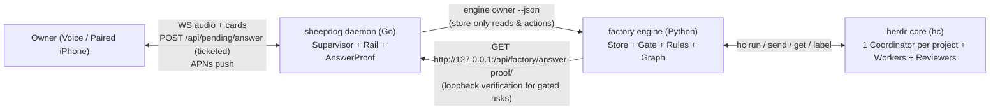
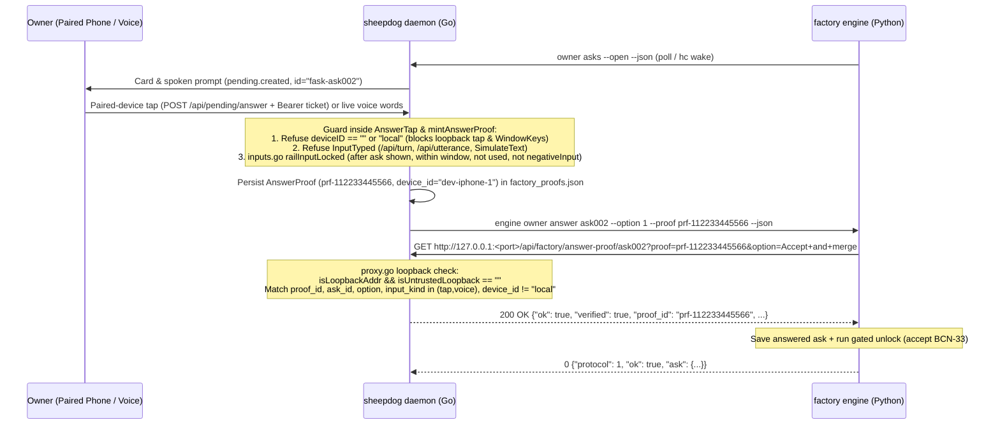
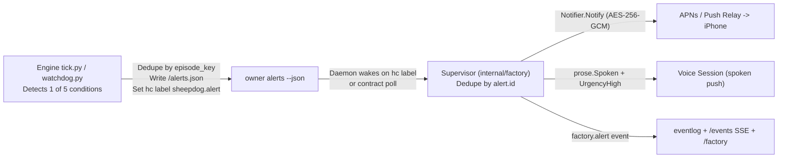

# Owner Contract v1 Design

This document specifies **owner contract v1** for `sheepdog-factory`: the versioned JSON boundary between the **sheepdog daemon** (Go, `internal/factory`, `internal/supervisor`, `internal/web`) and the **factory engine** (Python, `factory/`). It covers the resource shapes (`projects`, `asks`, `digest`, `rules`, `alerts`, and the provisional `graph`), the mutating actions (`answer`, `say`, `propose_rule`, `revoke_rule`), the eight ask kinds, the loopback answer proof that replaces `--owner-approved`, how factory alerts travel while routine worker speech stays silent, and the shared contract fixture [`testdata/factory/owner-contract-v1.json`](../../../testdata/factory/owner-contract-v1.json) that both the Python and Go test suites execute.

See [`architecture.md`](../architecture.md), [`roles.md`](../roles.md), and [`glossary.md`](../glossary.md) for sheepdog's daemon, voice, orchestrator, and rail conventions, and [`engine-audit.md`](engine-audit.md) and [`baseline.md`](baseline.md) for the Phase 0/1 factory baseline and module audit.

---

## 1. Roles, Boundaries, and v1 Binding

### 1.1 Terminology and Ownership

Following [`glossary.md`](../glossary.md), **the owner** is **the user** talking by voice or using the paired iPhone app. Across the factory seam, each layer owns a strict slice:

| Layer | Owns | Never does |
|---|---|---|
| **The owner (the user)** | Goals, standing rules, answering owner asks, approving releases (unless delegated by a typed rule), and at-the-Mac preflight steps (`sheepdog factory doctor`, logins, OS consent prompts, typing a new secret value, pressing a provider quota reset). | Babysit workers, read coordinator terminals, or manually accept routine code tasks. |
| **Voice (`internal/voice`)** | Speaking digests, alerts, ask cards, and rule read-backs; relaying the owner's verbatim words via `to_supervisor` and running `stop`. | Classify intent, touch the engine, or narrate worker/reviewer transitions. |
| **Orchestrator (`internal/brain`)** | Routing a spoken goal to the named project (`say` after reading the project name back), answering "what needs me?" and "how is X?" from code-built contract facts (`projects`, `asks`, `digest`, `graph`), and proposing a standing rule (`propose_rule`) with its read-back. | Rank projects, accept tasks, judge review gates, rewrite goals, or poll the engine in a loop (6 steps and 25 s per turn are for routing and read-back only). |
| **Supervisor & factory client (`internal/supervisor`, `internal/factory`)** | Polling/watching the contract, rendering open owner asks as cards (`pending.created` / `/api/state`), enforcing the one approval rail (`inputs.go`), minting and serving loopback `AnswerProof` records, silencing factory worker/reviewer panes by label (`SDF-23`), and delivering factory alerts and digests to APNs (`internal/push`) and the voice. | Run `git` in project worktrees or execute gated task mutations itself. |
| **Engine (`factory/`, Python stdlib)** | The task, ask, rule, milestone, and alert stores; the 15 s `tick` loop; the review and CI merge gate; task budgets and loop-breakers; the coordinator lease and watchdog; and executing every action unlocked by a verified owner answer. | Call out to a remote console or trust free-text approval flags (`--owner-approved` is removed). |
| **Coordinator (1 Opus session per project in `hc`)** | Planning the milestone graph (`plan apply` / `plan amend`), writing worker briefs, answering `decision` asks from workers, and judging recaps. Identified solely by the project record's coordinator lease (`SDF-16`). | Accept its own gated tasks without the engine's gate evidence or a verified owner `AnswerProof`. |
| **Workers & reviewers (`hc` panes)** | Changing code inside task worktrees, running checks, and reporting structured states (`status`, `ask`, `ready`, `blocked`, `dropped`). | Speak to or push notifications to the owner. |



### 1.2 Direction of Control and Store-Only Reads

1. **The daemon calls the engine; resources are the truth.** If the daemon is stopped or no phone is connected, unanswered asks and active alerts sit durably in the engine's store (`<store_dir>/asks/<id>.json`, `<store_dir>/alerts.json`) and outlive the worker that raised them (field note 31).
2. **Loopback callback for gated proof only.** The only call the engine makes to the local sheepdog daemon is a synchronous loopback HTTP `GET` to verify an `AnswerProof` before executing a gated action (Section 5).
3. **Read commands never touch project repos.** Every `engine owner <resource> --json` read command (`projects`, `asks`, `digest`, `rules`, `graph`, `alerts`) reads only the engine's JSON store files in `<data_dir>` (and the cached `usage-pools.json` from `usage.py`). It never spawns `git` inside a project folder or touches an external volume that might be stalled on a macOS TCC consent prompt (field notes 38–40).

### 1.3 CLI Binding (`engine owner … --json`)

In v1, the Go daemon invokes the embedded engine with the `uv`-managed pinned Python interpreter (`SDF-15`):

| Subcommand | Kind | Purpose |
|---|---|---|
| `owner projects --json` | Read | All registered factory projects on this machine with status, counts, coordinator lease, and quota pools. |
| `owner asks [--project <id\|folder>] [--open] --json` | Read | Owner ask records (oldest `at` first), filtered to open asks when `--open` is passed. |
| `owner digest [--project <id\|folder>] [--since <ms\|iso>] --json` | Read | Code-built cross-project or single-project digest since the given timestamp (no model call). |
| `owner rules [--project <id\|folder>] --json` | Read | Active standing rules across `everywhere`, `machine`, and `project` scopes (`typed` and `text`). |
| `owner graph --project <id\|folder> --json` | Read | Provisional Phase 4 milestone graph, task stages, dependencies, critical path, and voice summary for one project (`SDF-32`). |
| `owner alerts [--since <ms\|id>] --json` | Read | Active (and recently cleared when `--since` is given) factory-stopping alerts. |
| `owner answer <ask_id> --option <index\|label> [--proof <proof_id>] --json` | Action | Record an answer to an open ask, verify loopback proof if `gated`, and run what the answer unlocks. |
| `owner say <project> "<text>" --json` | Action | Deliver the owner's words unchanged to the project's leased coordinator. |
| `owner propose-rule --scope <scope> [--project <id\|folder>] (--type <t> --value <json> \| --text "<text>") [--section <s>] [--until <ms\|iso>] --json` | Action | Validate a candidate standing rule, build its `read_back`, and open a gated `rule` ask. (Alias: `propose_rule`.) |
| `owner revoke-rule <rule_id> --json` | Action | Immediately revoke a `delegation` rule, or open a gated `rule` ask to revoke any non-delegation rule. (Alias: `revoke_rule`.) |

### 1.4 Versioning and Error Envelope

- **Protocol version:** Every top-level response object carries `"protocol": 1`. Breaking changes increment `protocol`; additive fields within `v1` are ignored by older runtime consumers in production, while the contract validators in both test suites enforce exact key sets (`unexpected_key`) on all finalized v1 shapes so Go and Python never drift silently.
- **Timestamps:** All contract timestamps (`at`, `answered_at`, `created_at`, `expires_at`, `revoked_at`, `generated_at`, `since`, `updated_at`, `cleared_at`, `until`) are **UTC epoch milliseconds (`int`)**, matching the engine's task store and `test/contract_gate_evidence.py` (audited in [`engine-audit.md`](engine-audit.md) §2). Only `usage.py`'s upstream `five_hour_reset` and `week_reset` strings remain ISO-8601 UTC strings (`"2026-11-17T03:00:00Z"`) or `null`.
- **Error envelope:** When a command fails, it exits non-zero (exit `1`, or exit `2` on conflict) and writes a single JSON object to stdout:

```json
{
  "protocol": 1,
  "ok": false,
  "code": "proof_rejected",
  "error": "Ask ask002 is gated (gate) and the daemon rejected proof prf-deadbeef: no matching owner input."
}
```

Standard error codes (`code`):

| `code` | HTTP equivalent | Meaning |
|---|---:|---|
| `not_found` | 404 | Unknown `ask_id`, `project`, or `rule_id`. |
| `already_closed` | 409 | Ask was already answered with a different option or cancelled. |
| `invalid_option` | 400 | Option index or label is not in `ask.options`. |
| `invalid_ask` | 400 | Malformed ask record (e.g. `gated != (kind != "decision")`, invalid `options` or `recommend`, or answered gated ask missing a valid `answered_by`/`proof_id`). |
| `unknown_kind` | 400 | Ask `kind` or alert `kind` is not in the closed v1 enum. |
| `proof_required` | 403 | Gated action (`owner answer` on a gated ask, or revoking a non-delegation rule) was attempted without a verified `AnswerProof` or rule ask. |
| `proof_rejected` | 403 | The local sheepdog daemon refused or could not verify the `AnswerProof` over loopback (including ticketless loopback taps, window keys, or typed turns). |
| `not_delegable` | 400 | Attempted to create a `delegation` rule for `paid-key`, `delete`, `install`, `reset`, or `rule`. |
| `invalid_rule` | 400 | Malformed rule scope, class, type, or value schema (including a `delegation` rule missing a future `until` or valid `release_level`). |
| `unexpected_key` | 400 | JSON object contains an unknown extra property not in the v1 contract schema. |
| `not_ready` | 409 | Task or milestone cannot be accepted in its current state. |

---

## 2. Resource Shapes (v1)

Canonical JSON payloads for all resources below live in [`testdata/factory/owner-contract-v1.json`](../../../testdata/factory/owner-contract-v1.json).

### 2.1 `projects` (`owner projects --json`)

Top-level envelope: `{"protocol": 1, "projects": [Project]}`. Replaces Shepherdr's `spaces`: **a project is a repository folder** (`<store_dir>/<slug>.json`).

| Field | Type | Invariants |
|---|---|---|
| `id` | `string` | Non-empty store slug / project id (e.g. `"beacon"`). |
| `name` | `string` | Spoken/display name (e.g. `"Beacon"`). |
| `folder` | `string` | Canonical absolute path to the project repository on `machine` (e.g. `"/Users/me/projects/beacon"`). |
| `prefix` | `string` | Uppercase task prefix (`"BCN"`, `"SDF"`). |
| `machine` | `string` | Machine name (`"local"` on this computer). |
| `status` | `string` | Enum: `"working" \| "waiting" \| "idle" \| "stopped"`. `"waiting"` when `open_asks > 0`; `"stopped"` when held by an active alert (`no_pool`, `disk`, `consent_prompt`, `main_red`) or missing a live coordinator while tasks are open; `"working"` when any task or coordinator is active; else `"idle"`. |
| `open_asks` | `int` | Count of unanswered owner asks (`>= 0`). |
| `goal` | `string \| null` | Current project or active milestone goal text, or `null`. |
| `active_milestone` | `string \| null` | Active milestone id (e.g. `"M2"`), or `null`. |
| `coordinator` | `object \| null` | Lease holder from the project record (`SDF-16`): `{"terminal": string, "session": string \| null, "state": "working" \| "idle" \| "dead", "lease_valid": bool}`, or `null` before first start. |
| `spent` | `object` | `{"tasks_merged": int, "review_rounds": int, "ci_runs": int}` (`>= 0`). |
| `pools` | `Pool[]` | Account quota pools from `usage.py`: `{"pool": "claude" \| "codex" \| "antigravity-gemini" \| "antigravity-claude-gpt", "state": "ok" \| "floor" \| "unknown", "rolling": bool, "five_hour_left": number \| null, "week_left": number \| null, "five_hour_reset": string \| null, "week_reset": string \| null}`. `rolling` is `true` for `antigravity-*` pools so the daemon and coordinator render their rolling window accurately. |

### 2.2 `asks` (`owner asks [--project <id|folder>] [--open] --json`)

Top-level envelope: `{"protocol": 1, "asks": [Ask]}`. Each record in `<store_dir>/asks/<id>.json` represents one structured question (owner asks never expire on a timer):

| Field | Type | Invariants |
|---|---|---|
| `id` | `string` | Lowercase alphanumeric id (`^[a-z0-9]{6,24}$`, e.g. `"ask002"`). |
| `project` | `string` | Project `id` (`"beacon"`), or `"everywhere"` for a machine/global `rule` ask. |
| `name` | `string` | Spoken project name (`"Beacon"`), or `"All projects"` when `project == "everywhere"`. |
| `folder` | `string \| null` | Absolute repo path when project-scoped, else `null`. |
| `kind` | `string` | Required enum: `"decision" \| "gate" \| "release" \| "paid-key" \| "delete" \| "install" \| "reset" \| "rule"`. Unknown values fail with `unknown_kind`. |
| `gated` | `bool` | Strictly `kind != "decision"`. A record with `gated != (kind != "decision")` fails with `invalid_ask`. |
| `question` | `string` | Non-empty single-line question (`1..300` chars). |
| `options` | `string[]` | `2..9` distinct non-empty strings. None may end in `([a-z0-9]{1,6})`. |
| `recommend` | `string` | Must equal one element of `options[]`. |
| `task` | `string \| null` | Task ref (`"BCN-33"`) when tied to a task, else `null`. |
| `milestone` | `string \| null` | Milestone id (`"M2"`) when tied to a milestone, else `null`. |
| `subject` | `object \| null` | Structured action target executed by the engine when approved (Section 3.1); `null` for `decision`. |
| `at` | `int` | Creation time in UTC epoch ms. |
| `status` | `string` | `"open" \| "answered" \| "cancelled"`. |
| `answer` | `string \| null` | Chosen option string from `options[]` when `status == "answered"`, else `null`. |
| `answered_at` | `int \| null` | Epoch ms when answered, else `null`. |
| `answered_by` | `string \| null` | `"owner" \| "coordinator" \| "rule" \| null`. When `gated == true` and `status == "answered"`, must be `"owner"` (with `proof_id: "prf-..."`) or `"rule"` (only for `gate` or `release` with `proof_id: "rul-..."`); otherwise `validate_ask` fails with `invalid_ask`. |
| `proof_id` | `string \| null` | Daemon `AnswerProof.proof_id` (`"prf-..."`) when `answered_by == "owner"`, or `Rule.id` (`"rul-..."`) when `answered_by == "rule"`, else `null`. |

### 2.3 `digest` (`owner digest [--project <id|folder>] [--since <ms|iso>] --json`)

Built deterministically in Python from the task stores and `usage.py`, with **no model call** (`SDF-26`). Spoken on owner request, when a milestone completes, or at the morning summary:

In the spoken summary, report known quota by pool, for example “Claude 40% left”.
If any pool in use has an unknown reading, say “quota unknown” once for the
whole digest. Quota is reported per pool, independent of how many workers use it.

| Field | Type | Invariants |
|---|---|---|
| `protocol` | `int` | `1`. |
| `generated_at` | `int` | Epoch ms when the digest was built. |
| `since` | `int` | Epoch ms start of the digest window (`<= generated_at`). |
| `spoken_summary` | `string` | Code-built 1–3 sentence plain-words summary for the voice/phone (no file paths, git SHAs, or raw ids). |
| `open_asks` | `int` | Total open owner asks across the included projects. |
| `alerts_active` | `int` | Total active factory alerts across the included projects. |
| `pools` | `Pool[]` | Current account quota pools (`usage.py`). |
| `projects` | `ProjectDigest[]` | Per-project breakdown: `id`, `name`, `status`, `milestone` (`{id, title, state, merged, total} \| null`), `merged` (`[{ref, title, pr, merged_at}]`), `waiting` (`[{ref, title, stage, why}]`), `replans` (`int`), `open_asks` (`int`), and `spent` (`{tasks_merged, review_rounds, ci_runs}`). |

### 2.4 `rules` (`owner rules [--project <id|folder>] --json`)

Top-level envelope: `{"protocol": 1, "rules": [Rule]}`. Standing rules live in one layered store (`everywhere` → `machine` → `project`) and divide into two explicit classes (`SDF-25`):

1. **`class: "typed"` — Enforced in engine code (never depends on a model remembering):**
   - `merge_policy`: `"checks" | "auto" | "ask"` (default `"checks"`).
   - `review_rounds`: `{"code": int, "design": int, "doc": int}` (default `{"code": 2, "design": 1, "doc": 1}`).
   - `auto_accept`: `bool` (default `true` at the evidence bar: required passing review rounds on head SHA, green CI, proof present, no open owner ask).
   - `design_gate`: `"fable" | "owner"` (default `"fable"`; `"owner"` makes designs and milestone plans wait for an owner `gate` ask).
   - `delegation`: closed typed object `{"kinds": ("gate" | "release")[], "milestones": string[] | null, "release_level": "patch" | "minor" | "any" | null, "until": int}`:
     - `kinds`: non-empty array containing only `"gate"` and/or `"release"` (any other kind fails with `not_delegable`).
     - `milestones`: non-empty list of milestone ids (e.g. `["M0", "M1"]`) matched in code against `ask.milestone`, or `null` to cover any milestone in the rule's `scope`.
     - `release_level`: required enum `"patch" | "minor" | "any"` when `"release"` is in `kinds`; must be `null` when `"release"` is not in `kinds`. Matched deterministically in code against `ask.subject.tag` (`vMAJOR.MINOR.PATCH` compared against the repository's latest tag: `"patch"` requires `MAJOR` and `MINOR` unchanged and `PATCH` incremented by 1; `"minor"` allows `MINOR` or `PATCH` increments with `MAJOR` unchanged; `"any"` allows any semver tag).
     - `until`: mandatory future UTC epoch ms expiry (`> created_at`; missing or past `until` fails with `invalid_rule`).
   - `notify_level`: `"asks_and_alerts" | "alerts_only" | "quiet"` (default `"asks_and_alerts"`).
   - `project_priority`: `string[]` (non-empty ordered list of project `id`s, valid at `scope: "everywhere"` or `"machine"`).
2. **`class: "text"` — Assembled into the coordinator's prompt:**
   - Carries `text` (the rule prose), `section` (the template section name it layers onto, e.g. `"plan"`, `"ci"`, `"custom"`), and `base_hash` (first 12 hex chars of SHA-256 of the built-in prompt section when the rule was saved, so a binary upgrade detects base changes without losing the owner's text).
   - The typed-rules summary and the `usage.py` pool table are appended last and rebuilt fresh on every coordinator wake.

| Field | Type | Invariants |
|---|---|---|
| `id` | `string` | Rule id (`^rul-[a-z0-9]{6,16}$`). |
| `scope` | `string` | `"everywhere" \| "machine" \| "project"`. |
| `project` | `string \| null` | Non-empty project `id` when `scope == "project"`, else `null`. |
| `class` | `string` | `"typed" \| "text"`. |
| `type` | `string \| null` | One of the 7 `rule_types` when `class == "typed"`, else `null`. |
| `value` | `any` | Typed value matching `type` when `class == "typed"`, else `null`. |
| `text` | `string \| null` | Non-empty rule prose when `class == "text"`, else `null`. |
| `section` | `string \| null` | Prompt section key when `class == "text"`, else `null`. |
| `base_hash` | `string \| null` | 12-hex SHA-256 prefix of the built-in section when `class == "text"`, else `null`. |
| `read_back` | `string` | Spoken/shown sentence naming the class (`"Typed rule"` or `"Text rule"`) and scope (`"this project (<Name>)"`, `"this machine"`, or `"everywhere"`). |
| `created_at` | `int` | Epoch ms when saved. |
| `expires_at` | `int \| null` | Epoch ms expiry (required and `== value.until` when `type == "delegation"`, optional otherwise). |
| `saved_by_ask` | `string` | Id of the `rule` ask whose verified owner answer saved this rule. |
| `revoked_at` | `int \| null` | `null` while active; epoch ms when revoked. |
| `revoked_by_ask` | `string \| null` | `null` while active or when `type == "delegation"` was revoked immediately; **required** `rule` ask id (`^ask[a-z0-9]+$` / `^[a-z0-9]{6,24}$`) whenever a non-delegation rule (`type != "delegation"` or `class == "text"`) has `revoked_at != null` (otherwise fails with `proof_required`). |

### 2.5 `graph` (`owner graph --project <id|folder> --json` — Provisional Phase 4 Shape)

> **Provisional until Phase 4 (`SDF-30`–`SDF-32`):** The `graph` resource is sketched here so the contract client (`SDF-22`) knows its top-level envelope, but its exact keys are **outside v1 strict extra-key enforcement until `SDF-32`** extends [`testdata/factory/owner-contract-v1.json`](../../../testdata/factory/owner-contract-v1.json). The single-stage ordered table per task is defined in `SDF-30`. `SDF-31` defined the milestone fields, `plan apply` and `plan amend` ([milestones.md](milestones.md)). The mandate is one field, the owner's words; there is no `observe` mode.

| Object / Field | Type | Provisional Shape (finalized in `SDF-30`–`SDF-32`) |
|---|---|---|
| `protocol` | `int` | `1`. |
| `project`, `name`, `folder` | `string` | Project `id`, spoken `name`, and canonical `folder`. |
| `updated_at`, `replans` | `int` | Latest update timestamp (epoch ms) and count of `plan amend` replans (`SDF-31`). |
| `spoken_summary` | `string` | Code-built 1–3 sentence plain-words summary of active milestone, critical path, and blockers (`SDF-36`). |
| `critical_path` | `object \| null` | `{"milestone": string, "tasks": string[], "remaining_ms": int, "remaining_text": string}` (`SDF-32`). |
| `milestones[]` | `object[]` | `{"id", "title", "goal", "order", "exit_test", "gate": "auto"\|"fable"\|"owner", "state": "planned"\|"active"\|"validating"\|"done", "acceptance_task", "mandate": string, "ui": bool, "release": string \| null}`. `state` is derived, never stored (`SDF-31`). |
| `tasks[]` | `object[]` | `{"ref", "id", "title", "milestone", "kind", "stage", "why_waiting", "after": string[], "dependents": string[], "on_critical_path": bool, "estimate_ms", "left_ms", "done_pct"}`, where `stage` comes from `SDF-30`'s ordered stage table. |

---

## 3. Actions (`answer`, `say`, `propose_rule`, `revoke_rule`)

### 3.1 `answer(ask, option, proof)`

Command: `engine owner answer <ask_id> --option <index|label> [--proof <proof_id>] --json`

1. **Lookup & option resolution:** Loads `<store_dir>/asks/<ask_id>.json` (`not_found` if missing). Checks `ask.kind` against `ask_kinds` (`unknown_kind` if not one of the 8 v1 kinds). Resolves `--option` as a 1-based index (`"1".."9"`) or exact string match in `ask.options` (`invalid_option` if no match).
2. **Idempotency & conflict:**
   - If `ask.status == "answered"` with the **same** resolved option label (and same `proof_id` when provided), returns exit `0` with `"idempotent": true` and the `Ask` (§2.2) with no duplicate side effects.
   - If `ask.status != "open"` otherwise (answered with a different option or cancelled), refuses with `code: "already_closed"` (HTTP 409 equivalent).
3. **Proof verification for gated asks (`ask.gated == true`):**
   - Requires `--proof <proof_id>` (`proof_required` if omitted).
   - Queries the local sheepdog daemon over loopback (`GET http://127.0.0.1:<port>/api/factory/answer-proof/<ask_id>?proof=<proof_id>&option=<option_label>`; Section 5). If the daemon rejects the proof or cannot be reached, refuses with `code: "proof_rejected"` and leaves the ask `"open"`.
4. **Engine-run unlock:** Once verified, the engine atomically updates the ask record (`status: "answered"`, `answer`, `answered_at`, `answered_by: "owner"`, `proof_id`) and executes what the answer unlocks:
   - **`decision`**: Sends `<herdr-news event="answer">` to the asking worker or coordinator and marks the task eligible for the **answered-ask queue slot** (`queues.py` grants 1 urgent slot so new work never delays an answered ask).
   - **`gate`**: On an approving option, records `accepted_by: "owner"`, `accepted_ask: ask.id`, `proof_id` on the target task (`subject.ref`), clears `review_out` if out of rounds (field note 47), and runs the accept/merge flow (`cmd_accept`).
   - **`release`**: On an approving option, creates/pushes `subject.tag` or dispatches `subject.workflow` on `subject.head`.
   - **`paid-key`**: On an approving option, widens the named `herdr-secret` entry (`subject.secret`) to `subject.project` without exposing or logging the secret's value.
   - **`delete` / `install` / `reset`**: On an approving option, runs the pre-registered engine operation in `subject`.
   - **`rule`**:
     - When `subject.action == "save_rule"`, activates the rule in `settings.json` with `saved_by_ask: ask.id` and delivers the updated rules block to running coordinators (`settings_pass`).
     - When `subject.action == "revoke_rule"`, stamps `revoked_at: now()` and `revoked_by_ask: ask.id` on `subject.rule_id` and runs `settings_pass`.
   - **Declining option on any kind:** Records the decline without running the gated operation and notifies the coordinator via `<herdr-news event="answer">`.

Returns `{"protocol": 1, "ok": true, "idempotent": bool, "unlocked": string | null, "ask": <Ask (§2.2)>}` (see `valid.actions.answer` in [`testdata/factory/owner-contract-v1.json`](../../../testdata/factory/owner-contract-v1.json)).

### 3.2 `say(project, text)`

Command: `engine owner say <project> "<text>" --json`

1. Resolves `<project>` by project `id`, case-insensitive `name`, or canonical `folder` (`not_found` if unknown).
2. Resolves the target terminal strictly from the project's **coordinator lease** (`SDF-16`, field notes 54 & 55), never by scanning arbitrary terminals for a role label or tab title. If the lease has no live terminal, reconciles/starts the project's single coordinator in `folder` first.
3. Delivers `<herdr-owner project="<id>">text</herdr-owner>` with the owner's words **unchanged** via `send_or_hold`.
4. **Brain read-back rule (`SDF-27`):** Before the orchestrator (`internal/brain`) calls `say` for a new goal, it confirms the project name and goal summary with the owner so a goal is never routed to the wrong project silently.

Returns `{"protocol": 1, "ok": true, "project": string, "name": string, "coordinator": string, "delivery": "sent" | "held"}`.

### 3.3 `propose_rule(scope, value | text)`

Command: `engine owner propose-rule --scope <everywhere|machine|project> [--project <id|folder>] (--type <type> --value <json> | --text "<text>" [--section <section>]) [--until <ms|iso>] --json`

1. Validates `scope`, `class` (`typed` when `--type` is given, `text` when `--text` is given), and schema.
2. Enforces the **non-delegable rail**: if `type == "delegation"`, verifies that `value.kinds` is a non-empty subset of `["gate", "release"]`, `value.release_level` is `"patch" | "minor" | "any"` iff `"release"` is in `kinds` (else `null`), and `value.until` is a future timestamp (`> now()`). Any attempt to delegate `paid-key`, `delete`, `install`, `reset`, or `rule` fails immediately with `code: "not_delegable"`.
3. Builds the mandatory `read_back` string naming the rule's **class** (`"Typed rule"` or `"Text rule"`) and **scope** (`"this project (<Name>)"`, `"this machine"`, or `"everywhere"`).
4. Creates an open `Ask` (§2.2) with `kind: "rule"`, `gated: true`, `options: ["Save rule", "Cancel"]`, `recommend: "Save rule"`, and `subject` holding the candidate rule (`action: "save_rule"`). The rule takes effect only after that ask is answered through `owner answer` with a verified `AnswerProof`.

Returns `{"protocol": 1, "ok": true, "read_back": string, "ask": <Ask (§2.2)>}` (see `valid.actions.propose_rule` in [`testdata/factory/owner-contract-v1.json`](../../../testdata/factory/owner-contract-v1.json)).

### 3.4 `revoke_rule(id)`

Command: `engine owner revoke-rule <rule_id> --json`

Whether revoking a rule can run without an owner `AnswerProof` depends on whether revocation **tightens** or **loosens** authority:

1. **Delegation rules (`rule.type == "delegation"`) — Immediate:**
   - Revoking a delegation strictly tightens authority (returning `gate` or `release` decisions to the owner). It executes immediately without opening a second ask, sets `revoked_at: now()` and `revoked_by_ask: null`, logs the revocation, and runs `settings_pass`.
   - Returns `{"protocol": 1, "ok": true, "revoked": true, "rule": <Rule (§2.4)>, "ask": null}`.
2. **All other rules (`rule.type != "delegation"` or `rule.class == "text"`) — Gated by a `rule` ask:**
   - Revoking a non-delegation rule can **loosen** safety rails (for example, revoking `design_gate: "owner"`, `merge_policy: "ask"`, or `auto_accept: false` falls back to auto-accepting code or Fable-judging designs without the owner).
   - Therefore, calling `revoke_rule` on any non-delegation rule leaves `revoked_at: null` and opens a gated `Ask` (§2.2) with `kind: "rule"`, `gated: true`, `question: "Revoke <read_back>?"`, `options: ["Revoke rule", "Keep"]`, `recommend: "Revoke rule"`, and `subject: {"action": "revoke_rule", "rule_id": rule.id}`.
   - The rule is revoked (`revoked_at` and `revoked_by_ask` set) only when that `rule` ask is answered with `"Revoke rule"` and verified by a loopback `AnswerProof`. A stored non-delegation rule with `revoked_at != null` and `revoked_by_ask == null` is rejected by `validate_rule` with `code: "proof_required"`.
   - Returns `{"protocol": 1, "ok": true, "revoked": false, "rule": <Rule (§2.4)>, "ask": <Ask (§2.2)>}`.

---

## 4. Ask Kinds and Retirement of `--owner-approved`

### 4.1 The Eight v1 Ask Kinds

Every ask record carries a mandatory `kind` from this closed table:

| `kind` | `gated` | Coordinator may answer? | Delegable by typed rule? | What it gates / unlocks |
|---|---|---|---|---|
| `decision` | `false` | **Yes** | N/A (not gated) | Worker or coordinator engineering/product choice with no privileged side effect. |
| `gate` | `true` | No | **Yes** (`milestones` + `until`) | Accepting a design/plan task when `design_gate == "owner"`, accepting an out-of-rounds task (field note 47), or passing an owner-gated milestone (field note 18). |
| `release` | `true` | No | **Yes** (`milestones` + `release_level` + `until`) | Tagging a version, pushing a release tag, or triggering `release.yml` / TestFlight upload (placed before merge/tag, field note 31). |
| `paid-key` | `true` | No | **Never** | Widening a stored `herdr-secret` key's scope to a project (`subject.secret`, field notes 11 & 12). |
| `delete` | `true` | No | **Never** | Irreversible deletion outside a task's own worktree or build directory. |
| `install` | `true` | No | **Never** | Installing host packages, toolchains, or self-hosted factory updates. |
| `reset` | `true` | No | **Never** | Spending a provider limit-reset credit or resetting project state. |
| `rule` | `true` | No | **Never** | Saving a standing rule (`propose_rule`) or revoking a non-delegation rule (`revoke_rule`). |

**Delegation chain of custody (`answered_by: "rule"`):** When a `gate` or `release` ask is opened, the engine checks active, non-expired `delegation` rules (`revoked_at == null`, `expires_at > now()`) in `project` → `machine` → `everywhere` order using deterministic code checks only:
1. `ask.kind` is in `rule.value.kinds` (`"gate"` or `"release"` only).
2. `rule.value.milestones` is `null` or contains `ask.milestone`.
3. When `ask.kind == "release"`, `ask.subject.tag` (`vMAJOR.MINOR.PATCH`) satisfies `rule.value.release_level` against the repository's latest release tag (`"patch"` requires identical `MAJOR.MINOR` and `PATCH == prev_patch + 1`; `"minor"` requires identical `MAJOR`; `"any"` accepts any valid semver tag), and the milestone's acceptance/QA checks have passed.

When all three checks pass, the engine answers the ask in code with `status: "answered"`, `answer: ask.recommend`, `answered_at: now()`, `answered_by: "rule"`, and `proof_id: rule.id`. Because saving that `delegation` rule itself required a `rule` ask (`rule.saved_by_ask`) backed by a daemon-verified `AnswerProof`, every delegated `gate` or `release` traces back to a verified owner input in the store.

### 4.2 Unknown Ask Kinds Refused

Both producer and consumer enforce the closed `ask_kinds` set:
- **In Python (`SDF-21`):** `herdr-task ask --kind <k>`, `ask.load()`, and `owner.validate_ask()` reject any `kind` not in `("decision", "gate", "release", "paid-key", "delete", "install", "reset", "rule")`, raising `Fail` / `ValueError` with `code: "unknown_kind"`.
- **In Go (`SDF-22`):** `internal/factory.DecodeAsk` / `ValidateAsk` returns `ErrUnknownAskKind` on any unrecognized or empty `kind`. The daemon never creates a pending action, never renders an answer button, and never mints an `AnswerProof` for an unknown kind.

### 4.3 Removing `--owner-approved` and Unverified Approvals

To close the three approval loopholes identified in the audit (`commands.py:2016–2056`, `tick.py`, and `ask.py:199–237`):
1. **`--owner-approved` is deleted** from `cli.py` and `commands.py` (`SDF-21`). Passing `--owner-approved` is an unrecognized argument error.
2. **`HERDR_TASK_BY` no longer grants owner authority.** `cmd_accept` no longer defaults `accepted_by` to `"person"` when called outside a coordinator terminal.
3. **`accept --ask <ask_id>` replaces `--owner-approved`.** Accepting an out-of-rounds task or an owner-gated design/milestone requires an answered `gate` ask whose `subject.ref` names the task and whose `proof_id` passes the daemon's loopback verification.
4. **Terminal keystrokes cannot answer gated asks.** Gated asks (`gated: true`) are answered only through `engine owner answer` with a daemon-verified `AnswerProof`, never by an agent sending `hc keys` into an `_ask-pane` terminal.

---

## 5. The Loopback Answer Proof

### 5.1 Why the Proof Lives in the Daemon

Sheepdog's core safety rule ([`AGENTS.md`](../../../AGENTS.md), [`roles.md`](../roles.md) "The one rail") is that **an approval is answered only on the user's own fresh tap or recorded words, checked in Go code (`internal/supervisor/inputs.go`)**. Because any local process can invoke the Python CLI or write a string flag, the Python engine cannot trust its own CLI arguments as proof that the owner answered. Instead, the daemon records the owner's input through its rail, mints an `AnswerProof`, and the engine verifies that proof with the daemon over loopback before executing any gated action.

### 5.2 Step-by-Step Verification Flow



1. **Mapping asks into existing cards (`internal/factory` → `internal/supervisor`):**
   - Each open owner ask from `owner asks --open --json` is registered in `Supervisor` as a `state.PendingAction` (`Kind: state.PendingAnswerPrompt`) with:
     - `ID`: `"fask-" + ask.ID` (e.g. `"fask-ask002"`).
     - `PaneID`: `"factory:" + ask.Project` (spoken name set to `ask.Name`, e.g. `"Beacon"`).
     - `Question`: `ask.Question`.
     - `Command`: `ask.Kind` + task/subject summary (e.g. `"gate · BCN-33"`), or `""` for plain questions.
     - `Options`: 1-based `state.Option` entries for `ask.Options`, with `Recommended: o == ask.Recommend` and `Default: o == ask.Recommend`.
   - Because `/api/state` (`pending_action` and `questions[]`), `/events` (`pending.created`), APNs `push.KindApproval` notifications, and `/ws` `CardKindApproval` frames all read `state.PendingAction`, the paired iPhone app (`SDF-28`) and `/voice` render factory asks without a separate card protocol.
   - **Desktop panel (`mods/sheepdog`) is read-only for factory asks:** Because the desktop panel connects over ticketless loopback (`deviceID == localDevice`), it displays open factory asks in the timeline/list as read-only status cards and does not offer answer buttons for `"fask-"` items; answering a factory ask requires a paired phone ticket or live voice speech.
   - For `"fask-"` actions, `AnswerTap` skips terminal screen-scraping (`stillAsking`) and instead verifies that the ask is still open in the contract client before running the rail.
2. **Paired-ticket and voice-only guard inside `AnswerTap` and `mintAnswerProof` (`internal/supervisor/inputs.go`, `internal/supervisor/window.go`):**
   - In `internal/web/auth.go:120–124` and `internal/web/server.go:540–564`, `accessDevice` routes grant a ticketless loopback request `localDevice` (`"local"`) authority. Moreover, `AnswerTap` (`inputs.go:583`) has **two** callers: `handlePendingAnswer` (`POST /api/pending/answer`) and `Supervisor.WindowKeys` (`internal/supervisor/window.go:243`, reached via `POST /api/agents/{pane_id}/input` in `internal/web/window.go:99`), and `AnswerTap` appends its own `shepherdInput{kind: InputTap}` right before calling `railInputLocked` (`inputs.go:638–644`).
   - Putting the check only in `handlePendingAnswer` would leave `WindowKeys` open on loopback. Therefore, the authenticated `deviceID` from `r.Context()` is threaded into `AnswerTap(ctx, id, option, deviceID)` (and `WindowKeys`), and the guard sits **both inside `AnswerTap` (before `addInputLocked`) and inside `mintAnswerProof`**:
     1. **Paired-device tap (`input_kind: "tap"`):** Allowed only when `deviceID != "" && deviceID != localDevice` (i.e. authenticated via `s.hasValidTicket(r)` to an active, non-revoked paired device `d.ID` in `devices.go`). Any call to `AnswerTap` or `mintAnswerProof` on `"fask-"` with `deviceID == ""` or `deviceID == "local"` (whether via `POST /api/pending/answer` or `POST /api/agents/{pane_id}/input` `WindowKeys`) is refused before `addInputLocked` with `ErrProofRejected` (HTTP `403`, logged as `brain.rail_blocked`).
     2. **Live voice-session speech (`input_kind: "voice"`):** Allowed only when `in.kind == InputVoice` (transcribed from `voice.transcript.in` on the active `/ws` voice session, with `device_id` set to the `/ws` client's paired device id or `"voice-session"`). Typed HTTP turns (`POST /api/turn`, `POST /api/utterance`) and `/ws` `SimulateText` frames (`in.kind == InputTyped`) are refused by `railInputLocked` and `mintAnswerProof` for `"fask-"` actions.
   - Both authorized paths must also pass `railInputLocked` (`inputs.go:458`): input arrived after the ask was presented, `!in.used`, not displaced, within `AuthoriseWindow`, non-empty/non-filler, and `!(negativeInput(in.text) && approves(p, keys))`.
3. **Minting `AnswerProof` (`internal/factory`):**
   - Once the source check in `mintAnswerProof` and `railInputLocked` succeed and mark `in.used = true`, the daemon mints `proof_id` (`"prf-" + 12 hex chars`) and persists the `AnswerProof` record (including `device_id`) in `<data_dir>/factory_proofs.json` (mode `0600`, atomic rename, 24 h retention).
4. **Loopback verification endpoint (`GET /api/factory/answer-proof/{ask_id}`):**
   - Query parameters: `proof=<proof_id>&option=<option_label>`.
   - **Strict local loopback guard (`internal/web/proxy.go`):** Requires `isLoopbackAddr(r.RemoteAddr)` **and** `s.isUntrustedLoopback(r) == ""` (rejecting any request with `X-Forwarded-*`, `Forwarded`, `X-Real-IP`, `Tailscale-*`, `CF-Connecting-IP`, or `True-Client-IP` headers, or arriving while Tailscale Funnel is active on the daemon port).
   - Verifies that `proof_id` exists, `ask_id` and `option_label` match, `input_kind` is `"tap"` or `"voice"`, `device_id` is non-empty and `!= "local"`, and `input_seq > 0`. Logs `factory.proof_verified` (or `factory.proof_rejected` with `reason`) to `internal/eventlog`.
   - Returns HTTP `200` with the `answer_proof` shape in [`testdata/factory/owner-contract-v1.json`](../../../testdata/factory/owner-contract-v1.json), or HTTP `403` / `404` `{"ok": false, "verified": false, "code": "proof_rejected", "error": "..."}`.
5. **Threat boundary, residuals, and required tests (`SDF-22`):**
   - **What this stops:** Agent shortcuts (`--owner-approved`, `HERDR_TASK_BY`, `hc keys` into `_ask-pane`, ticketless loopback `POST /api/pending/answer`, loopback `POST /api/agents/{pane_id}/input` `WindowKeys`, loopback `POST /api/turn`, or an invented `--proof` token). `SDF-22` must test that all three loopback HTTP paths (`POST /api/pending/answer`, `POST /api/agents/{pane_id}/input` with option keys, and `POST /api/turn`) on `"fask-<id>"` without a paired-device ticket are refused and mint no `AnswerProof`.
   - **Two accepted residuals outside this boundary:**
     1. *Loopback self-pairing:* Because `GET /api/pair` (`internal/web/pair.go`) is `accessLoopback`, a local process running as the same OS user on the host could fetch a pairing code, enroll a fake device, and tap with that ticket (audited via `web.device.enrolled` and `device_id` in `factory.proof_verified`).
     2. *Unauthenticated local `owner say`:* A local process running as the same OS user can invoke `engine owner say <project> "<text>"` directly on the CLI.
     Workers run with full user permissions on the machine — as the owner is told at first run — so a hostile same-user process can call loopback pairing routes, run local CLI commands, or write files directly; the loopback proof is there to keep honest agents on the rail, and the audit events above remain on record.

---

## 6. How Alerts Travel (and the Quiet Rule)

### 6.1 The Quiet Rule (`SDF-23`)

In a factory project, every terminal spawned by the engine carries `sheepdog.project=<id>` and `sheepdog.role=<coordinator|worker|reviewer|checks>` (alongside `sheepdog.task=<slug>#<n>` on task panes), while worker-spawned reviewers and helpers carry `sheepdog.role=<reviewer|helper>` and/or `sheepdog.task=<slug>#<n>` without requiring `sheepdog.project`.

A hard code rule in `internal/supervisor` (`herdr.IsFactoryQuiet`) checks these labels on every `herdr` transition (`worker`, `reviewer`, `checks`, `helper`, or any non-coordinator pane with `sheepdog.task`):
- **Workers, reviewers, helpers, and check panes are completely silent to the owner:** their starts, finishes, blocks on coordinator `decision` asks, review rounds, CI runs, rebases, retries, and model switches trigger **zero** `announce` turns, **zero** voice pushes, **zero** pending prompt cards, and **zero** APNs notifications.
- Only **owner asks**, **factory alerts**, and **digests** break the silence.

### 6.2 The Five Allowed Alert Kinds (`SDF-24`)

An alert breaks the silence without being asked **only** when the factory or a release pipeline has stopped and cannot self-heal. The contract enforces a closed `alert_kinds` enum of five conditions:

| `kind` | Trigger Condition in Engine | Episode Dedupe Key (`episode_key`) | Clear Condition |
|---|---|---|---|
| `no_pool` | All configured pools for runnable tasks are at or below the quota floor (`usage.py` `state == "floor"` / `0%`), halting new starts or handoffs. | `no_pool:<machine>` | Any configured pool rises above the floor on reset. |
| `disk` | Free disk space falls below the machine guard threshold (`> 90%` used; body names the largest task build dirs per field note 41) or `probe_volume` times out cleanly. | `disk:<folder_or_mount>` | Disk usage drops below threshold and `probe_volume` succeeds. |
| `consent_prompt` | Two consecutive new agent starts hang blank (`<= 1` byte output, `0%` CPU) or `probe_volume` blocks only for new processes — indicating a macOS TCC / removable-volume consent dialog or CLI login prompt is waiting at the Mac (field notes 38–40). | `consent_prompt:<folder>` | A fresh canary/agent start or `probe_volume` succeeds. |
| `main_red` | The project's base branch (`main`) has had failing CI for over 60 minutes (`> 3,600,000 ms`), holding PR merges (`FAC-113`, field note 23). | `main_red:<project>:<base>` | Base branch CI turns green. |
| `ci_stalled` | A `ready` or `merging` task has waited on CI checks for over 90 minutes (`> 5,400,000 ms`, owned by `SDF-24`). | `ci_stalled:<project>:<task_ref>:<head_sha>` | The PR's checks finish, the task merges, or a new head is pushed. |

Any other event (such as a worker finishing, a single check failure that the coordinator is fixing, or a coordinator restart that succeeded) is **refused** by the alert validator (`unknown_kind`).

### 6.3 End-to-End Alert Transport



1. **Engine emission & episode deduplication:** When one of the five conditions fires and no active alert (`cleared_at: null`) exists for its `episode_key`, the engine appends an `Alert` record to `<store_dir>/alerts.json` and updates the `sheepdog.alert=<id>` label on the project's coordinator terminal so `internal/herdrcore`'s event stream wakes the daemon immediately.
2. **Contract shape (`owner alerts [--since <ms|id>] --json`):** Top-level envelope `{"protocol": 1, "alerts": [Alert]}` (see `valid.alerts` in [`testdata/factory/owner-contract-v1.json`](../../../testdata/factory/owner-contract-v1.json)).

| Field | Type | Invariants |
|---|---|---|
| `id` | `string` | Alert id (`^alt-[a-z0-9]{6,16}$`). |
| `episode_key` | `string` | Deterministic deduplication key for the outage spell. |
| `kind` | `string` | Enum: `"no_pool" \| "disk" \| "consent_prompt" \| "main_red" \| "ci_stalled"`. |
| `project` | `string \| null` | Project `id` (`"beacon"`), or `null` for machine-wide `no_pool` / `disk`. |
| `name` | `string \| null` | Spoken project name (`"Beacon"`), or `null`. |
| `task` | `string \| null` | Task ref (`"BCN-12"`) for `ci_stalled`, else `null`. |
| `title` | `string` | Plain headline (`1..120` chars). |
| `body` | `string` | Plain explanation with facts (`1..300` chars, e.g. reset time or biggest build folders). |
| `fix` | `string` | One-line action for the owner at the Mac or by voice (`1..200` chars). |
| `at` | `int` | Epoch ms when the episode started. |
| `cleared_at` | `int \| null` | `null` while active; epoch ms when resolved. |

3. **Daemon delivery (`SDF-24`):**
   - The daemon tracks delivered `alert.id` values in its persisted state so each episode alerts **at most once** across restarts.
   - Respects `notify_level` rule (`"quiet"` holds non-critical speech until the next session, while APNs push and `/factory` banner still record the stop).
   - Sends one encrypted APNs push notification (`internal/push`, [`push.md`](../push.md)) with `EventID: "factory-alert-" + alert.ID` and `NeedsYou: true`, and queues one `prose.Spoken`-scrubbed voice push. When APNs is not configured on a self-hosted daemon, the alert remains in the inbox and is spoken at the start of the next voice session.

---

## 7. Shared Contract Fixture (`testdata/factory/owner-contract-v1.json`)

To prevent the Go daemon and Python engine from drifting (`sheepdog-factory-design.md` §9 risk 4), both test suites run against the checked-in fixture at **[`testdata/factory/owner-contract-v1.json`](../../../testdata/factory/owner-contract-v1.json)** (following the pattern of [`ios/Tests/Fixtures/agent-attention.json`](../../../ios/Tests/Fixtures/agent-attention.json), [`internal/web/protocol_golden_test.go`](../../../internal/web/protocol_golden_test.go), and `test/contract_gate_evidence.py` as audited in [`engine-audit.md`](engine-audit.md) §2).

### 7.1 How Both Suites Run the Fixture

1. **Python suite (`SDF-21`, `factory/test/test_owner_contract.py`):**
   - Loads [`testdata/factory/owner-contract-v1.json`](../../../testdata/factory/owner-contract-v1.json).
   - Validates every finalized v1 payload in `valid` (`projects`, `asks_by_kind` covering all 8 ask kinds, `digest`, `rules` covering all 7 typed rule types + 1 text rule, `alerts` covering all 5 alert kinds, `answer_proof`, and `actions`) through `factory.owner.validate_<shape>()`, asserting zero errors.
   - Ensures that the live output of `owner {projects,asks,digest,rules,alerts,answer,say,propose-rule,revoke-rule} --json` against a seeded store passes the exact same validators.
   - Runs every entry in `invalid`, asserting that `validate_<target>()` (and `cmd_ask` / `cmd_owner`) raises `Fail` or `ValueError` with the expected `error_code`.
2. **Go suite (`SDF-22`, `internal/factory/contract_test.go`):**
   - Loads the same [`testdata/factory/owner-contract-v1.json`](../../../testdata/factory/owner-contract-v1.json).
   - Decodes every finalized v1 object in `valid` using strict Go decoders (`json.NewDecoder` with `DisallowUnknownFields()` plus `Validate()`), round-trips back to JSON, and asserts structural equality.
   - Runs every entry in `invalid`, asserting that strict decoding or `Validate()` fails with the mapped error code.
3. **Provisional `graph_provisional` until `SDF-32`:**
   - `valid.graph_provisional` is excluded from strict v1 extra-key enforcement in `SDF-21`/`SDF-22` so Phase 4 (`SDF-30`–`SDF-32`) can finalize the stage and mandate fields without breaking Phase 3 tests; `SDF-32` promotes `graph` into the strict validator set.

### 7.2 Negative Rejection Cases in `testdata/factory/owner-contract-v1.json`

| # | `invalid[].name` | `target` | `error_code` | What it proves |
|---:|---|---|---|---|
| 1 | `unknown ask kind is refused` | `ask` | `unknown_kind` | Unrecognized ask kind (`"deploy"`) is rejected by both Python and Go. |
| 2 | `empty ask kind is refused` | `ask` | `unknown_kind` | Empty `kind: ""` is rejected. |
| 3 | `gated ask marked gated=false is refused` | `ask` | `invalid_ask` | `kind: "release"` with `gated: false` violates `gated == (kind != "decision")`. |
| 4 | `answered gated ask without proof_id is refused` | `ask` | `invalid_ask` | Static `Ask` record with `answered_by: "owner"` and `proof_id: null` is rejected. |
| 5 | `gated ask answered by coordinator is refused` | `ask` | `invalid_ask` | Static `Ask` record with `kind: "gate"` and `answered_by: "coordinator"` is rejected. |
| 6 | `delegating paid-key or reset is refused` | `rule` | `not_delegable` | `delegation` rule naming `"paid-key"` or `"reset"` in `value.kinds` is refused. |
| 7 | `delegation rule without until is refused` | `rule` | `invalid_rule` | `delegation` rule with `until: null` is refused. |
| 8 | `delegation rule with unknown release_level is refused` | `rule` | `invalid_rule` | `delegation` rule with `release_level: "major_breaking"` outside `"patch"\|"minor"\|"any"` is refused. |
| 9 | `unknown rule type is refused` | `rule` | `invalid_rule` | `class: "typed"` with `type: "unknown_policy"` outside `rule_types` is refused. |
| 10 | `revoking a non-delegation rule without a rule ask proof is refused` | `rule` | `proof_required` | Non-delegation rule (`design_gate: "owner"`) with `revoked_at != null` and `revoked_by_ask: null` is refused. |
| 11 | `worker chatter as an alert kind is refused` | `alert` | `unknown_kind` | `kind: "worker_finished"` outside the 5 `alert_kinds` is refused. |
| 12 | `ticketless local device in AnswerProof is refused` | `answer_proof` | `proof_rejected` | `AnswerProof` with `device_id: "local"` (ticketless loopback tap or `WindowKeys`) is refused. |
| 13 | `typed input in AnswerProof is refused` | `answer_proof` | `proof_rejected` | `AnswerProof` with `input_kind: "typed"` (`/api/turn`, `/api/utterance`, `SimulateText`) is refused. |
| 14 | `unknown extra JSON key is refused` | `ask` | `unexpected_key` | Extra property `unexpected_extra_field` fails strict schema validation. |

---

## 8. Downstream Implementation Map (Milestones 3 and 4)

| Task | Side | What it builds from this document |
|---|---|---|
| **`SDF-21`** | Python (`factory/`) | `factory/owner.py` + `ask.py` + `commands.py`: 8 ask kinds (`unknown_kind` refused), `owner {projects,asks,answer,say} --json`, loopback proof check in `answer` and `accept --ask`, removal of `--owner-approved`, and `factory/test/test_owner_contract.py` against [`testdata/factory/owner-contract-v1.json`](../../../testdata/factory/owner-contract-v1.json). |
| **`SDF-22`** | Go (`internal/factory`, `internal/supervisor`, `internal/web`) | Contract client, open factory asks rendered as question cards (`pending.created` / `/api/state`, read-only on the desktop panel), `deviceID` threaded into `AnswerTap` and `mintAnswerProof` (refusing ticketless loopback `POST /api/pending/answer`, `POST /api/agents/{pane_id}/input` `WindowKeys`, and `POST /api/turn`), `GET /api/factory/answer-proof/{ask_id}` with `proxy.go` loopback guard, and `internal/factory/contract_test.go` against [`testdata/factory/owner-contract-v1.json`](../../../testdata/factory/owner-contract-v1.json). |
| **`SDF-23`** | Go (`internal/supervisor`) | Quiet rule keyed on `sheepdog.project` / `sheepdog.role` / `sheepdog.task` labels silencing all worker and reviewer speech and APNs pushes. |
| **`SDF-24`** | Python & Go | The 5 factory-stop alert kinds (`no_pool`, `disk`, `consent_prompt`, `main_red`, `ci_stalled` at 90m), `owner alerts --json`, episode deduplication, APNs push, and voice briefing push. |
| **`SDF-25`** | Python & Go | `owner rules --json`, `owner propose-rule --json`, `owner revoke-rule --json` (immediate for `delegation`, gated `rule` ask for all other rules), `typed` vs `text` rule store, `read_back` with class and scope, `factory start` answer migration, and prompt assembly (`base_hash`, typed summary, pool table). |
| **`SDF-26`** | Python & Go | `owner digest --json` built in pure code from the stores and `usage.py`, spoken on request, at a milestone, and in the morning. |
| **`SDF-27`** | Go (`internal/brain`, `prompts/svp/`) | Brain routes goals to the right project via `owner say` after reading the project name back (`make eval` with no Safe regression). |
| **`SDF-28`** | iOS (`ios/`) | Verifies that the app's existing approval cards render factory asks and tap answers via `/api/pending/answer`. |
| **`SDF-30`–`36`** | Python, Go, Web | Ordered stage table (`SDF-30`), milestones and `plan apply`/`amend` (`SDF-31`), critical path, merge order, and promoting `owner graph --json` in [`testdata/factory/owner-contract-v1.json`](../../../testdata/factory/owner-contract-v1.json) (`SDF-32`), `/factory` page (`SDF-34`, `SDF-35`), and voice graph summary (`SDF-36`). |
