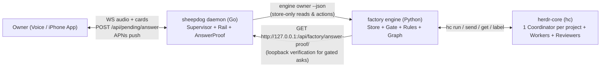
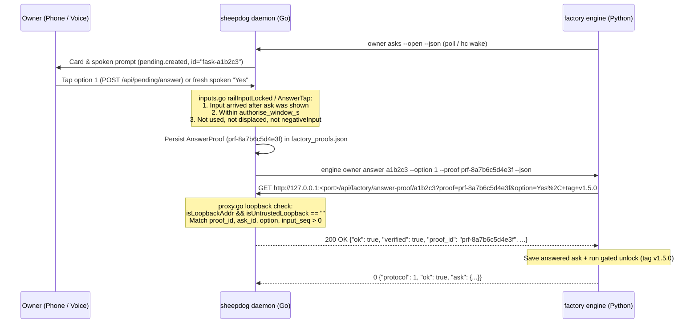
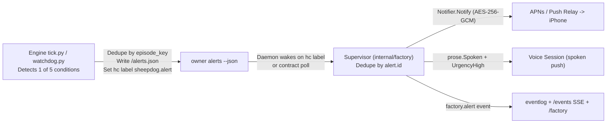

# Owner Contract v1 Design

This document specifies **owner contract v1** for `sheepdog-factory`: the versioned JSON boundary between the **sheepdog daemon** (Go, `internal/factory`, `internal/supervisor`, `internal/web`) and the **factory engine** (Python, `factory/`). It covers the resource shapes (`hello`, `projects`, `asks`, `digest`, `rules`, `graph`, `alerts`), the mutating actions (`answer`, `say`, `propose_rule`, `revoke_rule`), the eight ask kinds, the loopback answer proof that replaces `--owner-approved`, how factory alerts travel while routine worker speech stays silent, and the shared contract fixture that both the Python and Go test suites execute.

See [`architecture.md`](../architecture.md), [`roles.md`](../roles.md), and [`glossary.md`](../glossary.md) for sheepdog's daemon, voice, orchestrator, and rail conventions, and [`engine-audit.md`](engine-audit.md) and [`baseline.md`](baseline.md) for the Phase 0/1 factory baseline and module audit.

---

## 1. Roles, Boundaries, and v1 Binding

### 1.1 Terminology and Ownership

Following [`glossary.md`](../glossary.md), **the owner** is **the user** talking by voice or using the paired iPhone app. Across the factory seam, each layer owns a strict slice:

| Layer | Owns | Never does |
|---|---|---|
| **The owner (the user)** | Goals, standing rules, answering owner asks, approving releases (unless delegated by a typed rule), and at-the-Mac preflight steps (`sheepdog factory doctor`, logins, OS consent prompts, typing a new secret value, pressing a provider quota reset). | Babysit workers, read coordinator terminals, or manually accept routine code tasks. |
| **Voice (`internal/voice`)** | Speaking digests, alerts, ask cards, and rule read-backs; relaying the owner's verbatim words via `to_supervisor` and running `stop`. | Classify intent, touch the engine, or narrate worker/reviewer transitions. |
| **Orchestrator (`internal/brain`)** | Routing a spoken goal to the named project (`say` after reading the project name back), answering "what needs me?" and "how is X?" from code-built contract facts (`projects`, `asks`, `digest`, `graph`), and proposing a standing rule (`propose_rule`) with its read-back. | Rank projects, accept tasks, judge review gates, rewrite goals, or poll the engine in a loop (6 steps and 25 s per turn are for routing and read-back only). |
| **Supervisor & factory client (`internal/supervisor`, `internal/factory`)** | Polling/watching the contract, rendering open owner asks as cards (`pending.created` / `/api/state`), enforcing the one approval rail (`inputs.go`), minting and serving loopback `AnswerProof` records, silencing factory worker/reviewer panes by label (`SDF-23`), and delivering factory alerts and digests to APNs (`internal/push`) and the voice. | Run `git` in project worktrees or execute gated task mutations itself. |
| **Engine (`factory/`, Python stdlib)** | The task, ask, rule, milestone, and alert stores; the 15 s `tick` loop; the review and CI merge gate; task budgets and loop-breakers; the coordinator lease and watchdog; and executing every action unlocked by a verified owner answer. | Call out to a remote console or trust free-text approval flags (`--owner-approved` is removed). |
| **Coordinator (1 Opus session per project in `hc`)** | Planning the milestone graph (`plan apply` / `plan amend`), writing worker briefs, answering `decision` asks from workers, and judging recaps. Identified solely by the project record's coordinator lease (`SDF-16`). | Accept its own gated tasks without the engine's gate evidence or a verified owner `AnswerProof`. |
| **Workers & reviewers (`hc` panes)** | Changing code inside task worktrees, running checks, and reporting structured states (`status`, `ask`, `ready`, `blocked`, `dropped`). | Speak to or push notifications to the owner. |



### 1.2 Direction of Control and Store-Only Reads

1. **The daemon calls the engine; resources are the truth.** If the daemon is stopped or no phone is connected, unanswered asks and active alerts sit durably in the engine's store (`<store_dir>/asks/<id>.json`, `<store_dir>/alerts.json`) and outlive the worker that raised them (field note 31).
2. **Loopback callback for gated proof only.** The only call the engine makes to the local sheepdog daemon is a synchronous loopback HTTP `GET` to verify an `AnswerProof` before executing a gated action (Section 5).
3. **Read commands never touch project repos.** Every `engine owner <resource> --json` read command (`hello`, `projects`, `asks`, `digest`, `rules`, `graph`, `alerts`) reads only the engine's JSON store files in `<data_dir>` (and the cached `usage-pools.json` from `usage.py`). It never spawns `git` inside a project folder or touches an external volume that might be stalled on a macOS TCC consent prompt (field notes 38–40).

### 1.3 CLI Binding (`engine owner … --json`)

In v1, the Go daemon invokes the embedded engine with the `uv`-managed pinned Python interpreter (`SDF-15`):

| Subcommand | Kind | Purpose |
|---|---|---|
| `owner hello --json` | Read | Contract protocol version, machine name, and supported `ask_kinds` and `rule_types`. |
| `owner projects --json` | Read | All registered factory projects on this machine with status, counts, coordinator lease, and quota pools. |
| `owner asks [--project <id\|folder>] [--open] --json` | Read | Owner ask records (oldest `at` first), filtered to open asks when `--open` is passed. |
| `owner digest [--project <id\|folder>] [--since <ms\|iso>] --json` | Read | Code-built cross-project or single-project digest since the given timestamp (no model call). |
| `owner rules [--project <id\|folder>] --json` | Read | Active standing rules across `everywhere`, `machine`, and `project` scopes (`typed` and `text`). |
| `owner graph --project <id\|folder> --json` | Read | Milestones, ordered task stages, dependencies, critical path, and code-built voice summary for one project. |
| `owner alerts [--since <ms\|id>] --json` | Read | Active (and recently cleared when `--since` is given) factory-stopping alerts. |
| `owner answer <ask_id> --option <index\|label> [--proof <proof_id>] --json` | Action | Record an answer to an open ask, verify loopback proof if `gated`, and run what the answer unlocks. |
| `owner say <project> "<text>" --json` | Action | Deliver the owner's words unchanged to the project's leased coordinator. |
| `owner propose-rule --scope <scope> [--project <id\|folder>] (--type <t> --value <json> \| --text "<text>") [--section <s>] [--until <ms\|iso>] --json` | Action | Validate a candidate standing rule, build its `read_back`, and open a gated `rule` ask. (Alias: `propose_rule`.) |
| `owner revoke-rule <rule_id> --json` | Action | Immediately revoke a standing rule by id and notify affected coordinators. (Alias: `revoke_rule`.) |

### 1.4 Versioning and Error Envelope

- **Protocol version:** Every top-level response object carries `"protocol": 1`. Breaking changes increment `protocol`; additive fields within `v1` are ignored by older runtime consumers in production, while the contract validators in both test suites enforce exact key sets so Go and Python never drift silently.
- **Timestamps and IDs:** All contract timestamps (`at`, `answered_at`, `expires_at`, `created_at`, `revoked_at`, `generated_at`, `since`, `updated_at`, `cleared_at`, `until`) are **UTC epoch milliseconds (`int`)**, matching `contracts/gate-evidence.md` and `contracts/board-data.md`. Only `usage.py`'s upstream `five_hour_reset` and `week_reset` strings remain ISO-8601 UTC strings (`"2026-11-17T02:00:00Z"`) or `null`.
- **Error envelope:** When a command fails, it exits non-zero (exit `1`, or exit `2` on conflict) and writes a single JSON object to stdout:

```json
{
  "protocol": 1,
  "ok": false,
  "code": "proof_rejected",
  "error": "Ask a1b2c3 is gated (release) and the daemon rejected proof prf-deadbeef: no matching owner input."
}
```

Standard error codes (`code`):

| `code` | HTTP equivalent | Meaning |
|---|---:|---|
| `not_found` | 404 | Unknown `ask_id`, `project`, or `rule_id`. |
| `already_closed` | 409 | Ask was already answered with a different option, expired, or cancelled. |
| `invalid_option` | 400 | Option index or label is not in `ask.options`. |
| `unknown_kind` | 400 | Ask `kind`, rule `type`, or alert `kind` is not in the v1 enum. |
| `proof_required` | 403 | Gated ask (`gated: true`) was called without a `--proof` id and no active delegation rule covers it. |
| `proof_rejected` | 403 | The local sheepdog daemon refused or could not verify the `AnswerProof` over loopback. |
| `not_delegable` | 400 | Attempted to create a `delegation` rule for `paid-key`, `delete`, `install`, `reset`, or `rule`, or without an `until` expiry. |
| `invalid_rule` | 400 | Malformed rule scope, class, type, or value schema. |
| `not_ready` | 409 | Task or milestone cannot be accepted in its current state. |

---

## 2. Resource Shapes (v1)

### 2.1 `hello` (`owner hello --json`)

Reports the contract version and the closed enum sets this engine binary enforces:

```json
{
  "protocol": 1,
  "min_protocol": 1,
  "engine": "sheepdog-factory",
  "machine": "local",
  "ask_kinds": [
    "decision",
    "gate",
    "release",
    "paid-key",
    "delete",
    "install",
    "reset",
    "rule"
  ],
  "rule_types": [
    "merge_policy",
    "review_rounds",
    "auto_accept",
    "design_gate",
    "delegation",
    "notify_level",
    "project_priority"
  ],
  "alert_kinds": [
    "no_pool",
    "disk",
    "consent_prompt",
    "main_red",
    "ci_stalled"
  ]
}
```

### 2.2 `projects` (`owner projects --json`)

Replaces Shepherdr's `spaces`: **a project is a repository folder** (`<store_dir>/<slug>.json`).

| Field | Type | Invariants |
|---|---|---|
| `id` | `string` | Non-empty store slug / project id (e.g. `"wukongmind"`). |
| `name` | `string` | Spoken/display name (e.g. `"WukongMind"`). |
| `folder` | `string` | Canonical absolute path to the project repository on `machine`. |
| `prefix` | `string` | Uppercase task prefix (`"WUKO"`, `"SDF"`). |
| `machine` | `string` | Machine name (`"local"` on this computer). |
| `status` | `string` | Enum: `"working" \| "waiting" \| "idle" \| "stopped"`. `"waiting"` when `open_asks > 0`; `"stopped"` when held by an active alert (`no_pool`, `disk`, `consent_prompt`, `main_red`) or missing a live coordinator while tasks are open; `"working"` when any task or coordinator is active; else `"idle"`. |
| `open_asks` | `int` | Count of unanswered owner asks (`>= 0`). |
| `goal` | `string \| null` | Current project or active milestone goal text, or `null`. |
| `active_milestone` | `string \| null` | Active milestone id (e.g. `"M2"`), or `null`. |
| `coordinator` | `object \| null` | Lease holder from the project record (`SDF-16`): `{"terminal": string, "session": string \| null, "state": "working" \| "idle" \| "dead", "lease_valid": bool}`, or `null` before first start. |
| `spent` | `object` | `{"tasks_merged": int, "review_rounds": int, "ci_runs": int}` (`>= 0`). |
| `pools` | `Pool[]` | Account quota pools from `usage.py`: `{"pool": "claude" \| "codex" \| "antigravity-gemini" \| "antigravity-claude-gpt", "state": "ok" \| "floor" \| "unknown", "rolling": bool, "five_hour_left": number \| null, "week_left": number \| null, "five_hour_reset": string \| null, "week_reset": string \| null}`. `rolling` is `true` for `antigravity-*` pools so the daemon and coordinator render their rolling window accurately. |

Example:

```json
{
  "protocol": 1,
  "projects": [
    {
      "id": "wukongmind",
      "name": "WukongMind",
      "folder": "/Users/me/projects/wukongmind",
      "prefix": "WUKO",
      "machine": "local",
      "status": "waiting",
      "open_asks": 1,
      "goal": "Build Learn on ask for 1.5",
      "active_milestone": "M2",
      "coordinator": {
        "terminal": "term-4",
        "session": "sess-wuko-coord-1",
        "state": "idle",
        "lease_valid": true
      },
      "spent": {
        "tasks_merged": 9,
        "review_rounds": 19,
        "ci_runs": 14
      },
      "pools": [
        {
          "pool": "claude",
          "state": "ok",
          "rolling": false,
          "five_hour_left": 62.0,
          "week_left": 40.0,
          "five_hour_reset": "2026-11-17T03:00:00Z",
          "week_reset": "2026-11-22T20:00:00Z"
        },
        {
          "pool": "codex",
          "state": "ok",
          "rolling": false,
          "five_hour_left": null,
          "week_left": 78.5,
          "five_hour_reset": null,
          "week_reset": "2026-11-21T00:00:00Z"
        },
        {
          "pool": "antigravity-gemini",
          "state": "ok",
          "rolling": true,
          "five_hour_left": 85.0,
          "week_left": 70.0,
          "five_hour_reset": "2026-11-17T01:30:00Z",
          "week_reset": "2026-11-20T12:00:00Z"
        },
        {
          "pool": "antigravity-claude-gpt",
          "state": "floor",
          "rolling": true,
          "five_hour_left": 0.0,
          "week_left": 4.0,
          "five_hour_reset": "2026-11-17T04:00:00Z",
          "week_reset": "2026-11-19T18:00:00Z"
        }
      ]
    }
  ]
}
```

### 2.3 `asks` (`owner asks [--project <id|folder>] [--open] --json`)

Each record in `<store_dir>/asks/<id>.json` represents one structured question:

| Field | Type | Invariants |
|---|---|---|
| `id` | `string` | Lowercase alphanumeric id (`^[a-z0-9]{6,24}$`, e.g. `"a1b2c3"`). |
| `project` | `string` | Project `id` (`"wukongmind"`), or `"everywhere"` for a machine/global `rule` ask. |
| `name` | `string` | Spoken project name (`"WukongMind"`), or `"All projects"` when `project == "everywhere"`. |
| `folder` | `string \| null` | Absolute repo path when project-scoped, else `null`. |
| `kind` | `string` | Required enum: `"decision" \| "gate" \| "release" \| "paid-key" \| "delete" \| "install" \| "reset" \| "rule"`. Unknown values are refused. |
| `gated` | `bool` | Strictly `kind != "decision"`. A record with `kind == "decision"` and `gated == true` (or a gated kind with `gated == false`) is invalid. |
| `question` | `string` | Non-empty single-line question (`1..300` chars). |
| `options` | `string[]` | `2..9` distinct non-empty strings. None may end in `([a-z0-9]{1,6})`. |
| `recommend` | `string` | Must equal one element of `options[]`. |
| `task` | `string \| null` | Task ref (`"WUKO-11"`) when tied to a task, else `null`. |
| `milestone` | `string \| null` | Milestone id (`"M2"`) when tied to a milestone, else `null`. |
| `subject` | `object \| null` | Structured action target executed by the engine when approved (see Section 3.1); `null` for `decision`. |
| `at` | `int` | Creation time in epoch ms. |
| `expires_at` | `int \| null` | Expiry time in epoch ms, or `null` (owner asks do not expire on a short timer). |
| `on_expiry` | `string \| null` | `"hold" \| "recommend" \| "cancel" \| null`. Must be `"hold"` or `null` whenever `gated == true` (gated asks never auto-approve on expiry). |
| `status` | `string` | `"open" \| "answered" \| "expired" \| "cancelled"`. |
| `answer` | `string \| null` | Chosen option string from `options[]` when `status == "answered"`, else `null`. |
| `answered_at` | `int \| null` | Epoch ms when answered, else `null`. |
| `answered_by` | `string \| null` | `"owner" \| "coordinator" \| "rule" \| null`. When `gated == true` and `status == "answered"`, must be `"owner"` (with `proof_id != null`) or `"rule"` (only for `gate` or `release` with a valid `delegation` rule id in `proof_id`). Never `"coordinator"` on a gated ask. |
| `proof_id` | `string \| null` | Daemon `AnswerProof.proof_id` (`"prf-..."`) when `answered_by == "owner"`, or `Rule.id` (`"rul-..."`) when `answered_by == "rule"`, else `null`. |

Example:

```json
{
  "protocol": 1,
  "asks": [
    {
      "id": "a1b2c3",
      "project": "wukongmind",
      "name": "WukongMind",
      "folder": "/Users/me/projects/wukongmind",
      "kind": "release",
      "gated": true,
      "question": "Tag WukongMind v1.5.0 and trigger the TestFlight release workflow now?",
      "options": [
        "Yes, tag v1.5.0",
        "Hold release"
      ],
      "recommend": "Yes, tag v1.5.0",
      "task": "WUKO-15",
      "milestone": "M2",
      "subject": {
        "tag": "v1.5.0",
        "workflow": "release.yml",
        "head": "0123456789abcdef0123456789abcdef01234567"
      },
      "at": 1763310000000,
      "expires_at": null,
      "on_expiry": "hold",
      "status": "open",
      "answer": null,
      "answered_at": null,
      "answered_by": null,
      "proof_id": null
    }
  ]
}
```

### 2.4 `digest` (`owner digest [--project <id|folder>] [--since <ms|iso>] --json`)

Built deterministically in Python from the task stores and `usage.py`, with **no model call** (`SDF-26`). Spoken on owner request, when a milestone completes, or at the morning summary:

| Field | Type | Invariants |
|---|---|---|
| `generated_at` | `int` | Epoch ms when the digest was built. |
| `since` | `int` | Epoch ms start of the digest window (`<= generated_at`). |
| `spoken_summary` | `string` | Code-built 1–3 sentence plain-words summary for the voice/phone (no file paths, git SHAs, or raw ids). |
| `open_asks` | `int` | Total open owner asks across the included projects. |
| `alerts_active` | `int` | Total active factory alerts across the included projects. |
| `pools` | `Pool[]` | Current account quota pools (`usage.py`). |
| `projects` | `ProjectDigest[]` | Per-project breakdown (`id`, `name`, `status`, `milestone`, `merged[]`, `waiting[]`, `replans`, `open_asks`, `spent`). |

Example:

```json
{
  "protocol": 1,
  "generated_at": 1763313600000,
  "since": 1763270400000,
  "spoken_summary": "Since last night: 9 merged, milestone 2 done, 1 waiting on CI, Claude 40% left. Nothing needs you.",
  "open_asks": 0,
  "alerts_active": 0,
  "pools": [
    {
      "pool": "claude",
      "state": "ok",
      "rolling": false,
      "five_hour_left": 62.0,
      "week_left": 40.0,
      "five_hour_reset": "2026-11-17T03:00:00Z",
      "week_reset": "2026-11-22T20:00:00Z"
    }
  ],
  "projects": [
    {
      "id": "wukongmind",
      "name": "WukongMind",
      "status": "working",
      "milestone": {
        "id": "M2",
        "title": "Learn on ask",
        "state": "done",
        "merged": 9,
        "total": 9
      },
      "merged": [
        {
          "ref": "WUKO-15",
          "title": "M2 acceptance: Learn on ask",
          "pr": 48,
          "merged_at": 1763312000000
        }
      ],
      "waiting": [
        {
          "ref": "WUKO-16",
          "title": "Slow UI test batching",
          "stage": "ci",
          "why": "Waiting on GitHub Actions (18m)"
        }
      ],
      "replans": 0,
      "open_asks": 0,
      "spent": {
        "tasks_merged": 9,
        "review_rounds": 19,
        "ci_runs": 14
      }
    }
  ]
}
```

### 2.5 `rules` (`owner rules [--project <id|folder>] --json`)

Standing rules live in one layered store (`everywhere` → `machine` → `project`) and divide into two explicit classes (`SDF-25`):

1. **`class: "typed"` — Enforced in engine code (never depends on a model remembering):**
   - `merge_policy`: `"checks" | "auto" | "ask"` (default `"checks"`).
   - `review_rounds`: `{"code": int, "design": int, "doc": int}` (default `{"code": 2, "design": 1, "doc": 1}`).
   - `auto_accept`: `bool` (default `true` at the evidence bar: required passing review rounds on head SHA, green CI, proof present, no open owner ask).
   - `design_gate`: `"fable" | "owner"` (default `"fable"`; `"owner"` makes designs and milestone plans wait for an owner `gate` ask).
   - `delegation`: `{"kinds": ("gate" | "release")[], "scope": string, "until": int}`. Only `"gate"` and `"release"` may appear in `kinds[]`, and `until` (epoch ms expiry) is mandatory.
   - `notify_level`: `"asks_and_alerts" | "alerts_only" | "quiet"` (default `"asks_and_alerts"`).
   - `project_priority`: `string[]` (ordered project `id`s, valid at `scope: "everywhere"` or `"machine"`).
2. **`class: "text"` — Assembled into the coordinator's prompt:**
   - Carries `text` (the rule prose), `section` (the template section name it layers onto, e.g. `"plan"`, `"ci"`, `"custom"`), and `base_hash` (first 12 hex chars of SHA-256 of the built-in prompt section when the rule was saved, so a binary upgrade detects base changes without losing the owner's text).
   - The typed-rules summary and the `usage.py` pool table are appended last and rebuilt fresh on every coordinator wake.

| Field | Type | Invariants |
|---|---|---|
| `id` | `string` | Rule id (`^rul-[a-z0-9]{6,16}$`). |
| `scope` | `string` | `"everywhere" \| "machine" \| "project"`. |
| `project` | `string \| null` | Non-empty project `id` when `scope == "project"`, else `null`. |
| `class` | `string` | `"typed" \| "text"`. |
| `type` | `string \| null` | One of `rule_types[]` when `class == "typed"`, else `null`. |
| `value` | `any` | Typed value matching `type` when `class == "typed"`, else `null`. |
| `text` | `string \| null` | Non-empty rule prose when `class == "text"`, else `null`. |
| `section` | `string \| null` | Prompt section key when `class == "text"`, else `null`. |
| `base_hash` | `string \| null` | 12-hex SHA-256 prefix of the built-in section when `class == "text"`, else `null`. |
| `read_back` | `string` | Spoken/shown sentence naming the class (`"Typed rule"` or `"Text rule"`) and scope (`"this project (<Name>)"`, `"this machine"`, or `"everywhere"`). |
| `created_at` | `int` | Epoch ms when saved. |
| `expires_at` | `int \| null` | Epoch ms expiry (required when `type == "delegation"`, optional otherwise). |
| `saved_by_ask` | `string` | Id of the `rule` ask whose verified owner answer saved this rule. |
| `revoked_at` | `int \| null` | `null` while active; epoch ms when revoked via `revoke_rule`. |

Example:

```json
{
  "protocol": 1,
  "rules": [
    {
      "id": "rul-7f3a19",
      "scope": "project",
      "project": "wukongmind",
      "class": "typed",
      "type": "design_gate",
      "value": "fable",
      "text": null,
      "section": null,
      "base_hash": null,
      "read_back": "Typed rule, this project (WukongMind): designs and plans are judged by Fable without waiting for you.",
      "created_at": 1763300000000,
      "expires_at": null,
      "saved_by_ask": "b4c5d6",
      "revoked_at": null
    },
    {
      "id": "rul-9d2e01",
      "scope": "project",
      "project": "wukongmind",
      "class": "typed",
      "type": "delegation",
      "value": {
        "kinds": [
          "release"
        ],
        "scope": "patch_after_qa",
        "until": 1763395200000
      },
      "text": null,
      "section": null,
      "base_hash": null,
      "read_back": "Typed rule, this project (WukongMind): delegate patch releases after QA until 08:00.",
      "created_at": 1763305000000,
      "expires_at": 1763395200000,
      "saved_by_ask": "c7d8e9",
      "revoked_at": null
    },
    {
      "id": "rul-3b8c44",
      "scope": "everywhere",
      "project": null,
      "class": "text",
      "type": null,
      "value": null,
      "text": "Keep iOS UI PRs to one screen per task so simulator runs stay under 10 minutes.",
      "section": "plan",
      "base_hash": "9a0f1e2d3c4b",
      "read_back": "Text rule, everywhere: keep iOS UI PRs to one screen per task so simulator runs stay under 10 minutes.",
      "created_at": 1763306000000,
      "expires_at": null,
      "saved_by_ask": "d0e1f2",
      "revoked_at": null
    }
  ]
}
```

### 2.6 `graph` (`owner graph --project <id|folder> --json`)

Exposes the project's milestone graph, single-stage task table (`SDF-30`), `plan apply` / `plan amend` state (`SDF-31`), critical path and merge order (`SDF-32`), `/factory` page data (`SDF-35`), and voice summary (`SDF-36`).

#### Ordered Task Stage Table (`stage`)

Every task has **exactly one `stage`**, computed in code by evaluating this ordered table from top to bottom (**first matching row wins**):

| Priority | `stage` | Condition | In Owner Inbox? |
|---:|---|---|---|
| 1 | `owner_answer` | Task has an open owner ask with `kind != "gate"`. | **Yes** |
| 2 | `owner_gate` | Task has an open owner `gate` ask, or is Ready and waiting for the owner's Accept under current rules. | **Yes** |
| 3 | `blocked` | Out of review rounds (`review_out`), halted by the loop-breaker (`recap`), merge conflict, failed check with no active worker, or `device_wait`. (Never hidden behind `"working"`, fixing field note 49.) | No (coordinator / alert handles) |
| 4 | `ci` | Task is Ready/Merging with a PR waiting on GitHub Actions checks or the merge queue. | No |
| 5 | `waiting_on_dep` | Task is `todo` and at least one task in `after[]` is not `done`. | No |
| 6 | `queued` | All `after[]` blockers are `done`, waiting for a running slot (`max_running`), pool floor, or scheduled `--at` time. | No |
| 7 | `idle` | Worker terminal is idle with no open ask and no running background job. | No |
| 8 | `working` | Worker, gate reviewer, local check runner, or task background job (capped at 30 minutes, fixing field note 26) is running. | No |
| 9 | `done` | Task is merged / completed. | No |

Example:

```json
{
  "protocol": 1,
  "project": "wukongmind",
  "name": "WukongMind",
  "folder": "/Users/me/projects/wukongmind",
  "updated_at": 1763313600000,
  "replans": 1,
  "spoken_summary": "Milestone 2 of 4. 7 of 12 merged. The path to done runs through CI speed-up, then the slow UI tests: about 5 hours. Nothing needs you.",
  "critical_path": {
    "milestone": "M2",
    "tasks": [
      "WUKO-12",
      "WUKO-14",
      "WUKO-15"
    ],
    "remaining_ms": 18000000,
    "remaining_text": "5h"
  },
  "milestones": [
    {
      "id": "M2",
      "title": "Learn on ask",
      "goal": "Build Learn on ask for 1.5",
      "order": 2,
      "exit_test": "End-to-end Learn on ask flow passes on iPhone simulator with stubbed provider",
      "gate": "fable",
      "state": "active",
      "acceptance_task": "WUKO-15",
      "mandate": {
        "words": "In WukongMind, build Learn on ask for 1.5.",
        "project": "wukongmind",
        "at": 1763280000000,
        "kind": "explicit",
        "observe": false
      }
    }
  ],
  "tasks": [
    {
      "ref": "WUKO-12",
      "id": 12,
      "title": "CI speed-up and shared simulator cache",
      "milestone": "M2",
      "kind": "code",
      "stage": "ci",
      "why_waiting": "Waiting on GitHub Actions (18m)",
      "after": [],
      "dependents": [
        "WUKO-14",
        "WUKO-15"
      ],
      "on_critical_path": true,
      "estimate_ms": 3600000,
      "left_ms": 900000,
      "done_pct": 90,
      "pr": {
        "number": 49,
        "url": "https://github.com/example/wukongmind/pull/49",
        "ci_state": "pending"
      }
    },
    {
      "ref": "WUKO-14",
      "id": 14,
      "title": "Slow UI tests for Learn card",
      "milestone": "M2",
      "kind": "code",
      "stage": "waiting_on_dep",
      "why_waiting": "Waiting on WUKO-12",
      "after": [
        "WUKO-12"
      ],
      "dependents": [
        "WUKO-15"
      ],
      "on_critical_path": true,
      "estimate_ms": 10800000,
      "left_ms": null,
      "done_pct": null,
      "pr": null
    },
    {
      "ref": "WUKO-15",
      "id": 15,
      "title": "M2 acceptance: Learn on ask",
      "milestone": "M2",
      "kind": "acceptance",
      "stage": "waiting_on_dep",
      "why_waiting": "Waiting on WUKO-14",
      "after": [
        "WUKO-14"
      ],
      "dependents": [],
      "on_critical_path": true,
      "estimate_ms": 6300000,
      "left_ms": null,
      "done_pct": null,
      "pr": null
    }
  ]
}
```

---

## 3. Actions (`answer`, `say`, `propose_rule`, `revoke_rule`)

### 3.1 `answer(ask, option, proof)`

Command: `engine owner answer <ask_id> --option <index|label> [--proof <proof_id>] --json`

1. **Lookup & option resolution:** Loads `<store_dir>/asks/<ask_id>.json` (`not_found` if missing). Checks `ask.kind` against `ask_kinds` (`unknown_kind` if not one of the 8 v1 kinds). Resolves `--option` as a 1-based index (`"1".."9"`) or exact string match in `ask.options` (`invalid_option` if no match).
2. **Idempotency & conflict:**
   - If `ask.status == "answered"` with the **same** resolved option label (and same `proof_id` when provided), returns exit `0` with `"idempotent": true` and no duplicate side effects.
   - If `ask.status != "open"` otherwise (answered with a different option, expired, or cancelled), refuses with `code: "already_closed"` (HTTP 409 equivalent).
3. **Proof verification for gated asks (`ask.gated == true`):**
   - Requires `--proof <proof_id>` (`proof_required` if omitted).
   - Queries the local sheepdog daemon over loopback (`GET http://127.0.0.1:<port>/api/factory/answer-proof/<ask_id>?proof=<proof_id>&option=<option_label>`; Section 5). If the daemon rejects the proof or cannot be reached, refuses with `code: "proof_rejected"` and leaves the ask `"open"`.
4. **Engine-run unlock:** Once verified, the engine atomically updates the ask record (`status: "answered"`, `answer`, `answered_at`, `answered_by: "owner"`, `proof_id`) and executes what the answer unlocks:
   - **`decision`**: Sends `<herdr-news event="answer">` to the asking worker or coordinator and marks the task eligible for the **answered-ask queue slot** (`queues.py` grants 1 urgent slot so new work never delays an answered ask).
   - **`gate`**: On an approving option, records `accepted_by: "owner"`, `accepted_ask: ask.id`, `proof_id` on the target task (`subject.ref`), clears `review_out` if out of rounds (field note 47), and runs the accept/merge flow (`cmd_accept`).
   - **`release`**: On an approving option, creates/pushes `subject.tag` or dispatches `subject.workflow` on `subject.head`.
   - **`paid-key`**: On an approving option, widens the named `herdr-secret` entry (`subject.secret`) to `subject.project` without exposing or logging the secret's value.
   - **`delete` / `install` / `reset`**: On an approving option, runs the pre-registered engine operation in `subject`.
   - **`rule`**: On `"Save rule"`, activates `subject` in `settings.json` with `saved_by_ask: ask.id` and delivers the updated rules block to running coordinators (`settings_pass`).
   - **Declining option on any kind:** Records the decline without running the gated operation and notifies the coordinator via `<herdr-news event="answer">`.

Response shape:

```json
{
  "protocol": 1,
  "ok": true,
  "idempotent": false,
  "unlocked": "release_dispatched",
  "ask": {
    "id": "a1b2c3",
    "project": "wukongmind",
    "name": "WukongMind",
    "folder": "/Users/me/projects/wukongmind",
    "kind": "release",
    "gated": true,
    "question": "Tag WukongMind v1.5.0 and trigger the TestFlight release workflow now?",
    "options": [
      "Yes, tag v1.5.0",
      "Hold release"
    ],
    "recommend": "Yes, tag v1.5.0",
    "task": "WUKO-15",
    "milestone": "M2",
    "subject": {
      "tag": "v1.5.0",
      "workflow": "release.yml",
      "head": "0123456789abcdef0123456789abcdef01234567"
    },
    "at": 1763310000000,
    "expires_at": null,
    "on_expiry": "hold",
    "status": "answered",
    "answer": "Yes, tag v1.5.0",
    "answered_at": 1763310005000,
    "answered_by": "owner",
    "proof_id": "prf-8a7b6c5d4e3f"
  }
}
```

### 3.2 `say(project, text)`

Command: `engine owner say <project> "<text>" --json`

1. Resolves `<project>` by project `id`, case-insensitive `name`, or canonical `folder` (`not_found` if unknown).
2. Resolves the target terminal strictly from the project's **coordinator lease** (`SDF-16`, field notes 54 & 55), never by scanning arbitrary terminals for a role label or tab title. If the lease has no live terminal, reconciles/starts the project's single coordinator in `folder` first.
3. Delivers `<herdr-owner project="<id>">text</herdr-owner>` with the owner's words **unchanged** via `send_or_hold`.
4. **Brain read-back rule (`SDF-27`):** Before the orchestrator (`internal/brain`) calls `say` for a new goal, it confirms the project name and goal summary with the owner so a goal is never routed to the wrong project silently.

Response shape:

```json
{
  "protocol": 1,
  "ok": true,
  "project": "wukongmind",
  "name": "WukongMind",
  "coordinator": "term-4",
  "delivery": "sent"
}
```

### 3.3 `propose_rule(scope, value | text)`

Command: `engine owner propose-rule --scope <everywhere|machine|project> [--project <id|folder>] (--type <type> --value <json> | --text "<text>" [--section <section>]) [--until <ms|iso>] --json`

1. Validates `scope`, `class` (`typed` when `--type` is given, `text` when `--text` is given), and schema.
2. Enforces the **non-delegable rail**: if `type == "delegation"`, verifies that `value.kinds` is a non-empty subset of `["gate", "release"]` and that `until` is a future timestamp (`> now()`). Any attempt to delegate `paid-key`, `delete`, `install`, `reset`, or `rule` fails immediately with `code: "not_delegable"`.
3. Builds the mandatory `read_back` string naming the rule's **class** (`"Typed rule"` or `"Text rule"`) and **scope** (`"this project (<Name>)"`, `"this machine"`, or `"everywhere"`).
4. Creates an open `Ask` with `kind: "rule"`, `gated: true`, `options: ["Save rule", "Cancel"]`, `recommend: "Save rule"`, and `subject` holding the candidate rule. The rule takes effect only after that ask is answered through `owner answer` with a verified `AnswerProof`.

Response shape:

```json
{
  "protocol": 1,
  "ok": true,
  "read_back": "Typed rule, this project (WukongMind): designs and plans are judged by Fable without waiting for you.",
  "ask": {
    "id": "b4c5d6",
    "project": "wukongmind",
    "name": "WukongMind",
    "folder": "/Users/me/projects/wukongmind",
    "kind": "rule",
    "gated": true,
    "question": "Typed rule, this project (WukongMind): designs and plans are judged by Fable without waiting for you. Save?",
    "options": [
      "Save rule",
      "Cancel"
    ],
    "recommend": "Save rule",
    "task": null,
    "milestone": null,
    "subject": {
      "scope": "project",
      "project": "wukongmind",
      "class": "typed",
      "type": "design_gate",
      "value": "fable",
      "text": null,
      "section": null,
      "base_hash": null,
      "expires_at": null
    },
    "at": 1763300000000,
    "expires_at": null,
    "on_expiry": "hold",
    "status": "open",
    "answer": null,
    "answered_at": null,
    "answered_by": null,
    "proof_id": null
  }
}
```

### 3.4 `revoke_rule(id)`

Command: `engine owner revoke-rule <rule_id> --json`

Revoking a rule or delegation tightens authority, so it executes **immediately** without opening a second ask, sets `revoked_at`, logs the revocation, and triggers `settings_pass` to update running coordinators:

```json
{
  "protocol": 1,
  "ok": true,
  "rule": {
    "id": "rul-9d2e01",
    "scope": "project",
    "project": "wukongmind",
    "class": "typed",
    "type": "delegation",
    "value": {
      "kinds": [
        "release"
      ],
      "scope": "patch_after_qa",
      "until": 1763395200000
    },
    "text": null,
    "section": null,
    "base_hash": null,
    "read_back": "Typed rule, this project (WukongMind): delegate patch releases after QA until 08:00.",
    "created_at": 1763305000000,
    "expires_at": 1763395200000,
    "saved_by_ask": "c7d8e9",
    "revoked_at": 1763311000000
  }
}
```

---

## 4. Ask Kinds and Retirement of `--owner-approved`

### 4.1 The Eight v1 Ask Kinds

Every ask record carries a mandatory `kind` from this closed table:

| `kind` | `gated` | Coordinator may answer? | Delegable by typed rule? | What it gates / unlocks |
|---|---|---|---|---|
| `decision` | `false` | **Yes** | N/A (not gated) | Worker or coordinator engineering/product choice with no privileged side effect. |
| `gate` | `true` | No | **Yes** (`scope` + `until`) | Accepting a design/plan task when `design_gate == "owner"`, accepting an out-of-rounds task (field note 47), or passing an owner-gated milestone (field note 18). |
| `release` | `true` | No | **Yes** (`scope` + `until`, e.g. `"patch_after_qa"`) | Tagging a version, pushing a release tag, or triggering `release.yml` / TestFlight upload (placed before merge/tag, field note 31). |
| `paid-key` | `true` | No | **Never** | Widening a stored `herdr-secret` key's scope to a project (`subject.secret`, field notes 11 & 12). |
| `delete` | `true` | No | **Never** | Irreversible deletion outside a task's own worktree or build directory. |
| `install` | `true` | No | **Never** | Installing host packages, toolchains, or self-hosted factory updates. |
| `reset` | `true` | No | **Never** | Spending a provider limit-reset credit or resetting project state. |
| `rule` | `true` | No | **Never** | Saving a standing rule created by `propose_rule`. |

**Delegation chain of custody (`answered_by: "rule"`):** When a `gate` or `release` ask is opened and an active, non-expired `delegation` rule (`revoked_at == null`, `expires_at > now()`, `ask.kind in rule.value.kinds`, and matching `scope`) covers it, the engine answers the ask in code with `status: "answered"`, `answer: ask.recommend`, `answered_at: now()`, `answered_by: "rule"`, and `proof_id: rule.id`. Because saving that `delegation` rule itself required a `rule` ask (`rule.saved_by_ask`) backed by a daemon-verified `AnswerProof`, every delegated `gate` or `release` traces back to a verified owner input in the store.

### 4.2 Unknown Ask Kinds Refused

Both producer and consumer enforce the closed `ask_kinds` set:
- **In Python (`SDF-21`):** `herdr-task ask --kind <k>`, `ask.load()`, and `owner.validate_ask()` reject any `kind` not in `("decision", "gate", "release", "paid-key", "delete", "install", "reset", "rule")`, raising `Fail` / `ValueError` with `code: "unknown_kind"`.
- **In Go (`SDF-22`):** `internal/factory.DecodeAsk` / `ValidateAsk` returns `ErrUnknownAskKind` on any unrecognized or empty `kind`. The daemon never creates a pending action, never renders an answer button, and never mints an `AnswerProof` for an unknown kind.

### 4.3 Removing `--owner-approved` and Unverified Approvals

To close the three approval loopholes identified in the audit (`commands.py:2016–2056`, `tick.py`, and `ask.py:199–237`):
1. **`--owner-approved` is deleted** from `cli.py` and `commands.py` (`SDF-21`). Passing `--owner-approved` is an unrecognized argument error.
2. **`HERDR_TASK_BY` no longer grants owner authority.** `cmd_accept` no longer defaults `accepted_by` to `"person"` when called outside a coordinator terminal.
3. **`accept --ask <ask_id>` replaces `--owner-approved`.** Accepting an out-of-rounds task or an owner-gated design/milestone requires an answered `gate` ask whose `subject.ref` names the task and whose `proof_id` passes the daemon's loopback verification.
4. **Terminal keystrokes cannot answer gated asks.** Gated asks (`gated: true`) are answered only through `engine owner answer` with a daemon-verified `AnswerProof`, never by an agent sending `hc keys` into an `_ask-pane` terminal.

---

## 5. The Loopback Answer Proof

### 5.1 Why the Proof Lives in the Daemon

Sheepdog's core safety rule ([`AGENTS.md`](../../../AGENTS.md), [`roles.md`](../roles.md) "The one rail") is that **an approval is answered only on the user's own fresh tap or recorded words, checked in Go code (`internal/supervisor/inputs.go`)**. Because any local process can invoke the Python CLI or write a string flag, the Python engine cannot trust its own CLI arguments as proof that the owner answered. Instead, the daemon records the owner's input through its existing rail, mints an `AnswerProof`, and the engine verifies that proof with the daemon over loopback before executing any gated action.

### 5.2 Step-by-Step Verification Flow



1. **Mapping asks into existing cards (`internal/factory` → `internal/supervisor`):**
   - Each open owner ask from `owner asks --open --json` is registered in `Supervisor` as a `state.PendingAction` (`Kind: state.PendingAnswerPrompt`) with:
     - `ID`: `"fask-" + ask.ID` (e.g. `"fask-a1b2c3"`).
     - `PaneID`: `"factory:" + ask.Project` (spoken name set to `ask.Name`, e.g. `"WukongMind"`).
     - `Question`: `ask.Question`.
     - `Command`: `ask.Kind` + task/subject summary (e.g. `"release · WUKO-15 · tag v1.5.0"`), or `""` for plain questions.
     - `Options`: 1-based `state.Option` entries for `ask.Options`, with `Recommended: o == ask.Recommend` and `Default: o == ask.Recommend`.
   - Because `/api/state` (`pending_action` and `questions[]`), `/events` (`pending.created`), APNs `push.KindApproval` notifications, and `/ws` `CardKindApproval` frames all read `state.PendingAction`, the iPhone app (`SDF-28`), `/voice`, and the desktop panel render factory asks and submit taps through `POST /api/pending/answer {id: "fask-a1b2c3", option: 1}` without a separate card protocol.
   - For `"fask-"` actions, `AnswerTap` skips terminal screen-scraping (`stillAsking`) and instead verifies that the ask is still open in the contract client before running the rail.
2. **Rail check in Go (`internal/supervisor/inputs.go`):**
   - When the owner taps an option on a factory ask card (`POST /api/pending/answer`) or speaks/types an answer (`to_supervisor` / `POST /api/turn`), `Supervisor` runs the same `railInputLocked` check used for worker approval prompts:
     - `in != nil` and `!in.at.Before(promptSinceLocked(p))` (the owner's input arrived after the ask was presented).
     - `!in.used` (one `"yes"` answers at most one ask).
     - `s.displacedLocked(p, in) == ""` (no unannounced displacement).
     - `now.Sub(in.at) <= s.cfg.AuthoriseWindow`.
     - `strings.TrimSpace(in.text) != ""` and `!fillerOnly(in.text)`.
     - `!(negativeInput(in.text) && approves(p, keys))` (a `"no"` input never selects an approving option).
3. **Minting `AnswerProof` (`internal/factory`):**
   - Once `railInputLocked` succeeds and marks `in.used = true`, the daemon mints a random `proof_id` (`"prf-" + 12 hex chars`) and writes an `AnswerProof` record to `<data_dir>/factory_proofs.json` (mode `0600`, atomic rename, 24 h retention):

```json
{
  "proof_id": "prf-8a7b6c5d4e3f",
  "ask_id": "a1b2c3",
  "project": "wukongmind",
  "kind": "release",
  "option_index": 1,
  "option_label": "Yes, tag v1.5.0",
  "input_kind": "tap",
  "input_seq": 42,
  "utterance_id": "utt-1-19",
  "answered_at": 1763310005000
}
```

4. **Loopback verification endpoint (`GET /api/factory/answer-proof/{ask_id}`):**
   - Query parameters: `proof=<proof_id>&option=<option_label>`.
   - **Strict local loopback guard (`internal/web/proxy.go`):** The handler requires `isLoopbackAddr(r.RemoteAddr)` **and** `s.isUntrustedLoopback(r) == ""` (rejecting any request with `X-Forwarded-*`, `Forwarded`, `X-Real-IP`, `Tailscale-*`, `CF-Connecting-IP`, or `True-Client-IP` headers, or arriving while Tailscale Funnel is active on the daemon port).
   - Looks up `proof_id` in the daemon's store and checks that `ask_id` and `option_label` match exactly and `input_seq > 0`.
   - Logs `factory.proof_verified` (or `factory.proof_rejected` with `reason`) to `internal/eventlog`.
   - Returns HTTP `200`:

```json
{
  "ok": true,
  "verified": true,
  "proof_id": "prf-8a7b6c5d4e3f",
  "ask_id": "a1b2c3",
  "project": "wukongmind",
  "kind": "release",
  "option_index": 1,
  "option_label": "Yes, tag v1.5.0",
  "input_kind": "tap",
  "input_seq": 42,
  "utterance_id": "utt-1-19",
  "answered_at": 1763310005000
}
```

   - If missing, mismatched, or called from a proxied connection, returns HTTP `403` / `404`:

```json
{
  "ok": false,
  "verified": false,
  "code": "proof_rejected",
  "error": "no verified owner input matches ask a1b2c3 and proof prf-forged"
}
```

5. **Threat boundary:** As documented in `sheepdog-factory-design.md` §3 and §9, loopback answer verification stops agent shortcuts (passing `--owner-approved`, spoofing `HERDR_TASK_BY`, sending `hc keys`, or inventing a `--proof` token). Every verified answer is audited in `eventlog` with its `input_seq` and `input_kind`. Isolating untrusted worker processes from the user's filesystem is the job of running workers in a VM machine.

---

## 6. How Alerts Travel (and the Quiet Rule)

### 6.1 The Quiet Rule (`SDF-23`)

In a factory project, every terminal spawned by the engine carries `sheepdog.project=<id>` and `sheepdog.role=<coordinator|worker|reviewer|checks>` (alongside `sheepdog.task=<slug>#<n>` on task panes).

A hard code rule in `internal/supervisor` checks these labels on every `herdr` transition:
- **Workers, reviewers, and check panes are completely silent to the owner:** their starts, finishes, blocks on coordinator `decision` asks, review rounds, CI runs, rebases, retries, and model switches trigger **zero** `announce` turns, **zero** voice pushes, and **zero** APNs notifications.
- Only **owner asks**, **factory alerts**, and **digests** break the silence.

### 6.2 The Five Allowed Alert Kinds (`SDF-24`)

An alert breaks the silence without being asked **only** when the factory or a release pipeline has stopped and cannot self-heal. The contract enforces a closed `alert_kinds` enum of five conditions:

| `kind` | Trigger Condition in Engine | Episode Dedupe Key (`episode_key`) | Clear Condition |
|---|---|---|---|
| `no_pool` | All configured pools for runnable tasks are at or below the quota floor (`usage.py` `state == "floor"` / `0%`), halting new starts or handoffs. | `no_pool:<machine>` | Any configured pool rises above the floor on reset. |
| `disk` | Free disk space falls below the machine guard threshold (`> 90%` used; body names the largest task build dirs per field note 41) or `probe_volume` times out cleanly. | `disk:<folder_or_mount>` | Disk usage drops below threshold and `probe_volume` succeeds. |
| `consent_prompt` | Two consecutive new agent starts hang blank (`<= 1` byte output, `0%` CPU) or `probe_volume` blocks only for new processes — indicating a macOS TCC / removable-volume consent dialog or CLI login prompt is waiting at the Mac (field notes 38–40). | `consent_prompt:<folder>` | A fresh canary/agent start or `probe_volume` succeeds. |
| `main_red` | The project's base branch (`main`) has had failing CI for over 60 minutes (`> 3,600,000 ms`), holding PR merges (`FAC-113`, field note 23). | `main_red:<project>:<base>` | Base branch CI turns green. |
| `ci_stalled` | A `ready` or `merging` task has waited on CI checks for over 90 minutes (`> 5,400,000 ms`, owned by `SDF-24`). | `ci_stalled:<project>:<task_ref>:<head_sha>` | The PR's checks finish, the task merges, or a new head is pushed. |

Any other event (such as a worker finishing, a single check failure that the coordinator is fixing, or a coordinator restart that succeeded) is **refused** by the alert validator.

### 6.3 End-to-End Alert Transport



1. **Engine emission & episode deduplication:** When one of the five conditions fires and no active alert (`cleared_at: null`) exists for its `episode_key`, the engine appends an `Alert` record to `<store_dir>/alerts.json` and updates the `sheepdog.alert=<id>` label on the project's coordinator terminal so `internal/herdrcore`'s event stream wakes the daemon immediately.
2. **Contract shape (`owner alerts [--since <ms|id>] --json`):**

| Field | Type | Invariants |
|---|---|---|
| `id` | `string` | Alert id (`^alt-[a-z0-9]{6,16}$`). |
| `episode_key` | `string` | Deterministic deduplication key for the outage spell. |
| `kind` | `string` | Enum: `"no_pool" \| "disk" \| "consent_prompt" \| "main_red" \| "ci_stalled"`. |
| `project` | `string \| null` | Project `id` (`"wukongmind"`), or `null` for machine-wide `no_pool` / `disk`. |
| `name` | `string \| null` | Spoken project name (`"WukongMind"`), or `null`. |
| `task` | `string \| null` | Task ref (`"WUKO-12"`) for `ci_stalled`, else `null`. |
| `title` | `string` | Plain headline (`1..120` chars). |
| `body` | `string` | Plain explanation with facts (`1..300` chars, e.g. reset time or biggest build folders). |
| `fix` | `string` | One-line action for the owner at the Mac or by voice (`1..200` chars). |
| `at` | `int` | Epoch ms when the episode started. |
| `cleared_at` | `int \| null` | `null` while active; epoch ms when resolved. |

Example:

```json
{
  "protocol": 1,
  "alerts": [
    {
      "id": "alt-5e6f7a8b",
      "episode_key": "consent_prompt:/Users/me/projects/wukongmind",
      "kind": "consent_prompt",
      "project": "wukongmind",
      "name": "WukongMind",
      "task": null,
      "title": "WukongMind has stopped: a macOS permission prompt may be waiting",
      "body": "Two new agent terminals started blank in /Users/me/projects/wukongmind while existing processes still run.",
      "fix": "Check the Mac screen for a macOS Files and Folders or volume access prompt and click Allow.",
      "at": 1763312500000,
      "cleared_at": null
    }
  ]
}
```

3. **Daemon delivery (`SDF-24`):**
   - The daemon tracks delivered `alert.id` values in its persisted state so each episode alerts **at most once** across restarts.
   - Respects `notify_level` rule (`"quiet"` holds non-critical speech until the next session, while APNs push and `/factory` banner still record the stop).
   - Sends one encrypted APNs push notification (`internal/push`, [`push.md`](../push.md)) with `EventID: "factory-alert-" + alert.ID` and `NeedsYou: true`, and queues one `prose.Spoken`-scrubbed voice push. When APNs is not configured on a self-hosted daemon, the alert remains in the inbox and is spoken at the start of the next voice session.

---

## 7. Shared Contract Fixture (`testdata/factory/owner-contract-v1.json`)

To prevent the Go daemon and Python engine from drifting (`sheepdog-factory-design.md` §9 risk 4), both test suites run against a single checked-in fixture file at **`testdata/factory/owner-contract-v1.json`** (following the pattern of [`ios/Tests/Fixtures/agent-attention.json`](../../../ios/Tests/Fixtures/agent-attention.json) and `contracts/gate-evidence.md`).

### 7.1 How Both Suites Run the Fixture

1. **Python suite (`SDF-21`, `factory/test/test_owner_contract.py`):**
   - Loads `testdata/factory/owner-contract-v1.json`.
   - Validates every object in `valid` through `factory.owner.validate_<shape>()`, asserting zero errors.
   - Ensures that the live output of `owner hello --json`, `owner projects --json`, `owner asks --json`, `owner digest --json`, `owner rules --json`, `owner graph --json`, `owner alerts --json`, and the four actions (`answer`, `say`, `propose-rule`, `revoke-rule`) against a seeded store passes the exact same validators.
   - Runs every entry in `invalid`, asserting that `validate_<target>()` (and `cmd_ask` / `cmd_owner`) raises `Fail` or `ValueError` with the expected `error_code` — specifically refusing every unknown `ask.kind`, unknown `rule.type`, unknown `alert.kind`, non-delegable rule kind, unverified gated answer, and unexpected extra JSON key.
2. **Go suite (`SDF-22`, `internal/factory/contract_test.go`):**
   - Loads the same `testdata/factory/owner-contract-v1.json`.
   - Decodes every object in `valid` using strict Go decoders (`json.NewDecoder` with `DisallowUnknownFields()` plus `Validate()`), round-trips back to JSON, and asserts structural equality.
   - Runs every entry in `invalid`, asserting that strict decoding or `Validate()` fails with the mapped error code (`ErrUnknownAskKind`, `ErrProofRequired`, `ErrNotDelegable`, `ErrInvalidRule`, etc.).
3. **Extending in Milestone 4 (`SDF-32`):**
   - `SDF-32` adds multi-milestone critical-path and merge-order cases to the `valid.graph` and `invalid` sections of `testdata/factory/owner-contract-v1.json` without changing the v1 schema keys defined here.

### 7.2 Complete Fixture Specification (`testdata/factory/owner-contract-v1.json`)

The fixture contains `valid` payloads (covering all 8 ask kinds, all 7 typed rule types + text rules, all 5 alert kinds, and all 9 task stages) and `invalid` rejection cases:

```json
{
  "about": "Shared Go and Python fixture for owner contract v1 (docs/dev/factory/owner-contract.md). Both factory/test/test_owner_contract.py (SDF-21) and internal/factory/contract_test.go (SDF-22) validate every `valid` payload and assert that every `invalid` case is refused with `error_code`.",
  "protocol": 1,
  "valid": {
    "hello": {
      "protocol": 1,
      "min_protocol": 1,
      "engine": "sheepdog-factory",
      "machine": "local",
      "ask_kinds": [
        "decision",
        "gate",
        "release",
        "paid-key",
        "delete",
        "install",
        "reset",
        "rule"
      ],
      "rule_types": [
        "merge_policy",
        "review_rounds",
        "auto_accept",
        "design_gate",
        "delegation",
        "notify_level",
        "project_priority"
      ],
      "alert_kinds": [
        "no_pool",
        "disk",
        "consent_prompt",
        "main_red",
        "ci_stalled"
      ]
    },
    "asks_by_kind": [
      {
        "id": "ask001",
        "project": "wukongmind",
        "name": "WukongMind",
        "folder": "/Users/me/projects/wukongmind",
        "kind": "decision",
        "gated": false,
        "question": "Keep the offline cache in SQLite or plain JSON files?",
        "options": ["SQLite", "Plain JSON"],
        "recommend": "SQLite",
        "task": "WUKO-10",
        "milestone": "M2",
        "subject": null,
        "at": 1763300000000,
        "expires_at": null,
        "on_expiry": null,
        "status": "answered",
        "answer": "SQLite",
        "answered_at": 1763300060000,
        "answered_by": "coordinator",
        "proof_id": null
      },
      {
        "id": "ask002",
        "project": "wukongmind",
        "name": "WukongMind",
        "folder": "/Users/me/projects/wukongmind",
        "kind": "gate",
        "gated": true,
        "question": "WUKO-33 is out of review rounds after rebase. Accept and merge it?",
        "options": ["Accept and merge", "Send back to worker"],
        "recommend": "Accept and merge",
        "task": "WUKO-33",
        "milestone": "M2",
        "subject": {
          "target": "task",
          "ref": "WUKO-33",
          "head": "0123456789abcdef0123456789abcdef01234567"
        },
        "at": 1763301000000,
        "expires_at": null,
        "on_expiry": "hold",
        "status": "answered",
        "answer": "Accept and merge",
        "answered_at": 1763301030000,
        "answered_by": "owner",
        "proof_id": "prf-112233445566"
      },
      {
        "id": "ask003",
        "project": "wukongmind",
        "name": "WukongMind",
        "folder": "/Users/me/projects/wukongmind",
        "kind": "release",
        "gated": true,
        "question": "Tag WukongMind v1.5.0 and trigger release.yml now?",
        "options": ["Yes, tag v1.5.0", "Hold release"],
        "recommend": "Yes, tag v1.5.0",
        "task": "WUKO-15",
        "milestone": "M2",
        "subject": {
          "tag": "v1.5.0",
          "workflow": "release.yml",
          "head": "0123456789abcdef0123456789abcdef01234567"
        },
        "at": 1763302000000,
        "expires_at": null,
        "on_expiry": "hold",
        "status": "open",
        "answer": null,
        "answered_at": null,
        "answered_by": null,
        "proof_id": null
      },
      {
        "id": "ask004",
        "project": "wukongmind",
        "name": "WukongMind",
        "folder": "/Users/me/projects/wukongmind",
        "kind": "paid-key",
        "gated": true,
        "question": "Allow WukongMind tasks to use stored secret DEEPSEEK_API_KEY?",
        "options": ["Allow for WukongMind", "Deny"],
        "recommend": "Allow for WukongMind",
        "task": "WUKO-18",
        "milestone": "M2",
        "subject": {
          "secret": "DEEPSEEK_API_KEY",
          "project": "wukongmind"
        },
        "at": 1763303000000,
        "expires_at": null,
        "on_expiry": "hold",
        "status": "open",
        "answer": null,
        "answered_at": null,
        "answered_by": null,
        "proof_id": null
      },
      {
        "id": "ask005",
        "project": "wukongmind",
        "name": "WukongMind",
        "folder": "/Users/me/projects/wukongmind",
        "kind": "delete",
        "gated": true,
        "question": "Delete stale remote branch experiment/old-prototype on origin?",
        "options": ["Delete branch", "Keep branch"],
        "recommend": "Keep branch",
        "task": null,
        "milestone": null,
        "subject": {
          "action": "delete_remote_branch",
          "target": "experiment/old-prototype"
        },
        "at": 1763304000000,
        "expires_at": null,
        "on_expiry": "hold",
        "status": "open",
        "answer": null,
        "answered_at": null,
        "answered_by": null,
        "proof_id": null
      },
      {
        "id": "ask006",
        "project": "wukongmind",
        "name": "WukongMind",
        "folder": "/Users/me/projects/wukongmind",
        "kind": "install",
        "gated": true,
        "question": "Install swiftformat 0.55.0 via Homebrew on local?",
        "options": ["Install", "Skip"],
        "recommend": "Install",
        "task": "WUKO-19",
        "milestone": "M2",
        "subject": {
          "action": "brew_install",
          "target": "swiftformat"
        },
        "at": 1763305000000,
        "expires_at": null,
        "on_expiry": "hold",
        "status": "open",
        "answer": null,
        "answered_at": null,
        "answered_by": null,
        "proof_id": null
      },
      {
        "id": "ask007",
        "project": "wukongmind",
        "name": "WukongMind",
        "folder": "/Users/me/projects/wukongmind",
        "kind": "reset",
        "gated": true,
        "question": "Reset WukongMind milestone M2 failed check counters and restart queued tasks?",
        "options": ["Reset M2 counters", "Cancel"],
        "recommend": "Reset M2 counters",
        "task": null,
        "milestone": "M2",
        "subject": {
          "action": "reset_milestone",
          "target": "M2"
        },
        "at": 1763306000000,
        "expires_at": null,
        "on_expiry": "hold",
        "status": "open",
        "answer": null,
        "answered_at": null,
        "answered_by": null,
        "proof_id": null
      },
      {
        "id": "ask008",
        "project": "wukongmind",
        "name": "WukongMind",
        "folder": "/Users/me/projects/wukongmind",
        "kind": "rule",
        "gated": true,
        "question": "Typed rule, this project (WukongMind): designs and plans are judged by Fable without waiting for you. Save?",
        "options": ["Save rule", "Cancel"],
        "recommend": "Save rule",
        "task": null,
        "milestone": null,
        "subject": {
          "scope": "project",
          "project": "wukongmind",
          "class": "typed",
          "type": "design_gate",
          "value": "fable",
          "text": null,
          "section": null,
          "base_hash": null,
          "expires_at": null
        },
        "at": 1763307000000,
        "expires_at": null,
        "on_expiry": "hold",
        "status": "open",
        "answer": null,
        "answered_at": null,
        "answered_by": null,
        "proof_id": null
      }
    ],
    "answer_proof": {
      "ok": true,
      "verified": true,
      "proof_id": "prf-112233445566",
      "ask_id": "ask002",
      "project": "wukongmind",
      "kind": "gate",
      "option_index": 1,
      "option_label": "Accept and merge",
      "input_kind": "tap",
      "input_seq": 17,
      "utterance_id": "utt-1-8",
      "answered_at": 1763301030000
    },
    "projects": {
      "protocol": 1,
      "projects": [
        {
          "id": "wukongmind",
          "name": "WukongMind",
          "folder": "/Users/me/projects/wukongmind",
          "prefix": "WUKO",
          "machine": "local",
          "status": "waiting",
          "open_asks": 1,
          "goal": "Build Learn on ask for 1.5",
          "active_milestone": "M2",
          "coordinator": {
            "terminal": "term-4",
            "session": "sess-wuko-coord-1",
            "state": "idle",
            "lease_valid": true
          },
          "spent": {
            "tasks_merged": 9,
            "review_rounds": 19,
            "ci_runs": 14
          },
          "pools": [
            {
              "pool": "claude",
              "state": "ok",
              "rolling": false,
              "five_hour_left": 62.0,
              "week_left": 40.0,
              "five_hour_reset": "2026-11-17T03:00:00Z",
              "week_reset": "2026-11-22T20:00:00Z"
            },
            {
              "pool": "antigravity-gemini",
              "state": "ok",
              "rolling": true,
              "five_hour_left": 85.0,
              "week_left": 70.0,
              "five_hour_reset": "2026-11-17T01:30:00Z",
              "week_reset": "2026-11-20T12:00:00Z"
            }
          ]
        }
      ]
    },
    "digest": {
      "protocol": 1,
      "generated_at": 1763313600000,
      "since": 1763270400000,
      "spoken_summary": "Since last night: 9 merged, milestone 2 done, 1 waiting on CI, Claude 40% left. Nothing needs you.",
      "open_asks": 0,
      "alerts_active": 0,
      "pools": [
        {
          "pool": "claude",
          "state": "ok",
          "rolling": false,
          "five_hour_left": 62.0,
          "week_left": 40.0,
          "five_hour_reset": "2026-11-17T03:00:00Z",
          "week_reset": "2026-11-22T20:00:00Z"
        }
      ],
      "projects": [
        {
          "id": "wukongmind",
          "name": "WukongMind",
          "status": "working",
          "milestone": {
            "id": "M2",
            "title": "Learn on ask",
            "state": "done",
            "merged": 9,
            "total": 9
          },
          "merged": [
            {
              "ref": "WUKO-15",
              "title": "M2 acceptance: Learn on ask",
              "pr": 48,
              "merged_at": 1763312000000
            }
          ],
          "waiting": [
            {
              "ref": "WUKO-16",
              "title": "Slow UI test batching",
              "stage": "ci",
              "why": "Waiting on GitHub Actions (18m)"
            }
          ],
          "replans": 0,
          "open_asks": 0,
          "spent": {
            "tasks_merged": 9,
            "review_rounds": 19,
            "ci_runs": 14
          }
        }
      ]
    },
    "rules": {
      "protocol": 1,
      "rules": [
        {
          "id": "rul-7f3a19",
          "scope": "project",
          "project": "wukongmind",
          "class": "typed",
          "type": "design_gate",
          "value": "fable",
          "text": null,
          "section": null,
          "base_hash": null,
          "read_back": "Typed rule, this project (WukongMind): designs and plans are judged by Fable without waiting for you.",
          "created_at": 1763300000000,
          "expires_at": null,
          "saved_by_ask": "ask008",
          "revoked_at": null
        },
        {
          "id": "rul-3b8c44",
          "scope": "everywhere",
          "project": null,
          "class": "text",
          "type": null,
          "value": null,
          "text": "Keep iOS UI PRs to one screen per task so simulator runs stay under 10 minutes.",
          "section": "plan",
          "base_hash": "9a0f1e2d3c4b",
          "read_back": "Text rule, everywhere: keep iOS UI PRs to one screen per task so simulator runs stay under 10 minutes.",
          "created_at": 1763306000000,
          "expires_at": null,
          "saved_by_ask": "d0e1f2",
          "revoked_at": null
        }
      ]
    },
    "graph": {
      "protocol": 1,
      "project": "wukongmind",
      "name": "WukongMind",
      "folder": "/Users/me/projects/wukongmind",
      "updated_at": 1763313600000,
      "replans": 1,
      "spoken_summary": "Milestone 2 of 4. 7 of 12 merged. The path to done runs through CI speed-up, then the slow UI tests: about 5 hours. Nothing needs you.",
      "critical_path": {
        "milestone": "M2",
        "tasks": ["WUKO-12", "WUKO-14", "WUKO-15"],
        "remaining_ms": 18000000,
        "remaining_text": "5h"
      },
      "milestones": [
        {
          "id": "M2",
          "title": "Learn on ask",
          "goal": "Build Learn on ask for 1.5",
          "order": 2,
          "exit_test": "End-to-end Learn on ask flow passes on iPhone simulator with stubbed provider",
          "gate": "fable",
          "state": "active",
          "acceptance_task": "WUKO-15",
          "mandate": {
            "words": "In WukongMind, build Learn on ask for 1.5.",
            "project": "wukongmind",
            "at": 1763280000000,
            "kind": "explicit",
            "observe": false
          }
        }
      ],
      "tasks": [
        {
          "ref": "WUKO-12",
          "id": 12,
          "title": "CI speed-up and shared simulator cache",
          "milestone": "M2",
          "kind": "code",
          "stage": "ci",
          "why_waiting": "Waiting on GitHub Actions (18m)",
          "after": [],
          "dependents": ["WUKO-14", "WUKO-15"],
          "on_critical_path": true,
          "estimate_ms": 3600000,
          "left_ms": 900000,
          "done_pct": 90,
          "pr": {
            "number": 49,
            "url": "https://github.com/example/wukongmind/pull/49",
            "ci_state": "pending"
          }
        }
      ]
    },
    "alerts": {
      "protocol": 1,
      "alerts": [
        {
          "id": "alt-5e6f7a8b",
          "episode_key": "consent_prompt:/Users/me/projects/wukongmind",
          "kind": "consent_prompt",
          "project": "wukongmind",
          "name": "WukongMind",
          "task": null,
          "title": "WukongMind has stopped: a macOS permission prompt may be waiting",
          "body": "Two new agent terminals started blank in /Users/me/projects/wukongmind while existing processes still run.",
          "fix": "Check the Mac screen for a macOS Files and Folders or volume access prompt and click Allow.",
          "at": 1763312500000,
          "cleared_at": null
        }
      ]
    },
    "actions": {
      "say": {
        "protocol": 1,
        "ok": true,
        "project": "wukongmind",
        "name": "WukongMind",
        "coordinator": "term-4",
        "delivery": "sent"
      },
      "revoke_rule": {
        "protocol": 1,
        "ok": true,
        "rule": {
          "id": "rul-7f3a19",
          "scope": "project",
          "project": "wukongmind",
          "class": "typed",
          "type": "design_gate",
          "value": "fable",
          "text": null,
          "section": null,
          "base_hash": null,
          "read_back": "Typed rule, this project (WukongMind): designs and plans are judged by Fable without waiting for you.",
          "created_at": 1763300000000,
          "expires_at": null,
          "saved_by_ask": "ask008",
          "revoked_at": 1763311000000
        }
      }
    }
  },
  "invalid": [
    {
      "name": "unknown ask kind is refused",
      "target": "ask",
      "error_code": "unknown_kind",
      "payload": {
        "id": "bad001",
        "project": "wukongmind",
        "name": "WukongMind",
        "folder": "/Users/me/projects/wukongmind",
        "kind": "deploy",
        "gated": true,
        "question": "Deploy to production?",
        "options": ["Yes", "No"],
        "recommend": "Yes",
        "task": "WUKO-15",
        "milestone": "M2",
        "subject": null,
        "at": 1763300000000,
        "expires_at": null,
        "on_expiry": "hold",
        "status": "open",
        "answer": null,
        "answered_at": null,
        "answered_by": null,
        "proof_id": null
      }
    },
    {
      "name": "empty ask kind is refused",
      "target": "ask",
      "error_code": "unknown_kind",
      "payload": {
        "id": "bad002",
        "project": "wukongmind",
        "name": "WukongMind",
        "folder": "/Users/me/projects/wukongmind",
        "kind": "",
        "gated": false,
        "question": "Use SQLite?",
        "options": ["Yes", "No"],
        "recommend": "Yes",
        "task": "WUKO-10",
        "milestone": "M2",
        "subject": null,
        "at": 1763300000000,
        "expires_at": null,
        "on_expiry": null,
        "status": "open",
        "answer": null,
        "answered_at": null,
        "answered_by": null,
        "proof_id": null
      }
    },
    {
      "name": "gated ask marked gated=false is refused",
      "target": "ask",
      "error_code": "unknown_kind",
      "payload": {
        "id": "bad003",
        "project": "wukongmind",
        "name": "WukongMind",
        "folder": "/Users/me/projects/wukongmind",
        "kind": "release",
        "gated": false,
        "question": "Tag v1.5.0?",
        "options": ["Yes", "No"],
        "recommend": "Yes",
        "task": "WUKO-15",
        "milestone": "M2",
        "subject": {"tag": "v1.5.0", "workflow": "release.yml", "head": "0123456789abcdef0123456789abcdef01234567"},
        "at": 1763300000000,
        "expires_at": null,
        "on_expiry": "hold",
        "status": "open",
        "answer": null,
        "answered_at": null,
        "answered_by": null,
        "proof_id": null
      }
    },
    {
      "name": "answered gated ask without proof_id is refused",
      "target": "ask",
      "error_code": "proof_required",
      "payload": {
        "id": "bad004",
        "project": "wukongmind",
        "name": "WukongMind",
        "folder": "/Users/me/projects/wukongmind",
        "kind": "release",
        "gated": true,
        "question": "Tag v1.5.0?",
        "options": ["Yes", "No"],
        "recommend": "Yes",
        "task": "WUKO-15",
        "milestone": "M2",
        "subject": {"tag": "v1.5.0", "workflow": "release.yml", "head": "0123456789abcdef0123456789abcdef01234567"},
        "at": 1763300000000,
        "expires_at": null,
        "on_expiry": "hold",
        "status": "answered",
        "answer": "Yes",
        "answered_at": 1763300050000,
        "answered_by": "owner",
        "proof_id": null
      }
    },
    {
      "name": "gated ask answered by coordinator is refused",
      "target": "ask",
      "error_code": "proof_required",
      "payload": {
        "id": "bad005",
        "project": "wukongmind",
        "name": "WukongMind",
        "folder": "/Users/me/projects/wukongmind",
        "kind": "gate",
        "gated": true,
        "question": "Accept WUKO-33?",
        "options": ["Accept", "Hold"],
        "recommend": "Accept",
        "task": "WUKO-33",
        "milestone": "M2",
        "subject": {"target": "task", "ref": "WUKO-33", "head": "0123456789abcdef0123456789abcdef01234567"},
        "at": 1763300000000,
        "expires_at": null,
        "on_expiry": "hold",
        "status": "answered",
        "answer": "Accept",
        "answered_at": 1763300050000,
        "answered_by": "coordinator",
        "proof_id": null
      }
    },
    {
      "name": "delegating paid-key or reset is refused",
      "target": "rule",
      "error_code": "not_delegable",
      "payload": {
        "id": "rul-bad001",
        "scope": "project",
        "project": "wukongmind",
        "class": "typed",
        "type": "delegation",
        "value": {
          "kinds": ["paid-key", "reset"],
          "scope": "all",
          "until": 1763395200000
        },
        "text": null,
        "section": null,
        "base_hash": null,
        "read_back": "Typed rule, this project (WukongMind): delegate paid keys and resets.",
        "created_at": 1763300000000,
        "expires_at": 1763395200000,
        "saved_by_ask": "ask008",
        "revoked_at": null
      }
    },
    {
      "name": "worker chatter as an alert kind is refused",
      "target": "alert",
      "error_code": "unknown_kind",
      "payload": {
        "id": "alt-bad001",
        "episode_key": "worker_done:WUKO-12",
        "kind": "worker_finished",
        "project": "wukongmind",
        "name": "WukongMind",
        "task": "WUKO-12",
        "title": "WUKO-12 finished its turn",
        "body": "Worker completed.",
        "fix": "None.",
        "at": 1763300000000,
        "cleared_at": null
      }
    },
    {
      "name": "unknown rule type is refused",
      "target": "rule",
      "error_code": "invalid_rule",
      "payload": {
        "id": "rul-bad002",
        "scope": "project",
        "project": "wukongmind",
        "class": "typed",
        "type": "unknown_policy",
        "value": true,
        "text": null,
        "section": null,
        "base_hash": null,
        "read_back": "Typed rule, this project (WukongMind): unknown policy.",
        "created_at": 1763300000000,
        "expires_at": null,
        "saved_by_ask": "ask008",
        "revoked_at": null
      }
    }
  ]
}
```

---

## 8. Downstream Implementation Map (Milestones 3 and 4)

Each task that depends on `SDF-20` implements one slice of this contract:

| Task | Side | What it builds from this document |
|---|---|---|
| **`SDF-21`** | Python (`factory/`) | `factory/owner.py` + `ask.py` + `commands.py`: 8 ask kinds (`unknown_kind` refused), `owner {hello,projects,asks,answer,say} --json`, loopback proof check in `answer` and `accept --ask`, removal of `--owner-approved`, and `factory/test/test_owner_contract.py` against `testdata/factory/owner-contract-v1.json`. |
| **`SDF-22`** | Go (`internal/factory`, `internal/supervisor`, `internal/web`) | Contract client, open factory asks rendered as question cards (`pending.created` / `/api/state`), `AnswerTap` and spoken answers through `railInputLocked`, `GET /api/factory/answer-proof/{ask_id}` with `proxy.go` loopback guard, and `internal/factory/contract_test.go` against `testdata/factory/owner-contract-v1.json`. |
| **`SDF-23`** | Go (`internal/supervisor`) | Quiet rule keyed on `sheepdog.project` / `sheepdog.role` / `sheepdog.task` labels silencing all worker and reviewer speech and APNs pushes. |
| **`SDF-24`** | Python & Go | The 5 factory-stop alert kinds (`no_pool`, `disk`, `consent_prompt`, `main_red`, `ci_stalled` at 90m), `owner alerts --json`, episode deduplication, APNs push, and voice briefing push. |
| **`SDF-25`** | Python & Go | `owner rules --json`, `owner propose-rule --json`, `owner revoke-rule --json`, `typed` vs `text` rule store, `read_back` with class and scope, `factory start` answer migration, and prompt assembly (`base_hash`, typed summary, pool table). |
| **`SDF-26`** | Python & Go | `owner digest --json` built in pure code from the stores and `usage.py`, spoken on request, at a milestone, and in the morning. |
| **`SDF-27`** | Go (`internal/brain`, `prompts/svp/`) | Brain routes goals to the right project via `owner say` after reading the project name back (`make eval` with no Safe regression). |
| **`SDF-28`** | iOS (`ios/`) | Verifies that the app's existing approval cards render factory asks and tap answers via `/api/pending/answer`. |
| **`SDF-30`–`36`** | Python, Go, Web | Ordered 9-row stage table (`SDF-30`), milestones and `plan apply`/`amend` (`SDF-31`), critical path, merge order, and `owner graph --json` fixture extension (`SDF-32`), `/factory` page (`SDF-34`, `SDF-35`), and voice graph summary (`SDF-36`). |
