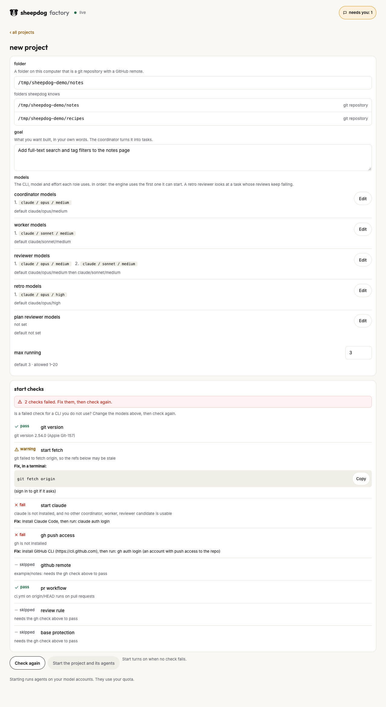
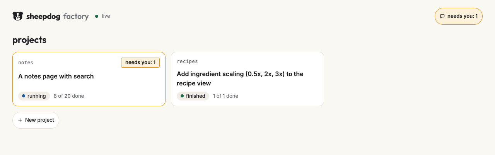
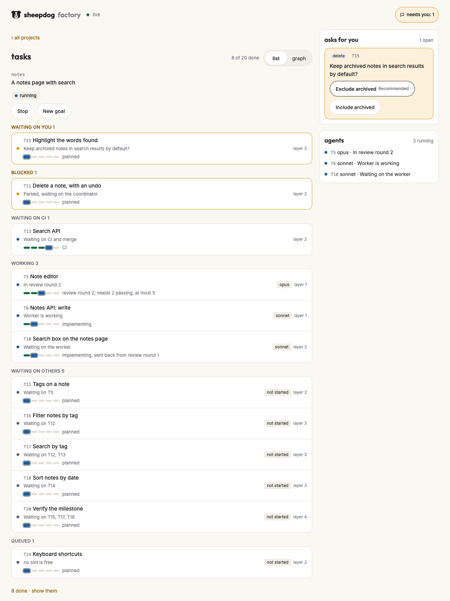
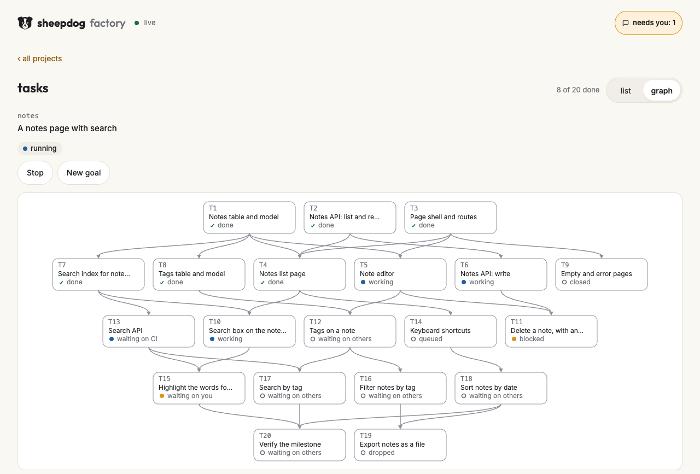
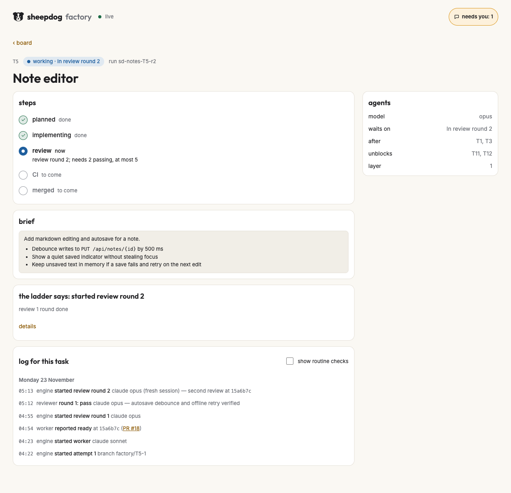
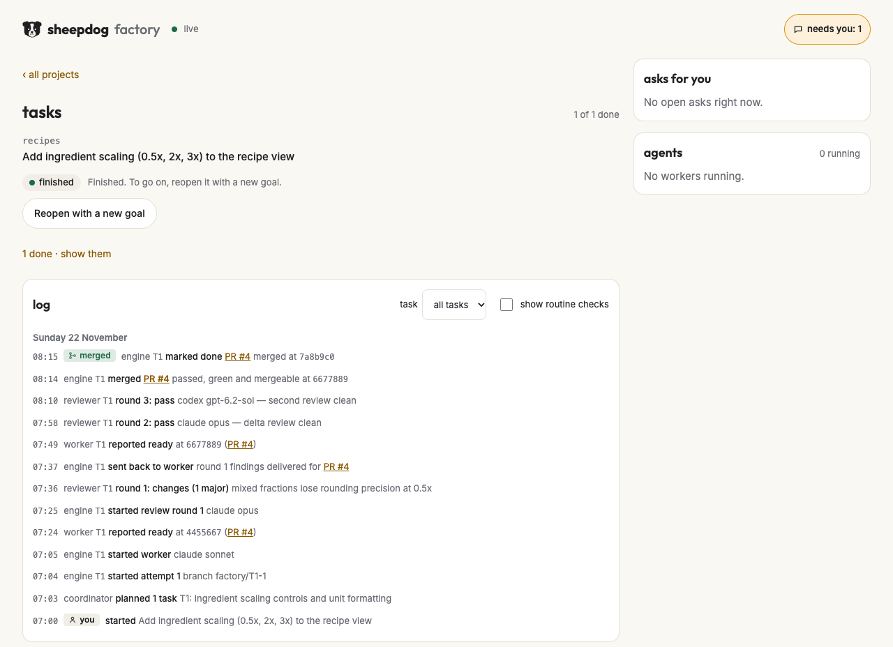
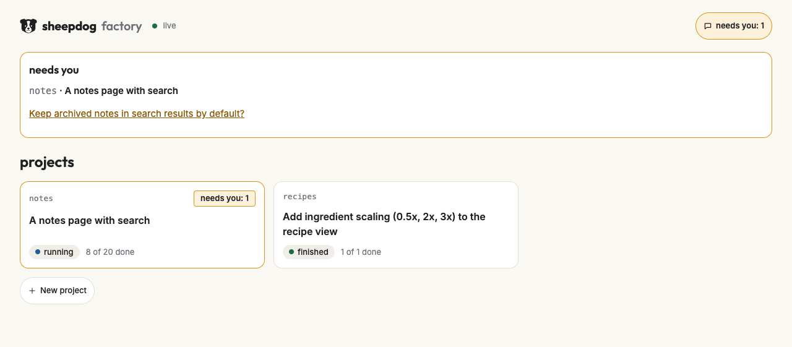
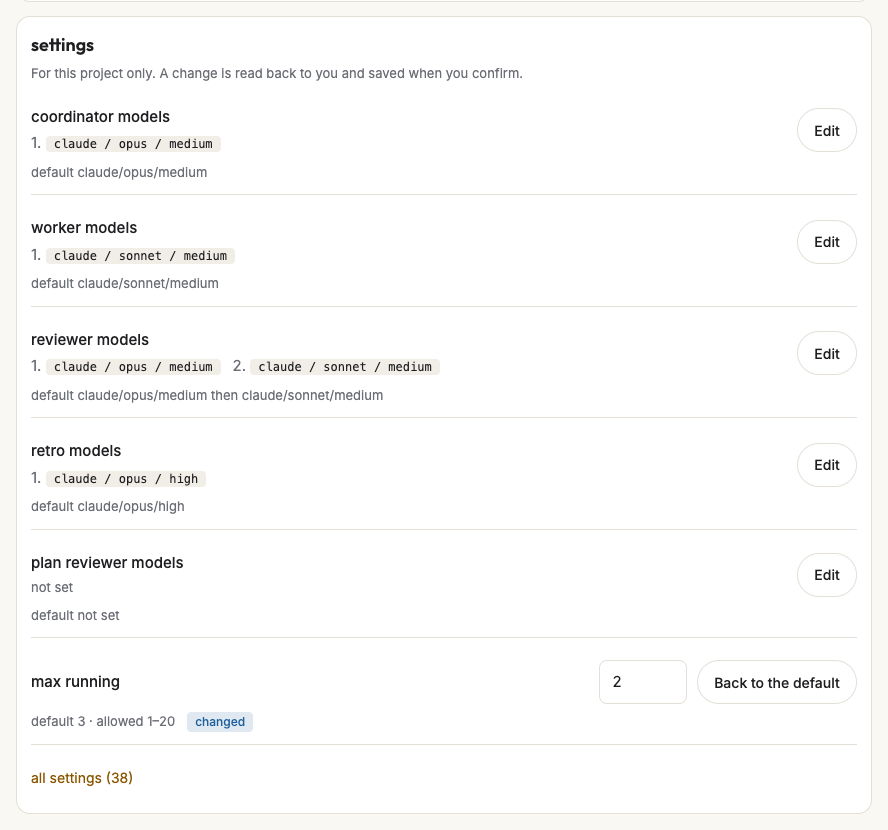

# factory

**Give a GitHub repository a goal and let sheepdog plan, build, review, test, and merge it while you step in only for decisions.**

The factory runs inside the sheepdog daemon. You give a repository a goal; a **coordinator** breaks it into small tasks, **workers** implement each task in its own git worktree, independent **reviewers** check each diff, GitHub CI runs on every pull request, and finished PRs squash-merge into your base branch. Routine chatter stays silent—as the **owner**, you are asked only when a decision or override needs you.

## What you need

- **A Mac (or Linux machine) running sheepdog on `herdr-core` (`hc`).** The factory uses `herdr-core`, not `herdr-tui`. On a Mac, [herdr-app and Sheepdog.app](desktop.md) let you pair your local browser to start projects, change settings, and answer asks right on `/factory`.
- **A local git repository (Git 2.38 or later) with a GitHub remote and push access.** Install the [GitHub CLI (`gh`)](https://cli.github.com) and sign in with an account that can push to the repo.
- **A pull-request CI workflow on the default branch** (under `.github/workflows/`), with **no required approving or code-owner review** on that branch—the factory merges passing PRs itself.
- **The coding CLIs you want to use, installed and signed in.** A new project defaults to Claude Code (`claude`) for the coordinator, workers, and reviewers; you can choose Codex (`codex`) or Antigravity CLI (`agy`) for coordinator, worker, and reviewer roles—and `claude` or `agy` (not `codex`) for retro and plan reviewer roles—when you start a project or later in settings.
- **`codexbar` (optional)** if you want the factory to pause before a provider quota window runs dry.

To check a folder from the terminal before starting, run:

```sh
sheepdog factory doctor ~/repo
```

Every failing check prints a one-line fix (`--no-canary` skips the short test prompt so it spends no tokens).

## Start a project from `/factory`

Make sure the daemon is running (`sheepdog start`), then open the factory page in a browser on the computer running sheepdog:

```text
http://127.0.0.1:7777/factory
```

Use your configured `web.port` if you changed it from `7777`. `/factory` opens only directly on this computer ([remote-access.md](remote-access.md#security)).

Click **New project** to set up your repository:

1. **Pick the folder** (or choose one under **folders sheepdog knows**) and write the **goal** in plain words.
2. **Choose models** if you want anything other than the Claude defaults, and set **max running** (how many tasks run at once; default `3`).
3. **Check this folder.** The **start checks** card verifies git, your chosen coding CLIs, GitHub access, your PR workflow, branch review rules, and base protection. A warning does not stop you; every failure shows a fix, and terminal commands (`run:` fixes) include a **Copy** button. If a failure is for a CLI you do not use, change the models above and click **Check again**.
4. **Click Start the project and its agents** once no check fails. On a Mac, the first time you start a project or answer an ask from `/factory`, the page asks for a one-time browser pairing code ([remote-access.md](remote-access.md#pair-a-phone-or-a-browser)).

<p align="center">
  
</p>

You can also start a project from the terminal (`sheepdog factory start ~/repo --goal "Add dark mode to the settings screen"`), which runs the same start checks first. See [commands.md](commands.md#factory) for all CLI flags.

## Watching it

`/factory` refreshes automatically every few seconds.

### Several projects at once

When you have two or more projects, `/factory` opens the **projects** overview—one card per project, ordered so projects that need you or are actively running come first. Click any card to open its board, or **+ New project** to add another repository.

<p align="center">
  
</p>

### The task list and step bars

Inside a project, the **list** view groups tasks in attention order—**needs your approval**, **waiting on you**, **blocked**, **waiting on CI**, **working**, **waiting on others**, **queued**, and a collapsed **done** list. Each row shows a step progress bar (**plan review → planned → implementing → review → CI → merged** by default, plus **retro** if a retro round runs and an ended step—**closed**, **dropped**, or **split**—when a task ends without merging) and the active model. The sidebar shows open **asks for you** and currently running **agents** (one active worker or reviewer per task).

<p align="center">
  
</p>

### The task graph

Switch to **graph** to see how tasks depend on one another across layers. On a narrow window, the graph scrolls sideways (or you can switch back to **list**). Click any node to open that task.

<p align="center">
  <picture>
    <source media="(prefers-color-scheme: dark)" srcset="../assets/readme/factory/graph-dark.png">
    
  </picture>
</p>

Every task state you will see on the graph and board:

| State | Meaning |
| --- | --- |
| **needs your approval** | Waiting on an owner gate you need to approve before it moves on. |
| **waiting on you** | Waiting on your answer to an open ask. |
| **blocked** | Paused or parked (for example waiting on the coordinator after a recap or failure). |
| **waiting on CI** | Reviews passed; waiting on GitHub CI checks and merge. |
| **working** | A worker is implementing (or fixing review findings), or a reviewer is checking the diff. |
| **waiting on others** | Depends on upstream tasks that are not done yet. |
| **queued** | Ready to run as soon as a concurrency slot opens. |
| **done** | Squash-merged into the base branch. On the **list**, **closed**, **dropped**, and **split** tasks also group under **done**; the **graph** shows them separately below. |
| **closed** *(graph)* | Ended without merging (for example its PR was closed or nothing needed changing). |
| **dropped** *(graph)* | Removed from the plan by the coordinator without merging. |
| **split** *(graph)* | Ended without merging after a recap split the task into smaller tasks. |

### Inside a task

Click any task in the list or graph to see its steps checklist, its **brief**, the engine's current status (with an expandable **details** fold), its dependencies, and the log filtered to that task.

<p align="center">
  
</p>

### The project log

At the bottom of the board, **log** records the story of the project—when you started it, what the coordinator planned, each PR opened, every review verdict, and each merge. Filter by a single task or tick **show routine checks** when you want the fuller trace.

<p align="center">
  
</p>

From a terminal, `sheepdog factory status` prints every task's state plus any active alerts, and `sheepdog factory log -n 30` shows the recent steps.

## When it needs you

While the factory runs, routine worker, reviewer, and coordinator updates stay quiet so they do not interrupt your voice session or spam phone notifications. You hear from it only when:

- **An ask needs the owner** (such as a gate, delete, install, release, setting change, or merge override; routine design choices stay between workers and the coordinator).
- **An override finishes or stops.**
- **The coordinator is stuck** on a terminal prompt.

Whenever any project has an open ask, the **needs you** button in the top right of `/factory` opens a list across all projects and jumps straight to the ask card.

<p align="center">
  
</p>

You can answer an open ask in three ways:

1. **On the card in `/factory` (Mac).** Click an option button on the card. If the browser is not paired yet, pair it with a one-time code from **Sheepdog.app** ([remote-access.md](remote-access.md#pair-a-phone-or-a-browser)), and your answer sends automatically.
2. **On the card in the iPhone or iPad app.** Factory asks arrive as push notifications and appear as question cards. Tap the notification to open the card and choose an option—factory notifications deliberately have no lock-screen **Approve** or **Decline** buttons ([iphone-app.md](iphone-app.md#notifications)).
3. **By live voice.** While a voice session is live, sheepdog reads open asks with their options and recommendation. Say the option label, or *"option 1"* through *"option 3"* (*"first"* through *"third"*) to pick options 1–3 on any ask; bare numbers like *"1"* are not matched, and options 4 and above require the exact label. If more than one ask is open, name it too—a task ask is named by its task ID, and a project-wide ask by its project ID.

On Linux (or a Mac without `Sheepdog.app`), answer from the paired iPhone or iPad app or by live voice. Typed chat messages and agents can never answer a gated ask ([safety.md](safety.md#factory)).

### Merging early (overrides)

If you want to merge a ready task without waiting for review or CI, tell the coordinator in its terminal (for example, *"merge T1 now"*). The coordinator opens an **override** card filled directly from live git and GitHub state (task, PR, commit, CI state, and whether the worktree has unreported work) with **Yes, merge now** and **No, wait** (recommended). Confirming covers that commit (or clean base merges ahead of it), cancels itself if CI gets worse, and still respects merge conflicts, unmet dependencies, and one merge at a time ([safety.md](safety.md#factory)).

## Stop, resume, new goal, reopen

Under the project's goal on `/factory`, the project bar controls its lifecycle:

- **Stop** (confirmed with **Stop the project**) stops the project and every agent run it started while keeping the plan and history intact.
- **Resume** restarts a stopped project with the same goal.
- **New goal** sends a fresh goal to the coordinator so it updates the plan while keeping your folder and settings.
- **Reopen with a new goal** starts a new goal on a finished project (as shown on the `recipes` project above).

By live voice, *"stop the factory"* stops running projects and *"start the factory"* only resumes a stopped project with its existing goal (it cannot set a new goal or reopen a finished project). From a terminal, use `sheepdog factory stop` and `sheepdog factory start` (passing the same `--goal` to resume or a new `--goal` to change direction; see [commands.md](commands.md#factory)).

## Settings and models

Scroll down on a project's board to open **settings**. Everything here applies to **this project only**.

<p align="center">
  
</p>

- **Models per role:** Click **Edit** on **coordinator models**, **worker models**, **reviewer models**, **retro models** (used when a task's reviews keep failing), or **plan reviewer models** (checks new plans before workers start) to choose an ordered list of CLI, model, and effort (`low`, `medium`, `high`). Coordinator, worker, and reviewer roles support `claude`, `codex`, and `agy`; **retro models** and **plan reviewer models** support `claude` and `agy` (not `codex`). The factory uses the first candidate it can start, and enforces as a hard rule that reviewers (and retro reviewers) differ from the worker—it refuses to start if no distinct reviewer candidate exists.
- **Max running:** Sets how many tasks run concurrently (`1–20`, default `3`; one extra slot beyond `max_running` is granted at the cap for an urgent task or one you just answered).
- **All settings:** Expand **all settings** for review counts, timeouts, size caps, and quota floors—every key, default, and range is documented in [CONFIG.md](../CONFIG.md#factory-settings).

When you change a setting on `/factory`, sheepdog reads back the new and current values on a confirmation card (**Save** / **Keep current**). Confirming **Save** applies the change on the next pass without restarting running agents.

## Limits and safety

- **It runs unattended and merges passing PRs.** Factory workers run without per-command approval prompts and squash-merge PRs into your base branch once review and CI pass.
- **It spends your model accounts' quota.** Every coordinator, worker, and reviewer run uses the coding CLI accounts you chose; install `codexbar` to hand off and pause before a quota window hits its floor.

Read [safety.md](safety.md#factory) for the safety rails (worktrees, read-only reviewers, role tokens, owner proofs, and overrides) and [privacy.md](privacy.md) for what stays on your computer and what goes to your model providers and GitHub.

## Troubleshooting

For git, CLI sign-in, GitHub remote/access, PR workflow, and branch-rule failures, follow the inline fixes in `/factory`'s **start checks** card or `sheepdog factory doctor ~/repo`. For runtime issues the start checks do not cover:

| You see | Fix |
| --- | --- |
| `herdr-core` unavailable / socket does not answer | Start herdr-core (`hc server start`) or open **herdr-app**, then check again. |
| Project paused with no new tasks starting | Run `sheepdog factory status` to check for active alerts (exhausted quota, full disk, a macOS Files and Folders consent prompt, or a signed-out coordinator). |

## Further reading

- [commands.md](commands.md#factory) — every `sheepdog factory` command and flag.
- [CONFIG.md](../CONFIG.md#factory-settings) — all per-project factory settings and stored files.
- [safety.md](safety.md#factory) — owner proofs, role separation, and override rules.
- [privacy.md](privacy.md#what-is-stored-on-your-computer) — what the factory stores locally and sends to providers.
- [dev/engine-v2/README.md](dev/engine-v2/README.md) — developer docs for how the factory engine works inside.
