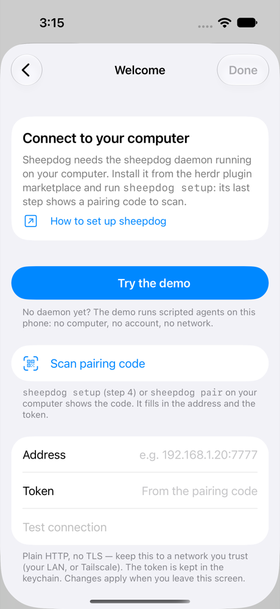
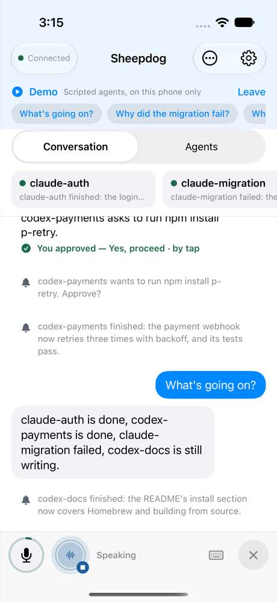
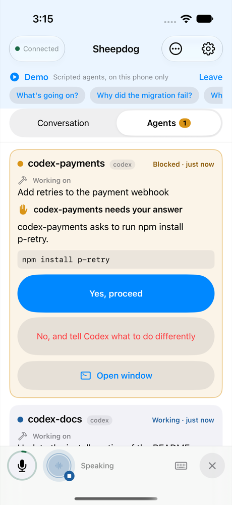
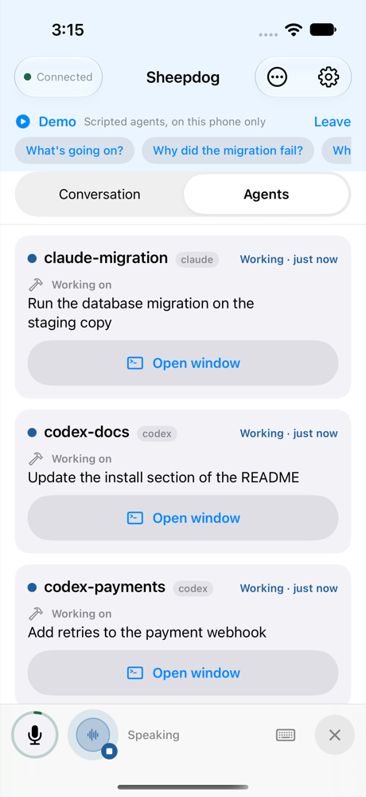

<p align="center">
  <picture>
    <source media="(prefers-color-scheme: dark)" srcset="https://github.com/kccarlos/herdr-sheepdog-ios/raw/main/assets/logo-transparent.svg">
    
  </picture>
</p>

# Sheepdog for iOS

The iPhone app for [**sheepdog**](https://github.com/kccarlos/herdr-sheepdog).
Sheepdog lets you manage the coding agents running in herdr on your
computer by voice. With the app you can talk to **Sheepdog**, hear what
your agents did, answer their approval prompts and look at their screens
when you are away from your desk.

The app is only the microphone, the speaker and the screen. Everything else
runs on your own computer, where the sheepdog daemon owns the models and the
agents. There is no sheepdog server and no account.

**Start with the main repository,
[kccarlos/herdr-sheepdog](https://github.com/kccarlos/herdr-sheepdog).**
Install the daemon from the herdr plugin marketplace and run
`sheepdog setup`. Then come back here to set up the phone.

| Welcome | The demo | An approval | Agents |
|---|---|---|---|
|  |  |  |  |

## Get the app

- **TestFlight:** [TESTFLIGHT_LINK](https://testflight.apple.com/join/TESTFLIGHT_LINK).
  Install Apple's TestFlight app first, then open the link. In TestFlight
  the app is called "Sheepdog for herdr" because the name "Sheepdog" was
  taken. The home-screen label is "Sheepdog". You need iOS 17 or newer.
- **Build it yourself:** see [Build it yourself](#build-it-yourself) below.

## Try it without a computer: the demo

Tap **Try the demo** on the first screen (it is also in Settings). Scripted
agents run on the phone. One finishes, one fails and one asks for an
approval that you can answer. The voice reads the news aloud with on-device
speech. You can tap a suggested question, type one, or ask it aloud if the
phone supports on-device speech recognition. The demo needs no daemon, no
account and no network. Tap **Leave** to go back to setup.

## Pair with your computer

1. On the computer, run `sheepdog setup`. Step 4, **Turn on phone access**,
   shows a pairing code. You can show it again later with `sheepdog pair`.
2. In the app, tap **Scan pairing code** on the Welcome screen or in
   Settings > Daemon. You can also point the iPhone's Camera app at the code
   and open the `sheepdog://pair` link. The app asks "Pair with <host>?"
   before it changes anything. The code contains the token and every
   address the daemon listens on, and the app keeps the first address that
   answers.
3. Allow the microphone when iOS asks, then tap the orb to talk.

If the phone and the computer are on the same Wi-Fi, this is all you need.
To use the app away from home, install Tailscale on the computer and on the
phone and sign in to the same account on both. Then run `sheepdog pair`
again and scan the new code
([remote access](https://github.com/kccarlos/herdr-sheepdog/blob/main/docs/remote-access.md)).

When something is wrong, the app says what to check:

| The app says | What to do |
|---|---|
| Can't reach the daemon … is it running? | Run `sheepdog status` on the computer. Put the phone on the same Wi-Fi, or use Tailscale on both. |
| … turned the token down | The token has changed. Run `sheepdog pair` and scan the code again. |
| Something answered … but it isn't a sheepdog daemon | The address is wrong. Scan the code instead of typing the address. |
| Camera access is off | Allow the camera in iOS Settings > Sheepdog, or type the address and the token. |

The app stores the token in the iPhone's keychain. The connection is plain
HTTP without TLS, so use it only on a network you trust, such as your home
Wi-Fi or Tailscale. Never expose the daemon's port to the internet.

## What it does

- **Voice.** Talk to the voice. The app sends audio only while you speak,
  and echo cancellation stops the voice from hearing itself. Mute turns off
  only the microphone. **Hold to talk** is available as an option. Use
  **Type instead** when you cannot talk.
- **Approvals.** When an agent stops at a prompt, a card shows which agent
  is asking, the command, and one button for each option. Tap an answer or
  say it.
- **Agents.** See which agents are working, blocked or done, and open a
  window onto each agent's screen.
- **Live Activity.** While a voice session runs, the Lock Screen and the
  Dynamic Island show it, with buttons.
- **Siri, Shortcuts and the Action Button.** "Talk to Sheepdog" starts a
  session.
- **Settings > Models.** Switch the voice model and the orchestrator model
  on the daemon.

### Notifications

Apple delivers a push notification only when it is signed with a key that
belongs to the Apple team that signed the app. A daemon that you run
yourself does not have that key for the TestFlight build, so **the
TestFlight build does not get notifications while the app is closed.** The
app asks for notification permission only if your daemon can send
notifications. While the app is open and connected, approvals still appear
as cards, the voice tells you about them, and the Live Activity shows the
session.

To get notifications while the app is closed, build the app under your own
Apple team (see below) and configure that team's APNs key on your daemon
(`[push.apns]`; see the daemon's push docs).

## Privacy

The app collects nothing and has no server. Audio, text and agent state go
only between the phone and your own daemon. The daemon's
[privacy page](https://github.com/kccarlos/herdr-sheepdog/blob/main/docs/privacy.md)
in the main repository lists what the daemon sends to the model providers
you choose and what it stores on your computer. That page is also the
privacy policy of this app.

## Build it yourself

You need a Mac with Xcode 27 (the version the project is built and tested
with; Xcode Cloud uses the latest release),
[XcodeGen](https://github.com/yonaskolb/XcodeGen) 2.46 or newer, and an
Apple developer account. The project has no third-party dependencies. The
Xcode project is generated by XcodeGen and is not committed.

```sh
brew install xcodegen
git clone https://github.com/kccarlos/herdr-sheepdog-ios.git && cd herdr-sheepdog-ios
xcodegen generate
open Sheepdog.xcodeproj
```

**Signing with your own team.** In `project.yml`, set `DEVELOPMENT_TEAM` to
your Team ID. Change the bundle IDs (`bundleIdPrefix` and the
`PRODUCT_BUNDLE_IDENTIFIER` values) to IDs that you own, then run
`xcodegen generate` again. The app uses the Push Notifications and Time
Sensitive Notifications capabilities and a widget extension for the Live
Activity. Automatic signing creates what they need.

**Push with your own key.** In the Apple developer portal, create an APNs
auth key (`.p8`) for your team and configure it on your daemon
(`[push.apns]` in its config; see the daemon's push docs). Debug builds use
the APNs sandbox and Release builds use production. The app tells the
daemon which one applies.

To run the tests on a simulator:

```sh
xcodebuild -scheme Sheepdog -destination 'platform=iOS Simulator,name=iPhone 17 Pro' test
```

Most UI tests need a fixture daemon and skip themselves when there is none
([docs/dev/status.md](docs/dev/status.md#running-the-tests)).

## Contributing

Bug reports and ideas are welcome; see [CONTRIBUTING.md](CONTRIBUTING.md).
Report security issues as described in [SECURITY.md](SECURITY.md).
[docs/dev/architecture.md](docs/dev/architecture.md) explains how the code
works. Builds and TestFlight releases run on Xcode Cloud
([docs/dev/xcode-cloud.md](docs/dev/xcode-cloud.md)).

## License

[MIT](LICENSE).
