# Status — 2026-09-29

## Distribution

Build **0.1.0 (2)** is in TestFlight, internal group **Me**, built by
Xcode Cloud on 2026-09-28 from `main` `4916d10` (Xcode 27 / macOS 27). App
Store Connect record: **"Sheepdog for herdr"** (App ID 6817155887, SKU
`herdr-sheepdog-ios`; the name "Sheepdog" was taken). Setup and workflows:
[`xcode-cloud.md`](xcode-cloud.md).

**Not verified**: nothing has been installed on a phone yet — TestFlight has
the build available, but no one has tapped Install. Every "Not verified"
item below (real device audio, a live Gemini/GPT-Live session, reconnect in
the field, history and approvals on the phone, the detector on a real
microphone) is therefore still exactly as open as it was before this build
existed; having a TestFlight build only means there is now something to
install, not that any of it has been checked on hardware.

## Verified

**Unit tests: 245 (243 run, 2 live-daemon tests skip without one), all passing** (`SheepdogKitTests`, iPhone 17 Pro simulator,
iOS 26, Xcode 27).

```sh
xcodegen generate
xcodebuild -scheme Sheepdog -destination 'platform=iOS Simulator,name=iPhone 17 Pro' build test
```

They cover:

- the **voice-activity detector** against macOS text-to-speech
  (`scripts/make-fixtures.sh`, six voices) mixed with white, pink, brown,
  babble and keyboard-click noise at 20/10/5 dB SNR: speech opens within
  250 ms and reaches the socket whole in every cell but 5 dB babble
  (asserted separately), noise alone never opens it (60 s × 5 kinds × 3
  levels), clicks never open it, the floor follows a room 25 dB louder and
  back, the margin widens for babble, digital silence does not make hiss
  speech, the pre-roll and the spurious-open count (table in
  `docs/architecture.md`);
- the capture gate: hold-to-talk transitions always
  matching what the daemon was told, pre-roll on press, reset semantics;
- the microphone-signal watchdog (3 s of digital zero or no buffers, cleared
  by one real sample, disarmed while muted, re-timed on unmute);
- the voice provider contract: the list, a minimal entry, 404 → hidden,
  `PUT` and its 400 with the daemon's reason, `voice_provider`/`voice_model`
  on hello and state, `status.provider`, and older payloads without any of
  it; the microphone-mode names against AVFoundation's raw values;
- the mute / hold-to-talk mapping and the status line's words for every
  state, including "No microphone signal";

- every `/ws` control message, decoded from the literal JSON the daemon's Go
  side writes and re-encoded to the same bytes (one test per message type,
  plus the rejections: unknown type, bad voice state, bad direction, missing
  required field);
- the capture peak (`PCMLevel.peak`, `Int16.min` included);
- the sample-rate path with synthetic signals: 48 k → 16 k keeps a 440 Hz
  tone and a 3:1 length ratio, 12 kHz does not alias down to 4 kHz, streaming
  in 4 096-frame blocks matches one big call, 44.1 kHz hardware works, a
  0-channel format is refused with a sentence rather than a trap;
- the playback queue: jitter buffer then release in arrival order, no
  re-buffering mid-utterance, the maximum-wait path for a short utterance,
  depth accounting, flush emptying everything including chunks already with
  the player;
- the **adaptive jitter buffer** (`PlaybackQueueAdaptiveTests`), replayed
  through a synthetic playback clock: steady real-time arrival never
  underruns; repeated 300 ms mid-utterance stalls raise the target and stop
  underrunning once it covers the stall; one underrun steps the target up
  100 ms and clean utterances afterward decay it 20 ms back to the 150 ms
  floor; a post-underrun refill holds every chunk until the new target is
  met and releases them as one batch; the refill's first chunk gets an 8 ms
  fade-in whose head ramps from true zero while a cold start and steady
  mid-utterance chunks stay untouched; a GPT-Live-shaped fast-start-then-
  slower-than-real-time timeline stays underrun-free on its banked runway; a
  flush mid-utterance counts as neither a drain nor a target move; a long,
  ordinary silence between utterances is a drain but never an underrun;
- **adaptive time-stretch** (`PlaybackRatePolicyTests`,
  `PlaybackQueueStretchTests`, `TimeStretchReplayTests`): the rate table
  and the 0.02-per-20 ms slew, catch-up only against latency debt, the
  provider profiles, the playhead stretching and shrinking with the rate
  (drain prediction and buffered audio), flush resetting the rate; replays
  of the two recorded GPT-Live turns and synthetic 0.75×/0.85× timelines
  with 0.3–1.5 s stalls, before against after (table in
  `docs/architecture.md`: underruns 45 → 15 on the recorded turns — a
  third, not zero), and a 4× Gemini timeline that stays gap-free at 1.0
  94 % of the time; and the real player → `AVAudioUnitTimePitch` → mixer
  graph rendered offline (`TimePitchGraphTests`): 1 s of tone at 0.85×
  plays for 1.178 s;
- the `ping`'s playback counters (`drains`, `underruns`, `buffer_ms`,
  `rate`, `stretched_ms`) on the wire;
- the conversation reducer: fragment merging, the other direction closing an
  output that never carried `final`, `flush` as a boundary, pushes as system
  cards, the voice-off mirroring, the cap;
- the orb's state machine: every rule in the priority order, and that
  `capturing` is exactly the set of states where something can hear you;
  the 800 ms speaking hold across a playback gap (muted while the dog
  talks never flicks to Muted), measured from when playback stopped, and
  dropped at once by Stop; the mute badge only while speaking or thinking;
- the voice bar's pure mapping (`VoiceBarModel`): the orb's tap action
  (connect / stop / none), Mute's availability and End's visibility, for
  every `SessionState`;
- the connection chip's status (`ConnectionChip`): every combination of the
  socket's and the `/events` stream's life plus a refused token, and the
  priority among them (a refused token outranks a failure, a failure
  outranks "still connecting");
- the SSE parser: one record, several records, keepalive comments, the
  `closed` record, multi-line `data`, undecodable payloads, the `since`
  sequence;
- endpoint parsing (what people actually type), the bearer header never
  reaching a URL, every error message reading like a sentence;
- the keychain round trip (hosted in the app, which is why `SheepdogKitTests`
  has the app as its test host: a hostless XCTest bundle has no keychain
  access group and every `SecItemAdd` fails);
- the measured audio numbers in `docs/architecture.md`;
- **New conversation**: `subkind`/`reset_id` decoding on a conversation
  item and `conversation_started_at` on state (both absent on an older
  daemon), the `ConversationReset` reply, `resetConversation` through the
  stubbed `URLProtocol` (200, 404 → `nil`, 401, and another status carrying
  the daemon's words), `ConversationResetAvailability` (only a `nil`
  response hides the action), folding a `conversation.reset` event into a
  `subkind: reset` notice, idempotently and deduped by `reset_id` even
  under a different event id, merging cleanly with the same item from a
  `/api/conversation` sync, the timeline's divider for it, and the
  reducer's `.reset` (closes an open bubble without adding one, a no-op
  with nothing open) — end to end against the fixture daemon in
  `NewConversationUITests` (screenshots below), against the daemon's real
  `POST /api/conversation/reset`;
- history and approvals, against JSON captured from the daemon at
  `7a192e9` (`Tests/SheepdogKitTests/Fixtures.swift`): decoding every
  conversation item kind, `/api/state`'s pending view and a real
  `pending.created` frame; the newest-page merge (server wins in its range,
  live items newer than the page survive, an empty server drops the stale
  cache) and paging by `next_before`; folding live events into items with
  the server's ids, idempotently, without reopening an answered approval;
  the timeline's day and restart dividers; the cache round trip, keying by
  host and port (never the token), one file per daemon, the 300-item cut;
  the approval state machine (shown → sending → answered / 409 gone /
  failed and retried / resolved elsewhere / our own event racing the
  reply); and the `/events` resume request (`Last-Event-ID` + `?since=`,
  neither on a first connect), the answer POST and its 409, through a
  stubbed `URLProtocol`.

`LiveDaemonTests` talks to a real daemon on `127.0.0.1:7799` and skips itself
when there is none, so CI (Xcode Cloud) stays green without one. The
`Sheepdog` scheme also runs the UI tests, which skip themselves the same way.

**End-to-end against a real daemon**, `Tests/SheepdogUITests` — the app
driven through the whole flow, with a screenshot at each step. Start two
fixture daemons from the **daemon** repo:

```sh
cd ../herdr-sheepdog
SHEEPDOG_DATA_DIR=/tmp/sheepdog-ios SHEEPDOG_STATE_PATH=/tmp/sheepdog-ios/state.json \
  bin/sheepdog serve --brain=fake --herdr=mock --voice=off --dev --port 7799 --env-file /dev/null &
SHEEPDOG_DATA_DIR=/tmp/sheepdog-ios-token SHEEPDOG_STATE_PATH=/tmp/sheepdog-ios-token/state.json \
  SHEEPDOG_WEB_BIND=0.0.0.0 SHEEPDOG_WEB_TOKEN=devtoken \
  bin/sheepdog serve --brain=fake --herdr=mock --voice=off --dev --port 7798 --env-file /dev/null &

cd ../herdr-sheepdog-ios
xcrun simctl privacy <udid> grant microphone com.github.kccarlos.herdr-sheepdog-ios
xcodebuild -scheme SheepdogUITests -destination 'platform=iOS Simulator,name=iPhone 17 Pro' test
```

No Gemini key is involved: `--brain=fake` is a scripted local model and
`--voice=off` means no live session. What the walkthrough proves, in order:

| | What |
|---|---|
| 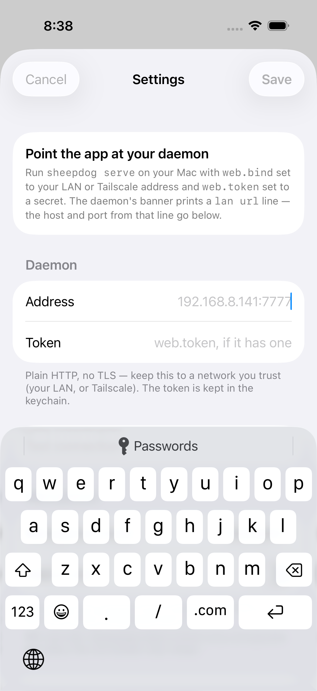 | First launch opens Settings with nothing saved, and Cancel is disabled — there is nowhere to go back to. |
| 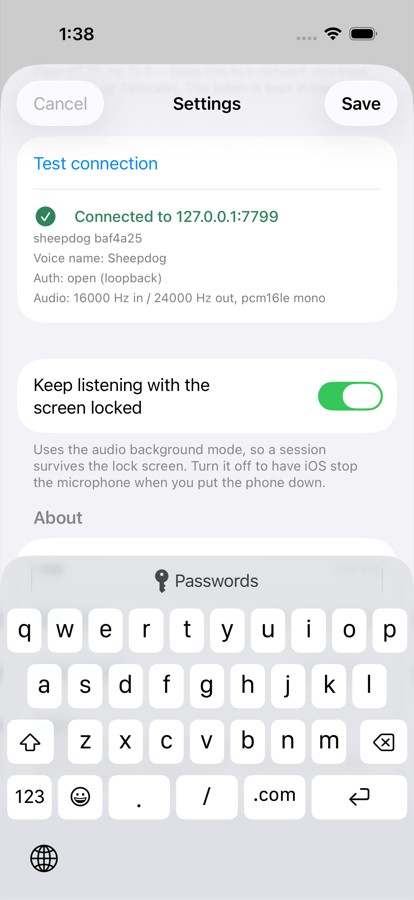 | **Test connection** against `127.0.0.1:7799` reports the `/api/hello` payload: name, version, voice name, auth mode, audio format. |
| 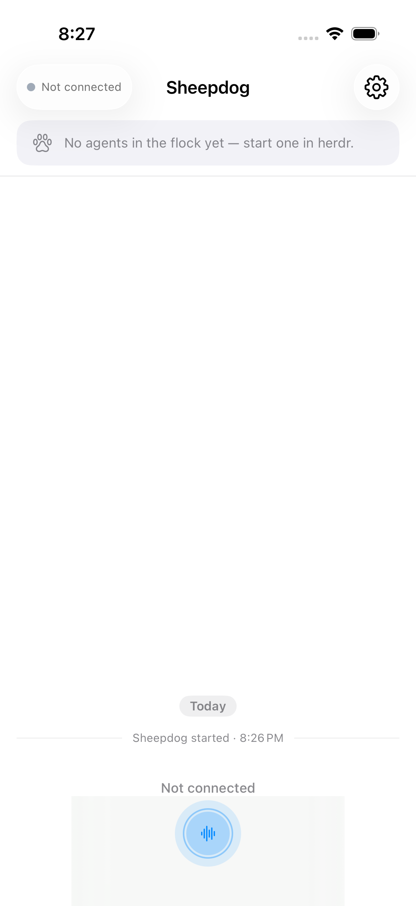 | Saved: the main screen with an empty flock and an empty conversation. |
| 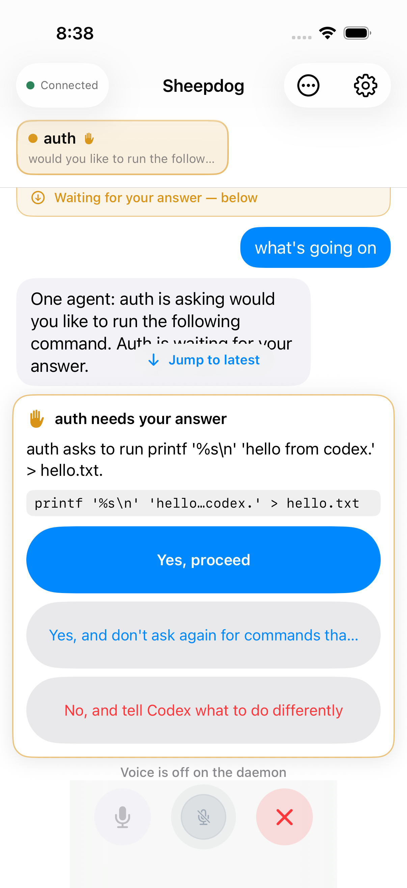 | An agent injected through `/api/inject/blocked` arrives over `/events`: the chip turns amber, the question is its subtitle. `/api/inject/utterance` "what's going on" produces the shepherd's bubble and the daemon's answer. The orb says *Voice is off on the daemon* — it does not pretend to listen. |
| 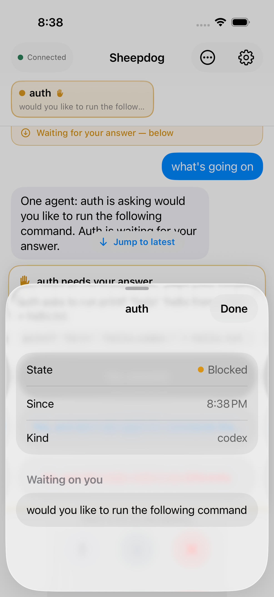 | Tapping the chip: state, current task, and the question it is waiting on. |
| 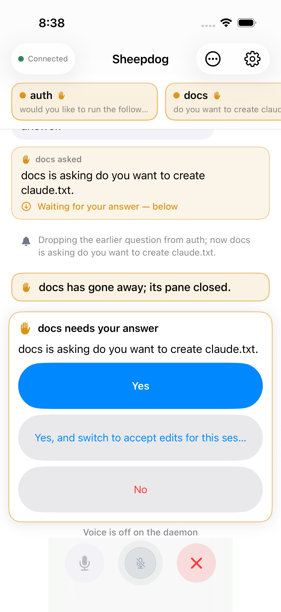 | A push from the daemon as a system card (and a haptic on a device). |
| 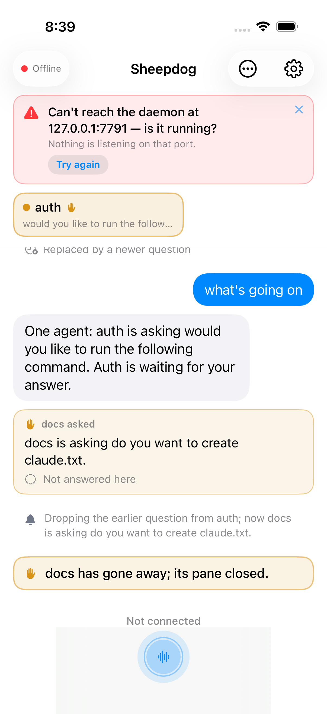 | Pointed at a dead port: "Can't reach the daemon at 127.0.0.1:7791 — is it running?", with a Try again button. No raw error text anywhere. |
| 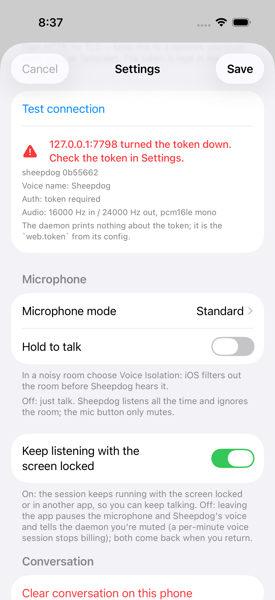 | Against the token daemon on 7798, a wrong token: `/api/hello` is public and would have "passed", so the probe goes on to `/api/state` and names the refusal. |
| 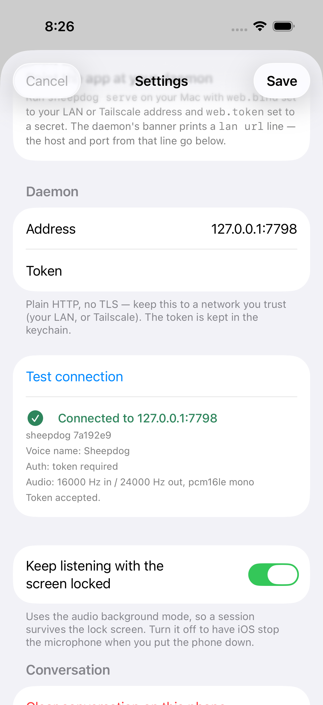 | The right token: accepted, and Connect then reaches the daemon. |

### History, approvals and the cache (simulator, 2026-09-22)

`HistoryApprovalUITests` (scheme `SheepdogUITests`) against the fixture
daemon on 7799 started with an empty config (`--config` pointing at an empty
file, so no personal bind or token is read), after a few
`/api/inject/utterance` calls and a daemon restart:

| | What |
|---|---|
| 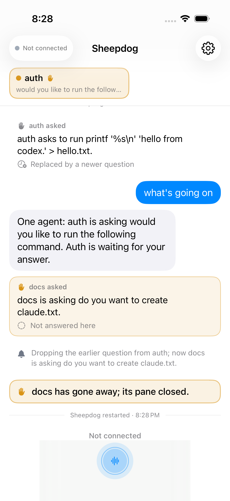 | Launched with nothing cached and **not connected**: the earlier conversation comes from `/api/conversation`, with the restart as a quiet divider. |
| 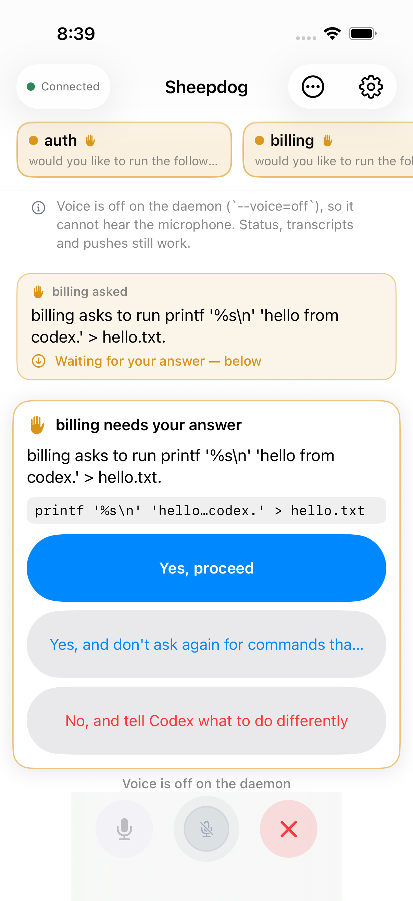 | Connected, then `/api/inject/blocked` with the daemon's `codex-approval-prompt.screen.txt`: the card arrives over `/events` with the summary, the command, and three options — the default prominent, the "No…" red. The same question sits in the conversation above it. |
| 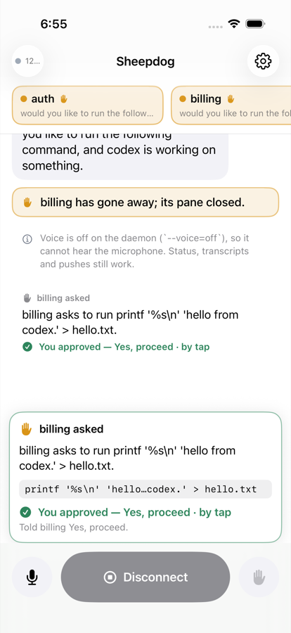 | Tapping **Yes, proceed**: the daemon logged `pending.confirmed {"answer":"Yes, proceed","option":1,"via":"tap"}` and answered "Told billing Yes, proceed.", which the card shows. |
| 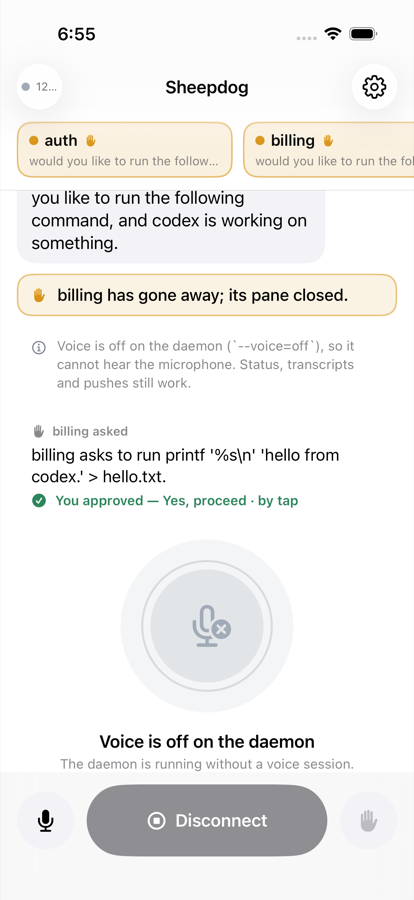 | 3.5 s later the card steps aside; the conversation keeps the approval as answered. |
| 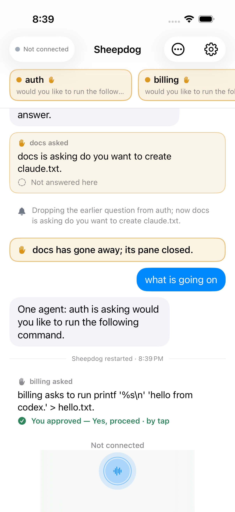 | The app killed and relaunched (daemon still up): the cached conversation is on screen at once, from the local cache, before any network round trip lands. |

The test also terminates and relaunches the app mid-stream (daemon up) and
finds the answered approval within 3 s. VoiceOver labels checked by the
test: "Approve: Yes, proceed", "Decline: No, and tell Codex what to do
differently".

### The compact voice bar and the connection chip (simulator, 2026-09-22)

The old 168 pt display-only orb and the Connect pill are gone, replaced by a
72 pt bar — **[Mute] [orb] [✕ end]** — and a small status line above it; the
top-left dot became a **connection chip** (dot + word) driven only by the
daemon connection itself (the `/ws` socket and the `/events` stream, plus
the token check), never by the voice state, so it no longer reads grey
while happily connected and quiet. Screenshots, from `WalkthroughUITests`
against the same 7799 fixture daemon:

| | What |
|---|---|
|  | Before Connect: Mute and End are hidden (fixed slots, so the orb never shifts), the orb is a Connect button, and the chip reads grey "Not connected". |
| 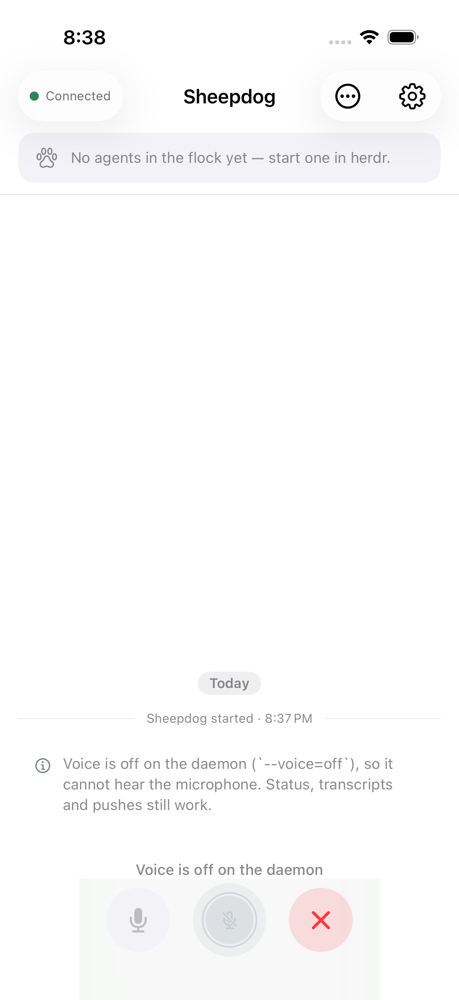 | Connected, voice off: the chip turns green "Connected" — a separate question from the orb's honest "Voice is off on the daemon" — and Mute/End are enabled. |
| 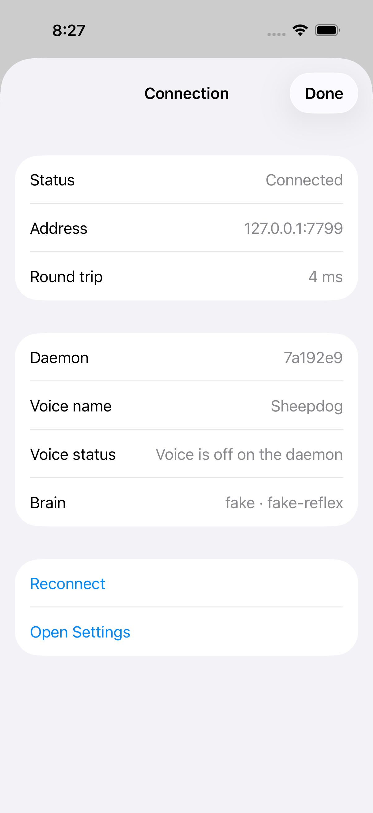 | Tapping the chip: full address, round-trip time (a timed `GET /api/hello`), daemon version, voice name and status, the supervisor's `brain` from `/api/state` (`fake · fake-reflex` here), Reconnect and Open Settings — all on one `.large`-detent sheet, no scrolling needed. |
|  | Pointed at a dead port: the chip turns red "Offline" (a failed attempt, not the grey of a session that was never opened), alongside the usual plain-words banner. |

The approval card (`11-approval-card.png` above) now sits above the bar
rather than replacing it — the bar's controls (mute, stop-via-orb, end) stay
reachable while a worker is waiting on an answer.

### Voice robustness (simulator, 2026-09-23)

`VoiceRobustnessUITests` (scheme `SheepdogUITests`) against the fixture
daemon on 7799 (`--voice=off`, empty config), launched with
`-sheepdogFakeVoice` (DEBUG only: pretends the live session is up, no
microphone, synthetic level) and `-sheepdogFakeProviders` (the provider
contract's example whenever the daemon lists no providers, as the
`--voice=off` fixture daemon does):

| | What |
|---|---|
| 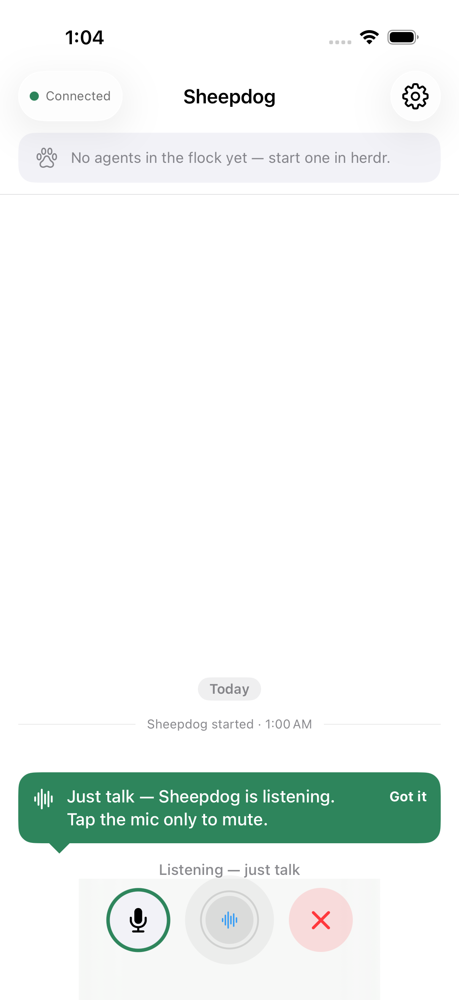 | First time listening: the coach mark over the mic button, "Listening — just talk", and the mic button with its green level ring, labelled "Mute microphone". |
| 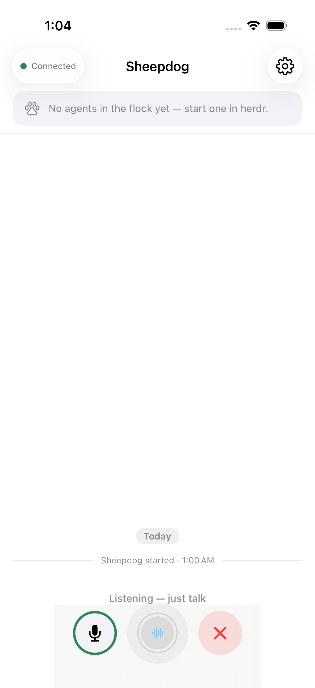 | Live, coach mark dismissed. |
| 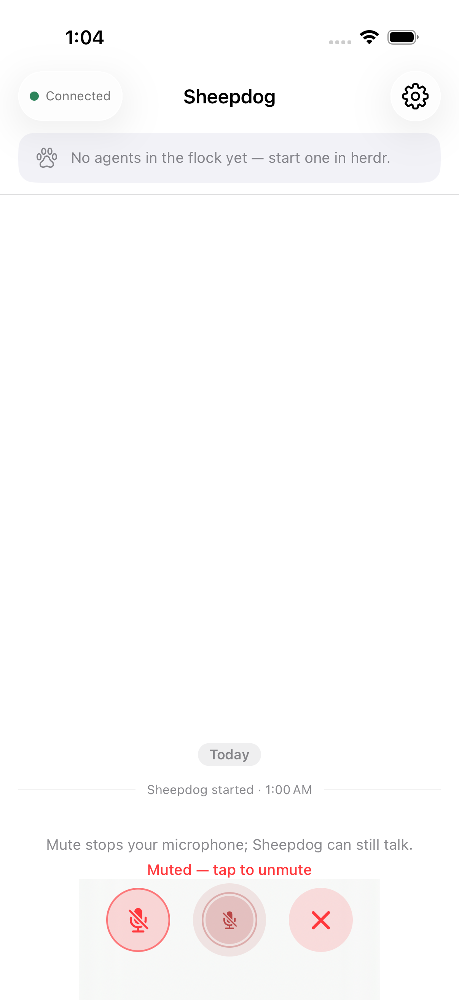 | Muted: red slashed mic ("Unmute microphone"), the orb muted, the status line "Muted — tap to unmute" in red, and the one-time Mute caption. |
| 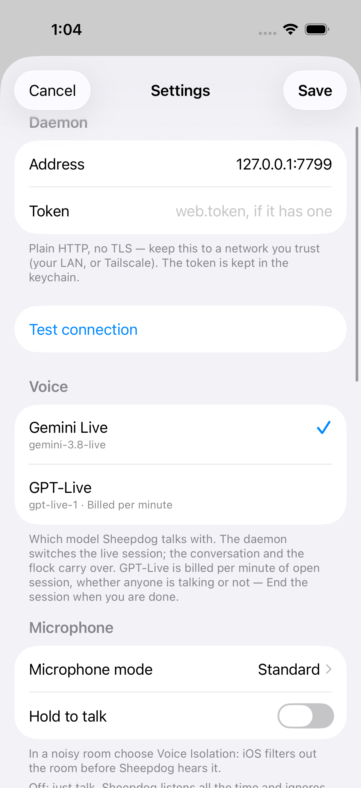 | Settings ▸ Voice (Gemini Live selected; GPT-Live "Billed per minute" with the note) and Microphone (mode row, Hold to talk). |
| 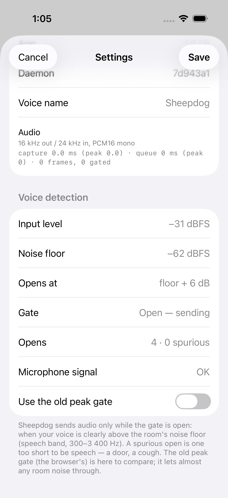 | Settings ▸ Voice detection: input level, noise floor, margin, gate state, opens / spurious, microphone signal. (Values are the fake-voice ones here.) |
| 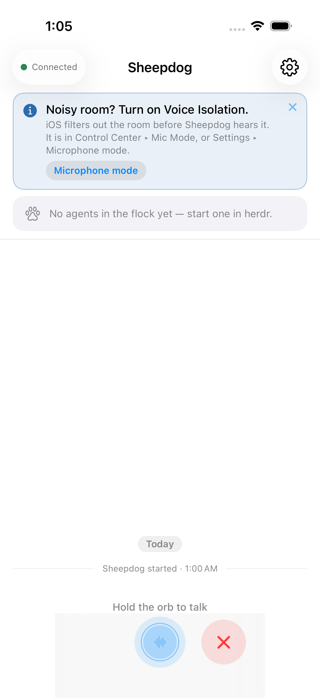 | Hold to talk on: no mic button, "Hold the orb to talk"; the Voice Isolation tip banner shown once after listening. |
| 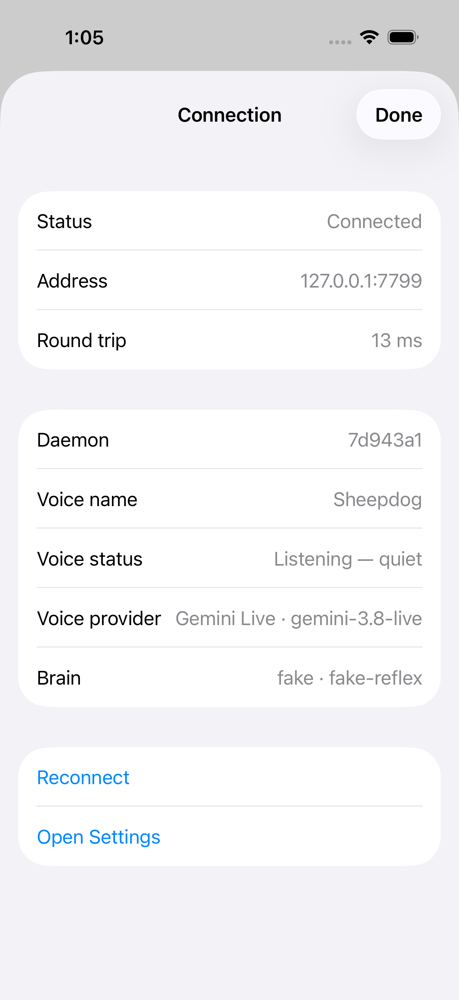 | The connection sheet names the voice provider and model. |

### New conversation (simulator, 2026-09-23)

`NewConversationUITests` against the fixture daemon on 7799, with an
utterance already logged so there is scrollback to keep, through the
daemon's real `POST /api/conversation/reset` and its `conversation.reset`
notice.

| | What |
|---|---|
| 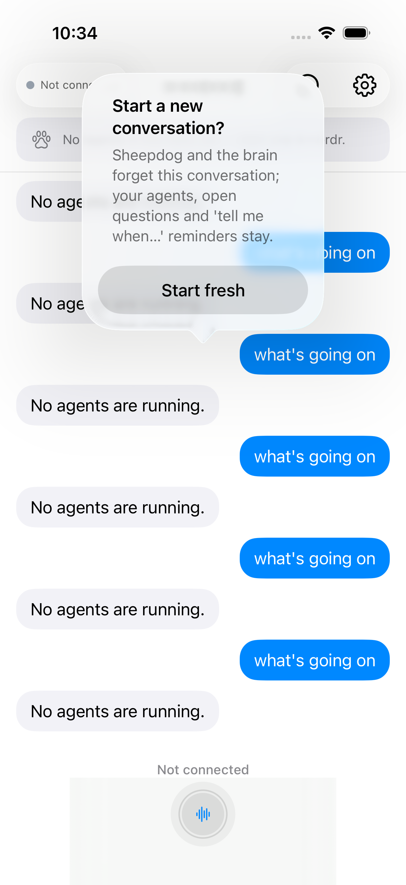 | The ⋯ menu ▸ New conversation: the confirmation dialog, word for word. |
| 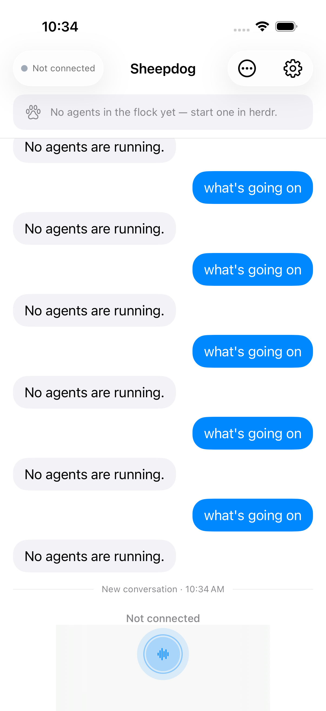 | After Start fresh: the scrollback stays, with "New conversation · 10:34 AM" marking the point. |

### Flock pane and typed input (simulator, 2026-09-25)

`FlockTypingUITests` against the fixture daemon (herdr-sheepdog `0be70e6`,
`--voice=off`):

| | What |
|---|---|
| 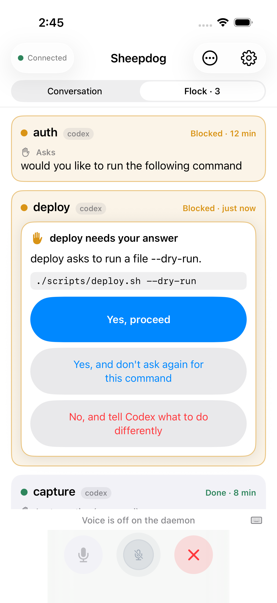 | The Flock pane: every agent with its state and how long, the injected question answerable on its card. |
| 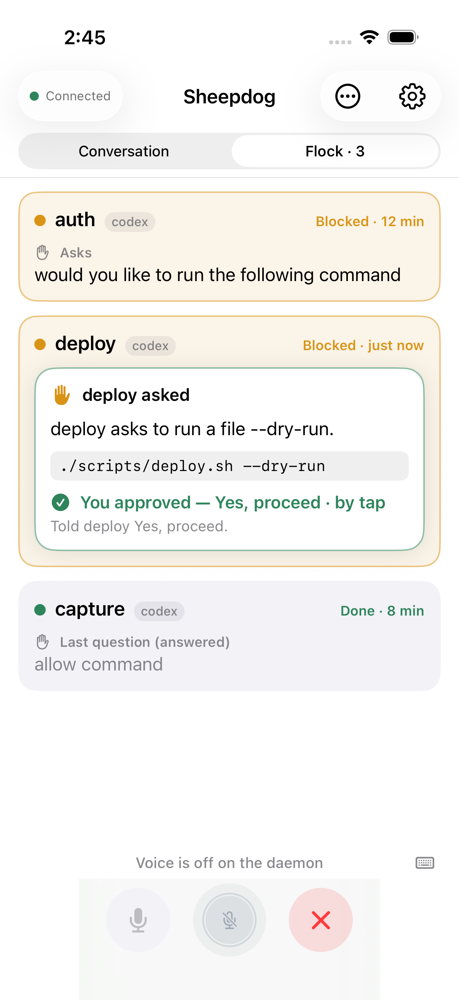 | Answered from the card: the daemon's "Told deploy Yes, proceed." |
| 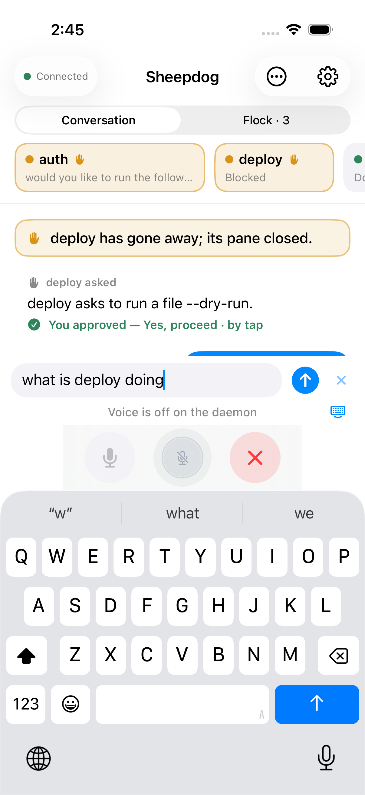 | Type instead: the field above the status line. |
| 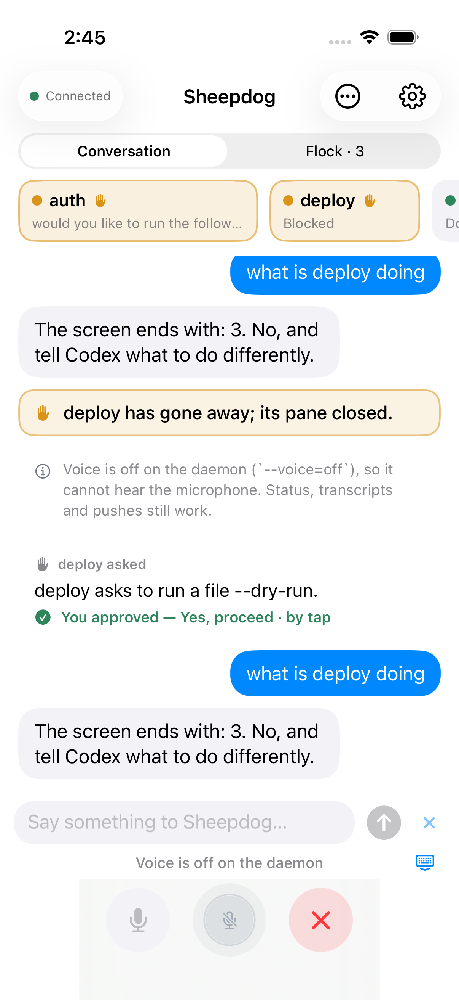 | The typed words as the shepherd's bubble, and the text router's answer. |

Not seen yet: a brain card with a detail, and a held push. The fake brain
gives no detail, and `--voice=off` has no voice to hold pushes for. Both
are unit-tested (`FlockAndBrainTests`) against the daemon's payloads.

### Health pane (simulator, 2026-09-25)

`HealthUITests` against the fixture daemon: version, uptime and the brain
picker; chattiness set to Quiet on the phone and read back from the
daemon's `GET /api/settings`.

| | What |
|---|---|
| 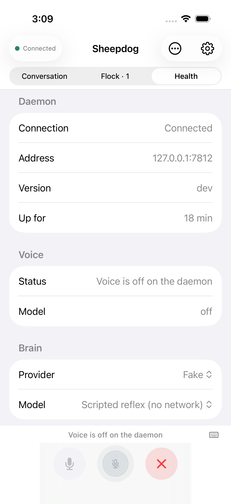 | Daemon, voice and brain at a glance; "Health · 2" on the switch while there are recent problems. |
| 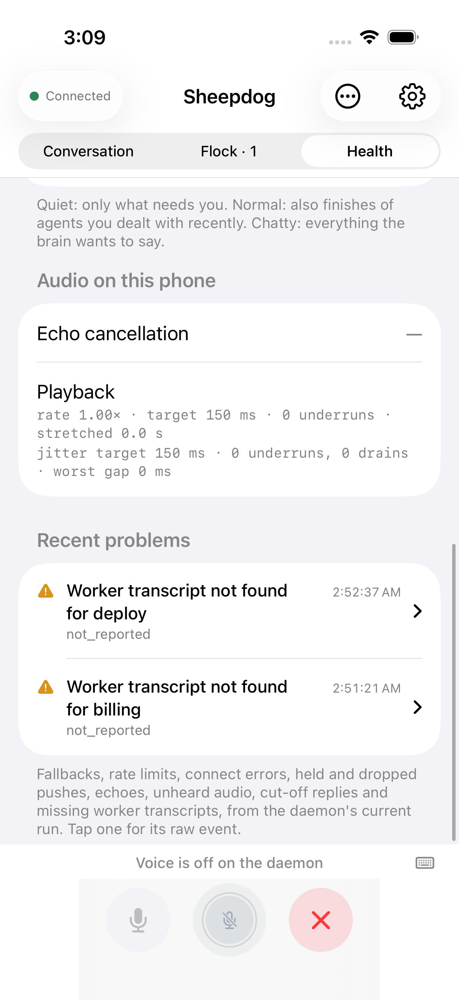 | Chattiness, the audio path, and the daemon's own `worker.session_missing` events in plain words (raw JSON behind the chevron). Echo cancellation reads "—" until the engine has run (`--voice=off`). |

## Not verified

- **Real device audio.** Nothing has run on an iPhone. The microphone, the
  echo canceller, AirPods, the lock screen and the background-audio mode are
  all untested outside the simulator; the simulator's audio stack is not a
  substitute. The capture and playback logic is unit-tested with synthetic
  signals, which is a different claim.
- **A real Gemini session.** Everything here ran against `--voice=off`, so
  no audio has been over the wire in either direction, and no `transcript`
  frame from a live model has ever been rendered by this app (the reducer is
  tested against the contract's shapes, not against the model's timing).
  `flush`, barge-in and `stalled` are likewise only tested as inputs.
- **Reconnect in the field.** The backoff and the `replaced` handling are
  coded to the contract and exercised by hand, not by an automated test.
- **History and approvals on the phone.** Everything above ran in the
  simulator against `--voice=off`. Still to see on a device: the approval
  haptic arriving (and not repeating after a long sleep), tapping an
  approval over the LAN or Tailscale with a token, the app coming back from
  the background and filling in what it missed, and a Gemini session's
  transcript bubbles being replaced by the server's items without a visible
  jump (the id-less bubbles are swapped 2.5 s after each turn, and never while one
  is still open, so a dog turn is not shown twice). Rows are ordered by the
  Mac's clock for history and the phone's for live bubbles; a few seconds of
  skew can misorder them until the next sync.
- **Pull-to-load-older** is model-tested but not seen in the simulator: the
  fixture daemon's whole log fits in one page.
- **The detector on a real microphone.** It is tuned on TTS + synthetic
  noise; a phone's voice-processed input (AGC, echo canceller, Voice
  Isolation) is a different signal. The numbers to watch are in Settings ▸
  Voice detection.
- **The "no signal" cause.** The 25 s of digital zero after connecting was
  not reproduced here (the simulator has no such path). Now: it is named on
  screen after 3 s, logged with the input format, voice-processing state and
  both input mutes (`log stream --predicate 'subsystem == "com.github.kccarlos.herdr-sheepdog-ios"'`),
  and capture is rebuilt once. The input-mute clearing at start and the
  multi-channel downmix are the candidate fixes; neither is confirmed.
- **The Mic Mode panel** (`showSystemUserInterface(.microphoneModes)`) does
  nothing visible in the simulator; the mode reads "Standard" there.
- **The provider picker against a real daemon**: built to the contract
  while the daemon side was being written; screenshots use the contract's
  example.

## For the morning

For the time-stretch, on the phone with GPT-Live: long replies should play
without the gaps, a touch slower when GPT-Live falls behind (pitch
unchanged — a slightly drawn-out voice, not a lower one) and back to
normal speed when it catches up. Settings ▸ About's rate line should show
the rate moving between 0.85 and 1.00 and the target starting at 800 ms;
the daemon's `web.client.stats` should now show non-zero `drains`, and
`rate`/`stretched_ms`. Muted while the dog talks, the orb should stay on
Speaking with a small red mic badge — no flicker. Gaps are expected to fall
to about a third, not to zero (see `docs/architecture.md`). Gemini: listen
for no change in voice quality and no added delay at the start of a reply
(the time-pitch unit is now in its path too, at 1.0); the last ~150 ms of
each reply runs a little slow (the tail is always below the target), and if
that sounds drawn out it needs an end-of-reply rule. The time-pitch graph
itself is only tested offline (`TimePitchGraphTests`); on the phone, check
first that GPT-Live and Gemini audio play at all.

For New conversation, once the daemon side (`POST /api/conversation/reset`,
the `conversation.reset` event) is on `main`: check the ⋯ menu actually
shows up against a real daemon (it is hidden until a non-404 reply proves
the route exists), tap through the real confirmation, and watch the
divider land — including one started from the browser pages or by voice,
to see it arrive over `/events` without the app having asked for it.

For the voice-robustness change, on the phone: connect in a normal room and
watch Settings ▸ Voice detection — the gate should read "Closed — room
noise" while you are quiet and "Open — sending" only while you talk, with
spurious opens staying near zero; say a few things and check nothing is
clipped; turn on Voice Isolation from the Microphone mode row and see it
reported; try Hold to talk; and if "No microphone signal" ever appears,
capture the log line it writes. If the old symptom (nothing sent right after
connecting) comes back, the status line should now say so within 3 s.

Earlier:

For this change, on the phone: open the app with the daemon running — the
last conversation should be there before Connect; ask a worker for
something that needs approval and answer it on the card; answer one by
voice instead and watch the card say so; put the phone to sleep for a
while, wake it, and check nothing is missing or doubled.

1. Open `Sheepdog.xcodeproj` after `xcodegen generate` (the Team is set in
   `project.yml`) and run on the phone.
2. Allow the microphone when it asks.
3. Start the daemon with `web.bind` and `web.token` set, read the `lan url`
   line, and type the host, port and token into Settings. Use **Test
   connection** before Connect.
4. Then the real test: talk to it. Watch for the dog hearing itself (the
   echo canceller), for gaps in playback, and for the orb's states matching
   what is actually happening.

## Known gaps, deliberate for v1

- **The token is only probed on the first connect.** If it is revoked while
  a session is running, the reconnect loop retries `/ws` and shows "could
  not connect" rather than "the token was refused" — a 401 on a WebSocket
  upgrade is not readable from `URLSessionWebSocketTask`.
- **Being replaced says it twice**: the daemon's `status: closed
  {reason: replaced}` produces both a notice in the conversation and the
  banner that explains what to do. One of them is redundant.
- **The orb says "Listening" when the microphone failed to start** (denied
  permission, or another app holding it). The banner explains it, but the
  orb should carry that state itself. (The separate stale "Listening" after
  a *failed session* is fixed: SessionCore now resets on failure as it does
  on End.)
- The `thinking` state comes from `voice.tool_call` / `voice.tool_result` on
  `/events`; the real Gemini session logs those under the same names as the
  debug path (`internal/voice/gemini/toolexec.go`), so it should fire in a
  live session — but that has not been seen happen.
- **Xcode Cloud is now exercised.** Both the PR and TestFlight workflows
  have run real builds (2026-09-28) and produced TestFlight build
  `0.1.0 (2)` — see the Distribution section above and
  [`xcode-cloud.md`](xcode-cloud.md). What is still open is device
  verification of what that build actually does.

## Known rough edges

- iOS offers to save the token to the user's passwords when Settings is
  dismissed. `.textContentType(.oneTimeCode)` does not suppress it; it is a
  system dialog and "Not Now" is the right answer. Worth revisiting.
- The blocked state is **amber** here, where the daemon's `/debug` page uses
  red. On a phone a red dot reads as "broken", and a blocked agent is only
  waiting for you. Deliberate deviation.
- `SheepdogUITests` occasionally fails with "Timed out while evaluating UI
  query" when the app is busy reconnecting; re-running it passes. The app is
  fine; XCUITest's idle detection is not.
- **Fixed while building the voice bar:** giving `ConversationView` more of
  the screen (the old 168 pt orb is gone) made its "am I scrolled to the
  bottom" tracking — a `Color.clear` sentinel's `onAppear`/`onDisappear`
  toggling a `@State var atBottom`, `.onChange(of: atBottom)` reacting to
  it — reliably deadlock the main thread on connect or on a sheet dismiss
  with a long-enough conversation already on screen (`log show` names it:
  `[com.apple.SwiftUI:Invalid Configuration] onChange(of: Bool) action
  tried to update multiple times per frame`). The mechanism itself
  predates this change; a `git stash` back to before it, run against the
  same daemon history, connected instantly with no hang — so it took the
  taller, more-often-full-height conversation this bar makes room for to
  trigger it. Fixed by folding the `onChange` into the sentinel and
  deferring its state write a run-loop turn with
  `DispatchQueue.main.async` (`Sources/Sheepdog/ConversationView.swift`) —
  confirmed gone across several clean `WalkthroughUITests` and
  `HistoryApprovalUITests` runs after the fix, where it had reproduced
  every time before it.
