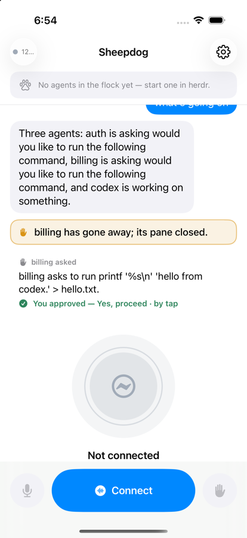

# Status — 2026-09-22

## Verified

**Unit tests: 129, all passing** (`SheepdogKitTests`, iPhone 17 Pro simulator,
iOS 26, Xcode 27).

```sh
xcodegen generate
xcodebuild -scheme Sheepdog -destination 'platform=iOS Simulator,name=iPhone 17 Pro' build test
```

They cover:

- every `/ws` control message, decoded from the literal JSON the daemon's Go
  side writes and re-encoded to the same bytes (one test per message type,
  plus the rejections: unknown type, bad voice state, bad direction, missing
  required field);
- the silence gate, ported case for case from the browser's
  `web/voice/audio-util.test.mjs` at the app's 40 ms frame: closes after the
  hold, counts what it withholds, reopens with the pre-roll in the right
  order, never gates a short pause, floor inclusive, `Int16.min` peak;
- the sample-rate path with synthetic signals: 48 k → 16 k keeps a 440 Hz
  tone and a 3:1 length ratio, 12 kHz does not alias down to 4 kHz, streaming
  in 4 096-frame blocks matches one big call, 44.1 kHz hardware works, a
  0-channel format is refused with a sentence rather than a trap;
- the playback queue: jitter buffer then release in arrival order, no
  re-buffering mid-utterance, the maximum-wait path for a short utterance,
  depth accounting, flush emptying everything including chunks already with
  the player;
- the conversation reducer: fragment merging, the other direction closing an
  output that never carried `final`, `flush` as a boundary, pushes as system
  cards, the voice-off mirroring, the cap;
- the orb's state machine: every rule in the priority order, and that
  `capturing` is exactly the set of states where something can hear you;
- the SSE parser: one record, several records, keepalive comments, the
  `closed` record, multi-line `data`, undecodable payloads, the `since`
  sequence;
- endpoint parsing (what people actually type), the bearer header never
  reaching a URL, every error message reading like a sentence;
- the keychain round trip (hosted in the app, which is why `SheepdogKitTests`
  has the app as its test host: a hostless XCTest bundle has no keychain
  access group and every `SecItemAdd` fails);
- the measured audio numbers in `docs/architecture.md`;
- history and approvals, against JSON captured from the daemon at
  `7a192e9` (`Tests/SheepdogKitTests/Fixtures.swift`): decoding every
  conversation item kind, `/api/state`'s pending view and a real
  `pending.created` frame; the newest-page merge (server wins in its range,
  live items newer than the page survive, an empty server drops the stale
  cache) and paging by `next_before`; folding live events into items with
  the server's ids, idempotently, without reopening an answered approval;
  the timeline's day and restart dividers; the cache round trip, keying by
  host and port (never the token), one file per daemon, the 300-item cut;
  the approval state machine (shown → sending → answered / 409 gone /
  failed and retried / resolved elsewhere / our own event racing the
  reply); and the `/events` resume request (`Last-Event-ID` + `?since=`,
  neither on a first connect), the answer POST and its 409, through a
  stubbed `URLProtocol`.

`LiveDaemonTests` talks to a real daemon on `127.0.0.1:7799` and skips itself
when there is none, so CI stays green without one.

**End-to-end against a real daemon**, `Tests/SheepdogUITests` — the app
driven through the whole flow, with a screenshot at each step. Start two
fixture daemons from the **daemon** repo:

```sh
cd ../herdr-sheepdog
SHEEPDOG_DATA_DIR=/tmp/sheepdog-ios SHEEPDOG_STATE_PATH=/tmp/sheepdog-ios/state.json \
  bin/sheepdog serve --brain=fake --herdr=mock --voice=off --dev --port 7799 --env-file /dev/null &
SHEEPDOG_DATA_DIR=/tmp/sheepdog-ios-token SHEEPDOG_STATE_PATH=/tmp/sheepdog-ios-token/state.json \
  SHEEPDOG_WEB_BIND=0.0.0.0 SHEEPDOG_WEB_TOKEN=devtoken \
  bin/sheepdog serve --brain=fake --herdr=mock --voice=off --dev --port 7798 --env-file /dev/null &

cd ../herdr-sheepdog-ios
xcrun simctl privacy <udid> grant microphone com.kccarlos.sheepdog.app
xcodebuild -scheme SheepdogUITests -destination 'platform=iOS Simulator,name=iPhone 17 Pro' test
```

No Gemini key is involved: `--brain=fake` is a scripted local model and
`--voice=off` means no live session. What the walkthrough proves, in order:

| | What |
|---|---|
|  | First launch opens Settings with nothing saved, and Cancel is disabled — there is nowhere to go back to. |
|  | **Test connection** against `127.0.0.1:7799` reports the `/api/hello` payload: name, version, voice name, auth mode, audio format. |
|  | Saved: the main screen with an empty flock and an empty conversation. |
|  | An agent injected through `/api/inject/blocked` arrives over `/events`: the chip turns amber, the question is its subtitle. `/api/inject/utterance` "what's going on" produces the shepherd's bubble and the daemon's answer. The orb says *Voice is off on the daemon* — it does not pretend to listen. |
|  | Tapping the chip: state, current task, and the question it is waiting on. |
|  | A push from the daemon as a system card (and a haptic on a device). |
|  | Pointed at a dead port: "Can't reach the daemon at 127.0.0.1:7791 — is it running?", with a Try again button. No raw error text anywhere. |
|  | Against the token daemon on 7798, a wrong token: `/api/hello` is public and would have "passed", so the probe goes on to `/api/state` and names the refusal. |
|  | The right token: accepted, and Connect then reaches the daemon. |

### History, approvals and the cache (simulator, 2026-09-22)

`HistoryApprovalUITests` (scheme `SheepdogUITests`) against the fixture
daemon on 7799 started with an empty config (`--config` pointing at an empty
file, so no personal bind or token is read), after a few
`/api/inject/utterance` calls and a daemon restart:

| | What |
|---|---|
|  | Launched with nothing cached and **not connected**: the earlier conversation comes from `/api/conversation`, with the restart as a quiet divider. |
|  | Connected, then `/api/inject/blocked` with the daemon's `codex-approval-prompt.screen.txt`: the card arrives over `/events` with the summary, the command, and three options — the default prominent, the "No…" red. The same question sits in the conversation above it. |
|  | Tapping **Yes, proceed**: the daemon logged `pending.confirmed {"answer":"Yes, proceed","option":1,"via":"tap"}` and answered "Told billing Yes, proceed.", which the card shows. |
|  | 3.5 s later the card steps aside; the conversation keeps the approval as answered. |
|  | The app killed and relaunched **with the daemon stopped**: the cached conversation is on screen at once. |

The test also terminates and relaunches the app mid-stream (daemon up) and
finds the answered approval within 3 s. VoiceOver labels checked by the
test: "Approve: Yes, proceed", "Decline: No, and tell Codex what to do
differently".

## Not verified

- **Real device audio.** Nothing has run on an iPhone. The microphone, the
  echo canceller, AirPods, the lock screen and the background-audio mode are
  all untested outside the simulator; the simulator's audio stack is not a
  substitute. The capture and playback logic is unit-tested with synthetic
  signals, which is a different claim.
- **A real Gemini session.** Everything here ran against `--voice=off`, so
  no audio has been over the wire in either direction, and no `transcript`
  frame from a live model has ever been rendered by this app (the reducer is
  tested against the contract's shapes, not against the model's timing).
  `flush`, barge-in and `stalled` are likewise only tested as inputs.
- **Reconnect in the field.** The backoff and the `replaced` handling are
  coded to the contract and exercised by hand, not by an automated test.
- **History and approvals on the phone.** Everything above ran in the
  simulator against `--voice=off`. Still to see on a device: the approval
  haptic arriving (and not repeating after a long sleep), tapping an
  approval over the LAN or Tailscale with a token, the app coming back from
  the background and filling in what it missed, and a Gemini session's
  transcript bubbles being replaced by the server's items without a visible
  jump (the id-less bubbles are swapped 2.5 s after each turn, and never while one
  is still open, so a dog turn is not shown twice). Rows are ordered by the
  Mac's clock for history and the phone's for live bubbles; a few seconds of
  skew can misorder them until the next sync.
- **Pull-to-load-older** is model-tested but not seen in the simulator: the
  fixture daemon's whole log fits in one page.
- **Mute's one-time caption** has only been seen in code review; it needs a
  connected voice session to be tappable.

## For the morning

For this change, on the phone: open the app with the daemon running — the
last conversation should be there before Connect; ask a worker for
something that needs approval and answer it on the card; answer one by
voice instead and watch the card say so; put the phone to sleep for a
while, wake it, and check nothing is missing or doubled.

1. Open `Sheepdog.xcodeproj` after `xcodegen generate` (the Team is set in
   `project.yml`) and run on the phone.
2. Allow the microphone when it asks.
3. Start the daemon with `web.bind` and `web.token` set, read the `lan url`
   line, and type the host, port and token into Settings. Use **Test
   connection** before Connect.
4. Then the real test: talk to it. Watch for the dog hearing itself (the
   echo canceller), for gaps in playback, and for the orb's states matching
   what is actually happening.

## Known gaps, deliberate for v1

- **The token is only probed on the first connect.** If it is revoked while
  a session is running, the reconnect loop retries `/ws` and shows "could
  not connect" rather than "the token was refused" — a 401 on a WebSocket
  upgrade is not readable from `URLSessionWebSocketTask`.
- **Being replaced says it twice**: the daemon's `status: closed
  {reason: replaced}` produces both a notice in the conversation and the
  banner that explains what to do. One of them is redundant.
- **The orb says "Listening" when the microphone failed to start** (denied
  permission, or another app holding it). The banner explains it, but the
  orb should carry that state itself.
- The `thinking` state comes from `voice.tool_call` / `voice.tool_result` on
  `/events`; the real Gemini session logs those under the same names as the
  debug path (`internal/voice/gemini/toolexec.go`), so it should fire in a
  live session — but that has not been seen happen.
- **CI is written, not exercised.** The workflow has never run: this repo's
  first push is the first chance it gets.

## Known rough edges

- iOS offers to save the token to the user's passwords when Settings is
  dismissed. `.textContentType(.oneTimeCode)` does not suppress it; it is a
  system dialog and "Not Now" is the right answer. Worth revisiting.
- The blocked state is **amber** here, where the daemon's `/debug` page uses
  red. On a phone a red dot reads as "broken", and a blocked agent is only
  waiting for you. Deliberate deviation.
- `SheepdogUITests` occasionally fails with "Timed out while evaluating UI
  query" when the app is busy reconnecting; re-running it passes. The app is
  fine; XCUITest's idle detection is not.
