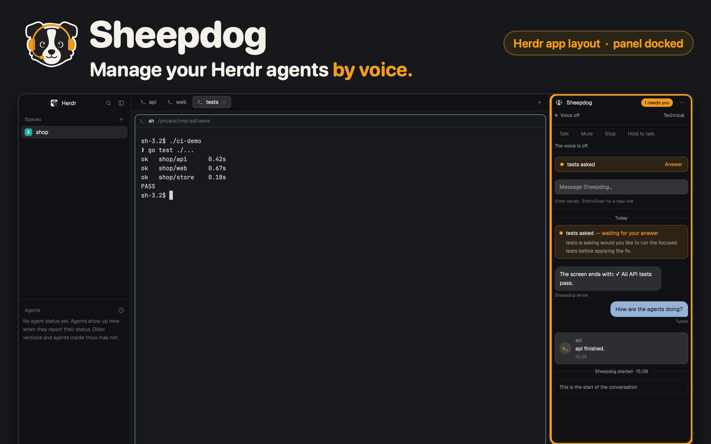

# Sheepdog

This is Herdr's usual window with the Sheepdog voice panel docked on the right. Spaces, tabs and agent terminals stay where they are, while the panel shows the shared Sheepdog conversation, the question that needs an answer and controls for the voice.

## What you see

The window starts with Herdr's own main layout from herdr-app 0.1.10: spaces
and agents in the left sidebar, tabs and agent terminals in the middle, and
the status bar below. A 340 px Sheepdog block is appended at the right edge of
the root row. It can shrink to 44 px into the panel's rail, which opens the
full panel as a window, or grow to 720 px.

The panel has the Sheepdog conversation, questions with a button per answer,
a composer, voice controls and Settings. It uses the same daemon and
conversation as the iPhone app.

## How it behaves

The layout is a fixed copy, so later changes to Herdr's main layout do not
change it. Herdr remembers resizing in its own layout state. The panel talks
to the sheepdog daemon on the same machine at `http://127.0.0.1:7777` unless
the shared setting `sheepdog.url` names another plain HTTP address.

The panel reads and changes Sheepdog through the daemon's HTTP API and event
stream. It never opens `/ws`, because that would replace the phone or browser
that holds the voice.

## Built from

- Herdr main's root row, sidebar, tabs, active terminal pane, hidden Files and
  Changes panel, and status bar, unchanged.
- One `sheepdog` block as the last child of the root row, sized 340 px with a
  44 px minimum and a 720 px maximum.
- The runtime files from `mods/sheepdog/` copied byte for byte into
  `mods/sheepdog/`.

The panel's build brief is [the panel recipe](../RECIPE.md).

## Watch out

The window is Herdr's main layout as shipped with herdr-app 0.1.10. It does not
follow later changes to that layout. It needs the sheepdog daemon on the same
machine; `sheepdog setup` installs the panel and offers this layout. The panel
never opens `/ws`.

## Done when

1. `herdr-app check sheepdog-layout/mods/sheepdog` passes.
2. The Sheepdog block is docked on the right and its rail appears below 160 px.
3. With the daemon running, the panel shows the conversation, an open question
   and its options, and the current voice state.
4. `make test` passes, including the layout's sync and shape checks.
