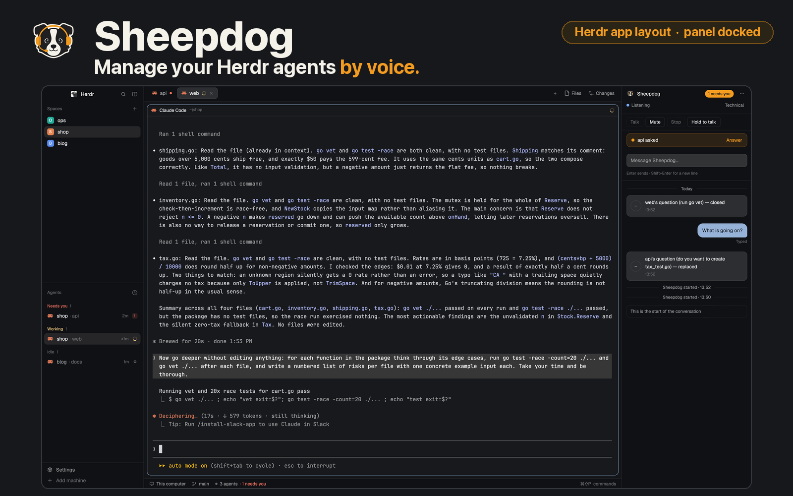

# Sheepdog

Manage your Herdr agents by voice. This is Herdr's usual window with the Sheepdog panel docked on the right: your spaces, tabs and terminals stay where they are, and the panel shows what your agents did and which one needs you. Reply by voice, by typing or with a tap. Needs the Sheepdog program on the same computer.

## What you see

The window starts with herdr-app's own main layout from version 0.1.10: spaces
and agents in the left sidebar, tabs and agent terminals in the middle, and
the status bar below. A 340 px Sheepdog block is appended at the right edge of
the root row. It can shrink to 44 px into the panel's rail, which opens the
full panel as a window, or grow to 720 px.

The panel has the Sheepdog conversation, questions with a button per answer,
a composer, voice controls and Settings. It uses the same daemon and
conversation as the iPhone app.

## How it behaves

The layout is a fixed copy, so later changes to herdr-app's main layout do not
change it. herdr-app remembers resizing in its own layout state. The panel talks
to the sheepdog daemon on the same machine at `http://127.0.0.1:7777` unless
the shared setting `sheepdog.url` names another plain HTTP address.

The panel reads and changes Sheepdog through the daemon's HTTP API and event
stream. It never opens `/ws`, because that would replace the phone or browser
that holds the voice.

## Built from

- herdr-app's main root row, sidebar, tabs, active terminal pane, hidden Files and
  Changes panel, and status bar, unchanged.
- One `sheepdog` block as the last child of the root row, sized 340 px with a
  44 px minimum and a 720 px maximum.
- The runtime files from `mods/sheepdog/` copied byte for byte into
  `mods/sheepdog/`.

The panel's build brief is [the panel recipe](../RECIPE.md).

## Watch out

- **Adding it: `sheepdog` comes first.** The panel is a view of the sheepdog
  daemon on the same computer; alone it only says "Sheepdog isn't running". If
  `sheepdog status` finds no program, tell the person and let them install it
  in their own terminal, because setup asks them questions:
  `curl -fsSL https://raw.githubusercontent.com/kccarlos/herdr-sheepdog/main/scripts/install.sh | sh`.
  `sheepdog setup` installs this panel and layout itself and offers to switch,
  so nothing is left to copy.
- **Adding it: a taken name is this panel, so do not rename it.** If
  `mods/sheepdog/` or `layouts/sheepdog.json` is already there, `sheepdog setup`
  put it there. Keep it, copy only what is missing and switch to the layout. A
  renamed copy would never be updated.
- **Adding it: run `sheepdog setup` once after copying by hand.** Until then the
  daemon does not update a copied panel.
- **Talking needs Sheepdog.app on a Mac:**
  `brew install --cask kccarlos/tap/sheepdog-app`. Without it, typing and
  tapping still work, and the panel says how to get it.
- The window is herdr-app's main layout as shipped with version 0.1.10. It does
  not follow later changes to that layout.
- The panel never opens `/ws`.

## Done when

1. `herdr-app check` passes on the copied `mods/sheepdog`.
2. The Sheepdog block is docked on the right and its rail appears below 160 px.
3. With the daemon running, the panel shows the conversation, an open question
   and its options, and the current voice state.
